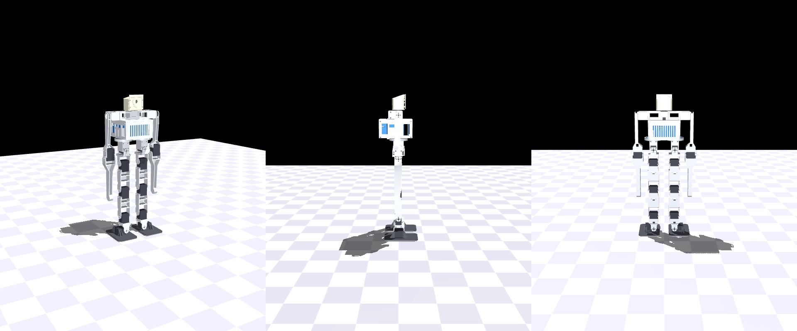
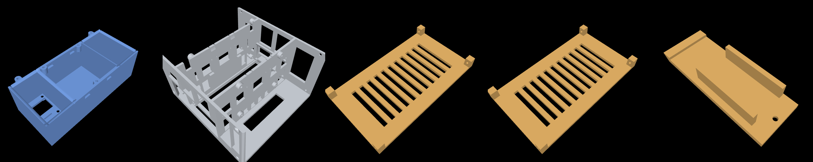
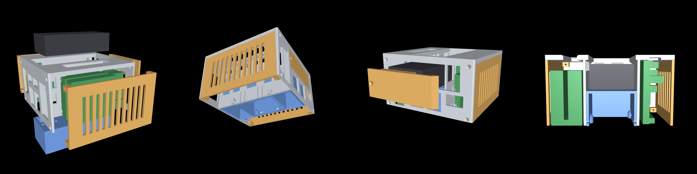
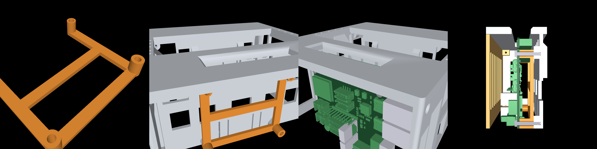

# Design

The current design of the robot: what it is, why each choice was made, what
has been validated and how, and what is still open. Dated records and the
evidence behind these numbers are in [docs/design-v6/](docs/design-v6/README.md);
the project's earlier history is in [docs/archive/](docs/archive/README.md).

**State:** the CAD is complete and passes its swept-ROM interference gate
(armless and with arms); the design passes simulation Gates A–D under the
servo plan below. Nothing has been printed or bought. The first step is a bench
measurement on one servo (issue #73), which gates the servo purchase.

## 1. Goal and requirements

A small 3D-printed biped that **walks by lifting one foot completely off the
ground**, gets itself up after a fall, and carries an onboard computer and a
head camera for navigation. Walking and get-up come from the body and an
open-loop gait first; a learned policy comes last, once the hardware has shown
its margins.

Each requirement traces to a measurement on the earlier 10-joint prototype
(see [lessons learned](docs/archive/2026-09-13-lessons-learned-walking.md)):

| | requirement | how the design meets it |
|---|---|---|
| R1 | A **static single-foot stance** must exist, with margin | ankle roll: a 6th joint per leg (Gate A: 30 mm CoM margin on one foot) |
| R2 | Margins are measured on the body **before any policy** | Gates A–D in simulation, then the same open-loop script on the bench; the policy (Gate E) is last |
| R3 | The **roll chains must be stiff** | every roll joint double-supported (horn + idler); servo stiffness is the one gated assumption (§4) |
| R4 | **Speed and torque margin** under load: ≥ 2× speed, ≥ 1.5× torque at 11.1 V | met at the design cadence (§8) |
| R5 | Contact realism made adversarial | every gate runs μ 0.3–1.0, full self-collision, free play on the rolls, and the deployed actuation chain |
| R6 | An onboard computer and camera | Raspberry Pi 4B in the torso, Camera Module 3 Wide in a head on a neck servo |
| R7 | Keep what is proven | hip yaw (decisive for turning in place), the "servo is the axle" leg link, the 50 Hz ESP32 control loop, the General Driver board, a 3S pack |
| R8 | Size may grow to ~45 cm and a bigger pack | deck top 465 mm, head top 560 mm |

## 2. The robot at a glance

| | |
|---|---|
| joints | **17**: per leg hip yaw, hip roll, hip pitch, knee, ankle pitch, ankle roll (12); neck yaw (1); per arm shoulder pitch, elbow (4) |
| servos | 15 × Feetech STS3215 (12 V, ST-3215-C018), with a raised position-loop gain on the ankle rolls and knees, and 2 × STS3250 at the hip rolls (§4) |
| height | deck top 465 mm, camera 534 mm, head top 560 mm |
| mass | ≈ 2.37 kg as drawn (§7) |
| controller | Waveshare General Driver for Robots (ESP32, onboard QMI8658C IMU), 1 Mbaud half-duplex servo bus |
| compute | Raspberry Pi 4B (vision, navigation), talking to the ESP32 |
| camera | Raspberry Pi Camera Module 3 Wide (102° HFOV) in the head, ±90° neck yaw |
| power | OVONIC 3S LiPo, 4200 mAh, 130C, XT60 (#107; 205 g weighed, listed 96 × 44.5 × 25.5 mm), protection board, inline fuse; #112 replaces these two with a custom power board, which the torso holds (§5.3); the Pi's 5 V supply is open with its place (§5.3) |
| structure | PETG prints, 2 mm silicone rubber soles; M2.5 flat-head self-tappers into printed pilots, M3 screws on the servo horns and idler discs |

## 3. Kinematics

Frames: +X forward, +Y left, +Z up. Leg chain from the pelvis down: yaw → roll →
pitch → knee → ankle pitch → ankle roll.

| joint | axis | range as drawn | servo placement |
|---|---|---|---|
| hip yaw | Z | ±45° | in a cell of the pelvis, under the battery layer, horn down; the yaw carrier (the whole leg) bolts to the horn |
| hip roll | X | ±55° swept (sim: 30° adduction, 45° abduction) | in the yaw carrier's bay, output forward |
| hip pitch | Y | −120° … +90° | at the thigh top, 50 mm below the roll axis, gripped by the leg link |
| knee | Y | 0 … 130° flexion | at the shin top; relief cuts on the leg link allow the deep flexion the get-up needs |
| ankle pitch | Y | ±40° | hangs in the ankle link's grip channel |
| ankle roll | X | ±25° | lies across the foot, output axis fore-aft; the ankle link forks onto its horn (front) and idler (rear) |
| neck yaw | Z | ±90° | stands on the deck, horn up; the head bolts to the horn |
| shoulder pitch | Y | −90° … +200° (0 = hanging, 90 = straight back, 180 = up along the torso) | lies fore-aft inside the shoulder girdle, horn outboard |
| elbow | Y | −100° … +10° | in the upper arm's grip channel, case running up the arm; the forearm forks round it on both discs |

**Axis stack** above the sole: ankle roll 18.4 → ankle pitch 76.4 → knee 186.4 →
hip pitch 296.4 → hip roll 346.4 → hip yaw 391.5 → deck top 465.3 → shoulder
481.6 mm. Thigh and shin are 110 mm each (the same printed part); ankle pitch to
roll 58 mm; hip roll to hip yaw 45.1 mm (the yaw carrier, §5.2).

**Why these numbers** (Gate A/D sweeps, `docs/design-v6/gateA_geometry_sweep.txt`):

- **Hip separation 84 mm.** The one-foot CoM margin is half the foot width
  whatever the hips do, so the foot is the margin budget and the hips set roll
  torque: narrower is stiffer (3.4× torque margin at 70 mm, 1.0× — stalled — at
  96 mm). At 72 mm the swing foot, which sags 12–15 mm inward while it hangs,
  lands on the stance foot. 84 mm leaves 37 mm between the soles and room for
  the pack between the yaw servos.
- **Legs 110 + 110 mm.** Longer levers lower the joint rates for the same step:
  the swing knee's speed margin goes 1.1× → 1.64× from 90 to 110 mm links.
- **Feet 130 × 84 mm, sole centreline 18.5 mm outboard of the ankle-roll axis**
  (23.5 mm inboard half, 60.5 mm outboard; 75 mm toe, 55 mm heel). The open-loop
  walk fails outward — the pelvis swings inward in single support and the closed
  chain throws it out at touchdown — so the sole extends outboard. The inboard
  half is as wide as the two feet allow: at the walk's 3° mutual hip-roll
  adduction they clear each other by 2.7 mm. 4 mm PETG plate, 2 mm silicone
  rubber sole bonded flat; mirrored left/right.
- **Forward knee.** A backward knee is the forward knee with time reversed in
  the sagittal plane; it gains nothing here and needs ±55° of ankle pitch.
- **Hip yaw on every leg.** It is what makes turning work (the walk turns up to
  20° per step, §8).

## 4. Actuation: STS3215s, with an STS3250 at each hip roll

Fifteen joints are STS3215s. The two **hip rolls are STS3250s**: same case,
horn and screw rows, +19.5 g, and ≈ 4× the STS3215's stiffness in the model.
The walk and get-up are limited by **roll-chain compliance, not torque or
speed**: under single-support load a soft hip or ankle roll sags, the pelvis
drifts toward the swing side, and the closed chain springs it outward at
touchdown. With stock STS3215s at the rolls and knees the design walks 0/4
gate cases and gets up 0/12 (`docs/design-v6/no3250_*.txt`). Nothing that
leaves joint stiffness alone moves that — cadence, lift, CoM aim, landing
offsets, a lighter torso or shorter legs.

**The plan: STS3250s at the hip rolls, and a raised position-loop P
(register 21, default 32) on the ankle-roll and knee STS3215s.** The bench
(#73, [experiments/plan-b-bench/](experiments/plan-b-bench/README.md)) found
P 96 / D 0 the smoothest high-gain setting at walking speeds, at ≈ 2.8× the
stock stiffness; P 128 (≈ 3.5×) shakes more, and P 160 (≈ 4.8×) limit-cycles
under a rigid inertia. With the tuned STS3215s at 2.8×, the extra stiffness
matters at the hip rolls, and two STS3250s there match the six-STS3250
assignment (design record §14.4a; on the robot's plant with the arms,
`docs/design-v6/no3250_mixsweep28_arms_bearingA.txt` and
`no3250_mixsweep28rolls_arms_bearingA.txt`):

| servo set (the other rolls and knees: STS3215 at 2.8×) | adversity matrix (18 cases × 3 seeds) |
|---|---|
| 6 STS3250, rolls + knees | 17/18 |
| no STS3250 | 14/18 |
| 2 STS3250 at the knees | 14/18 |
| 2 STS3250 at the ankle rolls | 13/18 |
| **2 STS3250 at the hip rolls** | **18/18** (17/18 on the 74.5 g plant) |
| 4 STS3250 at all four rolls | 17/18 |

The plant builder gives the sweep one servo mass for all six roll and knee
places, so a mixed set runs on the 55 g plant and is bracketed by the 74.5 g
one. The model does not represent the bench's sweep roughness at P ≥ 96.

**What raising P buys, in the model.** The walk loads (≤ 1.2 N·m, under 45 %
of stall) sit in the servo's linear region, so P raises static stiffness
roughly in proportion. At P × 4 on rolls and knees, above what the bench could
hold smoothly, the STS3215 matches the STS3250 case for case:

| | walk, CAD plant (4 cases) | adversity matrix (18 × 3 seeds) | walk with arms (5 cases) | get-up, as drawn |
|---|---|---|---|---|
| stock STS3215 | 0/4 | 0/18 | 0/5 | 0/12 |
| **P × 4, rolls + knees** | **4/4**, CoM margin 7.5–12.2 mm, clearance 15–20 mm | **15/18** | **4/5** | **robust 6/6** |
| P × 3, rolls + knees, ≤ 1° roll play | 4/4, margin 14.1–14.7 mm | — | — | — |
| STS3250 at rolls + knees | 4/4 | 15/18 | 5/5 | robust 6/6 |

Envelope under P × 4 at the design cadence: torque margins 2.7× (hip roll),
3.2× (knee), 2.3× (ankle roll); speed 6.0×, 2.3×, 2.2×. The STS3215 knee is
under the 2× speed rule at a 1.2 s swing (1.7×), so **the gait keeps a ≥ 1.6 s
swing**. Torque is not what binds: "servos −30 %" still passes.

**Still to measure:** the STS3250's ≈ 4× is a third-party figure that the
model adopts. The two on order go on the #73 rig first, for a direct comparison
with the STS3215 data, and the per-ID P/D table follows from that. If they fall
short, the fallbacks in order are the I term (register 23), one STS3235 (same
case, metal gears) to see whether the gears are what is soft, the ST-3025
(brushless, different case: a CAD redo), and last a Dynamixel XC430 (new bus
and board). Verified STS3250 sources and its Model_Number (2825) are in
[docs/bom.md](docs/bom.md).

The gain is a register, so it can silently revert: a factory reset or a
swapped spare comes back at 32 and the robot falls at its first crossover. The
firmware reads registers 21/22 at boot and before every arm and refuses to arm
on a mismatch with its per-ID table, which is recorded in
[docs/servo-map.md](docs/servo-map.md) §4 (factory values until the bench sets
them).

**Deploy servo model** used by every gate: kp 12 N·m/rad fitted to the
STS3215 (the bench measured ≈ 17), a torque–speed clamp at 11.1 V, the
bench-measured actuation response as a 2 Hz lag plus 80 ms dead time (the
firmware's 10 Hz command shaper and the servo's own response), integer goal
ticks, 5 ms bus latency, 1° gear backlash and 3° of free play on the four roll
joints. P × N is modelled as N × the fitted stiffness on the same envelope.
Measured STS3215 facts: no-load speed 4.04 rad/s at 12 V (14 % under the
datasheet), stall ≈ 2.94 N·m, dead time ≈ 85 ms plus a first-order lag.

**The shoulder** is the most heavily loaded servo in the get-up: 1.77 N·m (65 %
of stall) on the recommended sequence. STS overload protection drops a servo to
20 % torque after > 80 % of stall for 2 s (registers 34–36), so the margin is
real but not large; the bench should confirm it.

## 5. The body

All parts are parametric build123d under `cad/v6/`, driven by
`cad/v6/dimensions_v6.py`, which takes every servo-interface number (case,
discs, screw rows, idler face, countersinks, fits) from `cad/dimensions.py` —
measured from the vendor's STEP model (`cad/vendor/ST3215.step`). Print list:
[cad/PRINT_LIST.md](cad/PRINT_LIST.md); code map: [cad/README.md](cad/README.md).

### 5.1 Legs

- **`leg_link_v6`** (×4, thigh = shin): the servo is the axle — a grip channel
  holds one servo's case, and a fork at the other end straddles the next
  servo's horn and idler discs. 110 mm, an open-front U (back web, two side
  walls) with a wall between the sides at each end of the open span against
  twist; it prints on its back. Relief cuts for 130° of knee flexion and for
  −120° of hip flexion.
- **`ankle_link`** (×2): grips the ankle-pitch servo with the leg link's grip
  plates and forks fore/aft onto the ankle-roll servo's discs. The grip is a
  box around the servo's base: the back web, both plates, and the front tine
  carried up across the full width as the front wall, on a floor the rear
  tine hangs from. The plates cannot reach straight down: beside the servo
  the rolling ankle-roll servo leaves no room under them. It prints on its
  back, with supports.
- **`foot_L` / `foot_R`**: the roll servo lies across the foot plate in a
  cradle with two screwed retention tabs; the sole (`sole_tpu_L/R`, the
  outline) is 2 mm silicone rubber, cut, for edge compliance and grip. A tab
  is a thin plate standing 26 mm off the plate, and printed sole-down it
  bends across its own layer lines at the root, so each one is braced by two
  buttress fins on its outer face, one at each end, with the screws driven
  between them (a 7 mm driver channel); the inboard fins stay inside the
  tab's width, where the ankle link is cut clear of the tab at full roll. The
  rear tab's inboard top corner is chamfered out of the rear tine's sweep. The
  tabs hold the case only at its far hole rows, so a short boss on each case
  face also takes the low hole of the row nearest the output end (one M2.5
  each, six per foot), kept off the discs and the rear tine's pad by an arc
  about the roll axis.

### 5.2 Hip

- **Hip-yaw servos** (×2) stand in their cells horn down, **built without the
  idler disc**: nothing rides their idler side, which seats flat on the cell
  ceiling (§5.3). The disc stays in the bag as a spare.
- **Yaw carrier** (×2): hangs from the yaw servo's horn and carries the hip-roll
  servo in its bay. It is the prototype's carrier with a 5 mm spacer between
  its horn plate and the bay (roll axis 45.1 mm below the horn face), so the
  roll servo and all eight of its wall screws sit below the bearing band:
  every screw has a clear driver path with the hip fully assembled.
- **Hip-yaw bearing: a 6810-2RS** (nominal 50 × 65 × 7 mm; the ones in hand
  measure 50.0 × 65.0 × 7.0; sealed deep-groove, 50 g) per hip. Without
  it the yaw servo's horn and four M3 screws would be the only connection
  between a 0.34 m leg and the pelvis (single-support thrust ~15 N, roll
  moment ~0.65 N·m). The bearing moves thrust and moment
  into the pelvis and leaves the servo shaft carrying torque only.
  - The inner race sits on a round hub on the carrier, Ø50.08 as printed
    (+0.08 mm). The printer prints this hub undersize though its STL and
    sliced toolpath are on size, so it is modelled 0.4 mm over (Ø50.48), a
    value set by test prints; it presses into the bearing with a clamp. The
    outer race sits in a recess (Ø64.96, −0.04 mm)
    in the **bearing housing** (`yaw_bearing_housing`), against a shoulder that
    takes the thrust. Both seats get retaining compound.
  - **The housing** is one print for both hips: two skirts joined by a bridge,
    and a rear bar reaching y ±49.5, screwed up under the pelvis with five
    M2.5 × 8 into its pilot bosses (§5.3): four through the rear bar, one
    through the bridge, on the centre line, into the front web's boss. It is
    not part of the pelvis print because the yaw servo goes up into its cell
    through the space it occupies (the servo's cable end reaches 35.1 mm from
    the yaw axis, past the Ø62.6 shoulder). It goes up after the yaw servos,
    with both bearings pressed into it, and each carrier then goes up through
    its bearing (docs/assembly.md §7).
  - The bearing band is the top 7 mm of the carrier. The hub wraps the bay
    walls' footprint, and the bore is the smallest class that leaves a 1.5 mm
    wall around the bay's open interior (the horn screws are driven up through
    it). Under the band a lip (Ø52.3 × 1.2 mm, inside the seal's Ø54.6) stops
    the inner race's bottom face: it seats the carrier in the bearing, and the
    leg's thrust goes lip → inner race → balls → outer race → shoulder.
  - The bearings are generic 6810-2RS. The CAD's bore, OD, width and ring
    shoulders (d1 54.6, D2 62.0) are calipered values of the ones in hand,
    and the mass (50 g) is weighed; their play is not checked yet, and the
    CAD carries SKF's published 61810-2RS1 Da max. The housing's shoulder (Ø62.6)
    bears on the outer ring face between D2 (62.0, the seal) and Da max
    (63).
  - Load margin > 100×. Selection, alternatives (a 6811-2RS wrapping the
    rectangular carrier; screwed race retention) and checks:
    [study-yaw-bearing.md](docs/design-v6/study-yaw-bearing.md) (option A,
    #75).
- **`hip_yoke_v6`** (×2): the hip-roll clevis and hip-pitch clevis fused into
  one print, straddling the roll servo's discs and the pitch servo's discs. No
  flange bolts or inserts.

### 5.3 Torso

Two prints, two covers and a door (`cad/v6/torso_v8.py`): the **pelvis**
holds the legs, and the **torso** around it holds the pack, the General
Driver and the power board. The pack sits in the middle over the hips, the
General Driver in a bay in front of the pelvis and the power board in a bay
right behind it. The pelvis is glued into the torso
for good; the pack comes out sideways through the **battery door**, one
screw. The pelvis, the covers and the door print without supports; the torso
prints with slicer support in its wide windows and nowhere else. Frame: deck
top at z = 0, +x forward, the legs at y = ±42 mm.

**`pelvis_v8`** (56 g, 114.5 × 56.0 × 36.0 mm), printed ceiling down, the cell
walls rising; the bearing housing (§5.2) screws under it:

- two yaw cells at y = ±42 mm under one 2.6 mm ceiling, which also spans the
  centre channel between them. Each yaw servo goes up into its cell from below
  (1.2 mm lead-in at the mouth) and seats with its idler-side case face flat on
  the ceiling. Four M2.5 × 5 flat-heads go down through the ceiling,
  countersunk in its top face, into the face's mounting holes (rows 8.30 /
  32.75, flush with the face: no pads).
- over each cell, the ceiling has a hole for the servo's free-hub post (2.6 mm
  proud, its top flush with the ceiling's top, turning with the hip), a window
  for the moulded back-cover platform (1.9 mm proud; a 2.2 mm relief is left
  as a skin round the aft stator countersinks), and a slit over the connector
  trench for the leads.
- windows in its front and rear webs, in the centre channel, for the torso's
  snap fingers.
- the bearing housing's five pilot bosses: front at (10, 0) on the front web's
  inner face; rear-inboard at (−35, ±22) on the rear web; rear-outboard at
  (−40, ±46) on lugs standing 5 mm aft of the rear web, each with a 45° gusset
  (the torso's aft wall is notched round them).

**`torso_v8`** (125 g, 128.4 × 122.5 × 71.5 mm), printed deck top down: one
solid, x −75.01 … +53.34, its bottom at z −71.5 (0.5 mm over the bearing
housing), open at both ends for the covers:

- a 5 mm deck, and skins tapered from y ±61.26 at the deck (the edge the girdle
  is built against) to ±60.06 at the bottom. Their inner faces (±57.46) are
  0.2 mm off the pelvis's cell walls.
- two inner walls, either side of the pelvis and 0.2 mm off its webs: front
  x 13.21 … 15.81 (the General Driver stands off it), aft x −40.81 … −38.21 (the
  power board stands off it).
- the **battery layer** over the pelvis's ceiling: pack ribs on both inner
  walls (front pair at y ±29, aft pair at y ±22), stopping 14 mm under the
  deck top with a 45° top so leads pass over them, and a ledge with a 45° gusset
  along the −y skin over the pelvis's outer cell wall (the +y skin there is the
  battery door's opening). The ribs and the ledge are the stops the pelvis's
  ceiling bears against, and they carry the torso straight down the cell
  walls.
- the deck: the battery aperture (x −36.51 … +10.50, y ±54.66), which also
  runs under the neck servo, so the deck does not seat it (§5.5); an opening
  over the front bay (x 21.81 … 35.31, y ±30, 1.5 mm 45° lead-in), astride the
  General Driver's top edge, for the camera's ribbon and leads; and the
  girdle's ten pilots, 4.5 mm deep, on edge rails under the deck at y ±57 (the rails keep them from ending over air). The deck is
  pocketed 2.4 mm from below over both bays.
- flat-topped windows: cable passes in the inner walls (under the deck from
  the battery layer into the front bay, and from the battery layer's ends into
  both bays), two in the +y skin over the front bay, which the General
  Driver's service plugs face, and lightening windows in the walls and skins (23 g).
  Only the covers' vent slots are there for cooling. Printed deck down, a
  window's bottom edge is the top of its opening; where that spans more than
  an 8 mm bridge (26 windows, the door's opening among them) the slicer puts
  support inside the window and nowhere else: a support-enforcer box per
  window in `cad/v6/print_settings.json`, from
  `torso_v8.support_enforcers()` (the yaw carrier's method, `docs/slicing.md`).
  The printability audit reads those windows as filled.

**The front bay** holds the General Driver alone, on its plate
(`cad/v6/gd_plate.py`), installed from the front with the front cover off.
Where the Pi goes is open (#87): the Pi with the General Driver on it as a HAT
does not fit. Waveshare's STEP of the board
(`docs/datasheets/general-driver/`) shows why: the board is 65.0 × 65.01 mm
overall, an 8.99 × 52.51 mm tab carrying both 2 × 20 headers past its
56.01 mm edge; its sockets hang 9.0 mm under it; and its servo ports H5 and H6
are top-entry, so their leads need room square to the board.

- **General Driver**: its parts face forward (PCB x 29.81 … 31.44), its bus
  edge (switch, H5, H6) down on the torso's bottom plane and its header tab up,
  1.5 mm under the deck: the bay is 66.5 mm tall. There its four holes land on
  the four 4 mm bosses off the front inner wall (y ±29, z −68.0 / −19.0), and
  its service edge (XH inlet, both USB-C) is at +y, the plugs' cables straight
  out through the +y skin's window. 19.3 mm stay between its parts face and
  the front cover for the servo plugs and their bends.
- **`gd_plate`** (4.1 g, printed back face down): four 10 mm spacers on the
  bosses, joined by a rail through each pair and two rungs, and open at the
  top behind the sockets, which stay 1.0 mm in front of the bosses. Four
  M2.5 × 16 pan heads go through the board and the spacers into the bosses'
  pilots (4.4 mm of thread). Epoxy on the spacers' feet holds the plate while
  the board is off, if wanted.
- Not measured, and each sets a clearance: the board's thickness (1.63 mm
  modelled; the STEP's PCB is 0.41), its sockets' depth (9.0 mm, the STEP's
  pins), a mated servo plug (13.9 mm, an upper bound) and the XH inlet's
  place (photo-scaled; the STEP leaves it out).

**The power board** is the custom board of PR #112 (`pcb/power-board/` on
branch `design/power-circuit`, not merged): 97 × 64.5 × 1.6 mm, every part on
the top side, four M2.5 holes 3.2 mm in from the corners, which the torso uses
as they are.

- It stands vertical in the aft bay, right behind the pelvis and so beside the
  pack, parts facing aft, on four 6 mm standoff bosses off the aft inner wall
  (4 × M2.5 × 6 pan). The 6 mm keeps its leads clear of the bearing housing's
  rear lugs.
- The bay is 24 mm deep from the board's parts face to the cover, for its
  tallest part, C21 (a Ø10 × 20 mm can, +2 mm tolerance).
- The board sits hard to −y (y −56.96 … +40.04). The pack's lead comes through
  the aft wall's +y end window and loops into J1 (the XT60, mating sideways out
  of the board's +y edge) in the 17.4 mm beside that edge, behind the battery
  door; whether that room is enough for the plug and its 12 AWG lead is **not
  checked**.
- Its servo headers J4–J8 are on its −y edge and the control connectors along
  its bottom edge. The fuses F1/F2 and every connector are reached with the
  cover off.
- The torso is sized for this board (#108): there is no separate pocket for a
  protection board and buck.

**The covers** (`front_cover_v8`, `power_cover_v8`, 18 g each, 114.5 × 66.3 ×
10.6 mm), printed outer face down: a flat plate between the skins' ends, under
the deck, with vent slots and a corner block in each corner. 4 × M2.5 × 8
flat-heads per cover go in through the skins, countersunk in their outer
faces, into the blocks.

**The battery door** (`battery_door_v8`, 11 g, 79.8 × 29.6 × 12.4 mm),
printed outer face down, is the +y skin from the power board's J1 to the front
inner wall (opening x −59.0 … +17.0, z −38 … −8). One screw, one tab:

- the tab is its aft edge, a tongue bevelled 40° off the plate's normal that
  tucks 1.6 mm behind the power bay's skin, whose jamb carries the matching
  bevel: the edge cannot lift outward.
- one M2.5 × 8 flat-head goes through its front edge, countersunk, into a post
  on the front inner wall's aft face, beside the pack (x 10.35 … 15.81).
- two ribs on its inner face, along the pack's top and bottom edges, stop the
  pack's +y end 0.5 mm off it; the pack's lead leaves the end between them.
- to take it off: the screw out, the front end swung out about the tongue
  (to about 40°, so the tongue's tip clears the jamb), then the door lifted
  away. `torso_v8.py` sweeps that path, J1's plug pulled out through the
  opening, and the pack slid out.

**The joint is tab and glue**, the hip yoke's glued method
(`cad/v6/hip_yoke_glued.py`). The pelvis, its yaw servos in, goes up into the
torso from below until its ceiling stops on the ribs and the ledge. Four snap
fingers click into the windows in its webs: strips of the torso's inner walls
at y ±14, cut free by slots up to z −54, with 0.5 mm barbs (about 1.35 %
strain). They hold it while the glue cures: CA or epoxy on the web faces, the
ledge and the skins. The joint is permanent, and nothing needs the pelvis out:

- the board stack comes out of the front bay and the power board out of the
  aft bay with their covers off;
- the yaw stator screws are reached from above through the deck aperture, with
  the pack out. The four outboard ones (y ±52.25) need a driver shank of 5 mm
  or less: the aperture's edge (y ±54.66) is beside the girdle's rail pilot at
  (−9, ±57), so it cannot be notched.

**The pack**, an OVONIC 3S 4200 mAh 130C XT60 (#107), weighed at 205 g; its
size is still the listing's 96 × 44.5 × 25.5 mm (measure it: `BATT` in
`cad/v6/dimensions_v6.py`):

- lies transverse on the pelvis's ceiling, centred on the cells (x −34.75 …
  +9.75), on two 1.5 mm adhesive foam pads clear of the free-hub post holes.
  The posts are flush with the ceiling's top and turn with the hip.
- is located fore and aft by the ribs, with 0.5 mm, end to end by the door's
  ribs (+y) and two blocks under the deck rail (−y, between the outboard stator
  screws' driver paths), each 0.5 mm off it, and held down by the neck floor
  4.0 mm above it, with a foam pad between them. There is no belt: under the
  ceiling there is nowhere for a strap to pass but the servos.
- **comes out with one screw**: the battery door off, the XT60 pulled off J1
  and back through the aft wall's window, the pack slid out sideways (+y) from
  under the neck floor. The girdle stays on. The +y arm hangs across all of
  that, so with the robot switched off (arms hanging) it is swung up out of
  the way by hand first: `check_assembly_v6.py --joint swap` checks the
  screw's driver, the door's path off and the pack's path out against
  everything outside the torso with it horizontal forward (shoulder −90°).
  Whether the unpowered shoulder holds the arm there is not measured.

**Leads.** Each yaw servo's leads plug in from above through the slit over its
connector trench, run flat under the pack between its pads to the gap in front
of it, over the front ribs and through the top windows in the front inner wall
into the board-stack bay. The camera's ribbon leaves the Pi's top edge up
through the deck opening between the boards. Windows from the battery layer's
ends carry leads into both bays.

The torso carries the girdle's ten deck pilots. The code's `ARMS=0` variant (no
girdle, no arms, `neck_collar` for the neck) builds it without them, as
`torso_v8_armless`; that variant is kept for the CAD checks and is not a print
target.

### 5.4 Arms and shoulder girdle

- **`shoulder_girdle_v6`** (one print, 77 g, 200 × 58 × 33 mm) sits on the
  deck and holds both shoulder servos in open-top pods plus the neck servo's
  tube, whose side walls carry four bosses for the neck floor (§5.5). Ten
  M2.5 × 8 flat-heads into deck pilots on two edge rails. **The pack goes in
  before the girdle**: it cannot pass the neck tube or the neck floor
  afterwards, so the neck is built into the girdle on the bench first.
- **Shoulder axis in the hip plane** (x = 0), 16 mm above the deck top, arm
  planes at y = ±103.35 mm.
- **Upper arm 160 mm, forearm 160 mm.** The 0.32 m reach is a measured
  threshold: the hand must reach the floor behind the hips at hip level; 0.30 m
  never stands.
- **Arm links** (`arm_upper_v6`, `arm_fore_v6`, mirror pairs, 28 g and 42 g):
  the leg links' section, an open-front U printed on its back, with an end wall
  across each end of the open span against twist. The upper arm is
  single-sided on the shoulder horn, its four disc screws driven through a bore
  in the outboard flange; at the elbow it grips the **elbow servo's case**, the
  leg link's grip channel turned end for end so the case runs up the arm. The
  forearm forks round the elbow servo's horn and idler discs. So the elbow
  servo turns with the upper arm, and its lead crosses only the shoulder. The
  elbow clears −118° … +60° as drawn.
- Hand: a 12 mm-radius knuckle, bare PETG.
- **Rest pose: folded** — shoulder 15° forward, elbow folded 95°, so the
  forearm points forward and 20° up (`ARM_REST` in `cad/v6/dimensions_v6.py`;
  the plant's rest pose and the training preset's held targets). The arms hold
  it whenever they are not doing something else, standing and walking
  included. There, every leg joint clears the arm through its full range by
  ≥ 8.8 mm (the CAD gate), and a walking grid (hip roll ±15°, hip pitch
  −45° … +30°, knee 0 … 70°) by ≥ 17.8 mm
  ([arm_walk_grid_2026-10-07.txt](docs/design-v6/arm_walk_grid_2026-10-07.txt)).
  - **Why forward.** With the upper arm down or back, a folded forearm sits at
    the hip yoke's height, and rolling a leg outward past about 30° drives the
    yoke, the hip-pitch servo and the thigh into it. Raising the elbow forward
    lifts it out of their reach; 15° is the smallest lean with the full margin.
  - **Cost.** The arms' mass moves forward about 69 mm each, about 7 mm on the
    robot's CoM.
  - **Hanging straight** (torque off) the forearms touch the swinging legs.

### 5.5 Neck and head

The neck STS3215 stands on its idler face in the girdle's neck tube, horn up,
±90° yaw. The deck cannot seat it (its battery aperture runs under the whole
servo), so its seat is **`neck_floor`**: a 2 mm plate, its own print (4 g),
screwed up into four bosses on the tube's side walls with M2.5 × 8
flat-heads, dropping into the aperture with its top 3 mm below the deck top.
Four pads rise from it to the case's idler face, trimmed clear of the turning
idler disc and hub and of the moulded back-cover platform, and take the four
stator screws (M2.5 × 8 up through the floor, 4 mm of bite). The plate sits
4.0 mm over the pack, so the neck goes in on the bench: plate into the tube,
servo down onto the pads (leads plugged first, out through a window in the
floor under the connector trench), stator screws from below; then the girdle
goes onto the deck. The head (`head_shell` +
`head_face`, ~35 g) bolts to its horn with 4 × M3 and carries the Camera
Module 3 Wide on M2 bosses; the ribbon runs through a slot beside the axis.
A stereo alternative from one camera and four mirrors is proposed in PR #71
(not merged).

## 6. Electronics and power

Detail: [docs/wiring.md](docs/wiring.md), [docs/sensor-expansion.md](docs/sensor-expansion.md).

- **One servo bus**: all 17 servos on the General Driver's 1 Mbaud half-duplex
  TTL bus. Bus timing is not expected to bind: 12 servos take ≈ 3.4 ms of the
  20 ms tick; the 17-servo figure has not been computed.
- **Current is open**: the board's servo power path is rated 5 A continuous,
  and the servos can draw more than that in transients. The fuse, the bulk
  capacitor and a current budget from simulated walk and get-up traces are
  required before the first powered floor run.
- **Power path**: pack → protection board (≥ 15 A, over-discharge cut-off) →
  10–15 A fuse → switch → board inlet; bulk capacitor (1000 µF, ≥ 25 V) at the
  board; the Pi's 5 V supply is open with its place: the General Driver is
  not on its header (§5.3).
- **The ESP32 runs the 50 Hz control loop** and the servo bus; the Pi does
  vision and navigation and talks to the ESP32. How the Pi gets bus voltage and
  current for a low-battery shutdown is open.

## 7. Mass

The robot as drawn, from the CAD-inertial plant
(`sim/bimo_biped_v6ar.xml`) and the rollup
(`build/v6/reports/parts_v6_rollup.txt`, written by `make cad`):

| | |
|---|---|
| robot | ≈ 2.37 kg (the plant: 2.375 kg) |
| servos | 15 × 55 g + 2 × 74.5 g = 974 g |
| printed PETG + silicone soles | ≈ 0.86 + 0.05 kg: pelvis 56 g, torso 125 g, two covers 18 g each, battery door 11 g, bearing housing 25 g, girdle 77 g, arm links 139 g, legs from the yaw carriers down ≈ 0.34 kg, head 35 g, neck floor 4 g |
| hip-yaw bearings | 100 g (2 × 6810-2RS) |
| pack / boards + wiring | 205 g (weighed) / ≈ 180 g |

With STS3215s at the hip rolls too it is 39 g lighter, and with STS3250s at
all six roll and knee joints 78 g heavier. The P × 4 table in §4 and the gates
in §8 and §9 were run on earlier plants: the armless CAD-inertial plant (1.67 kg) for the
walk, the lumped as-drawn get-up plant (2.10 kg, no bearings) for the arms, and
the as-drawn CAD-inertial plant before the OVONIC pack and the power bay
(2.281 kg) for the rest. The current plant (2.375 kg) passes Gates A and B
(`tests/test_v6_design_gates.py`); the walk and get-up studies below are not
re-run on it yet (#108). On the 2.281 kg plant with STS3215s at the hip rolls
(2.224 kg), P × 4 on the rolls and
knees walks the four gate cases 4/4, with 32–37 mm of CoM margin, and stock
STS3215s still fall 0/4 (`docs/design-v6/no3250_walk_bearingA.txt`). With the
arms at their folded rest pose and self-collision on, no arm touches a leg in
any case; the robot's servo set (STS3250s at the hip rolls, the other rolls and
knees at 2.8×) stays up in 4 of 5 cases, and the μ 0.9 −15° turn falls
(`no3250_arms_walk_rest_folded.txt`).

The plant carries every part at its CAD inertia (`sim/build_v6_inertia.py`):
the printed parts from their STLs, each servo on its case mock at its CAD
place, the bearing as two rings split between the housing and the carrier, the
pack and boards as boxes. It is replaced by weighed masses once the parts
exist.

## 8. Walking

**First walk is open-loop**: `sim/static_gait.py` shifts the whole-robot CoM 5 mm
*inboard* of the stance sole centreline (so any drift falls toward the incoming
foot), swings the other foot on a sine arc, settles, and crosses over; joint
targets from the analytic IK (`sim/v6_kin.py`) at 50 Hz, min-jerk transitions
throughout. On hardware the same keyframes stream through the firmware's
`pose` path.

- **Cadence**: shift 1.6 s per 60 mm, swing 1.6 s, land 0.5 s — 5.25 s per 6 cm
  step. A step command is a fall; the swing leg lags its command ~0.3 s through
  the actuation lag and dead time, so the 0.5 s settle before the next shift is what
  separates a walk from a fall at the crossover. A 4 cm commanded lift gives
  15–25 mm of real clearance.
- **Turning** is walking in an arc: each swing foot is placed in a frame
  rotated from the stance foot and each leg is solved in its own yawed frame.
  Up to 20° of heading per step holds the same margins; the achieved heading
  is 10–15 % short of commanded (yaw-chain compliance), which a heading-aware
  controller closes.
- **Limits the gates found**: 5° of roll play fails at some friction values —
  hence the ≤ 3° requirement and ≤ 1° target per roll joint; a faster 1.2 s
  cadence loses the low-friction case.

**The policy comes after** the open-loop gait works on the floor (Gate E): trained
on the measured plant with the measured masses, stiffness and play in it —
[docs/training.md](docs/training.md).

## 9. Get-up

**Backward falls (supine) → the seat push with the arms**, a scripted sequence:
sit up with the arms folded up along the torso, plant the hands behind the
hips, tuck to hip −120° / knee −130°, and push (shoulder 90° → 0°, elbow −90° →
0°) while the ankles dorsiflex. On the as-drawn robot it stands, robust 6/6
(play 5°, μ 0.3–1.0, servos at 65–100 %), with 1° of margin on hip flexion (the
tuck needs ≥ 119°; the leg link's relief gives 120°). Config
`r5_asdrawn_rom120` in `sim/getup_v6_shoulder.py`.

**Forward falls (prone) → a roll onto the back with the arms stowed, then the
seat push** (simulation only, #85, #137). From the arms' walking pose (+15°,
where a forward fall leaves them) the arms swing up and stow, five leg
keyframes roll the body onto its back, and the arms fold to 180° as it lands.
The roll is searched (CEM, worst of seven conditions) on the current plant by
`sim/getup_ref_analytic.py`; with the seat push and its analytic rise it stands
216/216 open loop over joint friction 0.05–0.5, μ 0.5–1.0, play 1–4°, servos at
85–100 %, +10 % mass and ±10° start tilt. The legs-only roll with the arms
folded fails at 0.35 N·m joint friction, and the 2026-09-29 searched roll does
not carry over to the current plant.

**Paths that do not work**, each measured (full record in
[getup-decision-2026-09-17.md](docs/design-v6/getup-decision-2026-09-17.md) and
[getup-noappendage-2026-09-14.md](docs/design-v6/getup-noappendage-2026-09-14.md)):

| path | why not |
|---|---|
| legs only (≈ 150 sequences + continuous searches, deep flexion, kneel, pincer) | legs (0.335 m) are shorter than torso + head (0.55 m): every pivot on a leg contact lands the head, and below pelvis ~0.33 m no grounded pose puts the CoM over a sole |
| arms with reach ≤ 0.30 m | they push on the torso, not the floor behind the hips; the body pivots over the head |
| a third shoulder DOF; a one-arm side push; a prone push-up | 0 of hundreds of variants |
| no appendage at all: kip, bear, crow, bridge, rock-rise, a pelvis skid or rear bumper | the pelvis only lifts with a push from far behind the hips; a kip is bandwidth-bound under the deploy servo, not torque-bound. A hip −90…−100° crouch does keep the CoM 33–69 mm over the feet (full −125° flexion parks it behind the heel) — the target if a learned rise is ever tried |
| a tail at the hips | works in sim, rejected for the robot |
| a flat "bird" chassis with side-mounted hips | stands up in sim and is the documented fallback if the arm path fails on hardware, but needs a new chassis, hip and gait; most falls end on an edge |
| RL (PPO) reward shaping | reaches the kneel, never the rise (≈ 1.3 B steps) |

**Rules for get-up work**: search continuously before declaring a path dead;
verify a winner at 3× slower and across play, μ and servo strength; always run
with full self-collision; gate every idle pose of a hanging part in a walk; on
hardware, only with a sim margin, one motion per go, on the floor.

## 10. Validation method

Simulation can prove a design's capability before anything is ordered. The
gates, in order:

| gate | question | tool |
|---|---|---|
| A — kinematic capability | does a static single-foot stance exist, with margin, inside every joint limit and without self-contact? | `sim/design_gates.py` |
| B — actuator envelope | do the needed motions leave ≥ 2× speed and ≥ 1.5× torque at 11.1 V? | `sim/design_gates.py` |
| C — contact realism | does it survive μ 0.3–1.0, play as free travel, self-collision, the measured actuation lag and dead time? | built into D |
| D — open-loop capability | does the scripted walk (and get-up) hold across the adversity matrix? then: the same script on the bench | `sim/static_gait.py`, `sim/gate_no3250.py walk|sweep|envelope|arms|getup`, `sim/getup_v6_shoulder.py` |
| E — policy | only after D passes on hardware | [docs/training.md](docs/training.md) |

`tests/test_v6_design_gates.py` pins the plant, the IK and Gates A/B in the
pre-push suite.

**CAD gates** (`make check-cad`: `sh cad/run_checks.sh`, its output saved to
`build/v6/reports/cad_rom_check.txt`): `cad/v6/check_assembly_v6.py` poses the
articulated assembly through every joint's range for every pair of pieces that
move relative to each other, checks the relatively fixed pairs that must keep
their distance (the neck floor over the pack) and every disc screw's thread
engagement, on the robot's build and the `ARMS=0` variant (results in
`docs/design-v6/cad_rom_check.txt`); printability audits report bridges,
ceilings and islands for the slicer's support settings; `cad/v6/animate_v6.py`
flies the parts in along their insertion paths to prove they assemble.

**Plants**: `sim/gen_plant_v6.py` builds a parametric plant (`DesignParams`) for
design sweeps; `sim/build_v6_inertia.py` builds the CAD-inertial plant of the robot as
drawn (17 actuators, arms at their folded rest pose, the servo set's masses,
the bearing housing, the hip-yaw bearings split between it and the carriers); `sim/bimo_biped_v6ar.xml` is the committed plant,
pinned by the tests. `sim/bimo_biped_v6legs.xml` (`build_v6_inertia.py --asbuilt-legs`) is the body as it stands on the bench: the 12 leg servos and the control board on the torso frame, no pack, Pi, head, neck or arms (tethered); it is the plant the nightly walk and balance runs train on while the body is in that state.

## 11. Software

The software stack runs on hardware today and is shared by every body:

- **Firmware** (`firmware/`): the 50 Hz control loop on the ESP32 with the policy
  network in flash, a 250 Hz IMU sampler and attitude fusion, the command
  shaper, calibration in NVS, arming, fall and battery guards —
  [firmware/README.md](firmware/README.md), [docs/firmware-design.md](docs/firmware-design.md).
- **Link** (`link/`): a UDP protocol over Wi-Fi with a failsafe, and the
  consoles (`bimo_gui`, `bimo_tui`, `link/commander.py`) —
  [docs/control-channel.md](docs/control-channel.md).
- **Training** (`sim/mjx/`, `sim/walker_env.py`): brax PPO on MuJoCo MJX,
  graded by a CPU referee, distilled into the firmware —
  [docs/training.md](docs/training.md).
- **SIL** (`sim/sil/`): the real firmware code against the simulated plant —
  [docs/sil-harness.md](docs/sil-harness.md).

**The deployed policy is the 10-joint prototype's** (5 DOF per leg, no arms
or neck; plant `sim/bimo_biped_v5body.xml`, servo IDs 1–10). The training
envs and the referee also run on the robot's plant (12 leg joints driven, neck
and arms held, per-servo stiffness; [docs/training.md](docs/training.md) §13).
The firmware's bus side is the robot's 17 servos (calibration, `pose`,
telemetry, SIL ABI; the proposed ID map in
[docs/servo-map.md](docs/servo-map.md) §2.1), and the obs-spec generator
handles a robot run; a 17-servo bench test and a policy trained on the robot's
plant are open work (#81, #86).

## 12. Open decisions and open work

Everything open is a GitHub issue.

| decision | issue |
|---|---|
| servo set: the STS3250s' bench comparison and the per-ID gains | #73, then the purchase #74 |
| head: mono camera, or the stereo periscope | PR #71, #87 |
| make the code's defaults the robot to print: arms, the servo set, the 6810-2RS bearing, rollup and plant are done; the head follows PR #71 | #76 |

| work | issue |
|---|---|
| servo ID map, wiring, current budget | #77 |
| non-servo parts order | #78 |
| first print and fit check | #79 |
| assembly guide with figures | #80 |
| firmware port to 17 joints (with the register-21 check at boot) | #81 |
| measured plant, then the open-loop floor sequence | #82 |
| shoulder overload margin | #83 |
| scripted get-up on hardware | #84 |
| get-up from prone | #85 |
| training stack port (Gate E) | #86 |
| Pi and head camera integration | #87 |
| goal-conditioned locomotion | #88 |
| servo model: overload cutoff, sag, thermal | #6 |
| exteroceptive observation | #11 |

## 13. Build sequence

0. **Bench, no purchase** (#73, [experiments/plan-b-bench/](experiments/plan-b-bench/)): one spare STS3215 — read registers 21/22/23;
   torque off, write P 32 → 64 → 96 → 128 → 160 with D scaled (128 is exactly
   4 × 32, so 160 shows which side of the line it falls); measure stiffness from
   Present Position with 0.5 / 1.0 / 1.5 N·m on a lever; hold a leg-like
   inertia and watch for buzz; confirm the protections don't trip.
1. **Stance test**: that servo in a hip-roll mount, 8° of roll with a planted
   foot; pass ≤ 0.3° short at load 120 (≤ 0.4° on the 3× route).
2. **Buy** the STS3215s (15 needed, 12 on hand, plus spares), the two
   STS3250s for the hip rolls (ordered 2026-10-02, #74), the two generic
   6810-2RS bearings (in hand, measured 2026-10-13/14), and the
   non-servo parts ([docs/bom.md](docs/bom.md)).
3. **Configure** P and D per ID; record them in `docs/servo-map.md`.
4. **Print and assemble** ([cad/PRINT_LIST.md](cad/PRINT_LIST.md),
   [docs/assembly.md](docs/assembly.md)); weigh every part; measure play per roll
   joint (≤ 3° required, ≤ 1° target).
5. **Put the measurements in the plant** and re-run the gates
   (`gate_no3250.py walk | sweep | arms | getup`).
6. **Floor sequence, over the tether, one motion per go**: stand → crouch →
   shift → one-foot → step in place → six steps; each step a margin, clearance
   and slip number against the sim's. Then the scripted get-up.
7. **Gate E**: train a policy on the measured plant.

## 14. Design principles

- The servos are the skeleton: geometry comes from the vendor's STEP and
  datasheet, never from photos.
- Bench before policy. Measure a margin on the body before asking a policy to
  find it.
- Model a term only after the bench has measured it; a guessed
  domain-randomization range makes a policy robust to a thing the robot does
  not do.
- Calibrate the simulation where the question lives, and run the deployed
  actuation chain (lag, dead time, ticks, play) inside every gate.
- Stiffness of the roll chains is the whole game: double-support every roll
  joint, thread-lock horn screws, measure play per joint before the first walk.
- Every relatively-moving pair is enumerated and swept; a pair that is not
  listed is a pair that was never checked.
- Supports are the slicer's job; model printable geometry, not support slabs.
- Dynamic tests on hardware need the sim margin first and a go per attempt.

## Source-of-truth files

| what | file |
|---|---|
| every CAD dimension | `cad/v6/dimensions_v6.py` (servo interface from `cad/dimensions.py`) |
| the parts | `cad/v6/*.py`, exported by `cad/v6/parts_v6.py` (`make cad`): STLs to `cad/v6/stl`, STEPs to `build/v6/step` |
| the assembly and ROM gate | `cad/v6/assembly_v6.py`, `cad/v6/check_assembly_v6.py` |
| the plant | `sim/gen_plant_v6.py`, `sim/build_v6_inertia.py` → `sim/bimo_biped_v6ar.xml` |
| gait, IK, gates | `sim/static_gait.py`, `sim/v6_kin.py`, `sim/design_gates.py`, `sim/gate_no3250.py` |
| get-up | `sim/getup_v6_shoulder.py` (with `sim/getup_v6.py`) |
| records and evidence | `docs/design-v6/` |
