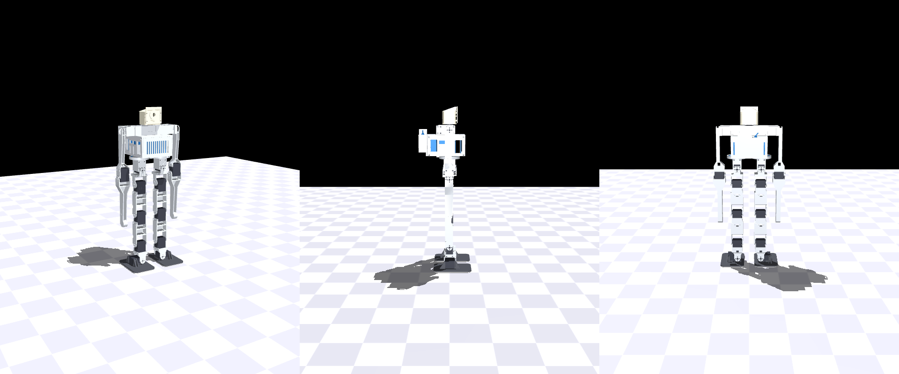

# Biped

A ~46 cm (to the deck; 56 cm to the top of the head) 3D-printed **bipedal
robot**: 17 serial-bus servos — six per leg, a neck, and two 2-DOF arms that
push it back up after a fall — an ESP32 running the 50 Hz control loop, and a
Raspberry Pi with a head camera. It is designed to walk by lifting a foot
clear of the ground: a static single-foot stance exists with 30 mm of margin,
and the first walk is an open-loop gait validated in simulation against the
measured actuation chain; a reinforcement-learning policy comes after the
body has proven its margins on the floor.



**Status:** the legs are built (the 12 leg servos and the control board; no
pack, Pi, head, neck or arms yet), and a trained legs policy —
`robot_legs_walk16_act_s128r24`, a distilled (128, 128) student on the v6 legs
plant — runs on the ESP32 and holds the robot standing. Walking on the floor
is not yet shown on hardware. The CAD for the whole robot is complete and
passes its swept-ROM interference gate; the design passes simulation Gates
A–D, and walking and get-ups train on the robot's plants.
Where everything stands: [DESIGN.md](DESIGN.md) §12–13 and the GitHub issues.

*Loosely inspired by the [Bimo Project](https://github.com/mekion/the-bimo-project);
an independent design built from servo datasheet dimensions, not reverse-engineered
parts.*

## Try it

Everything below runs on a laptop with no robot and no GPU.

```bash
python -m venv .venv && source .venv/bin/activate    # direnv does this via .envrc
pip install -r requirements.txt
make help                                  # every build, run and test target

# look at the robot: drag its joints under gravity, push it over (native Qt window)
make puppet                                # standing; ARGS="--pose supine" or "--pose prone"
make sim                                   # the plant in MuJoCo's viewer

# the design gates, on the robot's plant
python sim/static_gait.py --render build/v6/movies/walk.mp4   # the open-loop walk
python sim/gate_no3250.py walk             # the walk across the gate cases

# regenerate the printable parts from the parametric source, then gate them
make cad                                   # every part whose source changed: STL (cad/v6/stl), STEP and mass rollup (build/v6)
make check-cad                             # swept-ROM interference, must PASS
make slice                                 # OrcaSlicer projects + gcode, in build/v6/gcode

# the test gates (also run by the pre-push hook)
make test                                  # the firmware's pure modules under ASan/UBSan + the consoles, then
                                           # pytest tests/ (~4 min) and the SIL suite
```

The console drives a simulated robot over the real command protocol, and
`--host <robot-ip>` drives a real one:

```bash
brew install glfw && make -C firmware/host deps gui
firmware/host/build/bimo_gui --host 127.0.0.1
#   SIM: pick a run, Start; [a] arm, arrows to walk, PgUp/PgDn to turn
```

**Trained policies are not in the repo.** They are local artifacts under
`sim/runs/` (gitignored); [docs/training.md](docs/training.md) walks the pipeline
from the physics model to the weights compiled into the firmware. Training
wants an NVIDIA GPU; the referee, distillation and export run on a laptop.

## Where to read next

| | |
|---|---|
| [DESIGN.md](DESIGN.md) | **the design**: requirements, kinematics, servos, body, get-up, validation, open decisions, build sequence |
| [cad/README.md](cad/README.md) · [cad/PRINT_LIST.md](cad/PRINT_LIST.md) | the parametric CAD, and what to print and how |
| [docs/bom.md](docs/bom.md) · [docs/assembly.md](docs/assembly.md) | what to buy, and how to put it together |
| [docs/wiring.md](docs/wiring.md) · [docs/servo-map.md](docs/servo-map.md) · [docs/bringup.md](docs/bringup.md) | power and electrical, servo IDs and calibration, bare board to first arm |
| [firmware/README.md](firmware/README.md) · [docs/firmware-design.md](docs/firmware-design.md) | what runs on the ESP32 |
| [docs/control-channel.md](docs/control-channel.md) | the wireless command protocol and its failsafe |
| [docs/wifi-cli.md](docs/wifi-cli.md) | the bench CLI over Wi-Fi: provisioning, what is refused, the threat model |
| [docs/training.md](docs/training.md) · [docs/sil-harness.md](docs/sil-harness.md) | how a policy is trained, refereed and deployed |
| [AGENTS.md](AGENTS.md) | working practices: gates, branching, generated files, bench safety |
| [docs/design-v6/](docs/design-v6/README.md) | dated design records and the evidence behind DESIGN.md's numbers |
| [docs/archive/](docs/archive/README.md) | the project's history: the prototype, lessons learned, earlier studies |

## What's in here

```
cad/v6/     the robot's parametric CAD (build123d); cad/v6/dimensions_v6.py is the source of truth
cad/        shared CAD library (cad/common/), slicing and checks
sim/        the plants, design gates, open-loop gait and get-up; the CPU env (referee); sim/mjx/ (GPU training); sim/sil/
firmware/   the ESP32 target: the 50 Hz control loop, and its host test build
link/       the command channel: wire protocol, consoles, bench probes
tools/      sim <-> firmware exporters, and instruments that measure servos and the IMU
infra/      nightly training on the GPU box, burst compute
docs/       build, electrical, software and design records
```

## Hardware

15 × Feetech STS3215 (12 V) + 2 × STS3250 (hip rolls) · Waveshare General
Driver for Robots (ESP32, onboard IMU) · Raspberry Pi 4B + Camera Module 3 Wide · 3S 2200–2600 mAh LiPo ·
PETG prints + silicone rubber soles. Full list: [docs/bom.md](docs/bom.md).
