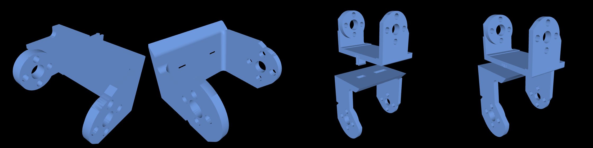
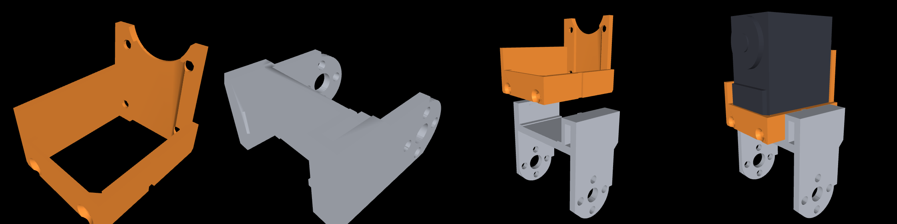

# Print list

What to print for the robot, how to orient each part, what supports each one
needs, and how to slice and send it. The CAD is `cad/v6/`; its code map is
[README.md](README.md). What to buy is [docs/bom.md](../docs/bom.md), and how it
goes together is [docs/assembly.md](../docs/assembly.md).

**The code's default build is the robot to print**: arms on, the torso with
the girdle's deck pilots, 15 × STS3215 + 2 × STS3250 (the hip rolls) in the
mass line. The `ARMS=0` variant
(`neck_collar` for the neck, no girdle, no arm links, no pilots) exists for
the CAD checks and is **not a print target**: the armless torso has no pilots
for the collar's flange screws.

## Status

| can print now | wait |
|---|---|
| `foot_L`, `foot_R`, `ankle_link` ×2, `leg_link_v6` ×4, `hip_yoke_v6` ×2, `pelvis_v8`, `torso_v8`, `front_cover_v8`, `power_cover_v8`, `yaw_bearing_housing`, `yaw_carrier_v6` ×2, `head_shell`, `head_face`, `neck_floor`, `shoulder_girdle_v6`, `arm_upper_v6_L/_R`, `arm_fore_v6_L/_R` | nothing: the bearings are measured ([docs/bom.md §5](../docs/bom.md)), and their D2 of 62.0 keeps the housing's Ø62.6 shoulder on the outer ring's steel face. |

**Fit check first (#79).** Before printing the full set, print one
`leg_link_v6` and one `hip_yoke_v6`. Fit them to a real servo, and check:

- the grip channel slides on;
- the disc screws engage;
- the supported horn-seating face sits flat on the disc.

## The parts

**How the masses are computed:** build123d volume × PETG 1.27 g/cm³ × 0.90
print factor (`parts_v6.mass_g`); the cut silicone soles are solid sheet,
estimated at 1.21 g/cm³ (no print factor) until weighed. They
are the rollup's, `build/v6/reports/parts_v6_rollup.txt`
(`make cad`, or `cad/v6/parts_v6.py --no-export`).

**Bounding boxes** are in the model frame (mm). **Supports** are what to tell
the slicer; see [Supports](#supports-are-the-slicers-job).

| part | qty | g each | bbox | orientation on the bed | supports | notes |
|---|---|---|---|---|---|---|
| `pelvis_v8` | 1 | 56.4 | 114.5 × 56 × 36 | ceiling down, the cell walls rising | no | holds the legs: both yaw cells under one 2.6 mm ceiling (a hole for each servo's free-hub post, a window for its back-cover platform, a slit over its connector trench), the windows for the torso's snap fingers, and the bearing housing's five pilot bosses; glued into `torso_v8` ([assembly §7a](../docs/assembly.md)) |
| `torso_v8` | 1 | 125.3 | 128.4 × 122.5 × 71.5 | deck top down | **in its wide windows only**: 26 enforcer boxes in `print_settings.json` (manual supports, snug) | the deck with the girdle's ten pilots, the skins, the battery layer, the bay for the Pi + General Driver stack forward, the power bay aft and the battery door's opening in the +y skin; the windows are flat-topped |
| `front_cover_v8` | 1 | 18.2 | 114.5 × 66.3 × 10.6 | outer face down | no | closes the board-stack bay: a flat plate with vent slots and four corner blocks; 4 × M2.5 × 8 flat-heads in through the skins |
| `power_cover_v8` | 1 | 18.2 | 114.5 × 66.3 × 10.6 | outer face down | no | closes the power bay: a flat plate with vent slots and four corner blocks; 4 × M2.5 × 8 flat-heads in through the skins |
| `battery_door_v8` | 1 | 11.4 | 79.8 × 29.6 × 12.4 | outer face down | no | the +y skin over the pack and the power board's J1: a bevelled tab aft, one M2.5 × 8 flat-head forward, two ribs that stop the pack ([assembly §10](../docs/assembly.md)) |
| `yaw_bearing_housing` | 1 | 25.2 | 80 × 155 × 9.3 | the face that goes against the pelvis down | no | both hips' outer-race seats (Ø64.96 recess, −0.04 mm on the 6810-2RS, under a Ø62.6 shoulder), joined by a bridge, with a rear bar; five M2.5 × 8 flat-heads up into `pelvis_v8`'s bosses. **A housing printed for `pelvis_v7` does not fit them: reprint it** |
| `yaw_carrier_v6` | 2 | 27.3 | 52 × 52 × 49 | horn-plate face down, bay walls rising | **the servo-plug window only**, from its sill (an enforcer box in `print_settings.json`) | carries the hip-roll servo in its bay, 5 mm below the horn plate; its round hub (Ø50.08 as printed, +0.08 mm on the measured 50.0 bore; modelled Ø50.48, see below) takes the bearing's inner race, which stops on the lip under the hub (Ø52.3) |
| `hip_yoke_v6` | 2 | 25.4 | 74 × 48 × 44 | on edge, model −Y on the bed, so the roll arms print as walls | **yes + 5 mm brim** | roll and pitch clevis in one print; see its notes below |
| `leg_link_v6` | 4 | 28.6 | 117 × 44 × 28 | on its back: web face on the bed | **yes**, build plate only: under the two round pad ends | thigh and shin are the same part |
| `ankle_link` | 2 | 13.6 | 65 × 43 × 38 | on its back (model +X up): the rear tine on the bed | **yes**: under the web (4.6 mm, from the plate) and under the front tine below the floor, standing on the rear tine's inner face, which seats the idler disc: clean it flat. The front wall bridges between the side walls | grips the ankle-pitch servo in a box around its base, forks onto the ankle-roll servo |
| `foot_L`, `foot_R` | 1 + 1 | 54.4 | 130 × 84 × 30 | sole down | no | a mirrored pair; each retention tab is braced by two fins on its outer face, sloped tops, support-free; a short near-row screw boss beside each disc |
| `head_shell` | 1 | 26.1 | 62 × 60 × 50 | base (horn plate) down; the dome is ≥ 45° | none expected | from `head.py` |
| `head_face` | 1 | 8.6 | 62 × 56 × 6 | flat, camera bosses up | no | |
| `neck_floor` | 1 | 4.0 | 46 × 45 × 5 | flat, bottom face down, pads and lugs up | no | the neck servo's seat (#90): screwed up into the neck tube's four bosses; the stator screws go up through it |
| `shoulder_girdle_v6` | 1 | 77.1 | 200 × 58 × 33 | base down | **yes**, build plate only | carries both shoulder servos and the neck tube (with the four bosses for `neck_floor`) |
| `arm_upper_v6_L`, `_R` | 1 + 1 | 27.8 | 169 × 38 × 29 | on its back, web face down | no | a mirror pair; open-front U with two end walls; grips the elbow servo |
| `arm_fore_v6_L`, `_R` | 1 + 1 | 41.5 | 182 × 44 × 27 | on its back, web face down | **yes**, build plate only: the two elbow-pad undersides start 5 mm off the bed | a mirror pair; the elbow fork, an end wall, 12 mm hand knuckle |

**Part notes:**

- **`pelvis_v8`, `torso_v8`, `front_cover_v8`, `power_cover_v8`, `battery_door_v8`**
  - The torso is five prints (the pelvis, the torso, two covers and the
    battery door). The pelvis, the covers and the door print without
    supports: the pelvis's ceiling is on the bed, the covers' vent slots are
    cut through flat plates, and the door's tab is bevelled 40° off vertical.
  - The torso's windows have flat tops. Printed deck down, a window's bottom
    edge is the top of its opening, so each one wider than an 8 mm bridge (26
    of them, the door's opening among them) gets support inside it and
    nowhere else: an enforcer box per window in `print_settings.json`
    (`torso_v8.support_enforcers()`, pinned by `tests/test_slice.py`), the
    yaw carrier's method. Each column stands on the window's other edge. Clear
    them out of every window after the print.
  - `torso_v8.py` audits the torso with those windows filled, as the support
    fills them while they print; `cad/v6/audit_torso.py` reports them as
    `[support]`.
  - The pelvis is snapped into the torso and glued with CA or epoxy
    ([assembly §7a](../docs/assembly.md)). The joint is permanent.
  - The deck does not seat the neck servo: its battery aperture runs under the
    whole servo. The seat is `neck_floor`.
- **Yaw carrier**
  - The carrier is not covered by the robot's printability audits.
  - Supports go in the servo-plug (connector) window and nowhere else. The
    window's ceiling in print, a 1 mm bar spanning 22.8 mm, stands on
    support built up from the window's sill. `print_settings.json` gives the
    part manual supports (`normal(manual)`, snug) and one enforcer box over
    the sill, which `slice.py` adds to the project. The box stops short of
    the idler seat's detent channel, which has no sill under it. Support
    there would run down to the bay floor and fill the channel.
  - The hub is modelled 0.4 mm over (Ø50.48) to print at Ø50.08, +0.08 mm
    on the bearing's 50.0 bore. The printer prints it undersize though its
    STL and its sliced outer wall are on size. Test prints set the allowance:
    modelled on size, the hub was loose; modelled 0.5 mm over, it went in
    only with great difficulty; modelled 0.4 mm over, it presses in with a
    clamp. Measure the hub; the allowance is
    `YAW_BRG_BOSS_PRINT_ALLOW` in `cad/v6/dimensions_v6.py`.
  - The lip under the hub prints unsupported. It is a 0.9 mm ledge, inside
    what prints without support (`check_printability.py` `LEDGE_OK`). Its
    downward face is the one the bearing's inner race stops on, so a support
    interface there would spoil the stop. OrcaSlicer prints its outer
    perimeters as overhang walls.
  - The horizontal screw holes are teardrops and print unsupported.
- **`hip_yoke_v6`**
  - The pitch horn arm is a slab over the servo void, and the roll pad rims and
    arm plates start in mid-air.
  - The underside of the pitch horn arm is a support-interface face that clamps
    onto the horn disc. Check that it seats flat.
- **`leg_link_v6`:** the back web and both side walls sit on the bed. Only the
  lower-rear quarter of each round pad end overhangs, 5 mm up; support it from
  the plate. The knee pocket in the idler side wall prints with a 6.6 mm roof.
- **`head_shell`:** the printability audit flags a ceiling at the dome seam. It
  is believed to be a boolean artifact; confirm in the slice preview.
- **`neck_floor`:** a separate print because it hangs 5 mm below the girdle's
  print plane. Its counterbores and countersinks open onto the bed; the audit
  finds nothing to support.
- **`shoulder_girdle_v6`**
  - It is 200 mm long, so **centre it on the bed**.
  - Supports go under the trapezius-web window tops (34 mm spans), the
    grip-plate rib-relief roofs, and the bay disc-relief tops.

**Totals:** 26 prints, all PETG, from 20 STLs: ≈ 861 g before supports and
brims.

**Not printed:**

- `sole_tpu_L/R`: the soles are cut from 2 mm silicone rubber sheet
  ([docs/bom.md §7](../docs/bom.md)), not printed. Each is the foot plate's
  outline: 130 × 84 mm with 14 mm corner radii, the same for left and right.
  The STLs are that outline.
- `head.stl`: the shell and face fused, used for mass, the assembly checks and
  the sim plant.
- `neck_collar.stl` and anything built with `ARMS=0` (see the top of this
  page).
- `yoke_roll.stl` and `yoke_pitch_v6.stl`: the `HIP_YOKE_VARIANT=split` build
  (the bolted two-piece yoke), which `hip_yoke_v6` replaces.

### Test print: the glued hip yoke

`HIP_YOKE_VARIANT=glued` builds the hip yoke as two U-channels that print
**without supports**, snap together, and are glued
([`hip_yoke_glued.py`](v6/hip_yoke_glued.py)). It is the test of that method
before it is used on other parts. It is not in the default build yet, so
`hip_yoke_v6` stays in the table above.



| part | qty | g each | orientation on the bed | supports |
|---|---|---|---|---|
| `hip_yoke_glued_roll` | 2 | 9.4 | on edge, model −Y on the bed (the face tangent to the pads and the idler boss) | **no**, no brim |
| `hip_yoke_glued_pitch` | 2 | 10.8 | on its back, model −X on the bed (the rear face, tangent to the idler hub) | **no**, no brim |

- **Slice:** `python3 cad/slice.py --variant hip_yoke_glued hip_yoke_glued`
  puts all four pieces on one plate: 1 h 34 min and 40.7 g, with no
  supports and no brim; `--copies 1` gives one set, 47 min and 20.3 g. One
  `hip_yoke_v6` takes 1 h 1 min and 25.2 g, supports and brim included. If a
  piece lifts off the bed, add `hip_yoke_v6`'s 5 mm outer brim to the variant.
- **Assemble:** press the roll piece's flange onto the pitch piece's flange
  until both split prongs click under it. The prongs locate the two pieces.
  Pull them apart again, glue the 27 × 30 mm flange faces (CA or epoxy, faces
  lightly sanded), and press the pieces back together.
- The bottom of the roll idler boss rests on the bed as a line, like a
  cylinder printed on its side. It is the journal that turns in the yaw
  carrier's bay bore with 0.3 mm of clearance, so check it for a ridge or a
  flat spot before fitting it into the carrier.

### Test print: the glued ankle link

`ANKLE_LINK_VARIANT=glued` builds the ankle link the same way, in two pieces
([`ankle_link_glued.py`](v6/ankle_link_glued.py)):

- a **cradle** that fits the ankle-pitch servo's base: four walls 0–0.4 mm off
  the case, where `ankle_link`'s front wall stood 8.1 mm in front of it. The
  rib detent runs out through its bottom, and its web has no lead window:
  the servo's ports are on its idler face, above the cradle;
- a **fork**: the floor 0.39 mm under the case, both tines, a closed box in
  front of the cradle that carries the roll torque, and a solid block behind
  it (the rear tine carried up to the box's height).

`ankle_link` stays in the table above.



| part | qty | g each | orientation on the bed | supports |
|---|---|---|---|---|
| `ankle_link_glued_cradle` | 2 | 4.7 | bottom down: the four walls' flat bottom | **no**, no brim |
| `ankle_link_glued_fork` | 2 | 10.3 | on edge, model −Y on the bed (the face tangent to the tine pads) | **no**, no brim |

- **Slice:** `python3 cad/slice.py --variant ankle_link_glued ankle_link_glued`
  puts all four pieces on one plate: 1 h 12 min and 31.6 g, with no
  supports and no brim; `--copies 1` gives one set, 37 min and 15.8 g. One
  `ankle_link` takes 50 min and 16.0 g, supports included.
- **Assemble:** lower the cradle into the fork: its front wall against the
  fork's inner wall, with the inner wall's tongue in the groove up the front
  wall, and its web against the rear block. Press it down onto the two seats
  on the floor: the middle of the web bows in as it passes the barb on the
  rear block, and clicks into place. To lift the cradle out again, press the
  web in. Glue both laps (the front wall to the inner wall, the web to the
  rear block) and the two seats (CA or epoxy, faces lightly sanded). Then fit
  the servo from the top, as before. With the servo in, the web cannot bow,
  so the snap stays locked.

## Regenerating

```bash
make cad                                               # every part whose source changed, and the mass rollup
.venv/bin/python cad/v6/parts_v6.py                    # every part -> cad/v6/stl + build/v6/step, bed check, mass rollup
.venv/bin/python cad/v6/parts_v6.py --only foot_L foot_R
.venv/bin/python cad/v6/parts_v6.py --no-export        # the rollup alone
.venv/bin/python cad/v6/head.py                        # head_shell + head_face (+ the fused head), audits
```

- Each part module's `__main__` exports that part and runs its own audits.
  `leg_link_v6`, `hip_yoke_v6`, `shoulder_girdle_v6`, `neck_floor` and `arm_v6`
  rewrite their STL as they go.
- Run `make check-cad` (`sh cad/run_checks.sh`) after any CAD change and
  before printing (see [README.md](README.md#the-gate)).

## Global print settings

**PETG for every part.**

- **Base settings:** 0.4 mm nozzle, 0.2 mm layers, 3 perimeters (every wall
  ≥ 2.4 mm is then perimeter-only), 30–40 % infill.
- **The profile that printed the prototype's PETG foot cleanly:** nozzle
  255 °C, bed 85 °C, 0.2 mm layers, 35 % infill.
- **Bed prep:** the FlashForge glue is a release layer on the PEI plate (PETG
  bonds hard to bare PEI). Degrease the plate with IPA.
- **Fits:** drop-in fits are `FIT = 0.30` mm (`cad/dimensions.py`). PETG runs
  hotter and strings more than PLA. On the first parts, check the snug
  interfaces: the grip channels on a servo case, the foot cradle, the pads on
  the discs. If anything binds, tune the flow or print a size test.
- **Filament:** keep PETG dry.
- **Bores:** small horizontal bores are teardropped toward each part's print-up
  direction, so their tops print without support. That is designed in;
  supports are not.

## Supports are the slicer's job

**Supports are never modelled into the STL.** Modelled fins put their anchor
tabs below the part, so the real first layer became disconnected stamps, and
the tabs fused into the part. The parts that need supports say so in the table
above, in their module's `SUPPORT_NOTE`, and in `check_printability.SUPPORTED`.

OrcaSlicer settings that work:

| setting | value |
|---|---|
| Enable support | on |
| **Support on build plate only** | **on**: otherwise every horizontal bore fills with support |
| Type | `normal(auto)`; `tree(auto)` also works and is gentler on round pads |
| Threshold angle | 30° |
| Top Z distance | **0.2 mm** (PETG welds to support at 0.1) |
| Support/object XY distance | 0.35 mm |
| Brim | outer only, **5 mm**, for tall narrow parts: `hip_yoke_v6` |

- Put the supported parts on their own plate so the setting does not leak onto
  the others.
- Read each supported part's audit findings (the `**` lines) against the slice
  preview.

**The printability audits** use `cad/check_printability.py`'s engine, run by
`cad/v6/audit_*.py` and by each module's `__main__`. They check each STL in its
print orientation for bridges, ceilings, ledges, islands, first-layer contact
and thin walls. The rules:

- PETG bridges 8 mm.
- A bridge is judged across its short side only when both ends are anchored. A
  window cut through a wall is a beam over its long span.
- The knife-edge threshold is 3.0 mm².

## Slicing

`cad/slice.py` slices a part, or a **plate** of parts printed together, into an
**OrcaSlicer project**, each part in its print orientation with the settings
above. Open the project in the GUI, check it, and print it from there.

```bash
make slice PART=leg_link_v6                  # -> build/v6/gcode/leg_link_v6.3mf + .gcode (gitignored)
make slice                                   # every plate and part whose STL or settings changed
python3 cad/slice.py leg_link_v6 --copies 4  # four on the plate, this run only
python3 cad/slice.py feet                    # both feet, one plate -> build/v6/gcode/feet.3mf
python3 cad/slice.py --all                   # every plate, and every part on no plate
python3 cad/slice.py --harvest               # only read saved projects back
```

- **Open `build/v6/gcode/<part or plate>.3mf`** with File → Open Project.
  - The printer is the GUI's own printer preset, the one that holds the print
    host, so the plate prints from the GUI.
  - The process and filament are Flashforge's "0.20mm Standard" and "Generic
    PETG", marked as modified. The modified values are this file's spec.
  - The plate is already sliced: check the preview, then print it.
- **The settings live in `cad/v6/print_settings.json`.** They are layered:
  1. Flashforge's presets.
  2. The spec on top, from Global print settings and Supports above.
  3. One entry per part, with:
     - the orientation: `IDENT`, `RX180`, `RY_XUP`, `RY_XDOWN`, `RY_ROLL_WALL`,
       or a 3×3 matrix whose rows are the print axes in model coordinates;
     - supports, and copies;
     - overrides, in OrcaSlicer's own keys.
  4. Plates: parts printed together. **`feet`** is `foot_L` + `foot_R`. One
     process slices a plate, so its parts must agree on supports and overrides
     (`slice.py` refuses a plate whose parts don't). A plate's copies are its
     own: `--copies 2` puts two of each foot on it.
- **Changes made in the GUI carry forward.** Save the project (Cmd+S). The next
  `slice.py` run on that part or plate reads the saved project's changes back
  into `print_settings.json`:
  - any process or filament setting, including per-object settings (on a
    plate, for every part on it);
  - a part tipped onto another face (on a plate, that part only);
  - a part turned a quarter turn on the bed (its `spin`). The slicer lays
    every copy square to the bed, walls along X and Y; a turn of any other
    angle is reported, not carried;
  - the number of copies.

  It prints what it changed, and keeps the saved project under
  `build/v6/gcode/.work/saved/`. Commit the JSON.
  - **Printer settings are not carried.** Change those in the GUI's printer
    preset.
  - **Painted supports or seams, modifier volumes and height-range modifiers
    cannot be carried.** `slice.py` then leaves that project alone and says so.
    To restrict a part's supports to one place, give it `support_enforcers`
    boxes in `print_settings.json` (as `yaw_carrier_v6` has). `slice.py` adds
    them to the project itself, and skips them when it reads a save back.
- **For each part it prints** the time, grams, height, supports, bed footprint
  and centre, and flags a part that lands off the bed. The footprint excludes the
  start gcode's purge line.
- **Where it runs.** On the Mac it drives `/Applications/OrcaSlicer.app`
  (`ORCA_APP` overrides the path). Elsewhere it runs the Flathub flatpak
  headless, as on mira. How it works and the upstream quirks it works around are
  in [docs/slicing.md](../docs/slicing.md).
- **One part departs from the table above** in `print_settings.json`:
  **`head_face`** is built in the assembly frame. Printed flat, outer face down
  and bosses up, its outer-face pocket becomes a ceiling of about 50 × 44 mm,
  1.8 mm above the bed. It is sliced with supports. Open: whether to keep the
  pocket and the supports.

### The printer

The printer is a **FlashForge Adventurer 5M Pro** at **`<printer-ip>`**, on
DHCP.

- **Fixed address:** if one is wanted, use a router DHCP reservation. Never set
  a static IP on the printer's panel: it ends up with two live addresses that
  flap.
- **LAN mode:** the working configuration has LAN mode off.
- **The bed is centre-origin, −110 … +110 mm in X and Y: centre every part on
  (0, 0).**
  - `slice.py` reports each part's measured centre.
  - A profile that emits corner-origin (0 … 220) coordinates puts the part in
    the +X/+Y corner, partly off the bed. If the centre is not (0, 0), shift
    X/Y by the part's own bounding-box centre before sending, and check the
    result stays inside ±110.
- **Upload over the LAN from OrcaSlicer.** Set these keys in the machine
  profile:
  - `host_type: flashforge`
  - `print_host: <printer-ip>` (bare IP; Orca adds port 8898 itself)
  - the printer's serial number, and its access code in `printhost_apikey`.
    Both are on the printer's panel under Settings → Network. **Keep them out
    of the repo.**
- **If an upload fails, check `host_type` before the network.** Without it,
  Orca falls back to plain HTTP on port 80, which this printer refuses.
- **Ports:**
  - 8898 is the printer's JSON API. `POST /detail` returns its status and its
    own `ipAddr`, which is the authoritative address.
  - 8899 is the raw `~M` command channel, not HTTP.
- **Sending from mira** is a separate host-side step, because the slicer's
  sandbox has no network.
