# Assembly

How the robot goes together, written from the CAD in `cad/v6/`. **Nothing has
been built yet**: the first build (#79) will correct this guide.

**The figures** in each section are rendered from the CAD
(`cad/v6/render_steps_v6.py`; `make figures` renders them and copies them into
`docs/assembly/v6_*.png`): installed parts in their own colours, the part
going in orange, backed off along its insertion path, with a ghost at its
seat. They show the left leg and arm; the right side is built the same way.

**Other visual references:**

- **Fly-in filmstrips.** Every part flies in along its insertion path in
  `cad/v6/animate_v6.py`; the second row of each strip closes in on the parts
  that build is about:
  - [the robot](assembly/assembly_v6_flyin_arms_strip.png)
    (and the armless variant's [strip](assembly/assembly_v6_flyin_strip.png))

  `make movies` writes the movies, with their strips, to `build/v6/movies/`.
- **STEP models to open in FreeCAD:** `build/v6/step/assembly_v6_arms.step`
  (the robot, from `make assembly`) and the per-part STEPs beside it (from
  `make cad`; [cad/README.md](../cad/README.md)).

The fly-in is a feasibility check that builds the robot in place, bottom-up.
It is not the bench order; the figures and this text are. The differences:

- **Legs and hip stack:** the strip builds each leg up from the foot under the
  pelvis; on the bench the leg is a subassembly offered up onto the hip-roll
  servo (§8).
- **Hip-roll servo:** the strip brings it in from the front; on the bench it
  goes up into its bay from below (§7e).
- **Hip-yaw bearings:** the strip lowers the housing and bearings onto the
  carriers' hubs; on the bench the housing goes up under the yaw cells first,
  and each carrier goes up through its bearing (§7c–7d).
- **Neck:** the strip lowers the girdle with its floor, then drops the neck
  servo in; on the bench the servo is screwed to the floor before the girdle
  goes on (§11a).

**Companion docs:**

- [Print list](../cad/PRINT_LIST.md) and [BOM](bom.md)
- [Wiring](wiring.md), [servo map and calibration](servo-map.md), and
  [bring-up](bringup.md)
- **Read [AGENTS.md](../AGENTS.md)'s bench-safety rules before any powered
  step.**

**Order at a glance:**

1. Prepare the servos (§2).
2. Build each leg from the foot up (§3–§6).
3. Seat the yaw servos in the bare pelvis, glue the pelvis into the torso,
   build the rest of the hip stack (§7), then hang the legs on it (§8).
4. Fit the boards and the power board (§9).
5. Put the pack in and close the battery door (§10).
6. Build the neck into the girdle on the bench, then fit the girdle,
   shoulders, arms and head (§11).
7. Cable it (§12), power it up and calibrate (§13), then test the play (§14).

---

## 1. The joint: the servo is the axle

Every servo carries its joint on **both** ends of its output:

- a driven metal **horn** on one face;
- a **free-spinning idler disc** on the other face.

Both are Ø19.2 discs with 4 × M3 tapped on a Ø14 bolt circle. The case also has
mounting holes on both faces. They take **M2.5, not M3**. The rows sit 8.30 and
29.00 mm behind the axis on the horn face, and 8.30 and 32.75 mm on the idler
face, at ±10.25 mm across the width. So two printed parts meet at every servo:

1. **The distal link forks onto the output.** One plate bolts to the horn and
   the other to the idler disc: a two-sided joint with no separate bearing.
   This link turns with the horn.
2. **The proximal link grips the case.** It uses six M2.5 × 8 flat-head
   self-tappers: four on the horn-side face and two on the idler face.
   - **The heads must sit flush** in their 90° countersinks. On the prototype,
     proud heads on the grip plates rode the sweeping fork arms and skewed the
     links.

[`assembly/joint_anatomy.svg`](assembly/joint_anatomy.svg) shows this
arrangement. **Its screw callouts are not the current ones; use the tables
below.**

**Rules at every joint:**

- **Horn side first**, with the servo at mechanical zero and the limb in the CAD
  standing pose. Then do the idler side.
- **The idler boss is a locator, not a seat.** The printed Ø20 boss inside the
  case's Ø25 recess has about 3 mm of radial clearance. Concentricity comes from
  the four screws, so snug the idler screws at zero and check runout before the
  final torque.
- **Thread-lock the M3 disc screws** with a medium-strength thread-locker, kept
  off the plastic. Loose horn screws cost the prototype its zeros.
- **Watch the idler threads.** The idler disc's moulded M3 threads carry the
  far-side bending load, so inspect them after the first hours of walking. If
  they wear, the upgrade is a shoulder bolt through the disc or a thin washer
  bearing under the arm.

### Disc screws: length by stack, no washers

The discs are tapped through a thin flange:

- **2.5 mm on the horn and 2.1 mm on the idler**, measured on the bench and
  confirmed by sectioning `cad/vendor/ST3215.step` (`HORN_THREAD`,
  `DISC_THREAD` in `cad/dimensions.py`);
- an M3 × 6 has **5.6 mm** of thread (measured).

A disc screw has to engage **at least 1.5 mm and no deeper than the flange**. A
longer screw bottoms out and jacks the joint apart instead of clamping it, so a
washer is never the fix. The length therefore follows the stack under the head:

| stack under the head | where | screw | engagement |
|---|---|---|---|
| 3.0 mm: a 3 mm plate straight on the **horn** | leg-link fork horn pads; ankle-link front tine; hip-yoke pitch horn arm; yaw carrier; forearm at the elbow horn | **M3 × 5** | ≈ 1.6–2.0 of 2.5 |
| 3.0 mm: a 3 mm plate straight on the **idler** | ankle-link rear tine | **M3 × 5** | ≈ 1.6–2.0 of 2.1 |
| 3.6 mm: plate + 0.6 mm locating boss, **idler** | leg-link fork idler pads; hip-yoke pitch idler; forearm at the elbow idler | **M3 × 6** | 2.0 of 2.1 |
| 4.0 mm: plate on a 1 mm boss, or the head's 4 mm base, **horn** | hip-yoke roll horn arm; upper arm at the shoulder horn; head | **M3 × 6** | ≈ 1.6 of 2.5 |
| 5.8 mm: the pad sunk 1.35 mm behind the carrier's bay wall, **idler** | hip-yoke roll idler | **M3 × 8** | 1.8 of 2.1 |

**What this table rests on:**

- The stacks come from each part's CAD. The part modules' `SCREWS()` lists
  take their lengths from the stack (`dimensions_v6.disc_screw`), and
  `cad/v6/check_assembly_v6.py` checks every disc screw's engagement against
  its flange (the `discscrew` rows of
  [cad_rom_check.txt](design-v6/cad_rom_check.txt)).
- The M3 × 5's thread length (taken as 4.6 mm, the same 0.4 mm short of
  nominal as the measured M3 × 6) is not measured. **Confirm on the first
  joint of each kind before torquing the rest.**

### Fasteners by step

The numbers are totals for the robot (both legs, both arms), from each module's
`SCREWS()`.

| step | fastener | total |
|---|---|---|
| §3 foot tabs and near-row bosses | M2.5 × 8 flat-head self-tap | 12 |
| §4 grip channels (4 leg links, 2 ankle links) | M2.5 × 8 flat | 36 |
| §5 ankle roll (ankle-link tines) | M3 × 5 | 16 |
| §5 ankle pitch, knee (leg-link forks) | M3 × 5 horn / M3 × 6 idler | 16 / 16 |
| §6 hip pitch (hip-yoke pitch clevis) | M3 × 5 horn / M3 × 6 idler | 8 / 8 |
| §7a yaw-servo stators | M2.5 × 5 flat | 8 |
| §7a pelvis into the torso | snap fingers + CA or epoxy, no screws | — |
| §7c bearing housing up into the pelvis | M2.5 × 8 flat | 5 |
| §7d carrier to the yaw horn | M3 × 5 | 8 |
| §7e hip-roll servo into the carrier bay | M2.5 × 8 flat | 16 |
| §8 hip roll (hip-yoke roll clevis) | M3 × 6 horn / M3 × 8 idler | 8 / 8 |
| §9a Pi | M2.5 × 17 male-female standoff (6 mm male) | 4 |
| §9b General Driver onto the standoffs / front cover | M2.5 × 6 / M2.5 × 8 flat | 4 / 4 |
| §9c power board | M2.5 × 6 pan | 4 |
| §9c power cover | M2.5 × 8 flat | 4 |
| §10 battery door | M2.5 × 8 flat | 1 |
| §11a neck floor to the tube / neck-servo stators | M2.5 × 8 flat | 4 / 4 |
| §11b girdle to deck | M2.5 × 8 flat | 10 |
| §11c shoulder servos | M2.5 × 8 flat | 8 |
| §11d shoulder horns | M3 × 6 | 8 |
| §11d elbow grips (upper arms) | M2.5 × 8 flat | 12 |
| §11d elbows (forearm forks) | M3 × 5 horn / M3 × 6 idler | 8 / 8 |
| §11e head to neck horn / head face / camera | M3 × 6 / M2.5 × 8 flat / M2 × 4 self-tap | 4 / 4 / 4 |

The robot has no heat-set inserts and no washers.

## 2. Servo prep (before any plastic)

1. **Incoming check** on every servo: weight, label and Model_Number
   ([bom.md §1](bom.md#1-servos)).
2. **IDs, one servo at a time.** Servos ship as ID 1, and two servos with the
   same ID do not enumerate. Assign each ID alone on the bus and label the
   case.
   - The ID map for the 17 joints is **proposed, awaiting sign-off** (#77):
     [servo-map.md §2.1](servo-map.md#21-the-robot-the-proposed-map), drawn
     below. The procedure is [bringup.md §2](bringup.md#2-servo-ids-and-gains).

   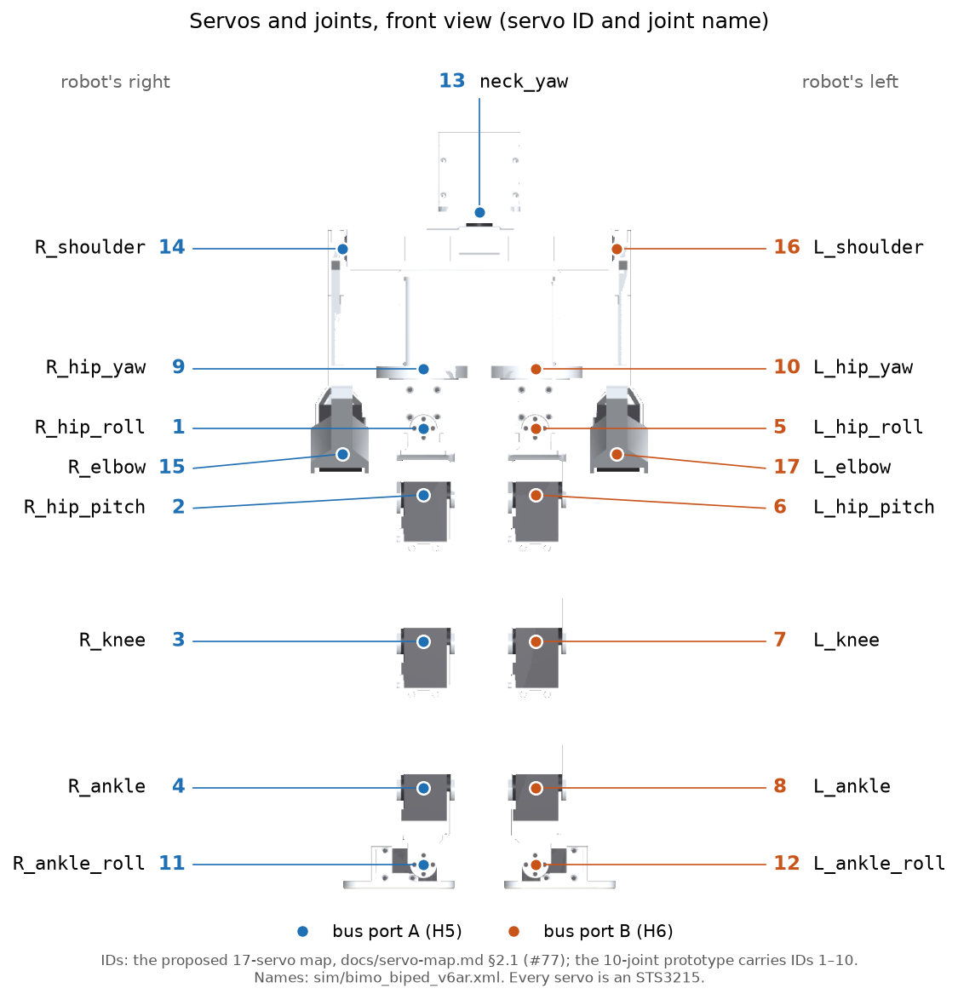
3. **Centre each servo at 2048, then fit its horn** with the centre screw.
   - The horn seats on discrete splines, so a mechanical zero is never exact.
     Calibration (§13) records the residual offset.
   - Centring first keeps each joint's travel clear of the encoder's 0/4095
     wrap. On the prototype, a zero at 3273 capped a hip's backward pitch at
     +72°.
   - **The two hip-yaw servos go in without their idler disc.** Nothing rides
     their idler side, which seats flat on the cell ceiling (§7a). Leave the
     disc off and keep it in the bag as a spare; the other 15 servos keep
     theirs.
4. **Gains.** On the four ankle-roll and knee STS3215s, write the
   position-loop P (register 21) and D (register 22) that the bench test (#73)
   settled. The hip rolls are STS3250s; their row in the table comes from the
   same bench. They are EEPROM registers: clear the lock flag (register 55)
   first.
   - **Do it with torque off. Every bus write is a motion command.**
   - Record the values per ID in servo-map.md.
   - A factory reset or a swapped spare comes back at P = 32.
5. **Orientation rules:**
   - **Legs are translations, not mirrors.** Leg links, ankle links, hip yokes
     and carriers are identical left and right, and every pitch-joint horn faces
     +Y (robot left) on both legs.
   - **Ankle-roll servos:** horn forward, cable end outboard.
   - **Hip-roll servos:** horn forward, cable end up.
   - **Yaw servos:** horn down. **Neck:** horn up.
   - **Feet and arms are mirror pairs.** The shoulder horns face outboard on
     both sides.

## 3. Feet ×2

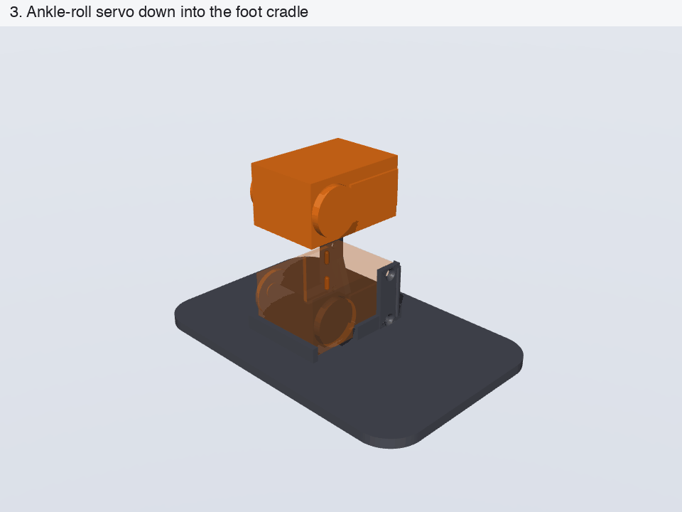

1. **Bond the silicone sole** to the foot plate's flat underside: 2 mm
   silicone rubber sheet cut to the plate's outline (130 × 84 mm, R14 corners;
   `sole_tpu_L/R`). Degrease the PETG first. Silicone needs a silicone-rubber
   adhesive, or CA over a polyolefin primer, unless the sheet is self-adhesive
   ([bom.md §7](bom.md)).
2. **Drop the ankle-roll servo into the cradle** from above.
   - Its output axis runs fore-aft, with the horn forward.
   - Its output end sits against the inboard end stop, and the cable end points
     outboard. The lead leaves through the notch in the rear rail.
3. **Screw the two retention tabs:** the front tab onto the horn-side case face,
   the rear tab onto the idler face. Each takes **2 × M2.5 × 8 flat-heads** into
   the far hole rows, driven from outside between the tab's two bracing fins.
4. **Screw the two near-row bosses:** the short bosses beside the discs, one
   on each case face, take **1 × M2.5 × 8 flat-head** each into the low hole of
   the row nearest the output end. The idler-side boss stands just short of
   the connector trench, so plug the lead in before the servo goes into the
   cradle.

## 4. Grip channels: ankle link, shin, thigh

- **Which link grips which servo:**
  - `ankle_link` grips the **ankle-pitch** servo;
  - the shin (`leg_link_v6`) grips the **knee** servo;
  - the thigh (the same part) grips the **hip-pitch** servo.
- **Slide the link on from the case's cable end.** The case enters the grip
  channel lengthwise, from below. Sliding a link on "from the front" instead
  drives the horn disc into the grip plate.
- **6 × M2.5 × 8 flat-heads** per link: 4 on the horn-side face (rows 8.30 and
  29.00) and 2 on the idler face (row 32.75). All heads flush.

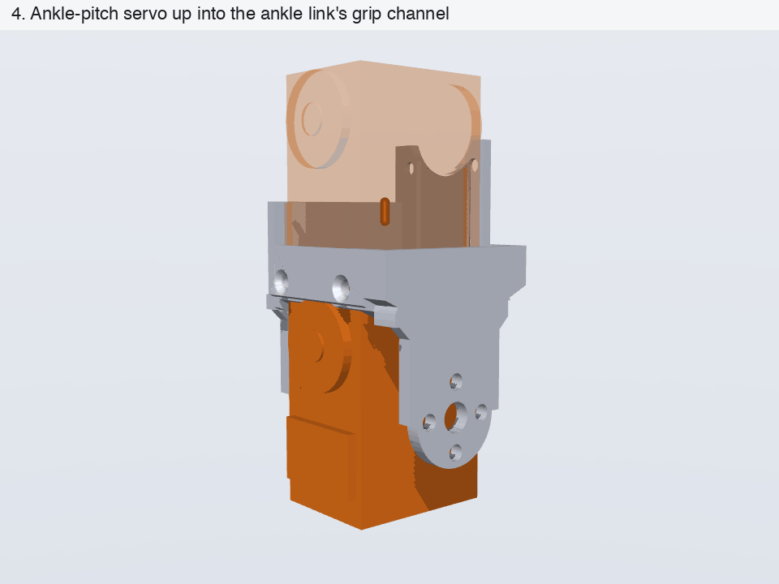

## 5. Close the leg joints: fork onto horn and idler

Each fork closes on the next servo's two discs. Work horn first at zero, then
the idler, with thread-locker, and check runout.

| joint | fork | horn side | idler side |
|---|---|---|---|
| ankle roll | the `ankle_link`'s two tines, lowered onto the roll servo in the foot: front tine to the horn, rear tine to the idler | 4 × M3 × 5 | 4 × M3 × 5 |
| ankle pitch | the shin's lower fork onto the ankle-pitch servo in the ankle link: horn +Y, idler −Y | 4 × M3 × 5 | 4 × M3 × 6 |
| knee | the thigh's lower fork onto the knee servo in the shin | 4 × M3 × 5 | 4 × M3 × 6 |

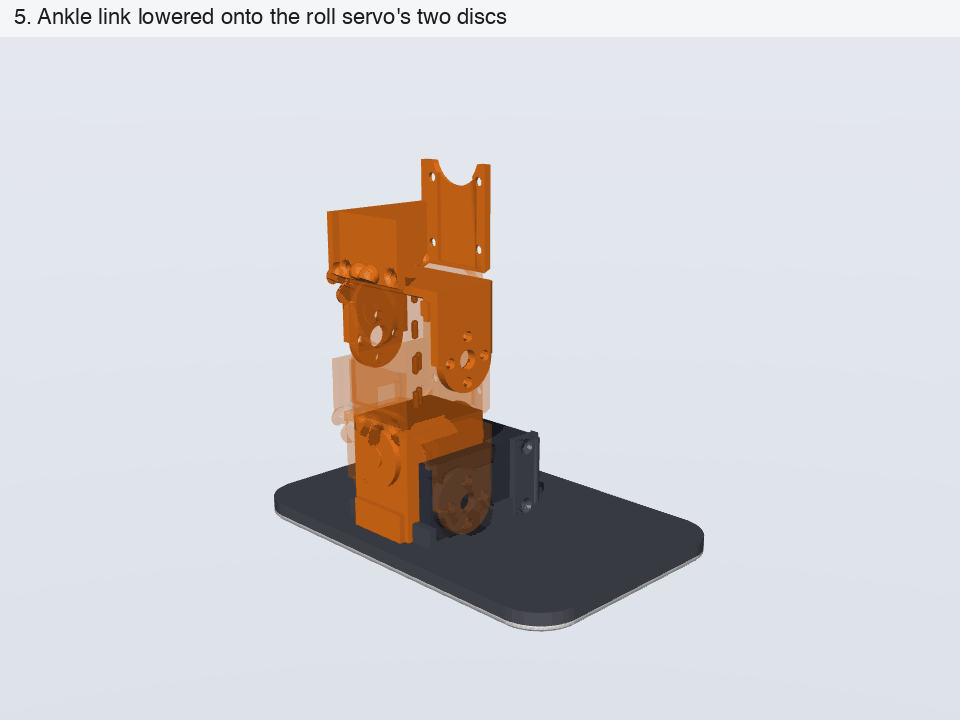
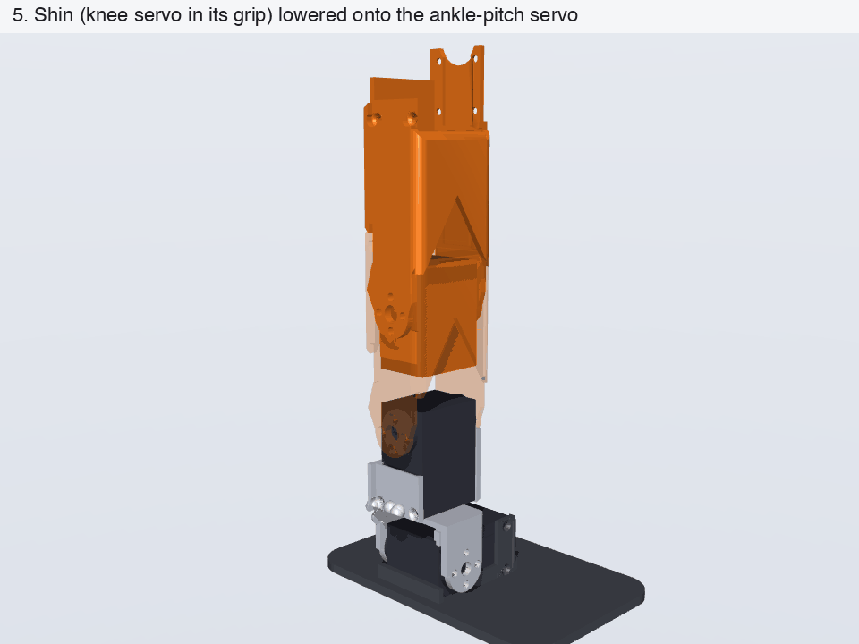
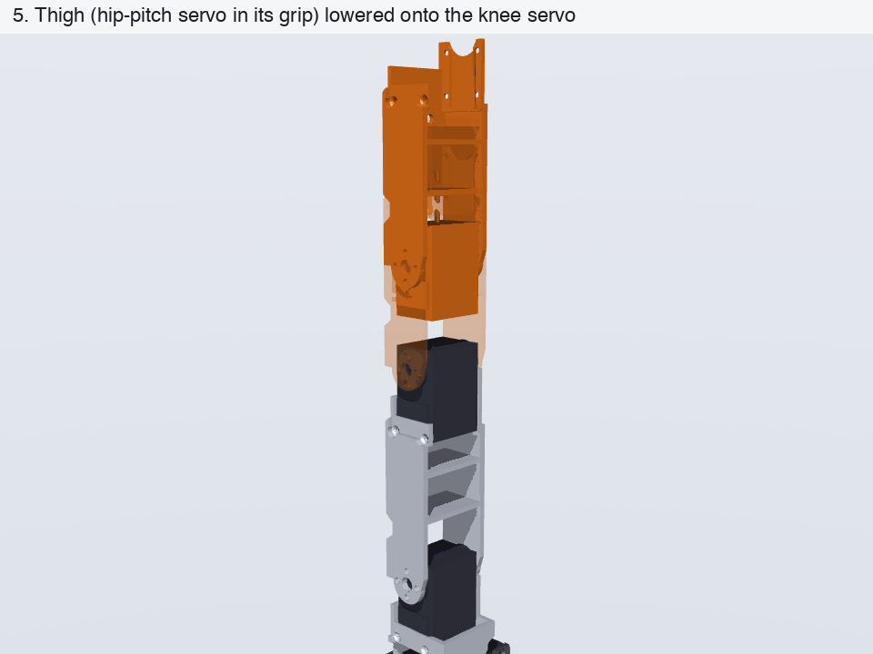

## 6. Hip yoke onto the hip-pitch servo

- **Pitch clevis.** Lower `hip_yoke_v6` onto the hip-pitch servo in the thigh.
  - Its pitch clevis (the lower half) straddles the servo's two discs: a horn arm
    on +Y (4 × M3 × 5) and an idler hub on −Y (4 × M3 × 6).
  - The yoke is one print, so there are no flange bolts.
- **Roll clevis.** The upper half waits for §8.

The leg is now a subassembly from the hip yoke down to the foot.

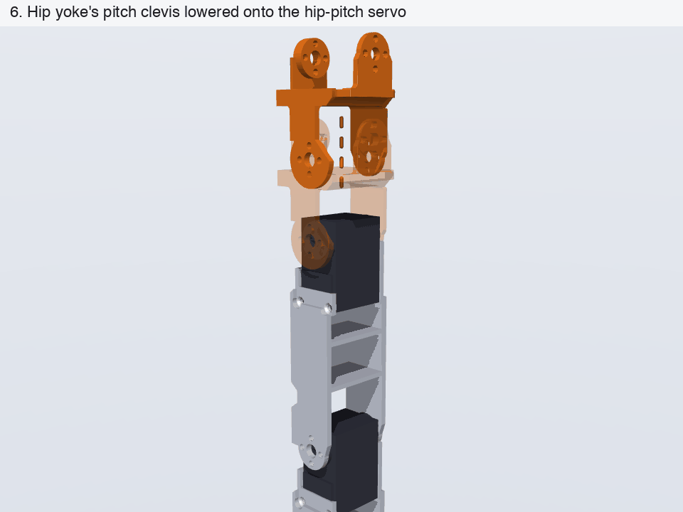

## 7. Hip stack in the pelvis (×2)

The yaw servos go into the bare pelvis on the bench, where every stator screw
has open access; then the pelvis, both servos in, goes up into the torso for
good (§7a). From §7c on, work with the torso upright on a stand, so that the
leg hangs below it later. Everything in the battery layer is done **before
the pack goes in** (§10).

### 7a. Yaw servos into the pelvis, then the pelvis into the torso

**Each yaw servo, into the bare pelvis on the bench:**

1. **Offer the servo up into its cell from below** (the mouth has a 1.2 mm
   lead-in).
   - Output axis vertical, **horn down**, case length fore-aft, **no idler
     disc** (§2).
   - The idler-side case face goes up flat against the ceiling. Its four
     mounting holes are flush with the face, so the ceiling clamps them
     directly. The free-hub post (2.6 mm proud) passes into a hole in the
     ceiling, and the moulded back-cover platform (1.9 mm proud) into a
     window: the face should sit flat with no rocking.
2. **Plug its leads first.** The bus ports sit in the connector trench on the
   idler face, under a slit in the ceiling: plug the leads in from above,
   through the slit. They run on through the battery layer later (§10, §12).
3. **Drive 4 × M2.5 × 5 flat-heads down through the ceiling** into the
   idler-face rows (8.30 and 32.75), with the pelvis on the bench and nothing
   in the way. A 5 mm screw takes 2.4 mm of the hole, which the vendor STEP
   shows 3.0 deep; **check the hole depth on the first servo**, and use an × 6
   only if it is at least 3.6 mm deep.

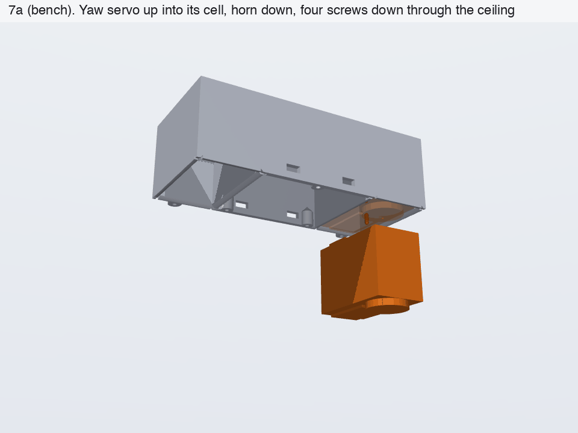

**Then the pelvis, both yaw servos in, into the torso:**

4. **Glue on the joint faces:** CA or epoxy on the pelvis's web faces, and
   where it meets the torso's ledge and skins.
5. **Push the pelvis up into the torso from below**, square, until its ceiling
   stops on the pack ribs and the −y ledge. The four snap fingers (strips of the
   torso's inner walls) click into the windows in the pelvis's webs and hold it
   while the glue cures. Lead the yaw servos' leads up into the battery layer
   as it goes.
6. **The joint is permanent.** Nothing needs the pelvis out again: the boards
   come out of their bays with the covers off, and the yaw
   stator screws are reached from above through the deck's battery aperture
   with the pack out. The four outboard ones (y ±52.25 mm) need a driver with a
   shank of 5 mm or less.

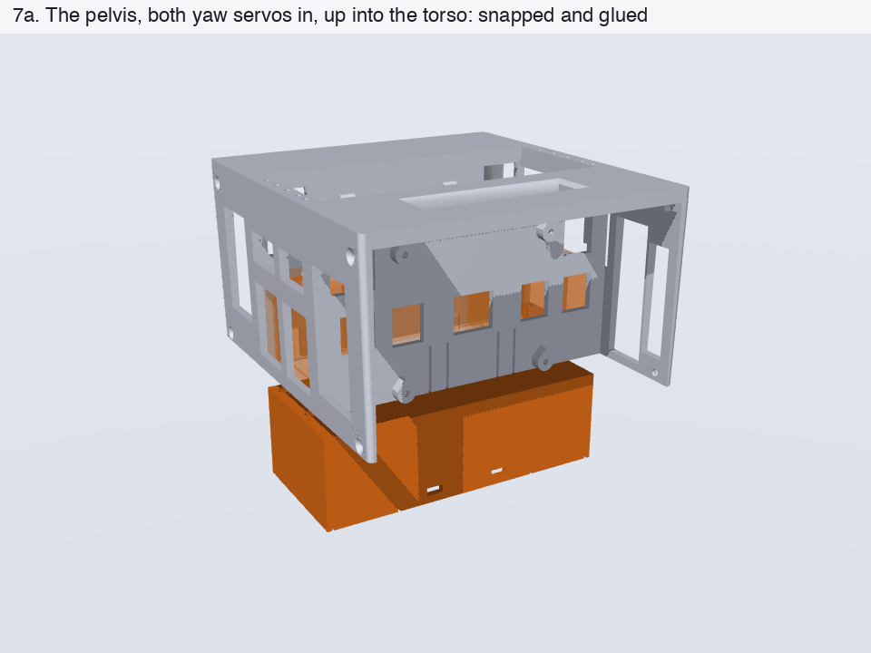

### 7b. The hip-yaw bearings into the housing (bench)

Each hip turns on a **6810-2RS** (nominal 50 × 65 × 7 mm, sealed, generic; the
ones in hand measure 50.0 × 65.0 × 7.0: [bom.md §5](bom.md#5-hip-yaw-bearing)). Its outer race sits
in a recess of the **bearing housing** (`yaw_bearing_housing`, one print for
both hips, Ø64.96, −0.04 mm) against a shoulder, which takes the leg's thrust.
Its inner race goes on the carrier's round hub (Ø50.08 as printed, +0.08 mm)
and sits on the **lip** under the hub (Ø52.3), which passes that thrust to it. The housing
is a separate print screwed under the pelvis because the yaw servo goes up into
its cell through the space the housing occupies. Background:
[study-yaw-bearing.md](design-v6/study-yaw-bearing.md) (option A).

1. **Measure the bearings and the printed seats first.** Both fits are inside
   the printer's error band and are fitted with **retaining compound** (Loctite
   641) on both seats. The carrier's hub is modelled 0.4 mm over
   (`YAW_BRG_BOSS_PRINT_ALLOW`), a value set by test prints. It then takes a
   clamp to press into the bearing (7d). If a clamp will not seat it, or it
   will not stay, correct that allowance and reprint.
2. **Press each bearing into its recess, pushing on the outer race only**,
   until it bottoms on the shoulder. The housing lies face down (the face that
   goes against the pelvis), recess mouth up.

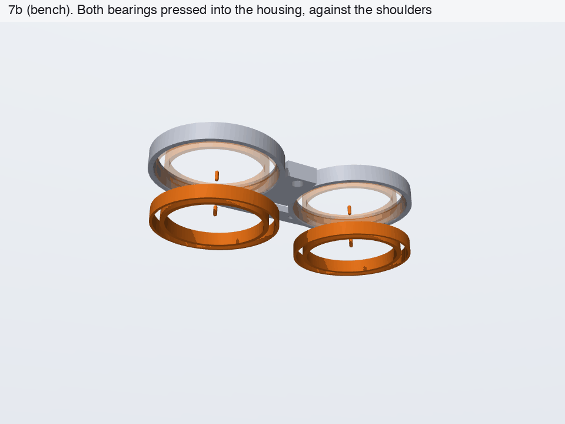

### 7c. Housing and bearings up under the yaw cells

1. **Offer the housing up from below**, square, recess mouths down, the yaw
   horns passing inside the shoulders, until its top face meets the pelvis.
2. **Drive 5 × M2.5 × 8 flat-heads up** into the pelvis's pilot bosses: four
   through the housing's rear bar (two into the rear web at y ±22 mm, two into
   the lugs aft of it at y ±46 mm) and one through the bridge between the hips,
   on the centre line, into the front web's boss.

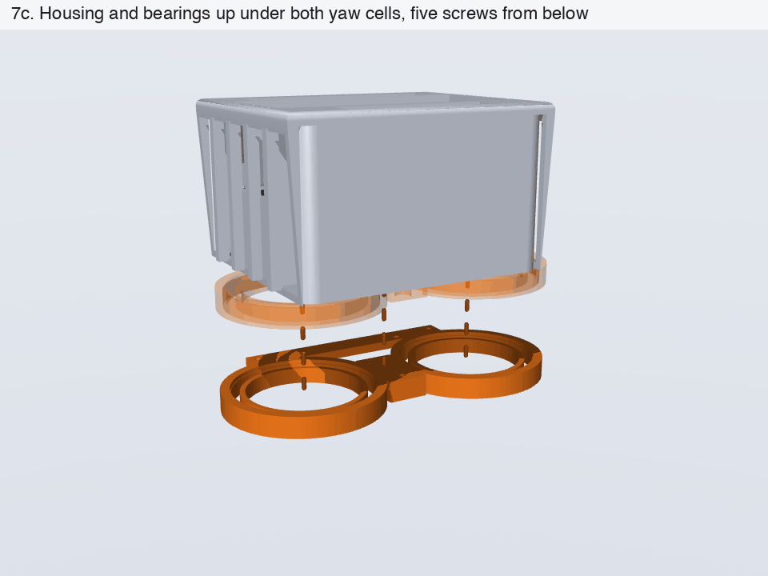

### 7d. Yaw carrier up through the bearing onto the yaw horn

The carrier's lip is wider than the bore, so the carrier goes into the bearing
from below and the bearing can never go on over it.

1. **Compound on the hub**, then **push the carrier up through the bearing**,
   horn plate first, roll bay opening downward, with the yaw servo at
   mechanical zero, until the **lip seats on the inner race**. The hub's top
   edge has a lead-in. The fit is tight: the printed hub takes a clamp. In
   this order the pressing force goes through the balls, so press slowly and
   squarely. Then turn the bearing: it should run smooth, not notchy.
2. **Check the horn plate against the horn disc** with the lip seated. If the
   plate stands off the horn, shim that gap rather than close it with the horn
   screws: they would pull the inner race up against the balls and the yaw
   servo's output shaft down.
3. **Square it before torquing**: a clocked carrier is a permanent yaw offset.
4. **Drive 4 × M3 × 5 up into the horn** through the bay ceiling, from inside
   the empty bay. Do this before the roll servo goes in.
5. **Turn the hip through ±45° by hand** before the compound sets: the carrier
   should turn on the bearing without touching the housing or the pelvis.

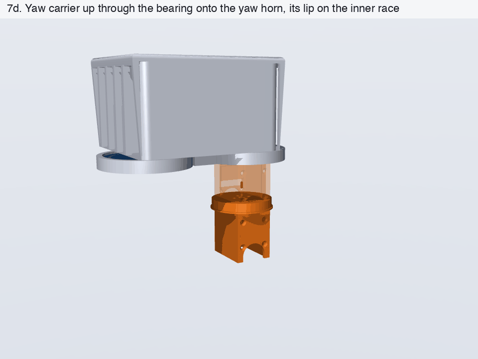

### 7e. Hip-roll servo up into the carrier bay

1. **Slide the servo up into the downward-open bay**, cable end first: output
   end down, horn forward.
   - The rear wall carries an idler seat with a detent channel for the case's
     moulded back-cover platform, so the servo should feel **snug against the
     rear wall** before any screw goes in. If it does not, check that the
     platform is running in the channel rather than sitting on top of it.
2. **Drive 8 × M2.5 × 8 flat-heads:** 4 through the front (horn) wall and 4
   through the rear (idler) wall, into the case. The carrier's 5 mm spacer
   keeps all eight below the bearing and the lip, so a driver reaches them with
   the housing on (to change a roll servo, take the leg off and these eight
   out; the carrier, bearing and housing stay).
3. **Plug the hip-roll servo's leads** in the trench on its idler face,
   through the window in the bay's rear wall, and route them outside the
   housing.

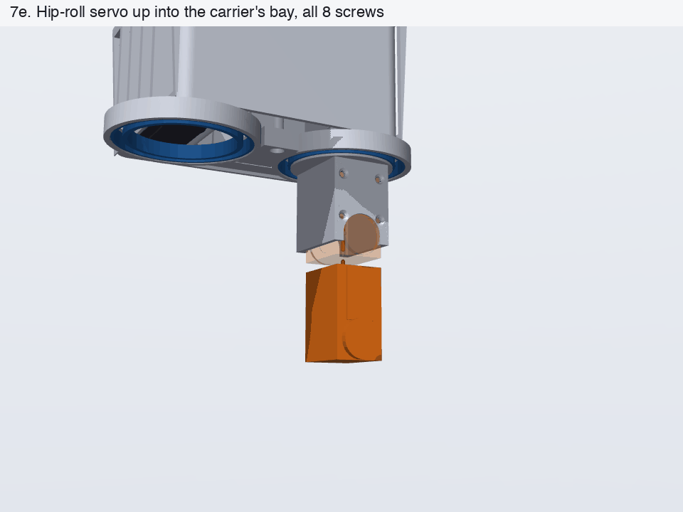

- **Never heat-set a bearing into PETG.** PETG must reach about 230 °C to flow,
  and a 2RS bearing's seals and grease are good to roughly 100 °C.
- **The ring dimensions in the CAD are the bearings' measured ones** (bore
  50.0, OD 65.0, width 7.0, inner ring shoulder d1 54.6, outer ring shoulder
  D2 62.0 mm). The housing's shoulder (Ø62.6) bears on the outer ring face,
  0.3 mm outside the seal's edge (D2) and inside SKF's Da max of 63. A
  replacement bearing gets measured the same way, and its values go into
  `cad/v6/dimensions_v6.py`.

## 8. Legs onto the roll servos

Offer each leg up so that the hip yoke's roll clevis straddles its roll servo:

- **Front:** the roll horn arm (on a 1 mm boss) bolts to the roll horn with
  **4 × M3 × 6**, at zero, with the leg hanging straight.
- **Rear:** the idler arm's long boss reaches through the slot in the carrier's
  rear wall to the idler disc, and takes **4 × M3 × 8**.
  - The heads land in a pad sunk 1.35 mm into the arm's outer face. That sink
    is what brings the screws into thread, so do not fill or file it.
  - Snug at zero, then check runout.

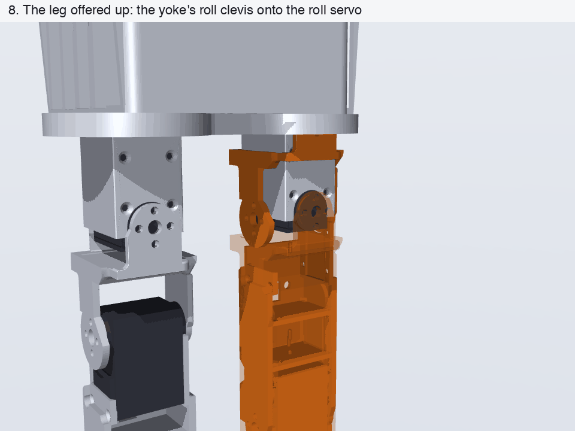

## 9. Torso electronics

The Pi and the General Driver go in as one stack, in the bay in front of the
pelvis, with the front cover off: the Pi on four standoffs off the front inner
wall, the General Driver plugged onto it as a HAT. The power board goes into
the bay right behind the pelvis, with the aft cover off.

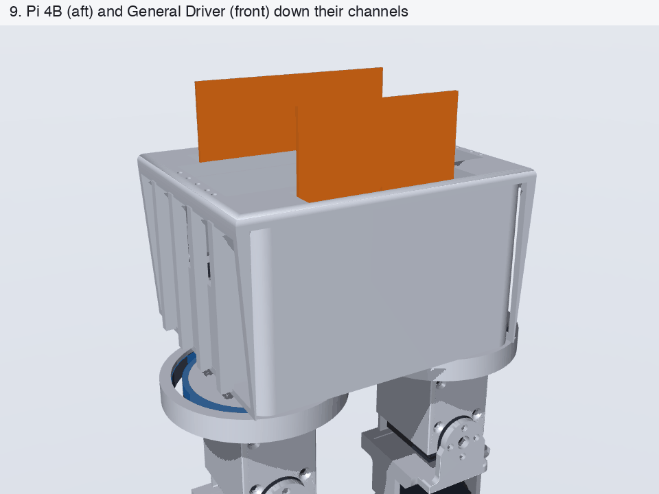

### 9a. Raspberry Pi 4B

- Fit the low-profile heatsink first: the Pi's parts under the HAT have 10 mm.
- **Four M2.5 × 17 male-female standoffs**: their 6 mm male thread through the
  Pi's holes into the four bosses on the front inner wall, the Pi's solder side
  4 mm off the wall, its parts facing forward.
- Its 40-pin header is down; its USB-C, HDMI and camera edge is up under the
  deck; its USB/Ethernet end faces +y, through the side window.
- Connect the camera ribbon at the top edge first, and lead it up through the
  deck opening between the boards toward the neck.

### 9b. General Driver, on the Pi as a HAT, and its IMU

- **Plug it onto the Pi's 40-pin header** through a 2 × 20 riser, its sockets
  (on its underside) down onto the header, its parts facing forward, its bus
  edge up and its service edge (XH inlet, USB-C) at +y, and drive **4 × M2.5 ×
  6** through its holes into the standoffs.
- **The riser:** the General Driver's side plugs face +y, the same side as the
  Pi's USB/Ethernet jacks, so the board has to sit 17 mm off the Pi's parts
  face for them to pass over the 16 mm jacks. **The riser part and the stack's
  real height are open** (`HAT_GAP` in `cad/v6/dimensions_v6.py`): measure them
  before printing.
- The leg leads come to its two bus ports, H5 and H6, through the top windows
  of the front inner wall; the upper branch (neck, shoulders) leaves up through
  the deck opening between the boards (§12). Both ports carry the same nets.
- **The IMU is the board's onboard QMI8658C.** The board's mounting fixes the
  IMU's axes. The firmware applies a mounting rotation (`imu::Mount`), which has
  to be set for this orientation as part of the 17-joint port (#81).
- **The front cover:** set it between the skins' front ends and drive **4 ×
  M2.5 × 8 flat-heads** in through the skins into its corner blocks.

### 9c. Power board and cover

- **The power board** is the custom board of PR #112. It goes into the bay
  behind the pelvis from aft, with the cover off: vertical, parts facing aft,
  onto the four 6 mm standoff bosses on the aft inner wall, with **4 × M2.5 ×
  6 pan** screws through its corner holes.
- J1, the XT60 for the pack, is on the board's +y edge. The pack's lead comes
  through the aft wall's +y end window and loops into it in the 17.4 mm beside
  the board's edge. Whether the plug and its 12 AWG lead fit there is **not
  checked**: check it at the first fit. The servo headers J4–J8 are on the −y
  edge and the control connectors along the bottom edge.
- The fuses F1/F2 and every connector are reached with the cover off.
- Its wiring is the power-circuit design's (PR #112, [wiring.md](wiring.md)).
  The current budget and the inlet are open (#77; [bom.md §3](bom.md#3-power)).
- **The cover:** set it between the skins' aft ends and drive **4 × M2.5 × 8
  flat-heads** in through the skins into its corner blocks.

## 10. The pack and the battery door

The pack goes in and out sideways, through the **battery door** in the +y skin
(`battery_door_v8`): one screw and one tab.

1. **Finish everything in the battery layer first:** the yaw leads (§12).
2. **Stick two 1.5 mm adhesive foam pads on the pelvis's ceiling**, one over
   each cell, clear of the post holes. The yaw servos' free-hub posts come up
   flush with the ceiling and turn with the hip; the pads hold the pack 1.5 mm
   off them. Lay each yaw servo's leads flat between the pads (§12).
3. **Slide the pack in through the door's opening**, lead end last (toward
   +y). It lies transverse on the pads, between the ribs on the inner walls,
   which locate it fore and aft with 0.5 mm, until its −y end meets the two
   blocks under the deck rail.
4. **Plug it in:** its lead runs aft from its +y end, through the aft wall's
   +y end window into the power bay, and loops into J1 on the power board's +y
   edge (§9c), all inside the door's opening.
5. **Close the door:** hook its tab (the bevelled aft edge) behind the power
   bay's skin, swing the front edge in, and drive **1 × M2.5 × 8 flat-head**
   through it into the post on the front inner wall. The door's two inner ribs
   stop the pack's +y end; its lead leaves the pack between them.
6. **There is no belt.** The neck floor holds the pack down from 4.0 mm above
   it, with a foam pad between them, once the girdle is on (§11b).

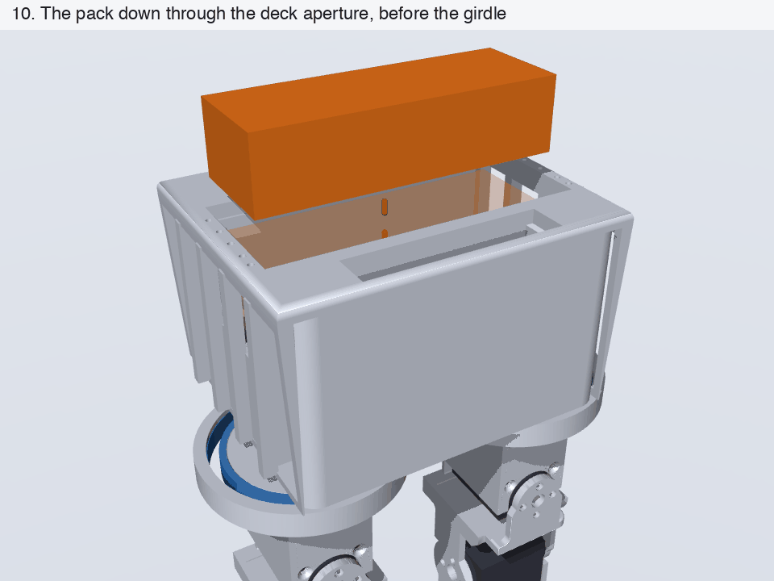

**Swapping the pack** leaves the girdle on:

1. **Switch off with the arms hanging**, then swing the +y arm up out of the
   way by hand (horizontal, forward). It hangs across the door, the door's
   path off and the pack's path out; `check_assembly_v6.py --joint swap`
   checks all three clear with the arm horizontal forward. Whether the
   unpowered shoulder holds it there is not measured: hold it.
2. **The door:** the screw out, the front edge swung out about the tab to
   about 40° (so the tab's tip clears the jamb), then the door lifted away.
3. **Pull the XT60 off J1** and back through the aft wall's window.
4. **Slide the pack out** sideways from under the neck floor's pad.
5. Fit the new one as steps 3–5 above.

## 11. Girdle, neck, shoulders, arms, head

The bench order, girdle first. The neck floor sits 4.0 mm over the pack, so
the neck is built into the girdle before the girdle goes onto the robot.

### 11a. Neck into the girdle (on the bench)

1. **Neck floor into the tube.** Offer `neck_floor` up into the bottom of the
   girdle's neck tube, pads up, and drive **4 × M2.5 × 8 flat-heads** up
   through its lugs into the four bosses on the tube's side walls.

   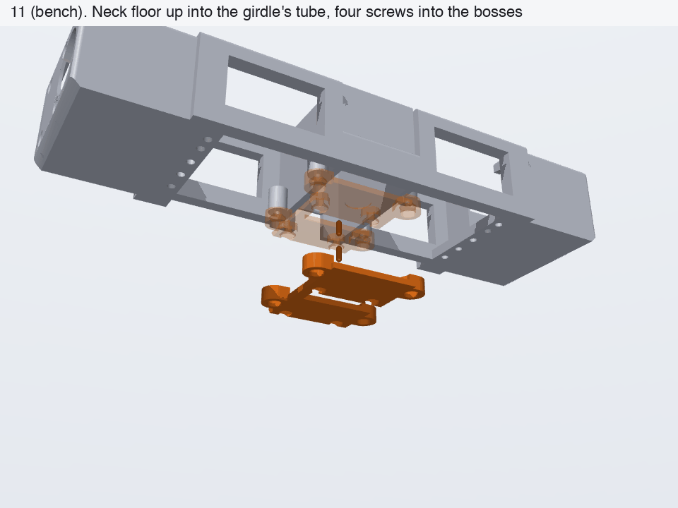

2. **Plug the neck servo's leads first.** The bus ports face down, in the
   connector trench on the idler face. The floor has a window under the trench,
   open toward the robot's left (+Y), so the plugs pass it and the leads leave
   sideways at floor level.
3. **Drop the neck servo into the tube from above**, horn up, case length
   fore-aft with the cable end aft. Its idler face lands on the floor's four
   pads; the turning idler disc and hub clear the floor by 0.6 mm.
4. **Drive 4 × M2.5 × 8 flat-heads up through the floor and the pads** into
   the idler-face rows (8.30 and 32.75). The heads seat in 1 mm counterbores,
   so each screw bites 4 mm into the case.

   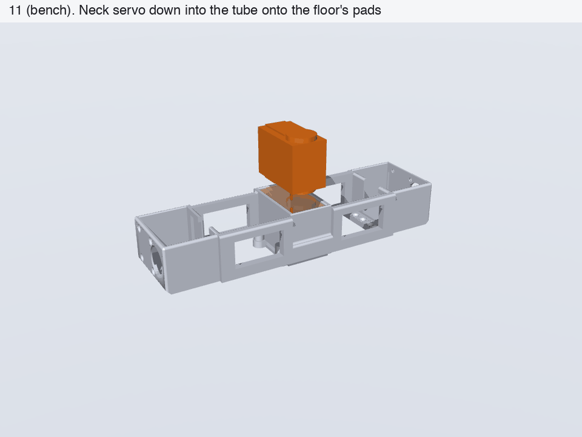

### 11b. Girdle onto the deck

- **Lower the girdle onto the deck**, the neck floor passing down into the
  battery aperture over the pack, with the foam pad (§10) between them. Lead
  the neck's bus leads up beside the tube.
- **Screw it down with 10 × M2.5 × 8 flat-heads** from above into the deck
  pilots on the two edge rails (x −27, −18, −9, 0, +6 mm at y ±57 mm). The
  rail pilots are clear of the pods, so the shoulder servos can go in before
  or after.

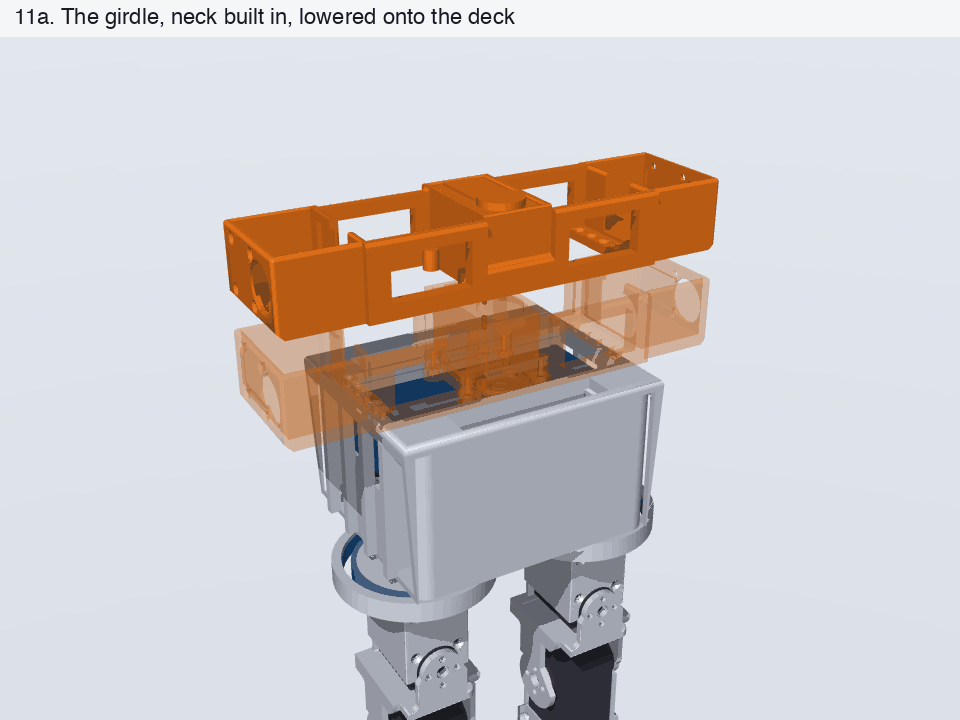

### 11c. Shoulder servos

- **Drop each servo straight into its open pod** from above: case length
  fore-aft, width vertical, horn outboard.
- **Screw it with 4 × M2.5 × 8 flat-heads into the horn-side case face, from
  outboard.** The inboard face sits 1.24 mm off the torso's skin, where no
  driver fits.

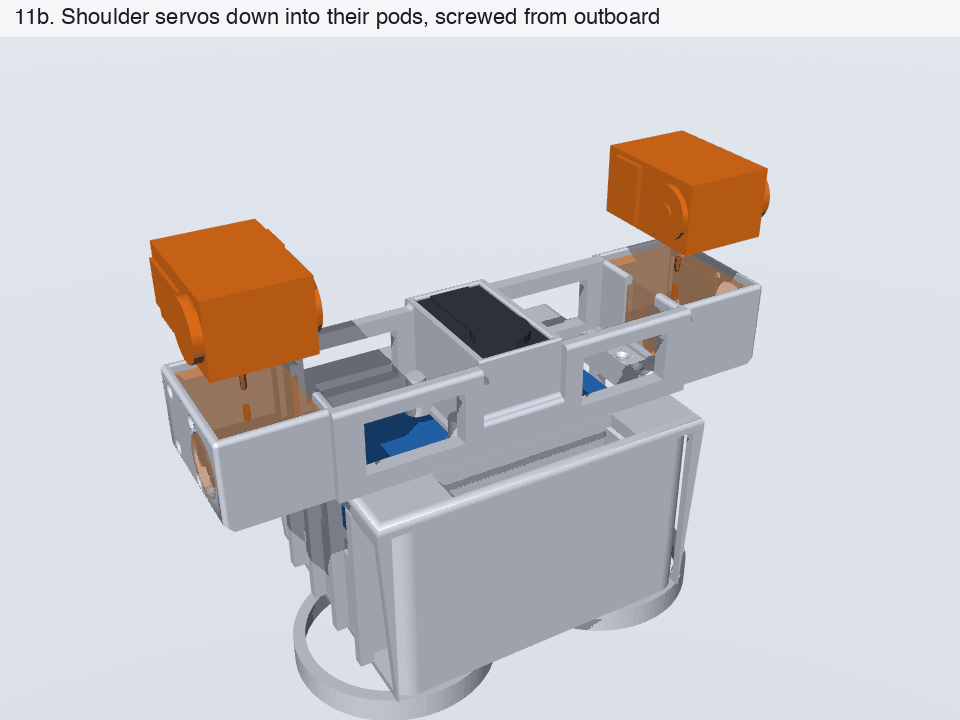

### 11d. Arms (a mirror pair)

1. **Upper arm onto the shoulder horn.** Offer it straight in along the joint
   axis, with the shoulder at zero (arm hanging). It is a single-sided horn
   joint.
   - **4 × M3 × 6** (the horn plate sits on a 1 mm seating boss: a 4.0 mm
     stack), driven through the access bore in the arm's outboard face.

   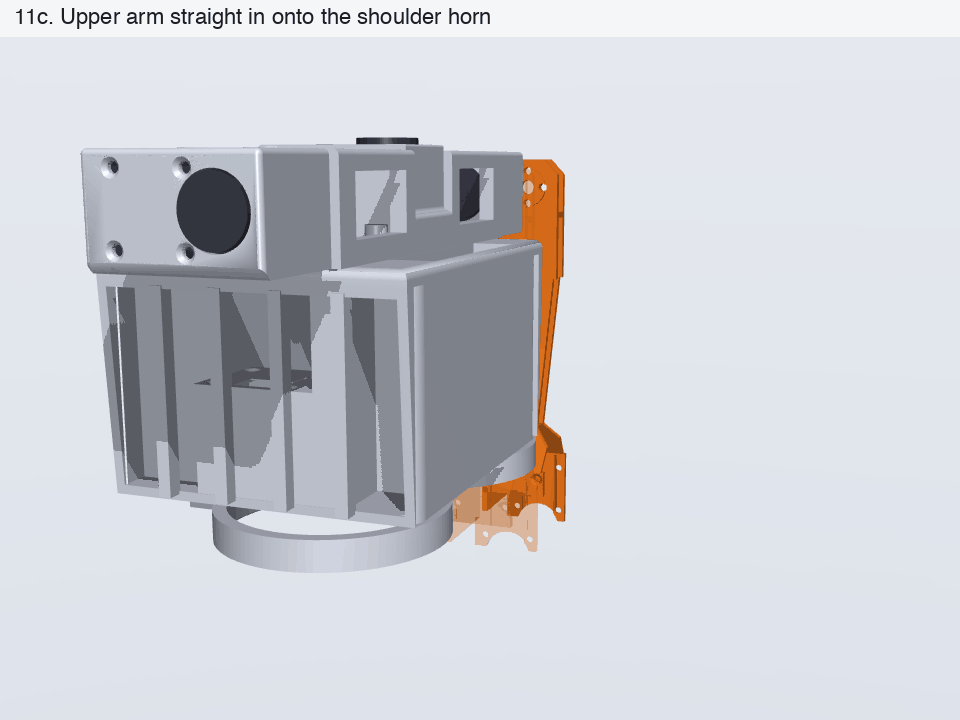

2. **Elbow servo into the upper arm.** Slide it into the grip channel at the
   upper arm's lower end from the front, output end down, horn outboard, so the
   case runs up the arm. **6 × M2.5 × 8 flat-heads**: four from outboard, two
   from inboard. Plug the shoulder-to-elbow lead in first and take it out
   through the web window just above the case.

   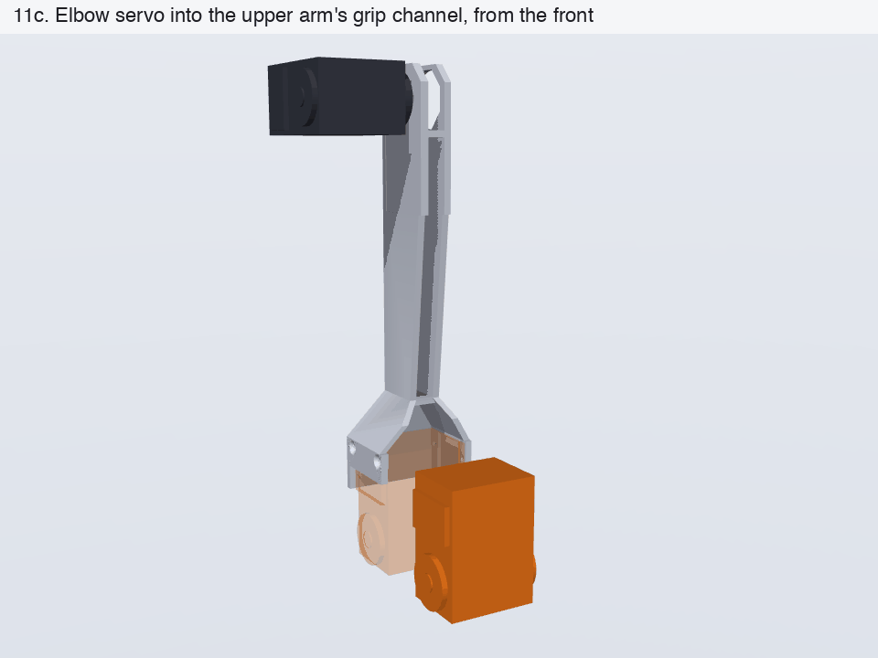

3. **Forearm onto the elbow servo.** Lift it up so its fork tines pass either
   side of the servo's output end onto the two discs, with the elbow straight:
   - horn side **4 × M3 × 5**;
   - idler side **4 × M3 × 6**.

   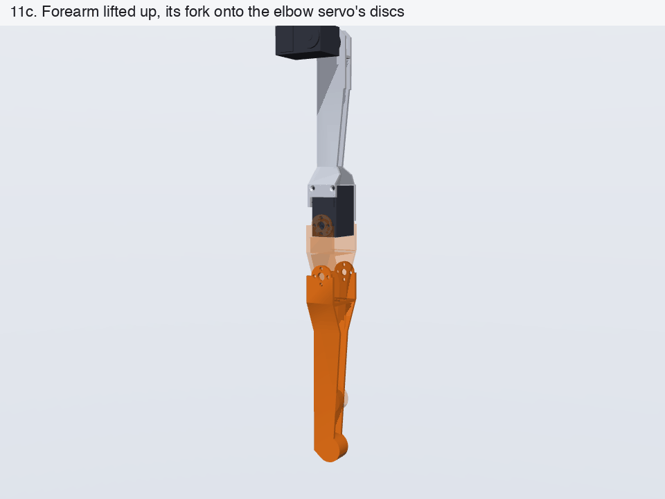

### 11e. Head and camera

1. **Camera onto the face.** Fit the Camera Module 3 to the four M2 bosses on
   the inside of `head_face` (4 × M2 × 4 self-taps), lens through the aperture.
2. **Route the camera cable** through the slot in the head's base beside the
   neck axis. Leave a slack loop for ±90° of yaw.
3. **Shell onto the neck horn.** Seat `head_shell` on the neck horn with the
   neck at zero and the head facing forward. Drive **4 × M3 × 6** through the
   4 mm base plate, from inside the open shell.
4. **Close the face** with **4 × M2.5 × 8 flat-heads**.

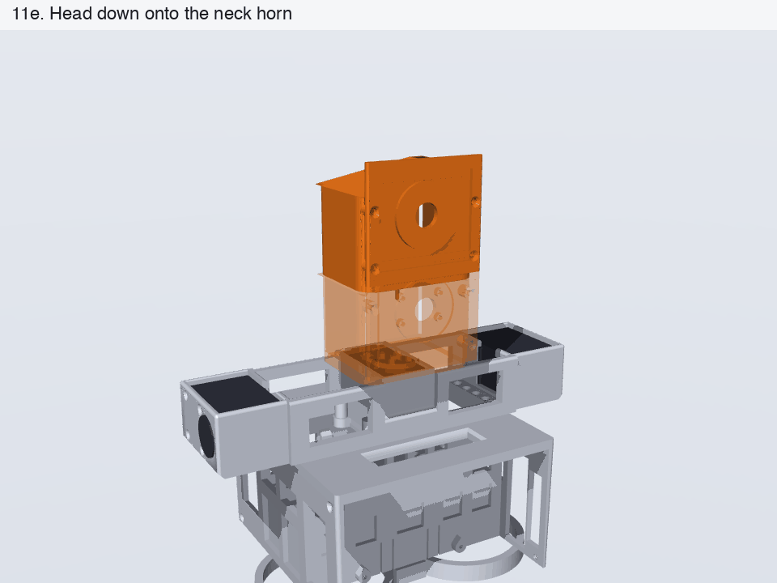

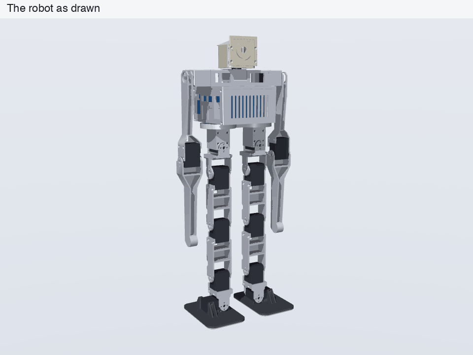

## 12. Cabling

**The harness is not drawn yet** (#77): the 17-joint ID map is proposed, not
signed off ([servo-map.md §2.1](servo-map.md#21-the-robot-the-proposed-map)),
the per-hop lead lengths are measured from the CAD
([wiring.md](wiring.md#per-hop-lead-lengths-from-the-v6-cad-arms1)), and there
is no current budget.

**What the CAD provides for it:**

- **Yaw servos:** a slit in the pelvis's ceiling over each connector trench.
  The leads plug in from above through it, run flat under the pack between its
  pads to the gap in front of it, then up over the front ribs and through the
  top windows in the front inner wall into the board-stack bay, to the General
  Driver's bus edge. The deck has no leg-bus slots.
- **Power bay:** windows at the battery layer's ends in the aft inner wall
  carry leads to the power board, the pack's lead through the +y one.
- **Roll servos:** their ports face rearward through the carrier's rear-wall
  window.
- **Boards:** the General Driver's bus edge faces up, and the upper branch
  (neck, shoulders) and the camera's ribbon (from the Pi's top edge) leave up
  through the deck opening between the boards.
- **Neck:** the leads leave the plugs through the neck floor's window, toward
  +Y, and rise through the deck aperture beside the tube; the tube also has a
  window at the servo's cable end.

**Rules:**

- **Daisy-chain.** Each servo has two paralleled ports, so the bus hops from case
  to case. Each servo ships with a 150 mm lead; where a hop needs more, use an
  extension lead.
- **Leave a slack loop across every joint, sized at full flexion.**
  - That means knee 130°, hip pitch −120°, and the shoulder through its whole
    −90° … +200°: its lead crosses a joint that folds 290°.
  - Fold each joint to its limit before cinching the zip ties.
- **Strain relief for the arm leads is not designed yet.**

## 13. First power-up and zero calibration

**Before anything powered,** read AGENTS.md's bench-safety rules:

- any bus write is a motion command;
- opening the serial port reboots the board and eats the first command;
- check torque before a bench run;
- disarming does not lower the robot.

Bare board to first arm: [bringup.md](bringup.md).

**The firmware currently drives the prototype's 10 joints.** The 17-joint port
(IDs, calibration blob, observation spec, and the register-21 check at boot) is
open (#81). The procedure is the one the prototype uses:

1. **Zero.** Standing is angle zero for every joint.
   - Hold the robot in the CAD standing pose on a stand, then run `cal zero` and
     `cal save`. The zeros are stored in NVS.
   - The table lives in [servo-map.md](servo-map.md); update it and
     `firmware/main/asbuilt_cal.h` in the same commit.
   - **Re-zero after any mechanical work on a joint.** Tightening loose horn
     screws moved the prototype's zeros by up to 4.7°.
2. **Directions.** Verify every joint's sign against the simulation at low
   torque limit and slow speed before trusting any gait. A wrong knee sign
   drives the knee into hyperextension.
3. **Gains.** Read registers 21 and 22 back on every servo the table raises.
4. **Pack.** Land the robot by 3.5 V/cell (10.5 V).

## 14. Play test, per roll joint

Measure play on every roll joint (both hip rolls, both ankle rolls) on the
assembled robot, **before the first walk**. Do the knees and hip yaws too.

- **The requirement:** ≤ 3° per roll joint, with ≤ 1° as the target. At ≤ 1°, a
  3× gain is enough (DESIGN.md §4).
- **The method is tilt hysteresis.** The encoders sit on the shaft side of any
  slop, so they cannot see it; the IMU can.
  - With the robot standing, step one joint slowly out and back: 0.5° steps to
    ±4°, slow slew, 1 s settle.
  - Read the torso tilt from the IMU at each step. The dead band at reversal is
    the play.
- **Tools.** `tools/joint_sweep.py` runs this on the prototype; its ID and zero
  table is the prototype's. For hip yaw, `tools/yaw_probe.py` yaws both hips
  together and reads the pelvis's yaw from the gyro.
- **On the prototype** this test found 2–3° at a hip roll.
- **If a joint is over the limit,** check the disc screws, the idler seating and
  the grip screws, then re-zero.

## Open

| item | where |
|---|---|
| ID map, harness, lead lengths, current budget | #77 |
| room for the pack's plug and 12 AWG lead at the power board's J1 (17.4 mm to the skin) | §9c; the power board, PR #112 |
| 17-joint firmware: calibration, IMU mounting rotation, register-21 check | #81 |
