# Assembly

How the robot goes together, written from the CAD in `cad/v6/`. **Nothing has
been built yet**: the first build (#79) will correct this guide.

**The figures** in each section are rendered from the CAD
(`cad/v6/render_steps_v6.py`; `make figures` renders them and copies them into
`docs/assembly/v6_*.png`): installed parts in their own colours, the part
going in orange, backed off along its insertion path, with a ghost at its
seat. They show the left leg and arm; the right side is built the same way.

On mira, render on the CPU (Mesa llvmpipe), never on the GPU the night
training owns, with all of these set:

```bash
export MUJOCO_GL=egl __EGL_VENDOR_LIBRARY_FILENAMES=/usr/share/glvnd/egl_vendor.d/50_mesa.json \
  EGL_PLATFORM=surfaceless LIBGL_ALWAYS_SOFTWARE=1 CUDA_VISIBLE_DEVICES= JAX_PLATFORMS=cpu
```

A harmless `EGLError` traceback may print at exit. Check that `nvidia-smi
--query-compute-apps=pid,process_name --format=csv,noheader` lists no render.

**Other visual references:**

- **Fly-in filmstrips.** Every part flies in along its insertion path in
  `cad/v6/animate_v6.py`; the second row of each strip closes in on the parts
  that build is about:
  - [the robot](assembly/assembly_v6_flyin_arms_strip.png)
    (and the armless variant's [strip](assembly/assembly_v6_flyin_strip.png))

  `make movies` writes the movies, with their strips, to `build/v6/movies/`.
  The CPU recipe above renders them clean: the script sets `<statistic extent>` and
  the shadow-map size so llvmpipe does not speckle the floor's horizon (#80).
- **STEP models to open in FreeCAD:** `build/v6/step/assembly_v6_arms.step`
  (the robot, from `make assembly`) and the per-part STEPs beside it (from
  `make cad`; [cad/README.md](../cad/README.md)).

The fly-in is a feasibility check that builds the robot in place, bottom-up.
It is not the bench order; the figures and this text are. The differences:

- **Legs and hip stack:** the strip builds each leg up from the foot under the
  pelvis; on the bench the leg is a subassembly offered up onto the hip-roll
  servo (§8).
- **Hip-roll servo:** the strip brings it in from the front; on the bench it
  goes up into its bay from below (§7e).
- **Hip-yaw bearings:** the strip lowers the housing and bearings onto the
  carriers' hubs; on the bench the housing goes up under the yaw cells first,
  and each carrier goes up through its bearing (§7c–7d).
- **Neck:** the strip lowers the girdle with its floor, then drops the neck
  servo in; on the bench the servo is screwed to the floor before the girdle
  goes on (§11a).

**Companion docs:**

- [Print list](../cad/PRINT_LIST.md) and [BOM](bom.md)
- [Wiring](wiring.md), [servo map and calibration](servo-map.md), and
  [bring-up](bringup.md)
- **Read [AGENTS.md](../AGENTS.md)'s bench-safety rules before any powered
  step.**

**Order at a glance:**

1. Prepare the servos (§2).
2. Build each leg from the foot up (§3–§6).
3. Seat the yaw servos in the bare pelvis, glue the pelvis into the torso,
   build the rest of the hip stack (§7), then hang the legs on it (§8).
4. Fit the boards and power lite (§9).
5. Put the pack in and close the battery door (§10).
6. Build the neck into the girdle on the bench, then fit the girdle,
   shoulders, arms and head (§11).
7. Cable it (§12), power it up and calibrate (§13), then test the play (§14).

---

## 1. The joint: the servo is the axle

Every servo carries its joint on **both** ends of its output:

- a driven metal **horn** on one face;
- a **free-spinning idler disc** on the other face.

Both are Ø19.2 discs with 4 × M3 tapped on a Ø14 bolt circle. The case also has
mounting holes on both faces. They take **M2.5, not M3**. The rows sit 8.30 and
29.00 mm behind the axis on the horn face, and 8.30 and 32.75 mm on the idler
face, at ±10.25 mm across the width. So two printed parts meet at every servo:

1. **The distal link forks onto the output.** One plate bolts to the horn and
   the other to the idler disc: a two-sided joint with no separate bearing.
   This link turns with the horn.
2. **The proximal link grips the case.** It uses six M2.5 × 8 flat-head
   self-tappers: four on the horn-side face and two on the idler face.
   - **The heads must sit flush** in their 90° countersinks. On the prototype,
     proud heads on the grip plates rode the sweeping fork arms and skewed the
     links.

[`assembly/joint_anatomy.svg`](assembly/joint_anatomy.svg) shows this
arrangement. **Its screw callouts are not the current ones; use the tables
below.**

**Rules at every joint:**

- **Horn side first**, with the servo at mechanical zero and the limb in the CAD
  standing pose. Then do the idler side.
- **The idler boss is a locator, not a seat.** The printed Ø20 boss inside the
  case's Ø25 recess has about 3 mm of radial clearance. Concentricity comes from
  the four screws, so snug the idler screws at zero and check runout before the
  final torque.
- **Thread-lock the M3 disc screws** with a medium-strength thread-locker, kept
  off the plastic. Loose horn screws cost the prototype its zeros.
- **Watch the idler threads.** The idler disc's moulded M3 threads carry the
  far-side bending load, so inspect them after the first hours of walking. If
  they wear, the upgrade is a shoulder bolt through the disc or a thin washer
  bearing under the arm.

### Disc screws: length by stack, no washers

The discs are tapped through a thin flange:

- **2.5 mm on the horn and 2.1 mm on the idler**, measured on the bench and
  confirmed by sectioning `cad/vendor/ST3215.step` (`HORN_THREAD`,
  `DISC_THREAD` in `cad/common/dimensions.py`);
- an M3 × 6 has **5.6 mm** of thread (measured).

A disc screw has to engage **at least 1.5 mm and no deeper than the flange**. A
longer screw bottoms out and jacks the joint apart instead of clamping it, so a
washer is never the fix. The length therefore follows the stack under the head:

| stack under the head | where | screw | engagement |
|---|---|---|---|
| 3.0 mm: a 3 mm plate straight on the **horn** | leg-link fork horn pads; ankle-link front tine; hip-yoke pitch horn arm; yaw carrier; forearm at the elbow horn | **M3 × 5** | ≈ 1.6–2.0 of 2.5 |
| 3.0 mm: a 3 mm plate straight on the **idler** | ankle-link rear tine | **M3 × 5** | ≈ 1.6–2.0 of 2.1 |
| 3.6 mm: plate + 0.6 mm locating boss, **idler** | leg-link fork idler pads; hip-yoke pitch idler; forearm at the elbow idler | **M3 × 6** | 2.0 of 2.1 |
| 4.0 mm: plate on a 1 mm boss, or the head's 4 mm base, **horn** | hip-yoke roll horn arm; upper arm at the shoulder horn; head | **M3 × 6** | ≈ 1.6 of 2.5 |
| 5.8 mm: the pad sunk 1.35 mm behind the carrier's bay wall, **idler** | hip-yoke roll idler | **M3 × 8** | 1.8 of 2.1 |

**What this table rests on:**

- The stacks come from each part's CAD. The part modules' `SCREWS()` lists
  take their lengths from the stack (`dimensions_v6.disc_screw`), and
  `cad/v6/check_assembly_v6.py` checks every disc screw's engagement against
  its flange (the `discscrew` rows of
  [cad_rom_check.txt](design-v6/cad_rom_check.txt)).
- The M3 × 5's thread length (taken as 4.6 mm, the same 0.4 mm short of
  nominal as the measured M3 × 6) is not measured. **Confirm on the first
  joint of each kind before torquing the rest.**

### Fasteners by step

The numbers are totals for the robot (both legs, both arms), from each module's
`SCREWS()`.

| step | fastener | total |
|---|---|---|
| §3 foot tabs and near-row bosses | M2.5 × 8 flat-head self-tap | 12 |
| §4 grip channels (4 leg links, 2 ankle links) | M2.5 × 8 flat | 36 |
| §5 ankle roll (ankle-link tines) | M3 × 5 | 16 |
| §5 ankle pitch, knee (leg-link forks) | M3 × 5 horn / M3 × 6 idler | 16 / 16 |
| §6 hip pitch (hip-yoke pitch clevis) | M3 × 5 horn / M3 × 6 idler | 8 / 8 |
| §7a yaw-servo stators | M2.5 × 5 flat | 8 |
| §7a pelvis into the torso | snap fingers + CA or epoxy, no screws | — |
| §7c bearing housing up into the pelvis | M2.5 × 8 flat | 5 |
| §7d carrier to the yaw horn | M3 × 5 | 8 |
| §7e hip-roll servo into the carrier bay | M2.5 × 8 flat | 16 |
| §8 hip roll (hip-yoke roll clevis) | M3 × 6 horn / M3 × 8 idler | 8 / 8 |
| §9a Pi | M2.5 × 17 male-female standoff (6 mm male) | 4 |
| §9b General Driver onto the standoffs / front cover | M2.5 × 6 / M2.5 × 8 flat | 4 / 4 |
| §9c power lite's bosses | M2.5 heat-set insert, M2.5 × 5.7 × Ø4.0 | 4 |
| §9c power lite: −y holes / +y holes | M2.5 × 6 button head / M2.5 × 15 male-female standoff (6 mm male) | 2 / 2 |
| §9c BMS bracket onto the standoffs (top / bottom) / power cap | M2.5 × 6 button head / M2.5 × 6 flat / M2.5 × 8 flat | 1 / 1 / 3 |
| §9c BMS onto its bracket / balance park onto the aft wall | double-sided foam tape, 1 mm | — |
| §9c switch pod onto the cap (from the cap's inner face) | M2.5 × 8 flat | 4 |
| §10 battery door | M2.5 × 8 flat | 1 |
| §11a neck floor to the tube / neck-servo stators | M2.5 × 8 flat | 4 / 4 |
| §11b girdle to deck | M2.5 × 8 flat | 10 |
| §11c shoulder cheeks to the pod lugs / shoulder servos through the cheeks | M2.5 × 8 flat | 8 / 8 |
| §11d shoulder horns | M3 × 6 | 8 |
| §11d elbow grips (upper arms) | M2.5 × 8 flat | 12 |
| §11d elbows (forearm forks) | M3 × 5 horn / M3 × 6 idler | 8 / 8 |
| §11e head to neck horn / head face / camera | M3 × 6 / M2.5 × 8 flat / M2 × 4 self-tap | 4 / 4 / 4 |

The robot has no heat-set inserts and no washers.

## 2. Servo prep (before any plastic)

1. **Incoming check** on every servo: weight, label and Model_Number
   ([bom.md §1](bom.md#1-servos)).
2. **IDs, one servo at a time.** Servos ship as ID 1, and two servos with the
   same ID do not enumerate. Assign each ID alone on the bus and label the
   case.
   - The ID map is [servo-map.md §2.1](servo-map.md#21-the-robot-the-map-as-assembled),
     drawn below. The leg IDs are the ones on the robot; the neck and arm IDs
     (13–17) are still a proposal (#77). The procedure is [bringup.md §2](bringup.md#2-servo-ids-and-gains).

   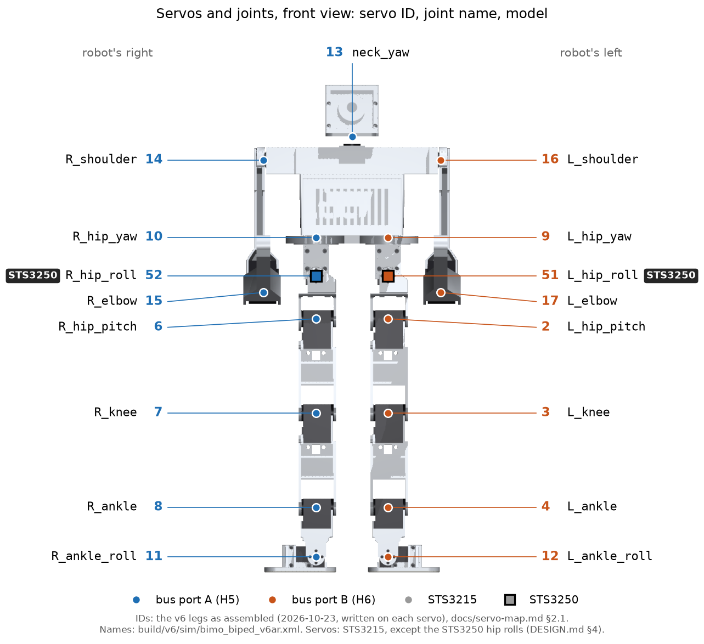
3. **Centre each servo at 2048, then fit its horn** with the centre screw.
   - The horn seats on discrete splines, so a mechanical zero is never exact.
     Calibration (§13) records the residual offset.
   - Centring first keeps each joint's travel clear of the encoder's 0/4095
     wrap. On the prototype, a zero at 3273 capped a hip's backward pitch at
     +72°.
   - **The two hip-yaw servos and the two shoulder servos go in without their
     idler disc.** Nothing rides their idler side: the hip yaws' seats flat
     on the cell ceiling (§7a), the shoulders' against the girdle's inboard
     wall (§11c). Leave the disc off and keep it in the bag as a spare; the
     other 13 servos keep theirs.
4. **Gains.** On the four ankle-roll and knee STS3215s, write the
   position-loop P (register 21) and D (register 22) that the bench test (#73)
   settled. The hip rolls are STS3250s; their row in the table comes from the
   same bench. They are EEPROM registers: clear the lock flag (register 55)
   first.
   - **Do it with torque off. Every bus write is a motion command.**
   - Record the values per ID in servo-map.md.
   - A factory reset or a swapped spare comes back at P = 32.
5. **Orientation rules:**
   - **Legs are translations, not mirrors.** Leg links, ankle links, hip yokes
     and carriers are identical left and right, and every pitch-joint horn faces
     +Y (robot left) on both legs.
   - **Ankle-roll servos:** horn forward, cable end outboard.
   - **Hip-roll servos:** horn forward, cable end up.
   - **Yaw servos:** horn down. **Neck:** horn up.
   - **Feet and arms are mirror pairs.** The shoulder horns face outboard on
     both sides.

## 3. Feet ×2

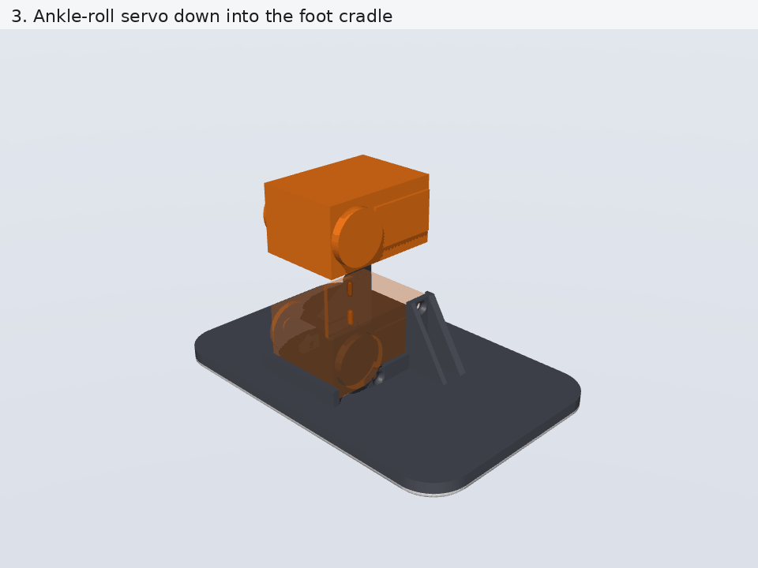

1. **Bond the silicone sole** to the foot plate's flat underside: 2 mm
   silicone rubber sheet cut to the plate's outline (130 × 84 mm, R14 corners;
   `sole_tpu_L/R`). Degrease the PETG first. Silicone needs a silicone-rubber
   adhesive, or CA over a polyolefin primer, unless the sheet is self-adhesive
   ([bom.md §7](bom.md)).
2. **Drop the ankle-roll servo into the cradle** from above.
   - Its output axis runs fore-aft, with the horn forward.
   - Its output end sits against the inboard end stop, and the cable end points
     outboard. The lead leaves through the notch in the rear rail.
3. **Screw the two retention tabs:** the front tab onto the horn-side case face,
   the rear tab onto the idler face. Each takes **2 × M2.5 × 8 flat-heads** into
   the far hole rows, driven from outside between the tab's two bracing fins.
4. **Screw the two near-row bosses:** the short bosses beside the discs, one
   on each case face, take **1 × M2.5 × 8 flat-head** each into the low hole of
   the row nearest the output end. The idler-side boss stands just short of
   the connector trench, so plug the lead in before the servo goes into the
   cradle.

## 4. Grip channels: ankle link, shin, thigh

- **Which link grips which servo:**
  - `ankle_link` grips the **ankle-pitch** servo;
  - the shin (`leg_link_v6`) grips the **knee** servo;
  - the thigh (the same part) grips the **hip-pitch** servo.
- **Slide the link on from the case's cable end.** The case enters the grip
  channel lengthwise, from below. Sliding a link on "from the front" instead
  drives the horn disc into the grip plate.
- **6 × M2.5 × 8 flat-heads** per link: 4 on the horn-side face (rows 8.30 and
  29.00) and 2 on the idler face (row 32.75). All heads flush.

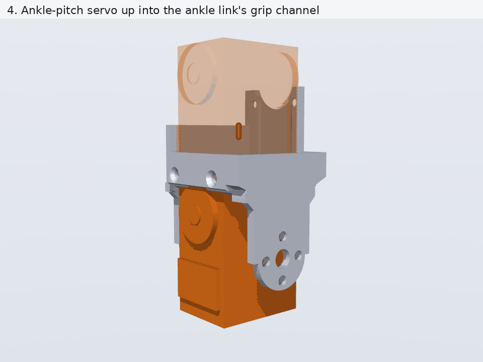

## 5. Close the leg joints: fork onto horn and idler

Each fork closes on the next servo's two discs. Work horn first at zero, then
the idler, with thread-locker, and check runout.

| joint | fork | horn side | idler side |
|---|---|---|---|
| ankle roll | the `ankle_link`'s two tines, lowered onto the roll servo in the foot: front tine to the horn, rear tine to the idler | 4 × M3 × 5 | 4 × M3 × 5 |
| ankle pitch | the shin's lower fork onto the ankle-pitch servo in the ankle link: horn +Y, idler −Y | 4 × M3 × 5 | 4 × M3 × 6 |
| knee | the thigh's lower fork onto the knee servo in the shin | 4 × M3 × 5 | 4 × M3 × 6 |

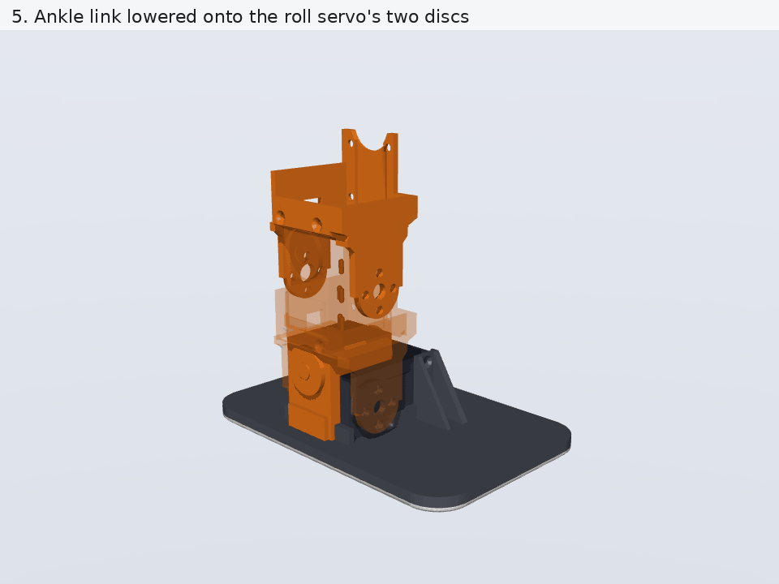
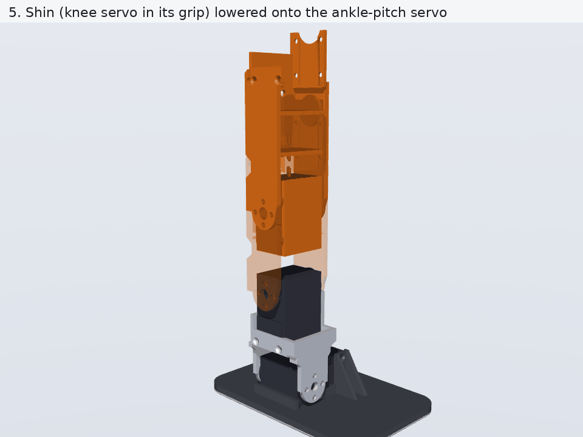
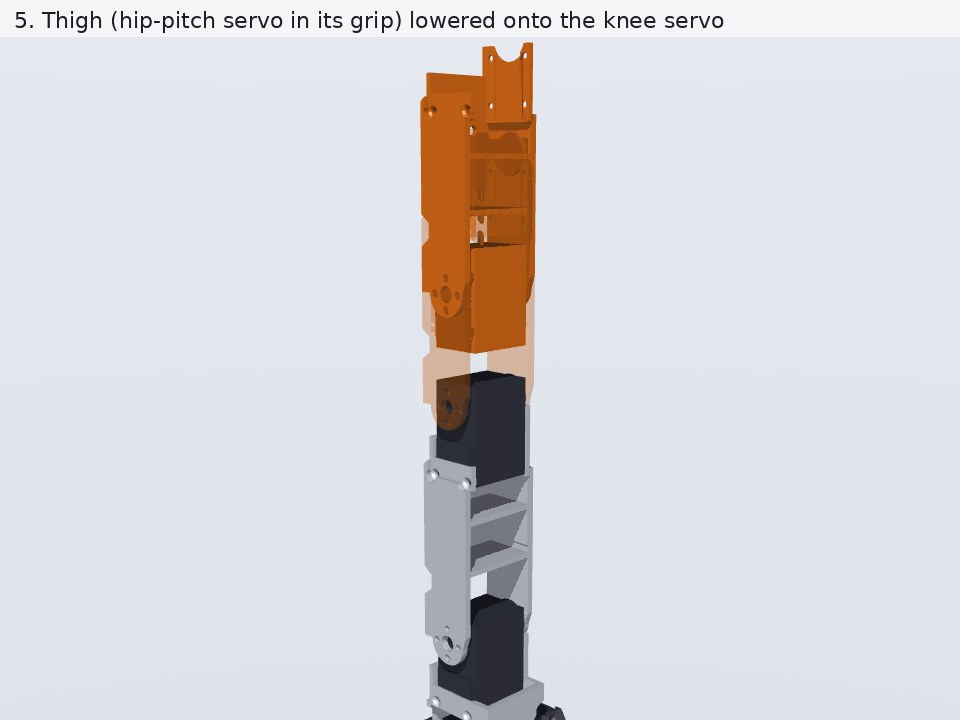

## 6. Hip yoke onto the hip-pitch servo

- **Join the yoke.** Press `hip_yoke_glued_roll` onto `hip_yoke_glued_pitch`
  until both split prongs click under the pitch flange, pull them apart, glue
  the lap (CA or epoxy, faces lightly sanded, the whole ~1058 mm² wetted) and
  press them back together. Let it cure before any load: the lap carries the
  servo torque. There are no flange bolts or inserts.
- **Pitch clevis.** Lower the yoke's pitch clevis (`hip_yoke_glued_pitch`,
  the lower half) onto the hip-pitch servo in the thigh.
  - It straddles the servo's two discs: a horn arm on +Y (4 × M3 × 5) and an
    idler hub on −Y (4 × M3 × 6).
- **Roll clevis.** The upper half (`hip_yoke_glued_roll`) waits for §8.

The leg is now a subassembly from the hip yoke down to the foot.

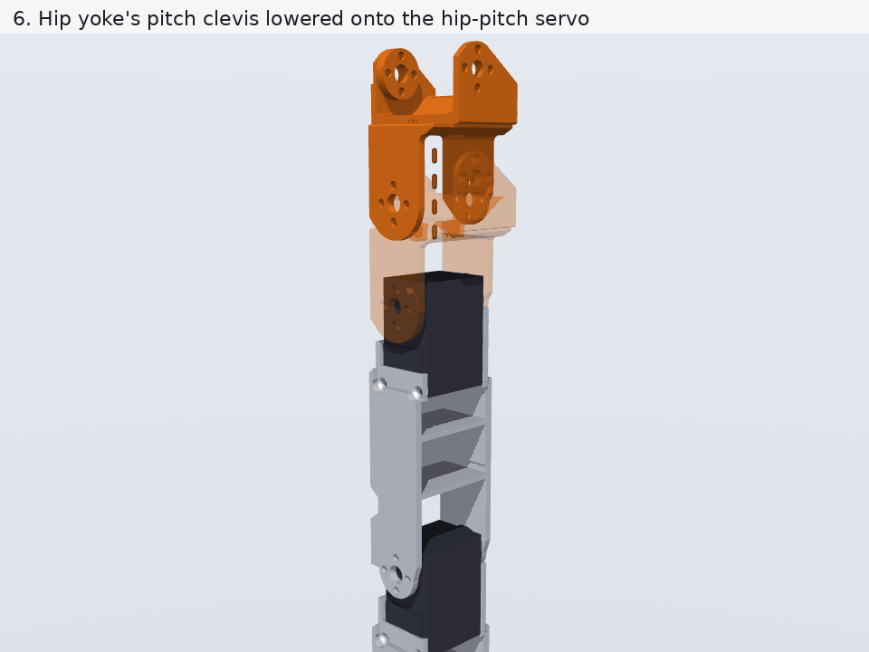

## 7. Hip stack in the pelvis (×2)

The yaw servos go into the bare pelvis on the bench, where every stator screw
has open access; then the pelvis, both servos in, goes up into the torso for
good (§7a). From §7c on, work with the torso upright on a stand, so that the
leg hangs below it later. Everything in the battery layer is done **before
the pack goes in** (§10).

### 7a. Yaw servos into the pelvis, then the pelvis into the torso

**Each yaw servo, into the bare pelvis on the bench:**

1. **Offer the servo up into its cell from below** (the mouth has a 1.2 mm
   lead-in).
   - Output axis vertical, **horn down**, case length fore-aft, **no idler
     disc** (§2).
   - The idler-side case face goes up flat against the ceiling. Its four
     mounting holes are flush with the face, so the ceiling clamps them
     directly. The free-hub post (2.6 mm proud) passes into a hole in the
     ceiling, and the moulded back-cover platform (1.9 mm proud) into a
     window: the face should sit flat with no rocking.
2. **Plug its leads first.** The bus ports sit in the connector trench on the
   idler face, under a slit in the ceiling: plug the leads in from above,
   through the slit. They run on through the battery layer later (§10, §12).
3. **Drive 4 × M2.5 × 5 flat-heads down through the ceiling** into the
   idler-face rows (8.30 and 32.75), with the pelvis on the bench and nothing
   in the way. A 5 mm screw takes 2.4 mm of the hole, which the vendor STEP
   shows 3.0 deep; **check the hole depth on the first servo**, and use an × 6
   only if it is at least 3.6 mm deep.

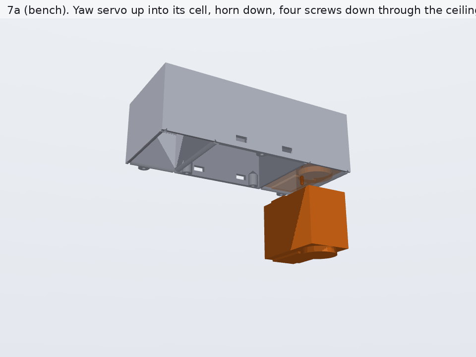

**Then the pelvis, both yaw servos in, into the torso:**

4. **Glue on the joint faces:** CA or epoxy on the pelvis's web faces, and
   where it meets the torso's ledge and skins.
5. **Push the pelvis up into the torso from below**, square, until its ceiling
   stops on the pack ribs and the −y ledge. The four snap fingers (strips of the
   torso's inner walls) click into the windows in the pelvis's webs and hold it
   while the glue cures. Lead the yaw servos' leads up into the battery layer
   as it goes.
6. **The joint is permanent.** Nothing needs the pelvis out again: the boards
   come out of their bays with the covers off, and the yaw
   stator screws are reached from above through the deck's battery aperture
   with the pack out. The four outboard ones (y ±52.25 mm) need a driver with a
   shank of 5 mm or less.

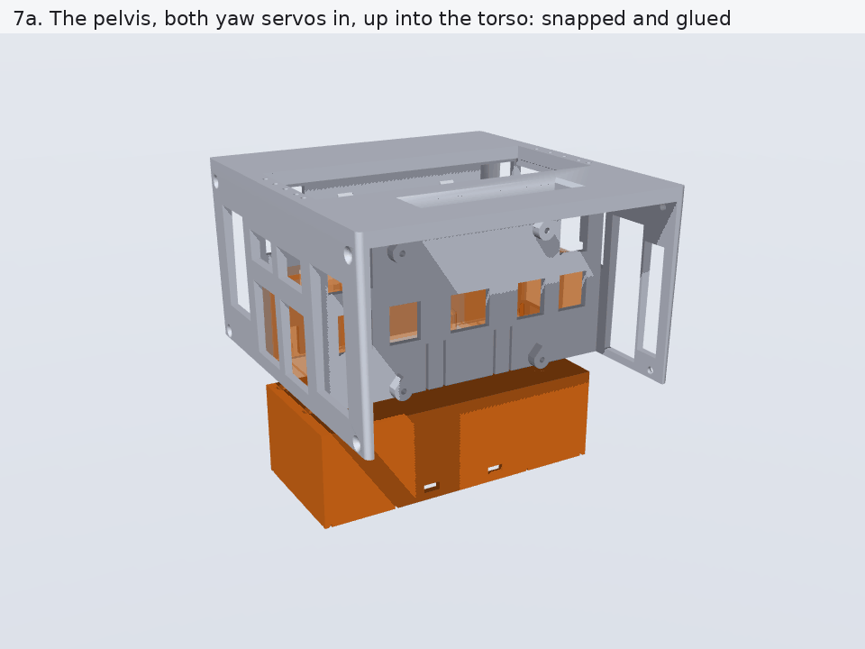

### 7b. The hip-yaw bearings into the housing (bench)

Each hip turns on a **6810-2RS** (nominal 50 × 65 × 7 mm, sealed, generic; the
ones in hand measure 50.0 × 65.0 × 7.0: [bom.md §5](bom.md#5-hip-yaw-bearing)). Its outer race sits
in a recess of the **bearing housing** (`yaw_bearing_housing`, one print for
both hips, Ø64.96, −0.04 mm) against a shoulder, which takes the leg's thrust.
Its inner race goes on the carrier's round hub (Ø50.08 as printed, +0.08 mm)
and sits on the **lip** under the hub (Ø52.3), which passes that thrust to it. The housing
is a separate print screwed under the pelvis because the yaw servo goes up into
its cell through the space the housing occupies. Background:
[study-yaw-bearing.md](design-v6/study-yaw-bearing.md) (option A).

1. **Measure the bearings and the printed seats first.** Both fits are inside
   the printer's error band and are fitted with **retaining compound** (Loctite
   641) on both seats. The carrier's hub is modelled 0.4 mm over
   (`YAW_BRG_BOSS_PRINT_ALLOW`), a value set by test prints. It then takes a
   clamp to press into the bearing (7d). If a clamp will not seat it, or it
   will not stay, correct that allowance and reprint.
2. **Press each bearing into its recess, pushing on the outer race only**,
   until it bottoms on the shoulder. The housing lies face down (the face that
   goes against the pelvis), recess mouth up.

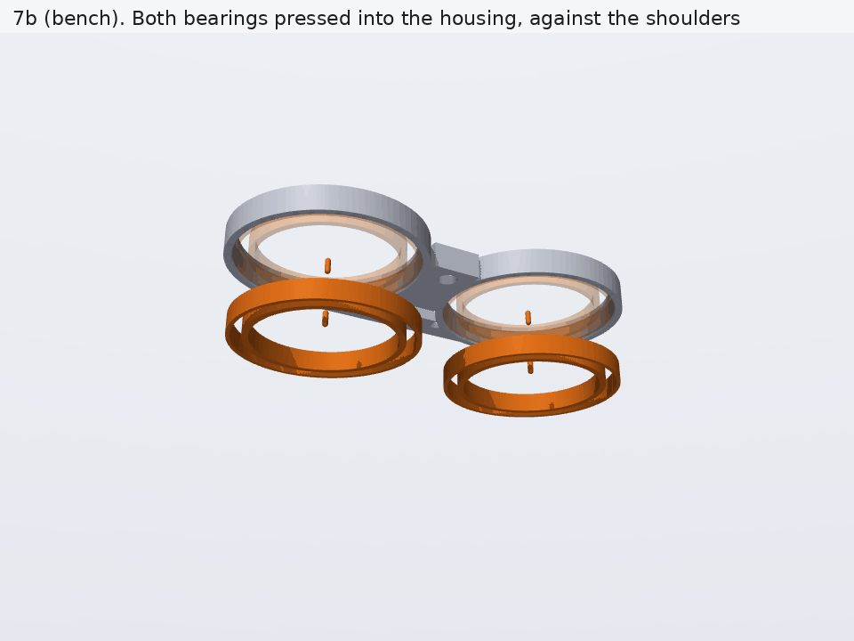

### 7c. Housing and bearings up under the yaw cells

1. **Offer the housing up from below**, square, recess mouths down, the yaw
   horns passing inside the shoulders, until its top face meets the pelvis.
2. **Drive 5 × M2.5 × 8 flat-heads up** into the pelvis's pilot bosses: four
   through the housing's rear bar (two into the rear web at y ±22 mm, two into
   the lugs aft of it at y ±46 mm) and one through the bridge between the hips,
   on the centre line, into the front web's boss.

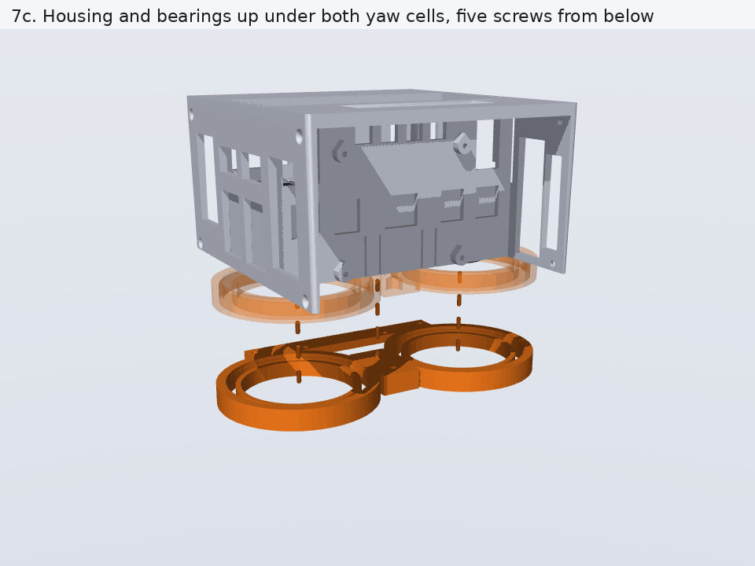

### 7d. Yaw carrier up through the bearing onto the yaw horn

The carrier's lip is wider than the bore, so the carrier goes into the bearing
from below and the bearing can never go on over it.

1. **Compound on the hub**, then **push the carrier up through the bearing**,
   horn plate first, roll bay opening downward, with the yaw servo at
   mechanical zero, until the **lip seats on the inner race**. The hub's top
   edge has a lead-in. The fit is tight: the printed hub takes a clamp. In
   this order the pressing force goes through the balls, so press slowly and
   squarely. Then turn the bearing: it should run smooth, not notchy.
2. **Check the horn plate against the horn disc** with the lip seated. If the
   plate stands off the horn, shim that gap rather than close it with the horn
   screws: they would pull the inner race up against the balls and the yaw
   servo's output shaft down.
3. **Square it before torquing**: a clocked carrier is a permanent yaw offset.
4. **Drive 4 × M3 × 5 up into the horn** through the bay ceiling, from inside
   the empty bay. Do this before the roll servo goes in.
5. **Turn the hip through ±45° by hand** before the compound sets: the carrier
   should turn on the bearing without touching the housing or the pelvis.

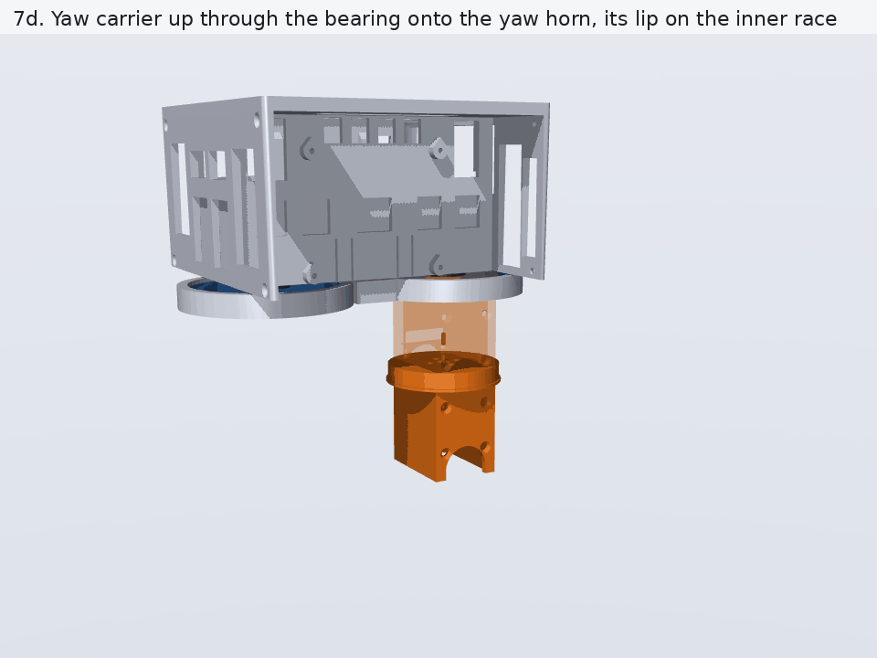

### 7e. Hip-roll servo up into the carrier bay

1. **Slide the servo up into the downward-open bay**, cable end first: output
   end down, horn forward.
   - The rear wall carries an idler seat with a detent channel for the case's
     moulded back-cover platform, so the servo should feel **snug against the
     rear wall** before any screw goes in. If it does not, check that the
     platform is running in the channel rather than sitting on top of it.
2. **Drive 8 × M2.5 × 8 flat-heads:** 4 through the front (horn) wall and 4
   through the rear (idler) wall, into the case. The carrier's 5 mm spacer
   keeps all eight below the bearing and the lip, so a driver reaches them with
   the housing on (to change a roll servo, take the leg off and these eight
   out; the carrier, bearing and housing stay).
3. **Plug the hip-roll servo's leads** in the trench on its idler face,
   through the window in the bay's rear wall, and route them outside the
   housing.

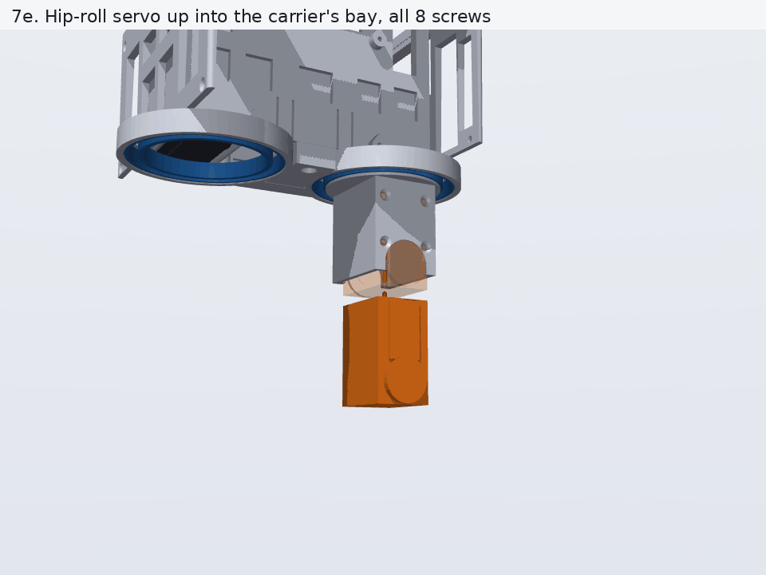

- **Never heat-set a bearing into PETG.** PETG must reach about 230 °C to flow,
  and a 2RS bearing's seals and grease are good to roughly 100 °C.
- **The ring dimensions in the CAD are the bearings' measured ones** (bore
  50.0, OD 65.0, width 7.0, inner ring shoulder d1 54.6, outer ring shoulder
  D2 62.0 mm). The housing's shoulder (Ø62.6) bears on the outer ring face,
  0.3 mm outside the seal's edge (D2) and inside SKF's Da max of 63. A
  replacement bearing gets measured the same way, and its values go into
  `cad/v6/dimensions_v6.py`.

## 8. Legs onto the roll servos

Offer each leg up so that the hip yoke's roll clevis straddles its roll servo:

- **Front:** the roll horn arm (on a 1 mm boss) bolts to the roll horn with
  **4 × M3 × 6**, at zero, with the leg hanging straight.
- **Rear:** the idler arm's long boss reaches through the slot in the carrier's
  rear wall to the idler disc, and takes **4 × M3 × 8**.
  - The heads land in a pad sunk 1.35 mm into the arm's outer face. That sink
    is what brings the screws into thread, so do not fill or file it.
  - Snug at zero, then check runout.

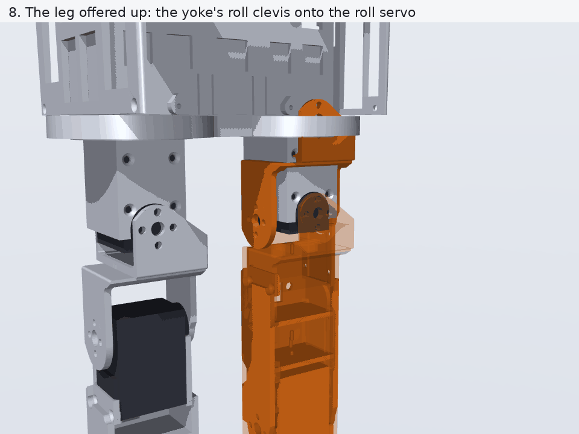

## 9. Torso electronics

The Pi and the General Driver go in as one stack, in the bay in front of the
pelvis, with the front cover off: the Pi on four standoffs off the front inner
wall, the General Driver plugged onto it as a HAT. Power lite goes into
the bay right behind the pelvis, with the cap off, and its BMS on a bracket
over it.

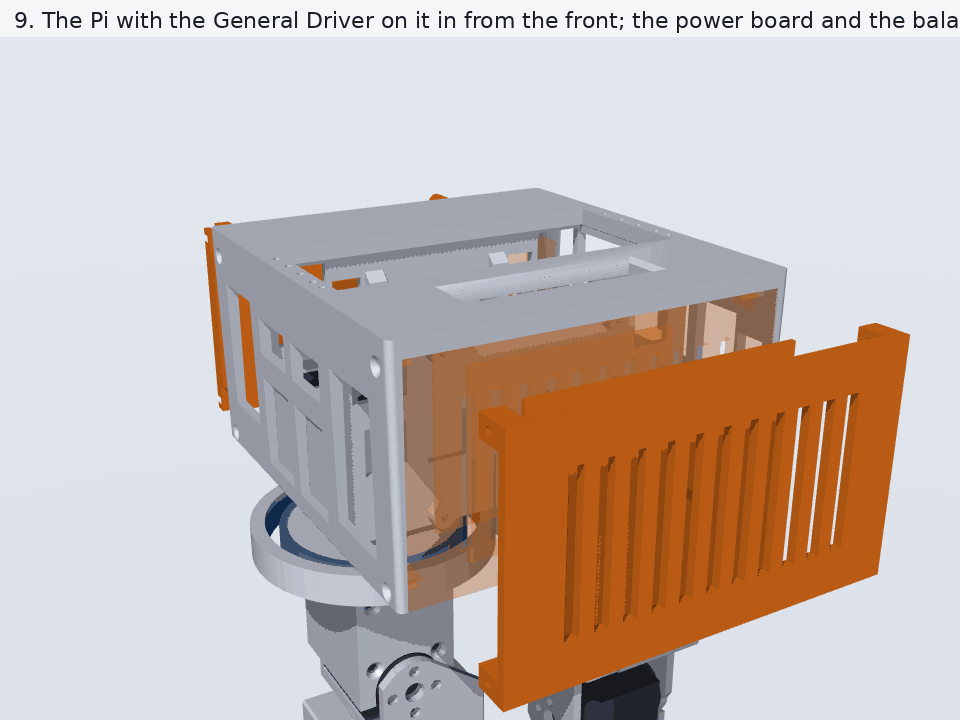

### 9a. Raspberry Pi 4B

- Fit the low-profile heatsink first: the Pi's parts under the HAT have 10 mm.
- **Four M2.5 × 17 male-female standoffs**: their 6 mm male thread through the
  Pi's holes into the four bosses on the front inner wall, the Pi's solder side
  4 mm off the wall, its parts facing forward.
- Its 40-pin header is down; its USB-C, HDMI and camera edge is up under the
  deck; its USB/Ethernet end faces +y, through the side window.
- Connect the camera ribbon at the top edge first, and lead it up through the
  deck opening between the boards toward the neck.

### 9b. General Driver, on the Pi as a HAT, and its IMU

- **Plug it onto the Pi's 40-pin header** through a 2 × 20 riser, its sockets
  (on its underside) down onto the header, its parts facing forward, its bus
  edge up and its service edge (XH inlet, USB-C) at +y, and drive **4 × M2.5 ×
  6** through its holes into the standoffs.
- **The riser:** the General Driver's side plugs face +y, the same side as the
  Pi's USB/Ethernet jacks, so the board has to sit 17 mm off the Pi's parts
  face for them to pass over the 16 mm jacks. **The riser part and the stack's
  real height are open** (`HAT_GAP` in `cad/v6/dimensions_v6.py`): measure them
  before printing.
- **No servo lead plugs into it except one.** The servos plug into power lite's
  J4–J7 (§12). The General Driver's **H5** takes one stock lead, to power lite's
  J8 (the servo data line); **H6 is not used**. Its **H1** (the power inlet)
  takes power lite's J3 lead, which also feeds the Pi through the board's buck
  and the INA219 (§12). Do not power the Pi from its own USB-C.
- **The IMU is the board's onboard QMI8658C.** The board's mounting fixes the
  IMU's axes. The firmware applies a mounting rotation (`imu::Mount`), which has
  to be set for this orientation as part of the 17-joint port (#81).
- **The front cover:** set it between the skins' front ends and drive **4 ×
  M2.5 × 8 flat-heads** in through the skins into its corner blocks.

### 9c. Power lite, BMS bracket, BMS and cap

The power bay holds power lite
([pcb/power-lite](../pcb/power-lite/README.md)), its BMS (a ShillehTek
CF-3SJH25A-C, wired to it with no connectors) on the **BMS bracket**
(`power_bracket_v8`), the **balance park** (`balance_park_v8`) for the
balance lead's free end, and the **cap** (`power_cover_v8`) over them, with
the main switch and the E-stop side by side in the **switch pod**
(`switch_pod_v8`) on it (#213).

**Two things to know before building this step.**

- **The BMS has no under-voltage cut-off.** On the bench its output stayed on
  down to 2.13 V a cell
  ([record, 2026-11-19](design-v6/2026-11-19-power-lite-bms-bench.md)). It
  switches the pack's negative lead and guards against over-current only. What
  replaces it (a cut-off on the board, or another BMS) is not decided (#207), so
  this step and the bracket describe the ShillehTek as it is. Until then the
  pack's only under-voltage protection is the firmware's battguard and you:
  **unplug the pack's XT60 after every session** and land the robot by 10.5 V
  ([wiring.md](wiring.md#battery-protection)).
- **The board comes to this step already bench-checked, with its servo headers
  checked.** Do power lite's bring-up Part 2 and bench check, and the P4 meter
  check on J4–J8 ([bringup.md](../pcb/power-lite/bringup.md#41-p4-the-servo-headers-before-any-servo)),
  on the bench first. **J4–J8 must have their bevelled corner at pin 1, the
  square pad.** The first board built had them turned 180° the other way (the
  files are fixed, #342, #344); its five headers have to be turned before any
  servo is plugged in (rework: power lite's
  [assembly guide](../pcb/power-lite/assembly.md#rework-j4j8-seated-with-the-bevel-at-pin-3)).
  Whether that board has been reworked is **(check on first fit, #207)**.


1. **Wire the BMS to the board first**, on the bench, after the BMS's bench
   check: power lite's [assembly guide](../pcb/power-lite/assembly.md), step 13
   (W1 → B−, W2 → P−, W3/W4/W5 → the BMS's 3.7 V, 7.4 V and 11.1 V taps).
   - **Wire the taps by voltage, not by label.** The datasheet calls them B3,
     B2 and B1+. The board received numbers them upward (B1, B2, B+) and prints
     no voltages, so W3 goes to the 3.7 V tap (the bottom cell) and W5 to the
     11.1 V one. Meter each tap against B− first. The P+ pad stays empty: the
     board takes the pack's + straight from J1.
   - Cut the wires for the BMS's place in the bay: it sits 18.5 mm off the
     board's parts face, over the W pads, its P−/P+ edge up and its B− and B3
     corners toward the fuses.
   - The two 14 AWG wires loop over the BMS's top edge to B− and P−, one
     behind the other: there are 7.75 mm between that edge and the deck.
   - The 24 AWG cell taps come up to the BMS's three tap pads from below,
     through their corner pads' plated holes. The corner pads stand past the bracket's edges.
   - The BMS then hangs on its wires while the board goes in.
   - At the same time, solder the board's half of the main switch's lead into
     W6/W7: a 14 AWG pair to the board half of its inline disconnect (step 6).
2. **The board** goes in from aft: vertical, parts facing aft, onto the four
   6 mm standoff bosses on the aft inner wall. Boards mount on M2.5 machine
   screws and standoffs into heat-set inserts, not self-tappers, and the
   board's holes are used as made (Tom, 2026-11-18).
   - **Before the board, the inserts:** press an **M2.5 heat-set insert**
     (M2.5 × 5.7 × Ø4.0) into each of the four bosses with the iron, from
     aft, flush with the boss's face. The pilots are Ø3.6, 6.5 deep: an
     assumed size, so check it against the inserts you have.
   - Its −y holes (H2, H4): **2 × M2.5 × 6 button heads**, 4.4 mm into the
     inserts.
     **No washer under H2's head:** J4's housing, with its bevel at pin 1,
     stands 0.35 mm from it.
   - Its +y holes (H1 at the top, H3 at the bottom): **2 × M2.5 × 15
     male-female standoffs**, their 6 mm male thread through the board into the
     inserts. Turn them with a 5 mm nut driver.
3. **The balance lead.** A 3S JST-XH balance extension lead stays plugged into
   J2, and its free end parks where the battery door reaches it: J2 itself is
   under the BMS and below the door's sill.
   - Plug the lead's female end into J2.
   - Tape the **balance park** (`balance_park_v8`) onto the aft inner wall's
     aft face, in the room beside the board's +y edge, under J1: its top at
     the door's sill, 1 mm of foam tape.
   - Run the lead out of J2 aft, across +y under where the bracket goes, past
     the board's edge, under the park and up through the slot in its floor
     (about 42 mm), and drop its male end into the park, pins up. Fold the
     slack under the park.
   - The male end is taken as JST's B4B-XH-A body (12.4 × 5.75 × 7.0 mm):
     **measure the lead's end on arrival** (`BAL_MALE` in
     `cad/v6/dimensions_v6.py`).
4. **The BMS bracket** onto the two standoffs: an **M2.5 × 6 flat head**
   (machine) into the bottom one, countersunk flush (it ends up under the
   BMS, so it goes in first), and an **M2.5 × 6 button head** into the top
   one.
5. **The BMS** onto the bracket, component side aft. It is held by **four
   hooks** whose lips reach 0.8 mm over its PCB's aft face: a fixed hook over
   its top edge, two snaps under its bottom edge and one at its −y edge.
   - Stick a 1 mm foam pad on its bare side, clear of its edges by 4 mm. The
     pad presses it back onto the hooks so it cannot rattle; it does not
     need to hold.
   - Tilt it about 25°, its bottom out toward you. Put its top edge in under
     the top hook: low enough to pass under the lip, then up against the
     bracket.
   - Swing its bottom in. The two bottom snaps and the −y snap ride aside on
     their ramps and click over its edges.
   - **To take it out:** press the two bottom snaps down and the −y snap
     outward (−y), swing its bottom out, and lift its top edge out of the
     top hook.
   - The +y skin is 0.9 mm off its other edge, and the cap is 2.2 mm off its
     parts.
   - Its four corner pads carry pack voltage: nothing metal may touch them.
     The hooks stay clear of them.
   - **Its PCB (56.8 × 44.8 mm) and its height (4.0 mm with the PCB) are
     measured; its pads and its part-free edge are not.** The hooks bear on
     a 2 mm margin at its edge that is assumed to be free of parts: check
     that before printing the bracket (`BMS_*` in
     `cad/v6/dimensions_v6.py`).

   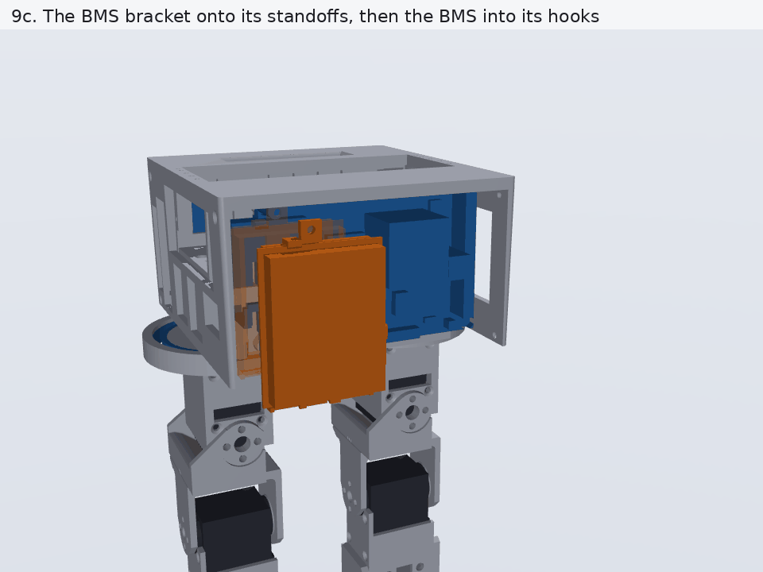
6. **The switch pod onto the cap**, on the bench. The cap carries the main
   switch and the E-stop side by side in the **switch pod**
   (`switch_pod_v8`), one block on the cap's outer face at its top, its top
   flush with the deck's. The main switch's body (27 mm behind the panel with
   its terminals) does not fit between the cap and the board, so both bodies
   hang in the pod, outside the bay; the pod reaches 3 mm under the torso's
   bottom. Its top is one **pocket** round both levers, walled on every side
   (the cap's face is its front), each lever's tip 2 mm or more under the
   rim. Both levers stand up and throw across the robot (y).
   - **The main switch** (a 20 A SPST toggle with screw terminals) goes up
     through the pocket's floor at +y, 25 mm under the deck's top, lever up;
     put its nut on over the floor (it has no washer). The floor is 3 mm
     thick, so the 9.25 mm thread leaves about 3.8 mm past a 2.4 mm nut (the
     nut is not measured).
   - A tab in its hole engages the bushing's keyway, so the switch cannot
     turn. It sits at the hole's −y side, on the lever's throw axis, and runs
     the top 2 mm of the floor. **Its width (1.0 mm), its reach into the
     keyway (0.5 mm) and its place round the hole are assumed, for a keyway
     about 1.5 mm wide:** measure the keyway and set `SW_KEY_*` in
     `cad/v6/dimensions_v6.py`.
   - **The E-stop** (an E-Switch 100SP1T1B1M1QEH: a miniature toggle, SPDT
     ON-NONE-ON, a 1/4-40 bushing, solder lugs) goes up through the
     **platform** at the pod's −y end, higher than the main switch's floor,
     behind a step, close to the pod's end wall. Turn it so its terminal 1
     is inboard (+y): its keyway is then outboard, on the tab in the
     platform's hole, the lever **IN (toward the main switch) is RUN**
     (terminals 2 and 3 closed, the datasheet's position 1) and **OUT
     (toward the end wall) is STOP**. Put its lockwasher and nut on over the
     platform.
   - The datasheet's B1 bushing is 8.89 mm long; the length of its thread is
     not dimensioned. The 3 mm platform, the lockwasher and the nut (0.5 and
     2.4 mm, assumed: the datasheet does not draw them) leave 3.0 mm of it:
     measure the thread when the switch arrives.
   - **The main switch's wires:** a 14 AWG pair with ring lugs on its two
     terminals, down to the channel along the pod's floor and through the
     notch in the cap's bottom edge, to the cap's half of a two-pin inline
     disconnect (an XT30-size pair; its rating is to be checked against the
     maker's datasheet). The board's half runs from W6/W7 out over the fuses,
     between K1 and the BMS, and down to the disconnect, which parks mated
     over the board's low parts behind the cap (Q1/Q2 and the resistors).
     It is soldered to W6/W7 in step 1.
   - **The E-stop's wires:** a 24–26 AWG pair soldered to lugs 2 (common)
     and 3, down the same channel and through the same notch, across over
     J12 to a PHR-2 that plugs into J11 on the board's bottom edge: about
     80 mm.
   - Drive **4 × M2.5 × 8 flat-heads** from the cap's inner face, through
     the cap, into the front edges of the pod's side walls.
7. **The cap** goes on from aft, its switches with it: its plate stands
   4.7 mm aft of the torso and 2.0 mm over the relay K1. Plug the disconnect
   and J11 first, then drive **3 × M2.5 × 8 flat-heads** in through the
   skins into its corner blocks: the +y top, −y top and −y bottom holes.
   - The fourth corner, +y bottom, has a **tab** instead of a block: it goes
     in 4.0 mm inside the +y skin, below the BMS's parts. A lip inside each skin and
     under the deck locates the cap's edges. A block and a skin screw
     there would stand where the BMS's lower corner is, so the torso has no
     hole there.
   - **To take the cap off** (a fuse): the three skin screws out, the cap
     back far enough to reach in, then the disconnect and J11 apart. The cap
     comes away whole with its switches; nothing is unscrewed from them.

   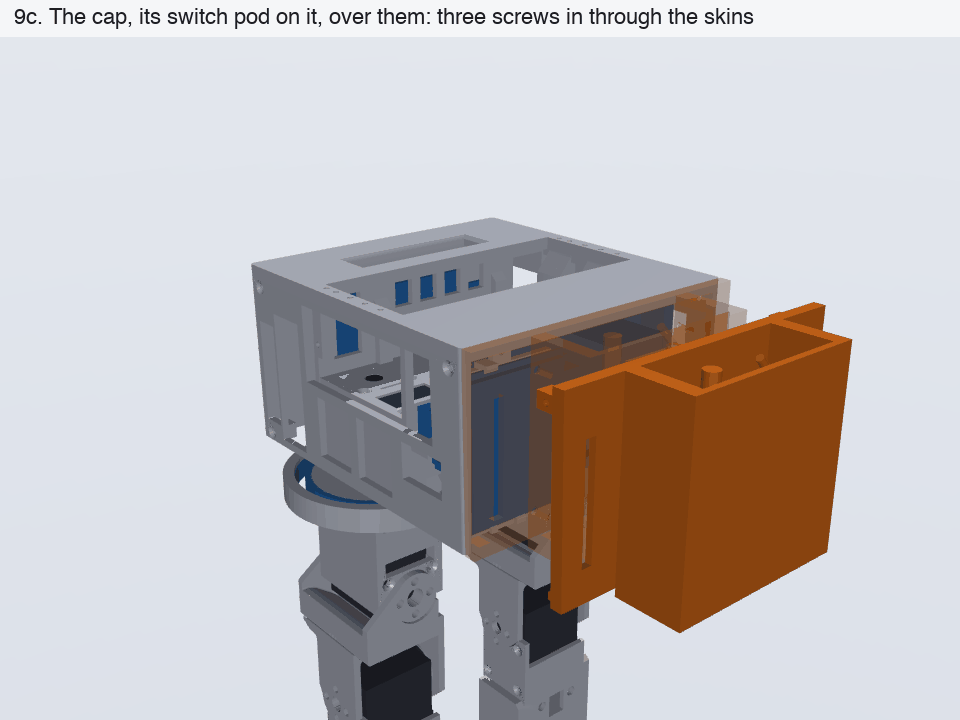

   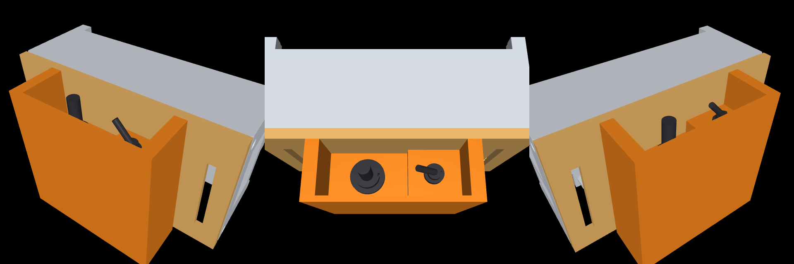

**What is reached how:**

- **F1/F2**, the fuses, pull straight out aft with the cap off. The BMS stands
  1.0 mm past their +y ends and 2.2 mm above their tops. Grip their wide faces,
  or use a MINI fuse puller.
- **J1**, the pack's XT60, is on the board's +y edge. The pack's lead comes
  through the aft wall's +y end window and loops into it in the 17.4 mm beside
  that edge, under the bracket. It is unplugged through the battery door
  (§10). Whether the plug and its 12 AWG lead fit there is **not checked**:
  check it at the first fit.
- **The pack's balance plug** goes onto the extension's male end in the
  balance park, and comes off it, through the door's opening (§10): the park
  holds it at the sill, 1.5 mm under J1's plug. J2 itself, with the
  extension's female end in it, is reached with the cap and the BMS off.
- **J4–J8**, the servo headers, are on the board's −y edge, and J3, J11 and J12
  along its bottom edge: all reached with the cap off. **J4–J8 are keyed like
  the General Driver's H5** (§12): a stock lead only goes in one way round, and
  that way is right only if the header's bevelled corner is at pin 1.
- **Both levers** stand up in the pod's pocket, their tips 2 mm under its
  rim, the deck's top: a fall on the back or a side lands on the rim. Reach
  in from above to throw them.
- **The E-stop's lever** is at the pocket's −y end, IN (toward the main
  switch) in run: push it OUT, toward the end wall, to stop. On its RUN side
  there are 14 mm clear to the main switch's lever for a finger; on its
  STOP side, thrown, its tip stands 3 mm off the end wall, so nothing can
  get behind it to push it back IN. Anything that reaches it in the pocket
  can only push it OUT.
- The board's wiring is power lite's ([README](../pcb/power-lite/README.md),
  [harness.md](../pcb/power-lite/harness.md)); its leads to the servos, the
  General Driver and the switches are §12. The sim current budget is in
  [wiring.md](wiring.md#current-measured-budget-issue-77); the bench current
  figure, with a watt meter on the pack lead, is still owed (#77).

**The room the CAD keeps for wires** (Tom, 2026-11-04: buffers for the wires,
not zero-margin fits). Each lead is a swept envelope in the checks
(`torso_v8.wire_envelopes`, `switch_keepouts`), and no part may enter one:

| keep-out | margin it holds | the tightest spot |
|---|---|---|
| the main switch's terminals: its body's outline, its 8 mm of screws, the lugs | 3 mm round them; 7 mm past the screws for a 14 AWG ring lug and its turn | the pod's walls, 0.5 mm |
| the E-stop's body and solder lugs, 12.9 mm under its platform | 3 mm round them; 4 mm past the lugs for a 24–26 AWG wire's turn | the platform's step, 0.5 mm |
| each lever's throw (the main switch's 15° each way, an estimate; the E-stop's 25°, the datasheet's) | 3 mm | the pocket's walls: the main switch's 5.8 mm; the E-stop's, the end wall, at the margin's edge |
| the main switch's 14 AWG pair, in the pod, through the cap, to the disconnect | 2 mm round two 3.4 mm wires side by side | the pod's floor, 0.1 mm; J4–J8, 0.5 mm; the cap's notch, 0.6 mm |
| the disconnect (an XT30-size pair, 26 × 11 × 6 mm assumed) | 2 mm | the board's parts, 2.0 mm |
| the board's half of that pair, up over the fuses to W6/W7 | 2 mm | the BMS bracket's side stop, 0.2 mm |
| the E-stop's 24–26 AWG pair, in the pod, through the cap, to J11 | 2 mm | the cap's notch, 0.3 mm |
| the BMS's 14 AWG pair, W1/W2 over its top edge | 2 mm | the deck, the BMS and the bracket, 0.3 mm each: 8 mm over the edge for a 3.4 mm wire |
| the balance extension, J2 to the park | 1.5 mm across its ribbon, under the BMS bracket; 2 mm elsewhere | J2's plug and the bracket, 0.35 mm |

The leads' envelopes overlap each other where the leads cross; that is
allowed. **Where the margin is less than 2 mm:** the balance extension's run
between J2's plug and the bracket (1.5 mm).

The cap, the bracket, the park and the switch pod print without supports:

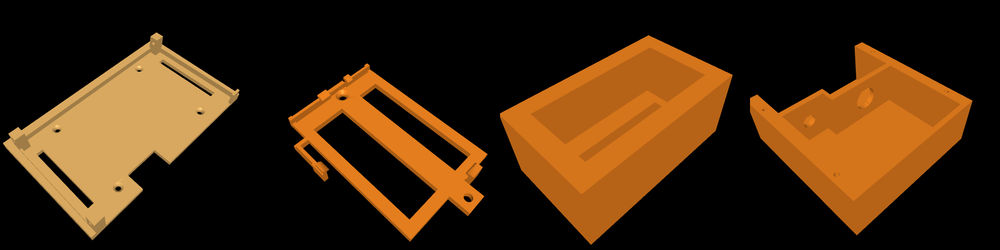

## 10. The pack and the battery door

The pack goes in and out sideways, through the **battery door** in the +y skin
(`battery_door_v8`): one screw and one tab.

1. **Finish everything in the battery layer first:** the yaw leads (§12).
2. **Stick two 1.5 mm adhesive foam pads on the pelvis's ceiling**, one over
   each cell, clear of the post holes. The yaw servos' free-hub posts come up
   flush with the ceiling and turn with the hip; the pads hold the pack 1.5 mm
   off them. Lay each yaw servo's leads flat between the pads (§12).
3. **Slide the pack in through the door's opening**, lead end last (toward
   +y). It lies transverse on the pads, between the ribs on the inner walls,
   which locate it fore and aft with 0.5 mm, until its −y end meets the two
   blocks under the deck rail.
4. **Plug it in:** its lead runs aft from its +y end, through the aft wall's
   +y end window into the power bay, and loops into J1 on power lite's +y
   edge (§9c), all inside the door's opening. Its balance plug goes onto the
   balance lead's male end in the park, at the opening's sill (§9c).
5. **Close the door:** hook its tab (the bevelled aft edge) behind the power
   bay's skin, swing the front edge in, and drive **1 × M2.5 × 8 flat-head**
   through it into the post on the front inner wall. The door's two inner ribs
   stop the pack's +y end; its lead leaves the pack between them.
6. **There is no belt.** The neck floor holds the pack down from 4.0 mm above
   it, with a foam pad between them, once the girdle is on (§11b).

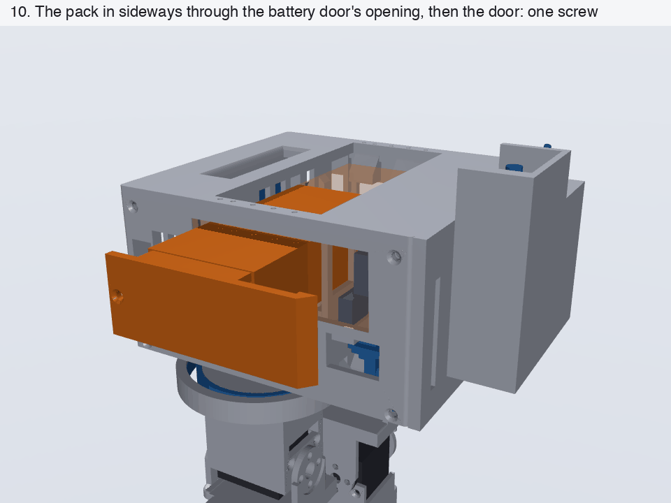

**Swapping the pack** leaves the girdle on:

1. **Switch off with the arms hanging**, then swing the +y arm up out of the
   way by hand (horizontal, forward). It hangs across the door, the door's
   path off and the pack's path out; `check_assembly_v6.py --joint swap`
   checks all three clear with the arm horizontal forward. Whether the
   unpowered shoulder holds it there is not measured: hold it.
2. **The door:** the screw out, the front edge swung out about the tab to
   about 40° (so the tab's tip clears the jamb), then the door lifted away.
3. **Pull the XT60 off J1** and the balance plug off the lead's male end in
   the balance park (hold the male end down), and both back through the aft
   wall's window.
4. **Slide the pack out** sideways from under the neck floor's pad.
5. Fit the new one as steps 3–5 above.

## 11. Girdle, neck, shoulders, arms, head

The bench order, girdle first. The neck floor sits 4.0 mm over the pack, so
the neck is built into the girdle before the girdle goes onto the robot.

### 11a. Neck into the girdle (on the bench)

1. **Neck floor into the tube.** Offer `neck_floor` up into the bottom of the
   girdle's neck tube, pads up, and drive **4 × M2.5 × 8 flat-heads** up
   through its lugs into the four bosses on the tube's side walls.

   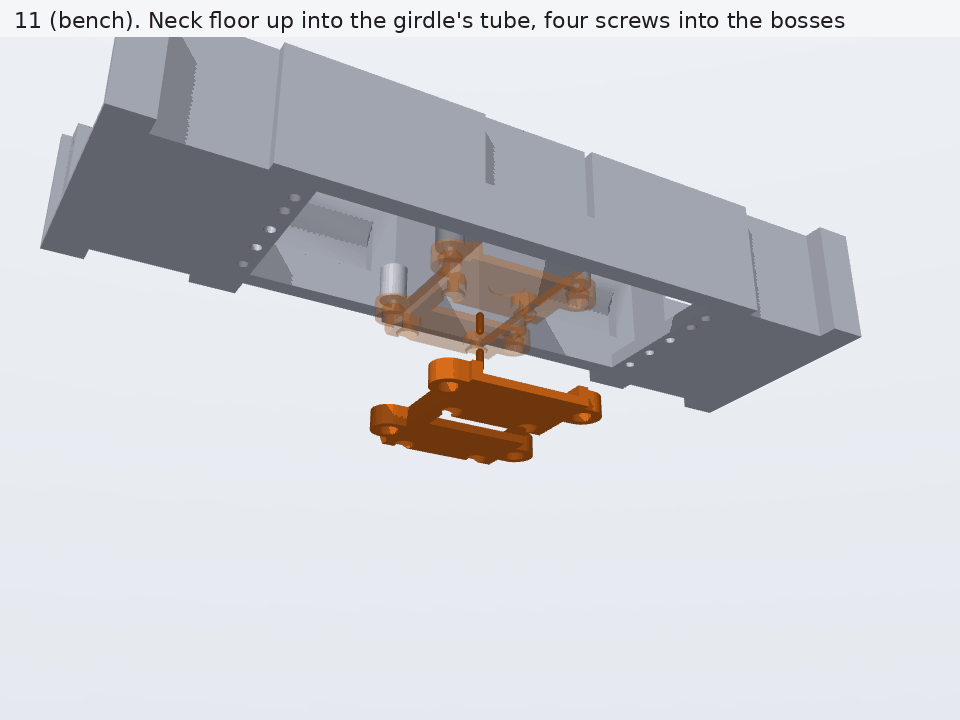

2. **Plug the neck servo's leads first.** The bus ports face down, in the
   connector trench on the idler face. The floor has a window under the trench
   that runs out toward the robot's left (+Y) as a tunnel under the floor's
   edge rail: the plugs sit in the window, and the leads are laid into the
   tunnel from below and leave sideways at floor level.
3. **Drop the neck servo into the tube from above**, horn up, case length
   fore-aft with the cable end aft. Its idler face lands on the floor's four
   pads; the turning idler disc and hub clear the floor by 0.6 mm.
4. **Drive 4 × M2.5 × 8 flat-heads up through the floor and the pads** into
   the idler-face rows (8.30 and 32.75). The heads seat in 1 mm counterbores,
   so each screw bites 4 mm into the case.

   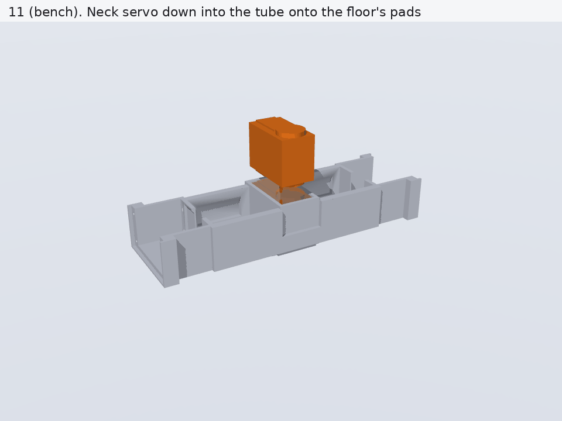

### 11b. Girdle onto the deck

- **Lower the girdle onto the deck**, the neck floor passing down into the
  battery aperture over the pack, with the foam pad (§10) between them. Lead
  the neck's bus leads up beside the tube.
- **Screw it down with 10 × M2.5 × 8 flat-heads** from above into the deck
  pilots on the two edge rails (x −27, −18, −9, 0, +6 mm at y ±57 mm). The
  rail pilots are clear of the pods, so the shoulder servos can go in before
  or after.

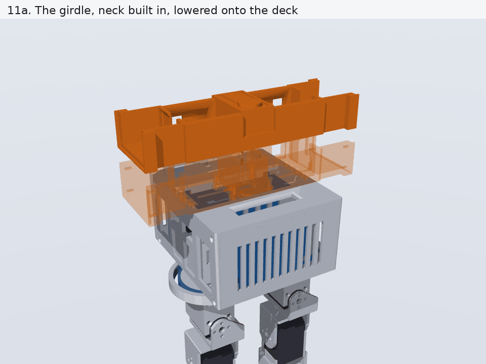

### 11c. Shoulder servos and cheeks

Each pod's outboard wall is a separate print, the **cheek**
(`shoulder_cheek_v6`, the same part for both pods). The servo cannot drop in from above: its
output boss and horn-side rib (outboard), and its back-cover platform and
free-hub post (inboard), all stand proud along the shoulder axis into
pockets in the pod's walls. So the servo goes in along that axis, from
outboard, with the cheek off.

1. **Plug its leads first.** They rise from the connector trench on the idler
   face and leave up through the open-topped notch in the pod's inboard wall.
   One of them is the shoulder-to-elbow lead (about 380 mm, [wiring.md](wiring.md#per-hop-lead-lengths-from-the-v6-cad-arms1)): run it aft
   inside the girdle and out through the square opening in the aft tie beside
   the pod (its print support cleared out), plug first, and leave it hanging
   behind the pod for the arm.
2. **Push the servo in along the shoulder axis from outboard**, **no idler
   disc** (§2): case length fore-aft with the cable end aft, width vertical,
   horn outboard. Rest it on the pod's floor, between the end walls, and slide
   it inboard. The free-hub post enters its hole, the platform its detent, and
   the leads slide into the notch. Stop when the idler face meets the four
   crush pads on the inboard wall.

   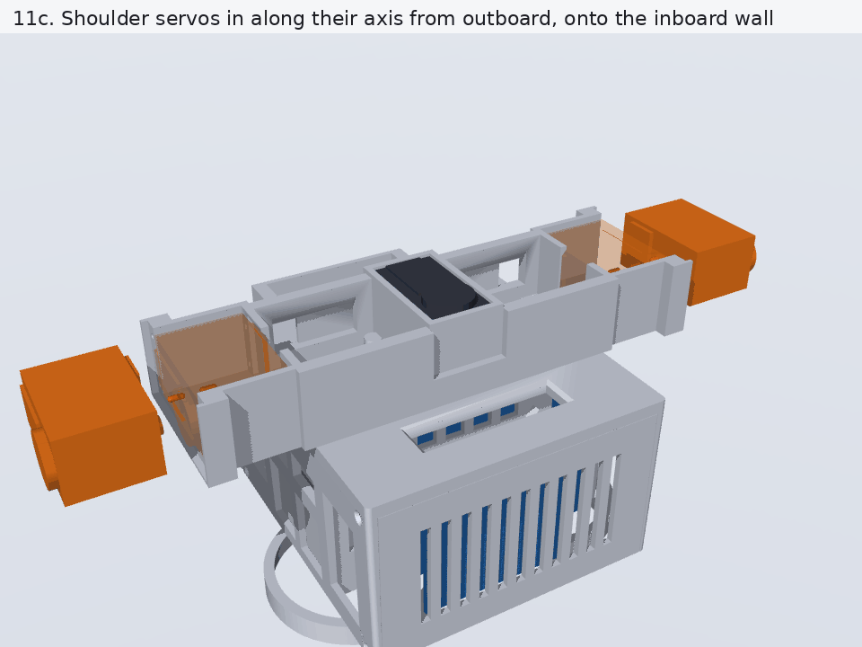

3. **Put the cheek on along the same axis.** Thread its large hole over the
   output boss and drop it into the rebate between the two end lugs' rims,
   onto the floor's ledge, countersinks outboard and its rib pocket against the
   case's horn-side rib. Both cheeks are the same part: it is symmetric top to
   bottom about the shoulder axis, so either way up fits.
4. **Drive the 4 corner screws** (M2.5 × 8 flat-heads, from outboard, into
   the end lugs). They push the case the last 0.25 mm home onto the crush
   pads, so it ends up clamped between the inboard wall and the cheek.
5. **Drive the 4 case screws** (M2.5 × 8 flat-heads) through the cheek into
   the horn-side case face, from outboard. The inboard face sits 1.24 mm off
   the torso's skin, where no driver fits.

   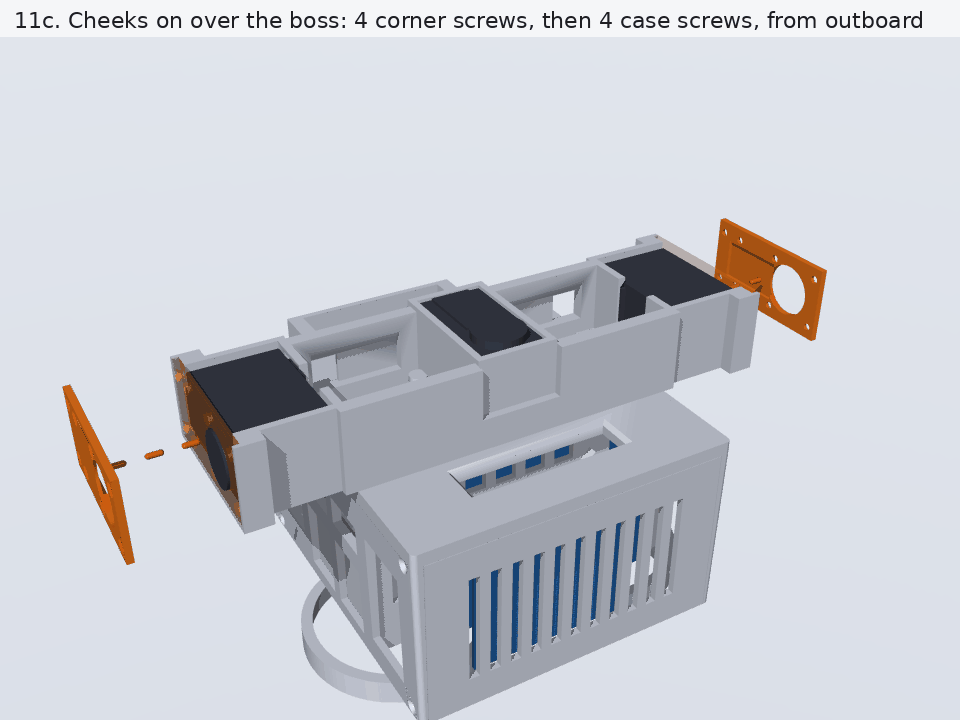

To take a shoulder servo out, remove the arm (§11d) first. The cheek comes
off outboard, and then the servo slides out the way it went in.

### 11d. Arms (a mirror pair)

Each arm link carries its side, **L** or **R**, on its outboard rail: the
letter faces out and reads upright with the arm hanging.

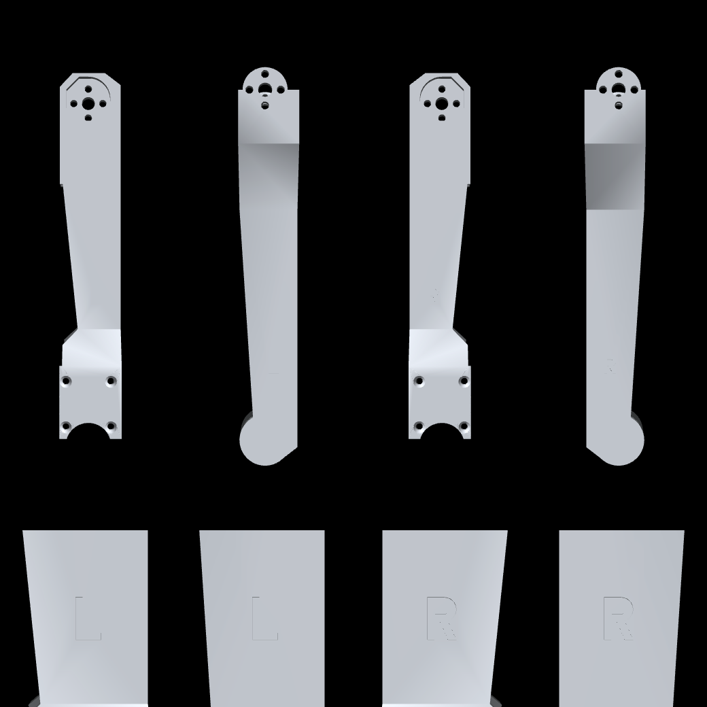

1. **Glue the head insert into the upper arm first**, on the bench
   (`arm_head_insert_v6`, a mirror pair: the right one for an arm is the one
   whose lip lands on the horn plate). Lower it into the head's U from above,
   lip toward the horn plate, until the lip sits on the horn plate's front and
   top edges. Apply CA or epoxy on both flanges' inner faces, the web and the
   end wall. It closes the U's open front and top,
   which otherwise leave the horn plate free on two edges, so the arm wobbles
   (#199). The access bore stays open, so the disc screws still go in after.
2. **Upper arm onto the shoulder horn.** Offer it straight in along the joint
   axis, with the shoulder at zero (arm hanging). It is a single-sided horn
   joint.
   - **4 × M3 × 6** (the horn plate sits on a 1 mm seating boss: a 4.0 mm
     stack), driven through the access bore in the arm's outboard face.

   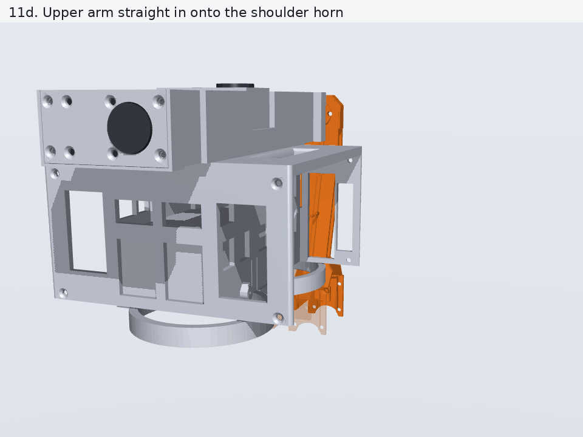

3. **Elbow servo into the upper arm.** Slide it into the grip channel at the
   upper arm's lower end from the front, output end down, horn outboard, so the
   case runs up the arm. **6 × M2.5 × 8 flat-heads**: four from outboard, two
   from inboard. Plug the shoulder-to-elbow lead in first and take it out
   through the web window just above the case. Its other end comes from the
   slot in the girdle's aft tie, round the pod's aft lug, and down the back
   of the upper arm's web.

   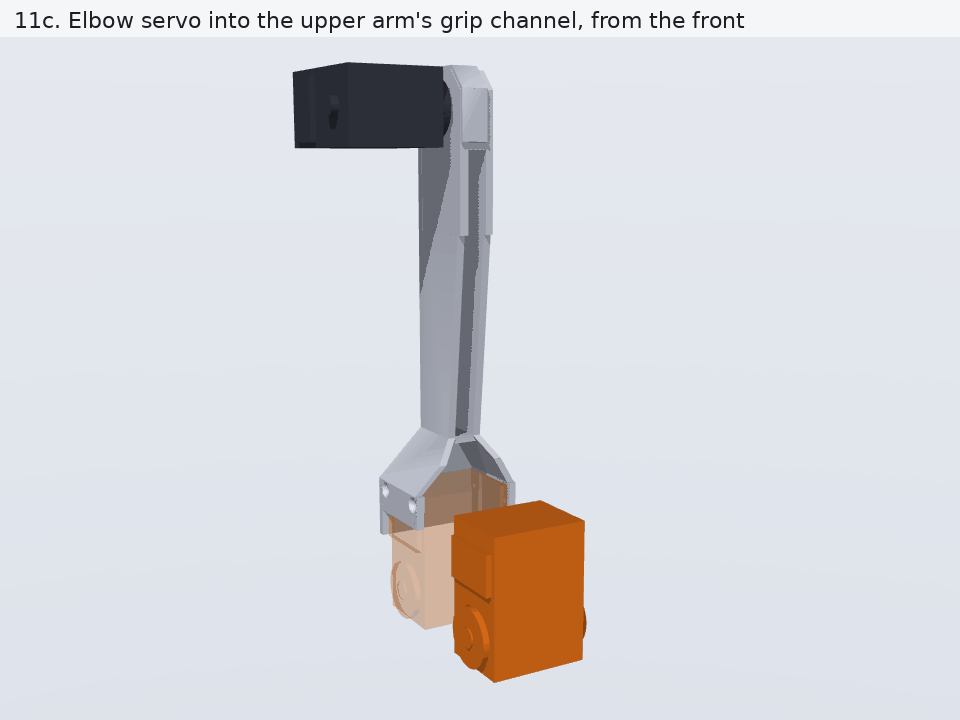

4. **Forearm onto the elbow servo.** Lift it up so its fork tines pass either
   side of the servo's output end onto the two discs, with the elbow straight:
   - horn side **4 × M3 × 5**;
   - idler side **4 × M3 × 6**.

   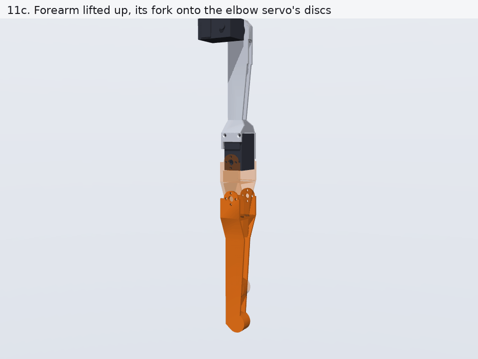

### 11e. Head and camera

1. **Camera onto the face.** Fit the Camera Module 3 to the four M2 bosses on
   the inside of `head_face` (4 × M2 × 4 self-taps), lens through the aperture.
2. **Route the camera cable** through the slot in the head's base beside the
   neck axis. Leave a slack loop for ±90° of yaw.
3. **Shell onto the neck horn.** Seat `head_shell` on the neck horn with the
   neck at zero and the head facing forward. Drive **4 × M3 × 6** through the
   4 mm base plate, from inside the open shell.
4. **Close the face** with **4 × M2.5 × 8 flat-heads**.

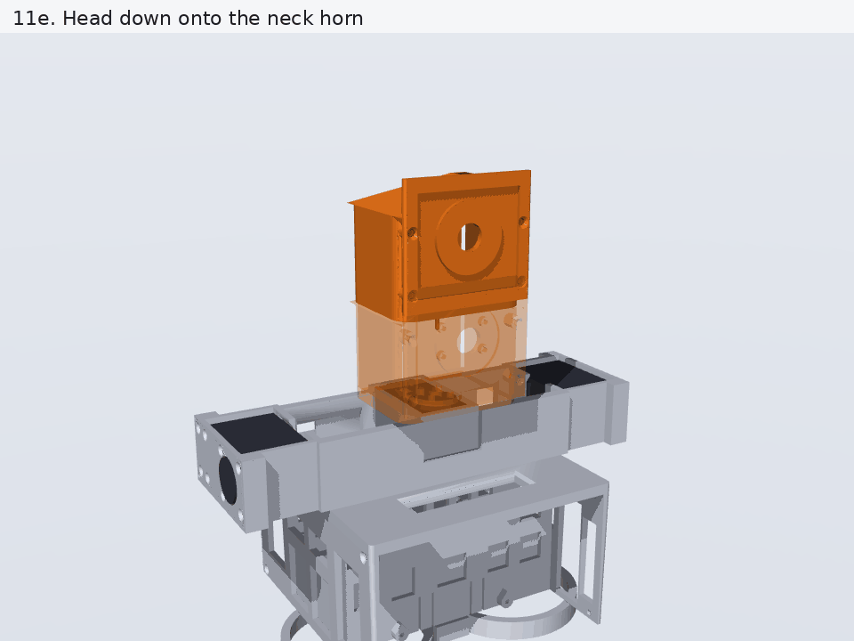

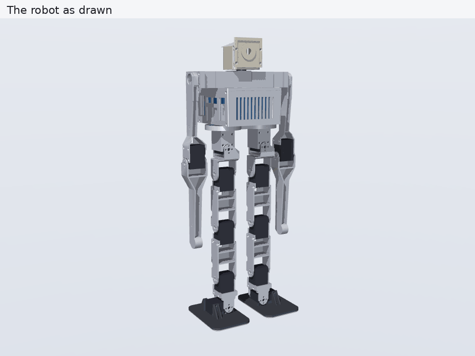

## 12. Cabling

**The harness is drawn in [wiring-general-driver.svg](wiring-general-driver.svg)**
(power lite and its four servo branches, #77); every connector, pin and check
is in power lite's [harness.md](../pcb/power-lite/harness.md). Power lite is
in the bay behind the pelvis (§9c); the General Driver and the Pi are in the
bay in front of it (§9a, §9b). Every servo plugs into power lite, not into the
General Driver.

What is settled and what is not:

- The leg IDs are as assembled; the neck and arm IDs (13–17) are still a
  proposal until the neck and arms are fitted
  ([servo-map.md §2.1](servo-map.md#21-the-robot-the-map-as-assembled)).
- The per-hop lead lengths are measured from the CAD
  ([wiring.md](wiring.md#per-hop-lead-lengths-from-the-v6-cad-arms1)). Its first
  hops (General Driver port to the front wall, and so on) were measured for the
  General Driver's ports; **the hops from J4–J7 are not measured** **(check on
  first fit, #207)**.
- The current budget is a sim figure
  ([wiring.md](wiring.md#current-measured-budget-issue-77)); the bench number
  with a watt meter on the pack lead is still owed.

### 12a. Which lead goes where

Do these with the **pack out, the fuses out and the main switch off**. The
leads are made as in power lite's
[assembly guide](../pcb/power-lite/assembly.md#make-the-leads).

| from | to | lead | length |
|---|---|---|---|
| pack XT60 | **J1**, the XT60 on the board's +y edge | the pack's own lead, no extension | the pack's own |
| pack balance plug | the balance lead's male end in the park (§9c), then **J2** | JST-XH 4-pin extension | about 100 mm ([bom.md](bom.md#3-power)) |
| **J3** | the General Driver's **H1** (power inlet) | XHP-2 to XHP-2, 22 AWG, pin 1 to pin 1 | as short as the torso allows **(check on first fit, #207)** |
| **J4** | servo **10**, the right hip yaw: the right leg's chain, 10, 52, 6, 7, 8, 11 | stock servo lead | 150 mm |
| **J5** | servo **13**, the neck: the right upper chain, 13, 14, 15 | stock servo lead | 150 mm |
| **J6** | servo **9**, the left hip yaw: the left leg's chain, 9, 51, 2, 3, 4, 12 | stock servo lead | 150 mm |
| **J7** | servo **16**, the left shoulder: the left upper chain, 16, 17 | stock servo lead | 150 mm |
| **J8** | the General Driver's **H5**, the servo data line | stock servo lead | 150 mm |
| **J11** | the E-stop's lugs 2 (common) and 3 (§9c) | PHR-2, 24–26 AWG | about 80 mm |
| **J12** | the General Driver's P3, H3 and H2 (below) | PHR-8, 24–26 AWG, pins 2, 3, 5 and 6 only | not set **(check on first fit, #207)** |
| **W1, W2, W3–W5, W6/W7** | the BMS and the main switch (§9c) | soldered | §9c |

The servos' own leads are 150 mm. Where a hop needs more, use an extension
lead; the only hop the CAD finds too long is shoulder to elbow (below). The
first hop from J4–J7 to the servo it feeds is **(check on first fit, #207)**:
if 150 mm will not do, an extension goes between the board and the servo, not
a longer chain.

**Beyond J4–J7, each chain is a daisy chain of stock leads**, case to case: each
servo has two paralleled ports. A branch's first lead carries the whole chain's
current ([wiring.md](wiring.md#servo-bus)).

**J4–J8 orientation (read this before plugging in a servo).**

- **A header turned the wrong way round puts the data wire on ground.** The
  General Driver's H5 has its D (data) pin at its bevelled corner, and a stock
  lead joins the two housings' bevelled corners. So on J4–J8 the **bevelled
  corner must be at pin 1**, the square pad: the header's lower end, on the side
  toward the middle of the board, as the silkscreen outline shows
  ([harness.md](../pcb/power-lite/harness.md#j4j8-servo-branches-and-the-data-line)).
- **The first board built had all five turned 180° the other way** (#342). With
  a stock lead from H5 to J8 the whole bus read as shorted to ground (`scan`
  found nothing), and the servos on J4 and J6 ran with no proper ground. The
  board files are fixed (#344); a board made from them is right. **A board built
  before that has to have J4–J8 desoldered and turned** (the rework is in power
  lite's [assembly guide](../pcb/power-lite/assembly.md#rework-j4j8-seated-with-the-bevel-at-pin-3)).
  Do not swap the contacts in the leads instead: that leaves non-standard leads.
- **Meter it, with no servo connected:** check P4, the steps in
  [bringup.md §4.1](../pcb/power-lite/bringup.md#41-p4-the-servo-headers-before-any-servo).
  Look at each header's bevel first, then check pin 1 of J4–J7 to J8's pin 1
  (0 Ω) and to ground and SERVO+ (open), then a stock lead from H5.
  Whether the fitted board has passed this is **(check on first fit, #207)**.

### 12b. In order

1. **The servo leads first, before the cap.** The legs' leads run from each
   yaw servo along the pelvis, under where the pack goes, to power lite's J4
   or J6; the neck and shoulder leads to J5 and J7. Plug the servo end, lay each
   lead, and leave the board end free until the board is in (§9c).
   - **Leg leads:** a slit in the pelvis's ceiling over each yaw servo's
     connector trench. The lead plugs in from above through it and runs flat
     under the pack between its pads.
   - **To power lite:** windows at the battery layer's ends in the aft inner
     wall pass them to the bay behind it (the pack's lead takes the +y one).
     Which window each lead takes, and its length, is **(check on first fit,
     #207)**: the CAD's hop table stops at the General Driver.
   - **Roll servos:** their ports face rearward through the carrier's
     rear-wall window.
2. **Power lite's end of each servo lead:** plug it into J4 to J7 as the table
   says, **after** the P4 meter check (§12a). Each stock lead's housing
   goes on one way.
3. **J8 to the General Driver's H5:** one stock lead, from J8 to H5 (the
   General Driver's bus edge faces up). Only data matters on it: J8's middle
   pin is not connected on purpose. H6 stays empty.
4. **J3 to the General Driver's H1.** Before the first plug-in, meter H1:
   it is silkscreened "− +", and **pin 1 must be +** (harness check P3, through
   to the AO4407). Plug the XHP-2 lead pin 1 to pin 1.
   - **The General Driver's slide switch SW1 must be on**, or the Pi gets no
     power.
   - **This lead also lets the INA219 read the pack.** Without it the INA219
     reads under 6 V, which the firmware takes as no reading, and the pack
     guard falls back to the servos' own voltage reading.
   - **Nothing else feeds the Pi.** Do not plug a USB-C supply into it.
   - **F2** (3 A) is in this lead's path: a short on it can blow it. Keep
     spares.
5. **J12 to the General Driver.** Pin 2 `SERVO_EN` to P3 pin 4 (IO16), pin 3
   GND to P3 pin 3, pin 5 `RAIL_V` to H3 pin 4 (GPIO34), pin 6 `ESTOP_N` to H2
   pin 1 (IO4). The figure in
   [harness.md](../pcb/power-lite/harness.md#j12-control-to-the-esp32) draws where
   each lands. P3 and H2 take 2.54 mm Dupont housings; H3 takes a PHR-6 with one
   contact in position 4. **The landing pins are drawn on Waveshare's photo and
   not yet checked on the General Driver in hand (check on first fit, #207).**
   An unplugged J12 reads as an E-stop, so the rail never closes.
6. **The E-stop and the main switch** (§9c): J11's PHR-2 lead to the E-stop,
   and the main switch's disconnect. Check with the meter that the E-stop's two
   wires read 0 Ω in RUN (lever IN, toward the main switch) and open in STOP.
7. **The pack's lead** into J1, last, and its balance plug onto the balance
   lead's male end in the park (§10). The pack goes in after the board is
   checked, not before.

### 12c. Before first power

Checks, with the fuses out and the pack out. The step-by-step procedure, with
the expected readings, is power lite's
[bringup.md](../pcb/power-lite/bringup.md) and the README's
[bench check with the ESP32](../pcb/power-lite/README.md#the-bench-check-with-the-esp32);
do not redo it from here.

1. **Polarity and orientation** (harness.md, "Checks before the first
   connection"):
   - **P1**: the pack's XT60 is female, with + on the housing's straight side.
     A reversed J1 reverses the whole board.
   - **P2**: meter the pack's balance plug from the pin-1 side: 0, about 3.7,
     7.4 and 11.1 V.
   - **P3**: the General Driver's H1 pin 1 is +.
   - **P4**: J4–J8 are keyed as H5 (above).
2. **Fuses:** a **15 A** blade in F1 (the upper holder, the servo rail) and a
   **3 A** blade in F2 (the lower one, the logic and the Pi). Fit them last,
   when the checks pass.
3. **The BMS** is wired by voltage (§9c), and its P+ pad is empty.
4. **The switches:** the E-stop at STOP and the main switch off when the pack
   goes in. **Switch off in the other order too**: E-stop to STOP first, so
   K1 drops the servo rail, **then** the main switch. The main switch has no DC
   rating for breaking a load; it should break only the logic's current.
5. **K1** (the relay) closes only when the E-stop is at RUN **and** the
   ESP32 drives `SERVO_EN` high; until then the rail is off. Pressing the
   E-stop opens it without the firmware. The firmware's arming and its stuck-rail
   check are in the README's "The firmware"; the robot runs its own image
   (`make firmware POWER_LITE=1`), not the default.
6. **What has not been done on this robot.** Power lite's bring-up Part 2 (the
   board on a lab supply, no pack) and the ESP32 bench check passed on the
   bench ([2026-11-20](design-v6/2026-11-20-power-lite-board-bench.md),
   [2026-11-21](design-v6/2026-11-21-power-lite-esp32-bench.md)). Parts 3 and 4
   (the pack on the board; the relay closing onto the real servos, ten times,
   with the BMS not tripping) wait on the pack-protection decision and on the
   servos; the relay's closing inrush is a simulation figure, 176–341 A for
   52–132 µs. **(check on first fit, #207)**
7. **After the first power-up with servos:** a full `scan`, and read every
   servo's status and voltage before any torque. Then read `stat`'s "last
   reset" with the pack and no USB: the ESP32 reset each time K1 closed with
   no USB attached, on the board with the swapped headers, and whether it still
   does is **(check on first fit, #342)**.

### 12d. What the CAD provides

- **Boards:** the General Driver's bus edge faces up, and the camera's ribbon
  (from the Pi's top edge) leaves up through the deck opening between the
  boards.
- **Neck:** the leads leave the plugs through the neck floor's window, toward
  +Y, and rise through the deck aperture beside the tube. How the neck's and
  shoulders' leads get from J5 and J7 to it, behind the Pi stack, is
  **(check on first fit, #207)**.
- **Shoulder to elbow:** the lead rises out of the notch in the pod's inboard
  wall, runs aft inside the girdle and leaves through the slot in the aft
  tie's web beside the pod (square, 11 × 11 mm; the plug passes), then
  goes round the pod's aft lug and down the back of the upper arm's web to
  the window above the elbow servo's case (#198). **The stock 150 mm lead is
  too short for it: it is 312 mm of route plus a 23 mm fold loop, so buy
  about 380 mm leads and trim on the bench** (wiring.md). The drawing
  [wiring-general-driver.svg](wiring-general-driver.svg) still says about
  200 mm; wiring.md is the newer figure.

**Rules:**

- **Daisy-chain.** Each servo has two paralleled ports, so the bus hops from case
  to case. Each servo ships with a 150 mm lead; where a hop needs more, use an
  extension lead.
- **Leave a slack loop across every joint, sized at full flexion.**
  - That means knee 130°, hip pitch −120°, and the shoulder through its whole
    −90° … +200°: its lead crosses a joint that folds 290°.
  - Fold each joint to its limit before cinching the zip ties.
- **Strain relief for the arm leads is not designed yet.**

## 13. First power-up and zero calibration

**Before anything powered,** read AGENTS.md's bench-safety rules:

- any bus write is a motion command;
- opening the serial port reboots the board and eats the first command;
- check torque before a bench run;
- disarming does not lower the robot.

Bare board to first arm: [bringup.md](bringup.md).

**The compiled policy drives the v6 legs' 12 joints.** The firmware's
bus side carries all 17 servos: the bus map, calibration blob v3, and the gain
check at boot and before every arm. The 17-servo bench steps and a 17-joint
policy are open (#81, #86). The procedure:

1. **Zero.** Standing is angle zero for every joint.
   - Hold the robot in the CAD standing pose on a stand, then run `cal zero` and
     `cal save`. The zeros are stored in NVS.
   - The table lives in [servo-map.md](servo-map.md); update it and
     `firmware/main/asbuilt_cal.h` in the same commit.
   - **Re-zero after any mechanical work on a joint.** Tightening loose horn
     screws moved the prototype's zeros by up to 4.7°.
2. **Directions.** Verify every joint's sign against the simulation at low
   torque limit and slow speed before trusting any gait. A wrong knee sign
   drives the knee into hyperextension.
3. **Gains.** Read registers 21 and 22 back on every servo the table raises.
4. **Pack.** Land the robot by 3.5 V/cell (10.5 V).

## 14. Play test, per roll joint

Measure play on every roll joint (both hip rolls, both ankle rolls) on the
assembled robot, **before the first walk**. Do the knees and hip yaws too.

- **The requirement:** ≤ 3° per roll joint, with ≤ 1° as the target. At ≤ 1°, a
  3× gain is enough (DESIGN.md §4).
- **The method is tilt hysteresis.** The encoders sit on the shaft side of any
  slop, so they cannot see it; the IMU can.
  - With the robot standing, step one joint slowly out and back: 0.5° steps to
    ±4°, slow slew, 1 s settle.
  - Read the torso tilt from the IMU at each step. The dead band at reversal is
    the play.
- **Tools.** `tools/joint_sweep.py` runs this; its ID and zero table are the
  earlier prototype's and need porting. For hip yaw, `tools/yaw_probe.py` yaws both hips
  together and reads the pelvis's yaw from the gyro.
- **On the earlier prototype** this test found 2–3° at a hip roll.
- **If a joint is over the limit,** check the disc screws, the idler seating and
  the grip screws, then re-zero.

## Open

| item | where |
|---|---|
| ID map, harness, lead lengths, current budget | #77 |
| power lite on the robot: the J4–J8 rework on the built board (#342); the first hops from J4–J7 and the J3 and J12 leads' lengths; the legs' and the upper branches' routes to the aft bay; J12's landing pins on the General Driver; bring-up Parts 3 and 4; the pack's protection | §9c, §12; #207, #342 |
| room for the pack's plug and 12 AWG lead at power lite's J1 (17.4 mm to the skin) | §9c; power lite, PR #209 |
| the BMS's pads and part-free edge margin (its PCB, 56.8 × 44.8 mm, and its 4.0 mm height are measured; `BMS_*`) | §9c; #213 |
| the balance lead's male end and the park's fit (`BAL_MALE`, from JST's B4B-XH-A) | §9c; #213 |
| the main switch's nut, lever length and throw, and its keyway's width, depth and place (the panel tab, `SW_KEY_*`); the inline disconnect's size and rating | §9c; #213 |
| the E-stop's hardware (its nut and lockwasher, assumed 7.94 mm across the flats × 2.4 mm and 0.5 mm) and its bushing's thread (the datasheet's B1: 8.89 mm) | §9c; #213 |
| the pod and its levers on the robot's back: the sim plant does not collide with them (supine get-up) | §9c; #213 |
| 17-joint firmware: calibration, IMU mounting rotation, register-21 check | #81 |
