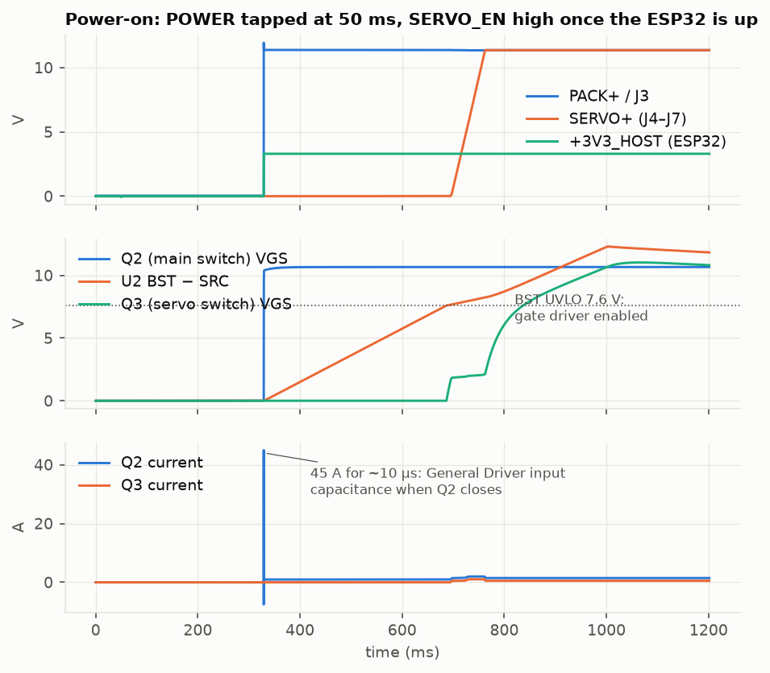
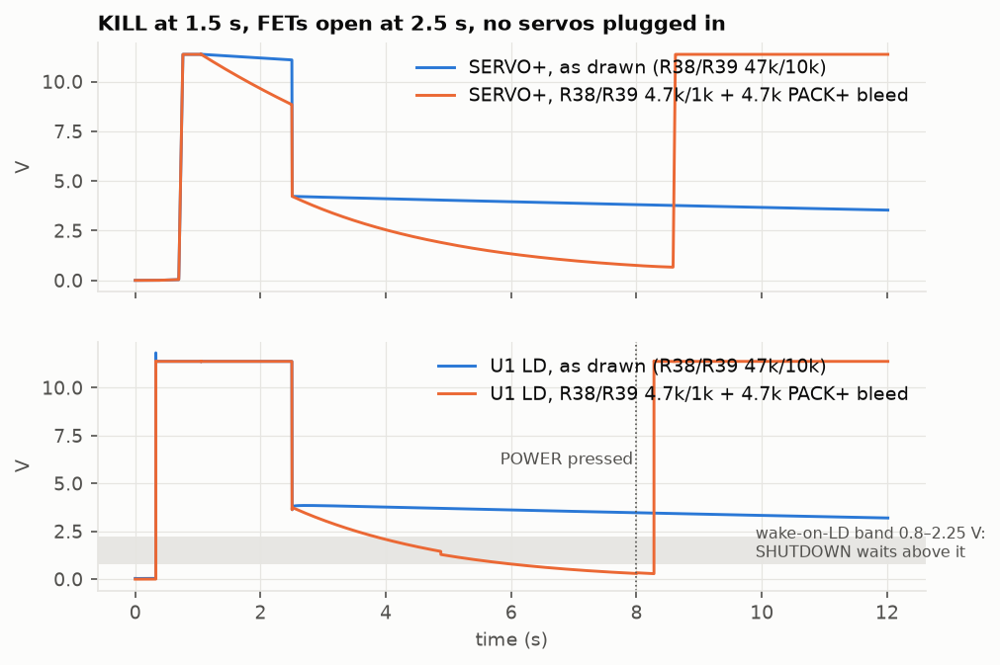
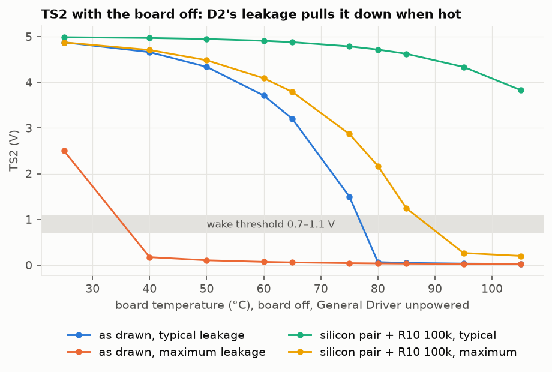
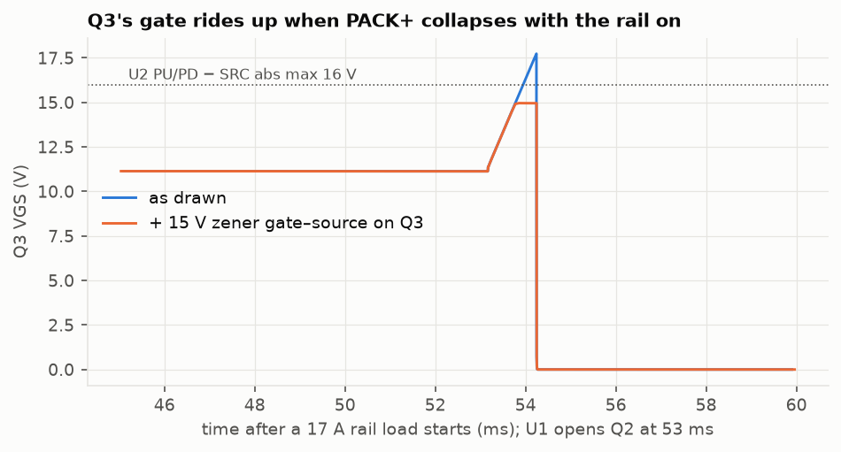
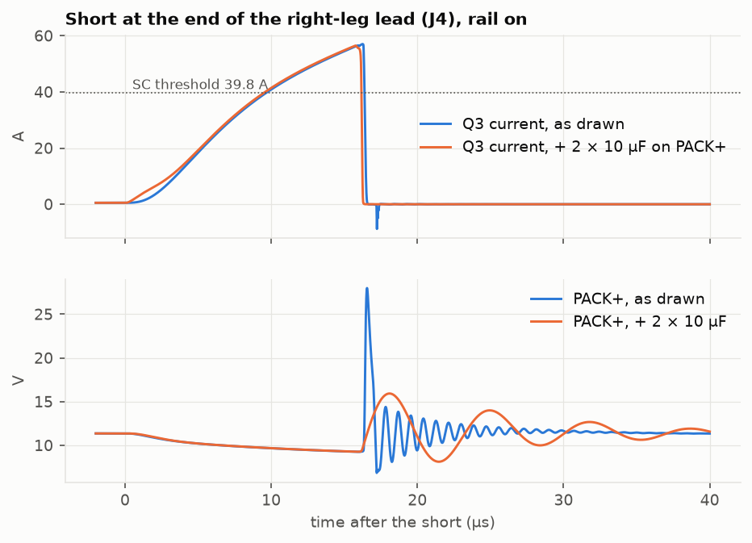

# Power board rev A: whole-board simulation before ordering (2026-10-24)

*A dated record. The board is [pcb/power-board](../../pcb/power-board/README.md); its design
is [2026-10-06-power-circuit.md](2026-10-06-power-circuit.md) and its earlier checks are
[2026-10-07-power-board-verification.md](2026-10-07-power-board-verification.md). The
static half of this pre-order check, a pin-by-pin datasheet audit, is
[2026-10-24-power-board-pin-audit.md](2026-10-24-power-board-pin-audit.md). Tom's ask:
"do a full simulation of it, making sure each of the outputs responds correctly to every
possible input".*

## Summary

**The board does what the design says in every normal combination of inputs.** All 1152
combinations of the discrete inputs (below) give the outputs the design asks for, on the
circuit as drawn, on two ngspice versions (47 and 42) with the same verdict in every
case. One state is left to F-9 rather than judged: with the balance lead in and the XT60
out, U1's cell inputs have no DC path to its VSS (§1.4). The timed sequences agree with
the design too: power-on, the E-stop, the servo-rail breaker and short-circuit trip,
KILL pulses, the rail UVLO, the logic levels and a full pack.

**It found ten problems that the earlier checks could not see.** Each one needs an input
combination, a timing or a temperature that those checks did not try. Five are board
changes worth a few cents each and should go in before ordering (F-1, F-2, F-5, F-7, F-9).
Four are settings in the BQ76922's one-time configuration (OTP), to write at bring-up
(F-3, F-4, F-6, F-8). One is a firmware rule (F-10).

| | what goes wrong | how likely | what it costs to fix |
|---|---|---|---|
| **F-1** | After KILL, POWER is ignored until the board has bled down, which takes tens of seconds to minutes. The BQ76922 cannot reach SHUTDOWN while PACK+ is held up, here by the servo rail's capacitance (through Q3's body diode) and the General Driver's input capacitance | **every shutdown** | 2 resistor values + 1 resistor: SHUTDOWN 3.4–6.2 s after KILL (simulated) |
| **F-2** | A switched-off board with the pack plugged in **wakes itself**: D2's leakage pulls TS2 under the wake threshold at about 80 °C with a typical BAT54C, and from about 5 °C with one at the datasheet's maximum leakage | a hot car with a typical part; any room with a part near the datasheet's limit | swap D2 for a silicon pair and R10 to 100 kΩ: no wake to 105 °C typical, 85 °C worst case (simulated) |
| **F-3** | After a discharge over-current trip (OCD), **POWER cannot turn the board back on**: only unplugging the pack does | needs > 20 A for 53 ms | OTP: keep TI's default latch, with F-4's OCD1 at 30 mV, so that only a fault on PACK+ can trip it (simulated) |
| **F-4** | A servo overload of 16–19 A **turns the whole robot off** (the BQ76922 trips first) instead of only the servo rail | needs a cluster of stalled servos; worst at the OCD threshold's low tolerance | OTP: OCD1 at 30 mV (simulated: selectivity restored) |
| **F-5** | When PACK+ collapses with the rail on (a BQ76922 trip, a PACK+ short), Q3's gate rides **17.3–18.2 V above its source**, past U2's 16 V rating, for up to 0.3 ms | every protection cut with the rail on | add a 15 V zener on Q3, gate to source (simulated: removes it) |
| **F-6** | After a cell-undervoltage cut (CUV) the board **switches itself back on 3 s later** once the weak cell recovers | a weak cell under a get-up load | OTP: Shutdown Cell Voltage = CUV with Low V Shutdown Delay 0 (simulated: the board ends in SHUTDOWN, and POWER restarts it) |
| **F-7** | A short on the servo side makes PACK+ **spike to 28–34 V at 160–180 V/µs**, about 3× U2's 60 V/µs slew rating; Q3 then sees up to 28.6 V of its 30 V | only during a servo short | add 4 × 10 µF on PACK+ at Q3, as two series pairs (simulated: 18.3 V, 10.9 V/µs) |
| **F-8** | A short on PACK+ that stays (a dropped tool) is **hit again every 5 s**: the BQ76922 re-closes Q2 into it on its own | rare | OTP: SCDL latch limit 1 (simulated: one hit) |
| **F-9** | VC0 has no path to VSS on the board, so the BQ76922 **does not support the balance lead going in before the XT60** (TI DS §8.3); VC0 also dips 0.68 V below VSS for 8 µs every time Q2 closes | every hot-plug in that order | 1 resistor, J2.1 to BAT− |
| **F-10** | The firmware's "E-stop pressed but the rail still up" rule (design §5.3) **fires falsely on a bench with no servos**: SERVO+ bleeds through 57 kΩ only, and it parks near 4–5 V even with servos | bench sessions | firmware rule (numbers below) |

None of these stops the board from powering the robot. F-1, F-3 and F-6 change what the
POWER button and the board do after a trip. F-2 and F-6 power the robot when nobody asked.
F-5 and F-7 take parts past their absolute maximum ratings: F-7 during faults, F-5 at
every protection cut made with the rail on.

The pin audit adds seven items: R29 overloads under an E-stop wiring fault; Q5 lacks the
1 nF TI says "must be placed"; TI's factory REG0/REG1 defaults; C4–C8 at their minimum
values; R1's TCR; and C22's label. It also lists the BQ76922 defaults that must change
(C1–C9).

**Recommendation.** Make the five board changes (F-1, F-2, F-5, F-7, F-9) and the
audit's R29 and Q5 items in rev B, re-run ERC/DRC and this campaign, then order. The parts
are resistors, four 10 µF capacitors, a zener and a diode pair, all a few cents each. The
cost is a re-placement and re-route near Q3 and U1. The OTP
items go in the configuration image written at bring-up, and the firmware items into
F4 of the design record. Everything below is from simulation and the datasheets; none of
it has been on a bench.

## 1. Method

### 1.1 The board, as drawn

- **Netlist.** `kicad-cli` from KiCad 10 exports the schematic's connectivity
  (`pbsim/board/netlist.py`); KiCad 9 cannot read this schematic. Every part becomes a
  SPICE element from its value and MPN, so nothing about the board is typed by hand:
  102 parts, 70 nets.
- **Simulator.** ngspice, driven through its shared-library API
  (`pbsim/board/engine.py`). Every suite was run on two engines: ngspice 47 (Homebrew
  libngspice, macOS) and ngspice 42 (the libngspice vendored in `pbsim/vendor/` for
  Linux, which `make pbfull` uses there). Every case's verdict on each is in
  [2026-10-24-power-board-full-simulation-cases.txt](2026-10-24-power-board-full-simulation-cases.txt).
- **Q1–Q3.** TI's CSD17556Q5B transient model, vendored (`pbsim/vendor/`), plus the
  datasheet's IDSS.
- **Diodes, zeners and TVS.** Each has a forward model and a reverse leakage taken from
  its datasheet, by temperature, typical or maximum (`pbsim/board/devices.py`). Example:
  the BAT54C's typical leakage at about 5 V, read off Diotec's curve, is 25 nA at 25 °C,
  0.7 µA at 75 °C and 45 µA at 125 °C. A part's maximum is its datasheet's figure,
  held at the lower biases this board applies, because leakage rises with reverse
  voltage: for the BAT54C that is 2 µA at 25 V and 25 °C, 80 × the 5 V typical.
- **Other parts.** The NTC follows Murata's B constant; Q5 is the 2N3904 Gummel-Poon
  model; Q4 is a level-1 fit to Vishay's 2N7002K.
- **Fuses.** Each is a resistor plus a melt model: heating above 110 % of its rating,
  against its melting I²t.

### 1.2 The two ICs

Neither IC has a vendor SPICE model (TI publishes none for the BQ76922). Each is modelled
the way the silicon is built (`pbsim/board/ics.py`):

- **Pins in ngspice.** Every pin's analog behaviour is ngspice elements on the board's
  real nets:
  - U1's REG18, TS1/TS2 bias, LD pull-down, charge pump and CHG/DSG drivers, with the DSG
    turn-off "pull toward VSS while above LD" of DS §8.5;
  - U2's charge pump, PU/PD drivers, current-sense amplifier, IMON, IWRN, ISCP with its
    internal 464 Ω, TMR current sources, DIODE currents, and the FLT open drains.
- **Logic in Python.** Each IC's logic is a state machine that reads its pin voltages at
  every accepted ngspice time step and switches those elements. This covers:
  - U1: power-on reset, SHUTDOWN, TS2/LD wake, the 278 ms boot, RST_SHUT, the shutdown
    sequence, soft shutdown, CUV/COV/OCD1/SCD with their delays and recoveries,
    body-diode protection, and low-voltage shutdown, which is judged on the 250 ms
    measurement loop's samples (TRM Table 6-9), not continuously like CUV;
  - U2: POR, EN/ENF/UVLO, BST UVLO, INP, the circuit breaker with its retry counter and
    latch-off, short circuit, the DIODE-measured over-temperature latch, and the latch
    resets.
- **Sources.** Every threshold, delay and current is from the datasheet or TRM and cites
  its table.
- **The OTP image.** The BQ76922's configuration is assumed to follow design record §5.5
  and the existing pbsim constants, with TI defaults for the rest (`BqOtp`):
  - CUV 2.985 V, 250 ms; COV 4.200 V;
  - OCD1 20 mV (20 A), 52.8 ms; SCD 150 mV, fastest delay, recovery 5 s; no SCDL;
  - shutdown stack voltage 9.0 V, 1 s;
  - FET_EN = 1; TS2 unused; SLEEP off.
- **Assumptions.** Where a document leaves a behaviour open, the model's choice is listed
  in `ics.ASSUMPTIONS` and repeated in §7.

### 1.3 The world around the board

Everything attaches at the connector pins (`board.py`):

- **The pack.** Three cells with internal resistance (5 mΩ each by default; 1.7–40 mΩ in
  the stress cases), 100 nH and 2 mΩ per discharge-lead conductor, and an XT60 and
  balance lead that can be plugged or pulled at any time.
- **The buttons.** POWER, and the E-stop's two contacts, each a switch.
- **The ESP32.** Its 3.3 V rail, with a 1 kΩ load when unpowered. KILL and SERVO_EN are
  push-pull outputs, or high-impedance until 0.3 s after its rail rises. Every J12 pin
  has clamp diodes to that rail and to GND, plus 35 pF of harness. The I²C pull-ups are
  4.7 kΩ.
- **The General Driver on J3.** 0.3 µH and 40 mΩ of lead and input path, 44 µF of input
  capacitance, and the MP8759 as a 9.6 W constant-power load. Its UVLO is 4.25 V on and
  3.9 V off; the off threshold is an assumption. The 3.3 V rail comes up when the buck
  runs or USB is present.
- **The servo branches.** Each of J4–J7 has a 30 mΩ / 200 nH lead to its servos'
  capacitance (2 mF in total, split by servo count). The servos' electronics draw
  30 mA each above about 5 V, and the motor current is scheduled.
- **Shorts.** A short of 10 mΩ + 100 nH can be applied to PACK+, SERVO+, the far end of
  J3, or the far end of J4–J7.

### 1.4 What "correct" means, and the stress monitor

- **Expected outputs.** These come from the design record (§5, §7) and harness.md; each
  test states its own.
- **Absolute maximums.** At every accepted time point, a monitor checks 90 limits from
  the datasheets (`pbsim/board/stress.py`):
  - every U1 and U2 pin;
  - Q1–Q4's VGS and VDS;
  - every capacitor's rated voltage;
  - the TVSs' standoff voltage;
  - the ESP32's pins, and its clamp current from RAIL_V.

  It records each limit's extremes and how long it spent outside. An excursion longer
  than 20 µs fails a test, except in two cases, where it is reported instead:
  - the short-circuit tests, where overstress is what is being measured;
  - U1's cell inputs (VC0–VC5) while the XT60 is out. U1's VSS then has no DC path to
    the cells, so the cell inputs float with the stack, at nanoamps, to wherever the
    solver puts the island. The two engines disagree (VC0 − VSS −0.13 V on
    ngspice 47, down to −1.45 V on ngspice 42), and the model has no IC internals to say
    where silicon would sit. TI's answer to that state is a board change, F-9.

### 1.5 The campaign

`make pbfull` runs the three suites on a process pool and writes
`build/power-board/fullsim/{truth,seq,sweep}.json`, plus waveforms for the figures. The
pre-push gate (`make pbsim`) runs a sample of 23 runs (`tests/test_whole_board.py`). The
findings are pinned there as strict expected failures, so a board change that fixes one
fails the gate until this record is updated.

## 2. Inputs and outputs

| inputs (and the range simulated) | outputs checked |
|---|---|
| pack: XT60 and balance lead in or out, plugged in either order, pulled while on; cells 2.2–4.21 V, a weak cell, 1.7–40 mΩ per cell | PACK+ and J3 (LOGIC_OUT) |
| POWER: released, tapped 2 ms–1 s, held, jammed; pressed while off, on, or during shutdown | SERVO+ at J4–J7 |
| E-STOP: contacts A and B in all four states (both open = J11 unplugged), pressed 0.5 s and 5 s | RAIL_V, PWR_INT_N, ESTOP_N, SERVO_FLT_N, SERVO_IMON on J12 |
| ESP32: unpowered, on the General Driver, on USB; KILL and SERVO_EN low, high, high-impedance, pulses, and levels 0.5–3.3 V | +3V3_HOST (no back-powering of an unpowered ESP32) |
| General Driver: on J3 with SW1 on, SW1 off, J3 unplugged | U1's mode and FET states; U2's gate, latches and FLT |
| servo load 0–30 A per branch, a 12 A get-up, servos plugged or not | every IC pin, FET and capacitor against its absolute maximum |
| shorts on PACK+, SERVO+, the far end of J3 and of J4 | |
| Q5 at 140 and 160 °C; the board from −20 to 105 °C, typical and maximum leakage | |
| U1/U2 threshold tolerances (OCD ±4 mV, IWRN 29.2–31.5 mV, UVLO min/max) | |

**J8 → J4–J7 (servo data)** is copper only. The netlist puts J8.1 and J4.1–J7.1 on one
net, J8.2 on no net (V+ not connected), and J8.3 on GND, as harness.md says. **I²C** is
checked as levels and loading only; the BQ76922's register protocol is driver
territory.

## 3. The truth table: every combination of the discrete inputs

**Inputs.** Board never switched on / switched on by a 50 ms tap (2) × contact A (2) ×
contact B (2) × SERVO_EN low / high / high-impedance (3) × POWER held from 1.2 s or not (2)
× USB (2) × General Driver on / SW1 off / J3 unplugged (3) × XT60 and balance both / XT60
only / balance only / neither (4) = **1152 cases**, each a 2.4 s whole-board transient,
judged on its last 0.1 s and on the monitor (`pbsim/board/truth.py`).

**Result: 1152 of 1152 pass, on ngspice 47 and on ngspice 42.** In the 288 cases with the
balance lead in and the XT60 out, U1's cell inputs are reported, not judged (§1.4): VC0 −
VSS sits at −0.13 V on ngspice 47 and falls to −1.45 V on ngspice 42 for the whole run.
Every case's verdict on both engines is in
[the cases file](2026-10-24-power-board-full-simulation-cases.txt). The numbers below are
ngspice 47's; the largest difference between the engines in any measured output is
0.12 V, in PACK+'s off-state residue.

| expected output | cases expecting it up | cases expecting it off |
|---|---|---|
| PACK+ / LOGIC_OUT up | 216 | 936 |
| +3V3_HOST up | 612 | 540 |
| SERVO+ / RAIL_V up | 24 | 1128 |
| PWR_INT_N reads high / low (ESP32 powered); ESP32 unpowered | 300 / 312 | 540 |
| ESTOP_N reads high / low (ESP32 powered); ESP32 unpowered | 306 / 306 | 540 |

- PACK+ when up: 11.358–11.400 V; LOGIC_OUT 11.326–11.400 V; when off: 0.000–0.129 V
- SERVO+ when up: 11.356–11.384 V; RAIL_V 1.992–1.997 V; IMON 0.084–0.084 V; Q3 VGS 10.814–10.881 V; BST−SRC 11.830–11.904 V
- brief excursions past an absolute maximum (all under 20 µs):
  - ESP32 PWR_INT_N: 216 cases, -0.59 V / 3.30 V, at most 0.3 µs
  - U1 VC0: 72 cases, -0.68 V / 0.40 V, at most 8.2 µs

What it shows, beyond the table:

- **Balance lead missing, XT60 in.** The BQ76922 wakes, sees impossible cells, keeps Q2
  open (CUV at boot), and shuts itself down 1.25 s later (TOS below 9 V). The board refuses
  to power the robot, which is the safe answer. Real VC inputs' bias currents may read
  differently while they float; the BQ76922's open-wire check is off by default.
- **ESP32 unpowered.** No board signal back-powers it: +3V3_HOST stays below 0.3 V in
  every case where nothing feeds it. SERVO_EN high-impedance (an ESP32 booting) keeps the
  rail off through R33.
- **POWER held in NORMAL** only pulls PWR_INT_N low: TS2 is unused there, so it is not
  mistaken for a hot thermistor (audit C3 keeps it so).
- **TS2 in NORMAL** floats to PWR_INT_N's level, about 3.3 V, through D2. That is inside
  the wake pin's VSS + 6 V, but it is a reason TS2 Config must stay "unused" (its
  thermistor/ADC rating is REG18 + 0.3 V).

## 4. Sequences

68 timed sequences, each a whole-board transient of 0.9–16 s (`pbsim/board/sequences.py`).
"Fail" means the board did not do what the design asks; each failure is a finding (§6), and
the what-ifs re-run a sequence with a proposed fix.

| group | sequences | result |
|---|---|---|
| POWER taps 2 ms, 20 ms, 200 ms, 1 s | `power_tap_*` | pass: PACK+ up 279 ms after the press in each |
| power-on, full sequence | `power_on_full_sequence` | pass (§4.1) |
| KILL pulse 0.5 s | `kill_pulse_short` | pass: a reset only, PACK+ never dips |
| KILL held by a USB-powered ESP32, then POWER | `power_while_kill_held_usb` | pass: PACK+ never rises (35 mV) |
| KILL while POWER is still held | `shutdown_power_still_held` | pass: no SHUTDOWN while TS2 is held low (TRM §7.5) |
| jammed POWER | `jammed_power_button` | pass: woken once, then held in soft shutdown, never re-woken |
| orderly shutdown: rail dropped first / rail on at KILL / no servos / servos drawing below 5 V / General Driver drawing 100 µA below UVLO | `shutdown_*` | **fail, F-1**: still in soft shutdown 6.5–10.5 s after KILL, PACK+ at 2.3–3.2 V; POWER ignored |
| the same with the F-1 fix | `shutdown_*_fix_both` | pass: SHUTDOWN 3.4 s (no servos), 5.2 s (rail dropped first), 6.2 s (rail on at KILL) after KILL; POWER works again |
| the same with only R38/R39 changed | `shutdown_no_servos_fix_bleed` | fail: the General Driver's capacitance still holds PACK+ at 2.6 V; both bleeds are needed |
| flat pack, 3.4 → 2.9 V a cell | `low_battery_ramp` | **fail, F-1**: CUV at 6.25 s, the shutdown sequence at 6.83 s, then held |
| the same with the F-1 fix | `low_battery_ramp_fix_both` | pass: SHUTDOWN at 11.4 s |
| E-stop pressed 0.5 s and 5 s | `estop_press_release_*` | pass (§4.2) |
| stuck-rail rule, no servos (drawn, and with the bleed) | `estop_stuck_rail_bench_*` | **fail, F-10** |
| stuck-rail rule, servos plugged in | `estop_stuck_rail_with_servos` | pass: SERVO+ below 5 V 40 ms after the press |
| rail overload 25 A; 22 A at the OCD −4 mV corner; 17 A nominal | `rail_overcurrent_*`, `rail_load_17A_nominal` | pass: the rail breaker alone, 11.0 ms; 17 A held |
| breaker latch reset by SERVO_EN | `rail_cb_latch_reset_by_servo_en` | pass: rail back 41 ms after the toggle |
| 17 A at the OCD −4 mV corner | `rail_load_17A_ocd_low_corner` | **fail, F-4 and F-5** |
| ... with OCD1 at 30 mV; 25 A with OCD1 at 30 mV | `rail_*_otp_ocd30` | pass: the 17 A load stays up; 25 A still cleared by the breaker alone |
| OCD trip, then POWER | `ocd_trip_then_power_press` | **fail, F-3** (and F-5) |
| OCD with time-based recovery (OTP) | `ocd_trip_otp_time_recovery` | fail by design of the option: back on by itself 3.03 s later |
| Q5 at 160 °C / 140 °C | `rail_ot_*` | pass (§4.3) |
| shorts: J4 lead (15 and 5 mΩ packs), SERVO+, PACK+ (15 and 5 mΩ), J3 | `short_*` | pass on what clears them (§4.4); F-5 and F-7 seen in their stress |
| persistent PACK+ short, default OTP | `short_packplus_persistent_default_otp` | **fail, F-8**: hit 3 times in 12 s |
| ... with SCDL limit 1 | `short_packplus_persistent_scdl1` | pass: hit once |
| weak cell under a get-up | `cuv_weak_cell_under_load` | **fail, F-6**: CUV at 1.25 s, back on by itself at 4.33 s |
| the same, with each F-6 option and the F-1 fix, POWER at 6 s | `otp_f6_*` | see F-6: only Shutdown Cell Voltage = CUV with a 0 s delay both stays off and comes back on POWER; a healthy get-up does not trip it |
| a 0.3 Ω fault on PACK+ with OCD1 at 30 mV, latched or time recovery | `otp_f3_*` | see F-3: latched stays off; time recovery closes Q2 into the fault every 3.3 s |
| a bench supply on the XT60 through the tether adapter, and without it | `tether_*` | see §4.6: the adapter works from 9.5 to 12.6 V; without it the board refuses; a loose tether takes Q2 past 30 V in a PACK+ short |
| 12 A get-up from a half-charged pack | `getup_peak_brownout` | pass: PACK+ ≥ 10.20 V, the General Driver's input ≥ 10.13 V, EN/UVLO ≥ 1.54 V, no trip |
| full pack, 4.21 V a cell | `full_pack_cov` | pass: COV opens CHG; body-diode protection closes it again under load; PACK+ stays up |
| hot-plug: XT60 after the balance lead (with and without USB), the reverse, both at once; XT60 pulled while on | `hotplug_*`, `unplug_xt60_while_on` | pass: no wake; PACK+ ≤ 0.31 V; Q2's VGS coupled to ≤ 1.36 V for nanoseconds (F-9 for what the model cannot show) |
| pack unplugged, ESP32 on USB driving KILL and SERVO_EN high | `usb_only_pack_unplugged_outputs_driven` | pass: PACK+ and SERVO+ stay at 0 V |


### 4.1 Power-on



*POWER tapped at 50 ms. The board wakes 1 ms later; Q2 closes 278 ms after the wake (DS
§8.4); the General Driver and the ESP32 start; U2's BST charges for 0.36 s (TPS eq. 1:
4.7 µF × 7.6 V / 100 µA); then SERVO_EN brings the rail up in 53 ms (10–90 %), with a
1.0 A peak into 3 mF of servo capacitance.*

- **Any tap wakes the board.** 2 ms, 20 ms, 200 ms and 1 s taps all switch it on, as
  DS 6.3 and §7.8.5 say: TS2 pulled below the threshold wakes the part, and the FET
  decision follows 278 ms later whether or not the button is still held. The pbsim suite's
  "a 200 ms tap does not wake" (`test_buttons.py`) models a 280 ms hold requirement that
  the datasheet does not have.
- **Q2's turn-on inrush.** Q2 closes into the General Driver's input capacitance with a
  45 A, roughly 10 µs pulse (18 A seen on R1 through the sense filter). It is far inside
  Q2's SOA and the fuses, and far below SCD (150 A) and OCD.
- **VC0 dips at turn-on.** The same pulse's di/dt in the pack's negative lead puts VC0
  0.68 V below VSS for 8 µs on every switch-on: the balance lead's B− cannot follow the
  XT60's. R3 limits the clamp current to about 20 mA. See F-9.
- **U2's soft start waits for BST.** U2's gate driver is enabled only once BST reaches
  7.6 V, 0.36 s after U2 becomes active. At power-on the ESP32's boot hides this. After a
  long E-stop or a VS dropout, the rail returns up to 0.36 s late (audit N2). The model
  holds BST's charge through an E-stop because the datasheet gives no BST leakage in
  shutdown, so the simulated 32 ms return is the short end.

### 4.2 The E-stop

- **Press.** U2's gate drops 0.46 ms after the press, while EN/UVLO falls through
  R31 × C18 to below UVLOF. ESTOP_N reads high within microseconds. PACK+ and +3V3_HOST
  are undisturbed (minimum 11.32 V and 3.299 V).
- **Release.** The rail is back at 90 % 30–32 ms after release (BST still charged).
- **SERVO+ does not go to 0 V.** It falls only as far as the servos' electronics draw
  current, near 4–5 V, and then bleeds through R38 + R39. RAIL_V reads about 0.8 V for
  tens of seconds. The design's V4 check "rail at 0 V" will not be seen. The servos are
  unpowered in practice, but firmware has to treat "below about 5 V" as off. See F-10.

### 4.3 The servo rail's protections

- **Breaker.** At 25 A the rail's breaker latches 11.0 ms after the step. FLT goes low at
  10.1 ms, and IMON reads 4.17 V (25.5 A) before the trip. U1's OCD does not trip.
  SERVO_EN low→high restarts the rail.
- **Below the threshold.** A 17 A load is held indefinitely (OCD nominal), and 18.5 A
  holds. The breaker trips at a rail current of 20.0 A (TI's nominal 19.8 A).
- **IMON** reads 0.1637 V/A against TPS eq. 13's 0.1638.
- **Over-temperature.** Q5 measured at 160.7 °C through U2's ΔV(DIODE) latches the rail off
  as soon as U2 is active. A SERVO_EN toggle does not clear it. An E-stop cycle does,
  and with Q5 still hot it latches again. At 140 °C there is no trip.
- **UVLO.** The rail switches off at PACK+ 7.42 V falling and on at 7.87 V rising. The
  divider and TI's typical thresholds give 7.34 / 7.80 V; the difference is R29 and C18's
  lag.

### 4.4 Shorts

| short | cleared by | after | peak current | worst stress |
|---|---|---|---|---|
| far end of the J4 lead, 15 mΩ pack | U2 short circuit | 15.9 µs | Q3 57 A | PACK+ 28.0 V at 158 V/µs (F-7) |
| far end of the J4 lead, 5 mΩ pack | U2 | 14.5 µs | Q3 64 A | PACK+ 29.3 V, 162 V/µs |
| SERVO+ at the board | U2 | 7.6 µs | Q3 103 A | **Q3 VDS 28.6 V of 30**, PACK+ 34.0 V, 181 V/µs |
| PACK+ on the board, 15 mΩ pack | U1 SCD | 34.7 µs | Q2 263 A | Q2 13.4 V, 18.8 mJ; Q3 gate 17.3 V (F-5) |
| PACK+ on the board, 5 mΩ pack | U1 SCD | 28.0 µs | Q2 338 A | Q2 14.8 V, 28.8 mJ; Q3 gate 18.2 V (F-5) |
| far end of J3 (logic lead) | F2 melts | 0.87 ms | Q2 100 A | PACK+ dips to 8.5 V; U1 does not trip |

- **Every servo-side short is cleared by U2 alone.** U1 never trips, and PACK+ and the
  logic stay up, as design §5.3 and record C5 intend.
- **U2's trip takes longer than record C5 found.** C15 (1 nF across ISCP and CS−, TI
  §9.2.2.4) with R26 filters the comparator with a 4.6 µs time constant. Here U2 trips
  8–16 µs after the short, not C5's 5.9 µs. Q3's peak stays well inside its 400 A pulse
  rating.
- **The PACK+ short stays inside Q2's ratings** for packs of 15 and 5 mΩ in this model.
  Record C13's stiffer-pack risk stands as accepted.

### 4.5 Shutdown, and what holds it up

See F-1 below.

### 4.6 The tether: a bench supply instead of the pack (2026-10-25)

Tom's requirement: run the robot from a lab supply plugged into the XT60. The supply is
modelled as three equal sources (V/3 each, 1 mΩ) behind 2.5 m of 14 AWG per conductor
(21 mΩ). Its inductance is estimated from the geometry: about 1 µH a conductor as two
loose wires and 0.5 µH twisted. The balance lead is out, and the adapter of harness.md
drives J2 from the supply leads at the XT60 plug: B− and B+ direct, C1+ and C2+ from a
3 × 1 kΩ divider. These runs use the board as drawn.

| run | result |
|---|---|
| no adapter, 12.0 V (`tether_no_adapter_refuses`) | refuses: CUV at boot (the empty cell inputs read 0.87 V), PACK+ ≤ 0.04 V, SHUTDOWN 1.25 s later |
| adapter, 12.0 V, full power-on (`tether_power_on_12V`) | pass: PACK+ 11.92 V, rail at 90 % at 0.76 s, Q2's turn-on pulse 40 A |
| adapter, 9.5 V (`tether_power_on_9V5`) | pass: PACK+ 9.41 V |
| adapter, 12.6 V (`tether_power_on_12V6`) | pass, but COV trips (4.2 V a cell): CHG switches on and off under body-diode protection while PACK+ stays at 12.52 V |
| adapter, 12 A get-up for 2 s (`tether_getup_12V`) | pass: PACK+ ≥ 11.26 V, the General Driver's input ≥ 11.19 V |
| short at the far end of J4 (`tether_short_J4_12V`) | U2 trips after 33 µs (15.9 µs on the pack: the tether limits di/dt). PACK+ peaks at 27.5 V at 162 V/µs, as in F-7, and F-7's series pairs bring it to 18.8 V and 9.1 V/µs (a what-if, not in the campaign) |
| hard short on PACK+, twisted tether (`tether_short_packplus_12V_twisted`) | SCD after 88 µs, Q2 173 A peak, 24.6 mJ, VDS 24.7 V |
| the same with a loose tether (`tether_short_packplus_12V_loose`) | **fail**: SCD after 114 µs, then the tether's stored energy takes Q2's VDS to 31.3 V against its 30 V rating; 41.7 mJ. An SMBJ15A across the XT60 only brings it to 29.7 V (a what-if, not in the campaign) |

What the model leaves out:
- **The supply's current limit.** The source here is stiff. A real supply drops into
  constant current, and its output capacitors feed the first microseconds of a short.
- **Energy the servos push back.** A pack absorbs it; most bench supplies cannot sink
  current. Not measured, so not modelled: harness.md's T1 measures it before the first
  tethered motion.

## 5. Sweeps

### 5.1 A switched-off board at temperature: TS2 and LD (V)

Board in SHUTDOWN, General Driver unpowered, the wake comparators disabled so the run shows where TS2 and LD settle. "Fix" is D2 as a silicon pair (1N4148W data) with R10 at 100 kΩ. "max" is each part at its datasheet's maximum leakage (§1.1). 70 °C is missing: ngspice's operating point did not converge there.

| °C | as drawn, typ | as drawn, max | fix, typ | fix, max | LD typ / max |
|---|---|---|---|---|---|
| -20 | 4.98 | 3.52 | 5.00 | 4.99 | 0.00 / 0.02 |
| 0 | 4.96 | 1.54 | 5.00 | 4.97 | 0.01 / 0.05 |
| 10 | 4.93 | 0.29 | 4.99 | 4.95 | 0.02 / 0.06 |
| 25 | 4.87 | 0.17 | 4.99 | 4.87 | 0.03 / 0.09 |
| 40 | 4.66 | 0.11 | 4.97 | 4.71 | 0.06 / 0.10 |
| 50 | 4.34 | 0.08 | 4.95 | 4.48 | 0.07 / 0.11 |
| 60 | 3.71 | 0.06 | 4.91 | 4.09 | 0.09 / 0.11 |
| 65 | 3.20 | 0.05 | 4.88 | 3.79 | 0.09 / 0.12 |
| 75 | 1.50 | 0.04 | 4.79 | 2.87 | 0.10 / 0.12 |
| 80 | 0.07 | 0.03 | 4.72 | 2.17 | 0.11 / 0.12 |
| 85 | 0.05 | 0.03 | 4.62 | 1.24 | 0.11 / 0.12 |
| 95 | 0.03 | 0.03 | 4.34 | 0.27 | 0.12 / 0.12 |
| 105 | 0.03 | 0.02 | 3.83 | 0.20 | 0.12 / 0.12 |

### 5.2 POWER pressed: the levels the ICs see (V)

Wake needs TS2 < 0.7 V (DS 6.3 minimum); the ESP32 reads PWR_INT_N low below 0.83 V.

| °C | TS2, drawn | PWR_INT_N, drawn | TS2, fix | PWR_INT_N, fix |
|---|---|---|---|---|
| -20 | 0.205 | 0.321 | 0.419 | 0.540 |
| 0 | 0.162 | 0.288 | 0.359 | 0.491 |
| 25 | 0.109 | 0.247 | 0.284 | 0.428 |
| 60 | 0.044 | 0.190 | 0.179 | 0.340 |
| 85 | 0.020 | 0.148 | 0.110 | 0.277 |

### 5.3 The rail's UVLO on the drawn divider (PACK+ ramped 0.06 V/s)

`_min` / `_max` use TPS 6.5's UVLOR/UVLOF limits.

- `uvlo_down`: PACK+ 7.423 V, EN/UVLO 1.110 V
- `uvlo_up`: PACK+ 7.865 V, EN/UVLO 1.180 V
- `uvlo_down_min`: PACK+ 7.279 V, EN/UVLO 1.100 V
- `uvlo_down_max`: PACK+ 7.559 V, EN/UVLO 1.130 V

### 5.4 The ESP32's drive levels into RST_SHUT and INP

RST_SHUT's V(IH) is 0.67 × REG18 = 1.21 V; INP's V(INP_H) is 1.6 V typical, 2.0 V maximum. The ESP32's V(OH) minimum, 2.64 V, clears both.

| signal | ESP32 pin (V) | IC pin (V) | result |
|---|---|---|---|
| KILL | 0.49 | 0.450 | no shutdown |
| KILL | 0.82 | 0.749 | no shutdown |
| KILL | 1.15 | 1.048 | no shutdown |
| KILL | 1.48 | 1.348 | shutdown started |
| KILL | 2.64 | 2.395 | shutdown started |
| KILL | 3.30 | 2.993 | shutdown started |
| SERVO_EN | 0.99 | 0.979 | rail off |
| SERVO_EN | 1.48 | 1.468 | rail off |
| SERVO_EN | 1.81 | 1.795 | rail on |
| SERVO_EN | 2.15 | 2.121 | rail on |
| SERVO_EN | 2.64 | 2.610 | rail on |
| SERVO_EN | 3.30 | 3.263 | rail on |

### 5.5 Rail current: IMON and the breaker

"Branch A" is the load on J4; the servos' electronics add 0.5 A.

| branch A | Q3 A | IMON V | V/A | breaker |
|---|---|---|---|---|
| 0 | 0.51 | 0.084 | 0.1639 | holds |
| 2 | 2.51 | 0.411 | 0.1638 | holds |
| 5 | 5.51 | 0.903 | 0.1638 | holds |
| 10 | 10.51 | 1.721 | 0.1638 | holds |
| 15 | 15.51 | 2.540 | 0.1637 | holds |
| 18.5 | 19.01 | 3.112 | 0.1637 | holds |
| 19 | 19.51 | 3.194 | 0.1637 | holds |
| 19.5 | 20.01 | 3.276 | 0.1637 | trips after 11.4 ms |
| 20 | 20.51 | 3.357 | 0.1637 | trips after 11.2 ms |
| 20.5 | 21.01 | 3.439 | 0.1637 | trips after 11.2 ms |
| 22 | 22.51 | 3.684 | 0.1637 | trips after 11.1 ms |
| 30 | 30.51 | 4.991 | 0.1636 | trips after 10.9 ms |

### 5.6 Who acts first on a rail overload

OCD1 20 mV at its −4 / 0 / +4 mV accuracy (DS 6.25), each against U2's over-current threshold at its 29.2 / 30.6 / 31.5 mV spread (TPS 6.5); where the three U2 corners disagree, both answers are shown. OCD can act first anywhere from 16 to 19 A of rail current.

| rail A | OCD −4 mV | OCD nominal | OCD +4 mV |
|---|---|---|---|
| 16 | BQ76922 OCD (whole robot off) | none | none |
| 17 | BQ76922 OCD (whole robot off) | none | none |
| 18 | BQ76922 OCD (whole robot off) | none | none |
| 19 | BQ76922 OCD (whole robot off) / rail breaker | BQ76922 OCD (whole robot off) / rail breaker | none / rail breaker |
| 21 | rail breaker | rail breaker | rail breaker |
| 25 | rail breaker | rail breaker | rail breaker |

### 5.7 The fixes, re-simulated

| fix | test | result |
|---|---|---|
| 15 V zener, Q3 gate to source (F-5) | the 17 A OCD cut | Q3's VGS clamps at 15 V; no PD−SRC excursion |
| 2 × 10 µF on PACK+ at Q3 (F-7) | the J4 short | PACK+ 15.9 V peak, 5.6 V/µs; Q3 VDS 7.9 V; U2 still trips (15.8 µs) |
| the same four parts as two series pairs (F-7) | the J4 short | PACK+ 18.3 V peak, 10.9 V/µs; Q3 VDS 10.4 V; U2 still trips (15.8 µs); one cracked capacitor cannot short PACK+ |
| R38/R39 4.7k/1k + 4.7 kΩ PACK+ bleed (F-1) | shutdowns, flat pack | SHUTDOWN 3.4–6.2 s after KILL; POWER works again |
| R38/R39 only | the rail-dropped shutdown | still held at 2.7 V by the General Driver: not enough alone |
| 1 kΩ J2.1 to BAT− (F-9) | XT60 after the balance lead | ngspice 42's floating VC0 (−1.45 V for the whole balance-only phase) is gone; nothing changes on ngspice 47, where VC0 sat at −0.13 V. The internals TI warns about are not in the model |
| silicon pair for D2, R10 100 kΩ (F-2) | §5.1, §5.2 | no wake to 105 °C typical / about 85 °C worst case; pressed levels still clear |
| OTP: OCD1 30 mV (F-4) | 17 A and 25 A overloads | selectivity restored |
| OTP: SCDL limit 1 (F-8) | persistent PACK+ short | one hit |


## 6. Findings

### F-1. After KILL the board cannot reach SHUTDOWN for a long time, and ignores POWER



*The bench case: no servos plugged in, rail off before KILL. Drawn values in blue: SERVO+
still near 2.8 V at 12 s, and LD above the wake-on-LD band, so U1 is still in soft
shutdown when POWER is pressed at 8 s. With R38/R39 at 4.7 k/1 k and a 4.7 kΩ PACK+
bleeder (orange), U1 reaches SHUTDOWN 3.4 s after KILL and the POWER press at 8 s turns
the board on.*

- **The mechanism.** After KILL the BQ76922 opens Q1/Q2 on time, 1.00 s after RST_SHUT
  went high. It then enters SHUTDOWN only once LD, which is PACK+ through R16, is below
  V(WAKEONLD), 0.8–2.25 V. Until then it waits in "soft shutdown" (TRM §7.5), and a
  POWER press there is lost. Two things hold PACK+ up:
  - **the servo rail.** C21 (1 mF) plus about 2 mF in the servos feeds PACK+ through Q3's
    body diode. The only bleed is R38 + R39 (57 kΩ), and the servos' electronics stop
    drawing near 4–5 V. With C21 alone that is τ ≈ 57 s; with the servos, about 170 s;
  - **the General Driver's input.** Once its buck is in UVLO, its 44 µF has only the
    E-stop divider (661 kΩ) to discharge into, τ ≈ 30 s. How much the MP8759 draws below
    UVLO is not documented in the repo, and 100 µA does not change the result.
- **Simulated.**
  - Rail on at KILL, servos plugged in: soft shutdown still holding 6.5 s later, PACK+ at
    3.1 V.
  - Rail dropped first: PACK+ 2.7 V, SERVO+ 2.8 V at 6.5 s.
  - No servos: PACK+ 3.2 V, SERVO+ 3.5 V at 10.5 s, and POWER at 8 s is ignored.
  - Servos drawing current below 5 V (2 kΩ each): SERVO+ reaches 0 V, but the General
    Driver's capacitance still holds PACK+ at 2.7 V.
  - The same hold stops the low-battery ramp (`low_battery_ramp`) from completing its
    SHUTDOWN: it reaches the shutdown sequence at 6.83 s and then waits.
- **Fix, simulated.** R38/R39 → 4.7 kΩ / 1 kΩ (same 2.21 V at 12.6 V; 28 mW) plus 4.7 kΩ
  from PACK+ to GND (34 mW while on; nothing in SHUTDOWN, where PACK+ is at 0 V):
  - no servos: SHUTDOWN 3.4 s after KILL, and POWER works at 8 s;
  - servos plugged in: 5.2 s with the rail dropped first, 6.2 s with it on at KILL;
  - the low-battery ramp then ends in SHUTDOWN.

  Faster would take more bleed current, or a switched discharge.

### F-2. A hot board that is switched off wakes itself



- **The mechanism.** With the board in SHUTDOWN the General Driver is unpowered, so
  PWR_INT_N sits near 0 V (R10 to a dead rail). D2's second junction is then reverse
  biased by TS2's own voltage. TS2's wake bias is about 5 V through 5 MΩ (DS 6.6), so
  0.7 µA of leakage is enough to pull it under the 1.1 V maximum threshold.
- **Simulated.**
  - Typical BAT54C: TS2 sits at 4.87 V at 25 °C and 1.50 V at 75 °C, and has collapsed
    by 80 °C.
  - A part at the datasheet's maximum leakage: Diotec's only limit is 2 µA at 25 V and
    25 °C, which bounds the part at the 5 V it sees here too, 80 × the typical curve.
    TS2 is 1.54 V at 0 °C and 0.29 V at 10 °C, so such a part wakes the board from
    about 5 °C (§5.1). Diotec gives no typical-to-maximum spread at 5 V, so where real
    parts fall between the two curves is not known without measuring them.
- **Consequence.** The BQ76922 wakes and closes Q2, the General Driver and the Pi boot,
  and the ESP32's normal boot raises SERVO_EN. The servos are powered with torque off, and
  the pack drains until the low-voltage shutdown. Unplugging the pack after use (design
  §7) avoids it.
- **Fix, simulated.** A silicon common-cathode pair in place of D2, modelled with
  1N4148W's data from the repo, plus R10 → 100 kΩ:
  - no wake up to 105 °C with typical leakage, and to about 85 °C with the datasheet's
    maximum;
  - pressed levels still clear the thresholds from −20 to 85 °C: TS2 at most 0.42 V
    against ≥ 0.7 V, PWR_INT_N at most 0.54 V against the ESP32's 0.83 V V(IL).

  A low-leakage part (BAV170 class) would hold further, but its datasheet would have to
  go in the repo first.

### F-3. After an OCD trip, POWER cannot switch the board back on

- **The mechanism.** OCD opens Q2 and the BQ76922 stays in NORMAL. TRM 13.6.9.1: OCD
  recovers only on charge current ≥ 200 mA, and this board never charges. TS2 has no
  function in NORMAL, and the ESP32 is unpowered, so KILL and I²C are gone too.
- **Simulated.** A 17 A rail load at the OCD threshold's −4 mV corner trips OCD at 53 ms.
  A POWER press at 2.5 s does nothing, and U1 is still in NORMAL with Q2 open at the
  end. Only unplugging the pack restarts the board.
- **With F-4's fix, only a fault reaches OCD.** With OCD1 at 30 mV, U2's breaker clears
  every servo overload first (`rail_*_otp_ocd30`: 17 A held, 25 A cleared by the breaker
  alone), and F2 (3 A) limits the logic branch. What is left to trip OCD is a fault on
  the PACK+ side, above OCD1 and below SCD's 150 A.
- **The options (OTP), simulated** against that fault: 0.3 Ω from PACK+ to GND (about
  36 A), with rev B's F-1 and F-5 fixes and POWER pressed at 6 s:
  - *TI's default, latched* (`otp_f3_pack_fault_latched`): the board stays off, POWER
    does nothing, and unplugging the pack resets it.
  - *Time recovery* (OCD Recovery Threshold −100 mA, `otp_f3_pack_fault_time_recovery`):
    the board closes Q2 into the fault again by itself every 3.3 s (4.08 s, 7.33 s, …),
    36 A for 53 ms each time. Without the fault it would simply come back 3 s after the
    cut (`ocd_trip_otp_time_recovery`), an uncommanded restart like F-6.
  - *Time recovery with OCDL:* OCDL latches after a set number of trips (TRM 5.2.8), but
    it recovers only by time, charge current, load detect or I²C. Load detect needs the
    pack's load above about 20 kΩ (TRM 5.2.18), which F-1's 4.7 kΩ bleed rules out, so a
    latched OCDL is again unplug-to-reset. It is not modelled.
- **Recommended:** keep the default, latched, with OCD1 at 30 mV. A board that stays off
  until someone unplugs the pack and looks is the right answer to a fault on PACK+. The
  bench rule: after a shutdown that POWER does not undo, unplug the pack.

### F-4. A servo overload can turn the whole robot off instead of the servo rail

- **The mechanism.** U1's OCD1 (20 mV ± 4 mV on R1, so 16–24 A of pack current, after
  52.8 ms) and U2's breaker (18.8–20.7 A of rail current, after about 11 ms) overlap. Pack
  current is the rail current plus about 1 A of logic.
- **Simulated.**
  - Rail overloads of 16–19 A at the OCD −4 mV corner trip U1 first, and the Pi loses
    power without halting.
  - At nominal OCD, 19 A of rail current (about 20.4 A of pack current) trips U1 first
    at two of U2's three threshold corners (§5.6).
  - Above about 20 A the breaker always acts first, because it is five times faster.
- **Fix, simulated (OTP).** OCD1 at 30 mV (26–34 A). The 17 A case then stays up, and a
  25 A overload is still cleared by the rail breaker alone, with no OCD trip.

### F-5. Q3's gate rides above its rating when PACK+ collapses with the rail on



- **The mechanism.** C16, the soft-start capacitor, goes from the gate to **GND**, as in
  TI Fig. 8-6. When PACK+ and SERVO+ fall faster than R27 × C16 (33 ms), C16 holds the
  gate up while the source drops. Nothing turns U2's gate off until EN/UVLO, behind
  C18, falls below UVLOF.
- **Simulated.** In every protection cut with the rail on, VGS(Q3), which is also U2's
  PD − SRC, reaches:
  - 17.7 V for 0.3 ms at an OCD cut;
  - 17.3–18.2 V for about 40 µs in a PACK+ short.

  U2's PU/PD/BST − SRC absolute maximum is 16 V; Q3's VGS rating is ±20 V.
- **Fix, simulated.** A 15 V zener from Q3's gate to its source (cathode on the gate).
  MMSZ5245B is the same family as D3/D5/D6 and its datasheet is in the repo. It removes
  the excursion. Dropping SERVO_EN before KILL helps only that one path; it cannot help
  the BQ76922's own cuts.

### F-6. After a CUV cut the board switches itself back on

- **Simulated.** One weak cell (40 mΩ, 3.15 V at rest) under a 10 A, 0.6 s get-up:
  - it sags to CUV at 1.25 s, and Q2 opens;
  - with no load it recovers past CUV + 101 mV, and after Recovery:Time (3 s, TRM) the
    BQ76922 closes Q2 at 4.33 s;
  - the robot reboots with nobody asking. Under the next load it would cut again.
- **The options (OTP), simulated** on the same weak cell with rev B's F-1 fix, POWER
  pressed at 6 s (`otp_f6_*`). The low-voltage shutdown is judged on the 250 ms
  measurement loop (TRM Table 6-9), while CUV is a comparator with its own 250 ms delay
  (TRM 5.2.5):
  - *Shutdown Cell Voltage = CUV, Low V Shutdown Delay 1 s* (`otp_f6_shutcell_cuv_1s`):
    no change. Once CUV opens Q2 the cell recovers within milliseconds, so it is never
    below the threshold for a second, and the board is back on by itself at 4.33 s.
  - *Shutdown Cell Voltage = CUV, Low V Shutdown Delay 0* (`otp_f6_shutcell_cuv_0s`):
    the first sample inside the sag (1.08 s, lowest cell 2.68 V) starts the shutdown
    sequence, and the board is in SHUTDOWN at 1.26 s, before CUV would have tripped.
    Nothing restarts it; POWER at 6 s brings it back, and it stays up with the cell at
    rest. A 12 A get-up on a healthy half-charged pack does not trip it
    (`otp_f6_getup_shutcell_cuv_0s`). A sag that lasts as long as CUV's delay contains at
    least one sample, because the loop period and CUV's delay are both 250 ms. The catch:
    a dip that a sample happens to catch turns the board off even when it is shorter
    than CUV's delay.
  - *Shutdown Cell Voltage 3.2 V, delay 1 s* (`otp_f6_shutcell_3v2_1s`): this cell rests
    at 3.15 V, under the threshold, so the board shuts down about 1.25 s after every boot:
    SHUTDOWN at 1.58 s here, and again 1.25 s after POWER at 6 s. That is an empty-cell
    lockout. It gives up the capacity between 3.2 V and CUV, and it does not stop a
    healthier cell's restart after a sag.
  - *CUV Recovery Hysteresis 300 mV* (`otp_f6_cuv_hys_300mV`): no restart, but the board
    is stuck as in F-3. U1 stays in NORMAL with Q2 open, POWER does nothing, and only
    unplugging the pack resets it.
  - *Firmware:* on every boot, read the cells over I²C and KILL if one is below its
    landing line. The restart still happens, briefly, and the result depends on the
    firmware.
- **Recommended:** Shutdown Cell Voltage = CUV with Low V Shutdown Delay 0. It ends a
  CUV event in SHUTDOWN, POWER undoes it, it needs no firmware, and the firmware's
  landing line stays the first line of defence.

### F-7. Servo-side shorts slew PACK+ faster than U2 is rated for



- **The mechanism.** When Q3 opens on a short, the pack leads' inductance (200 nH in
  total here) drives PACK+. Only about 0.15 µF of local capacitance is there to absorb
  it before D8 clamps: C14 (100 nF) and C12–C13, a series pair (50 nF). The pair is TI's
  EVM pattern across the pack terminals (SLVU957A, C30/C32), so one cracked capacitor
  cannot short PACK+. The runs are built from the netlist, so these numbers are the
  board as drawn.
- **Simulated.**
  - Short at the far end of J4: PACK+ 28 V at 158 V/µs.
  - Short on SERVO+ at the board: 34 V at 181 V/µs, D8 carrying about 58 A, and Q3's VDS
    28.6 V against its 30 V rating.

  U2's drain-side pins (VS, CS+, CS−, ISCP) are rated 60 V/µs (TPS 6.1). This confirms
  the pin audit's F9.
- **Fix, simulated.** 2 × 10 µF, 25 V X7R (C22's part) on PACK+ at R24/Q3, modelled at
  50 % for DC bias. For the J4 short, PACK+ then peaks at 15.9 V and 5.6 V/µs, and Q3
  sees 7.9 V. The extra capacitance raises Q2's turn-on inrush (§4.1) about 45 %, still
  inside its SOA; it should be re-checked in rev B's run.

  Each of those is a single capacitor from PACK+ to GND, so one that cracks short is a
  PACK+ short (§4.4). The same four parts as two series pairs, in C12–C13's pattern
  (2 × 2.5 µF after derating), keep that protection: PACK+ peaks at 18.3 V and
  10.9 V/µs, and Q3 sees 10.4 V. That is still well inside U2's 60 V/µs, and it is the
  version to fit.

### F-8. A persistent PACK+ short is hit again every 5 seconds

- **The mechanism.** SCD recovers by time (TRM 13.6.7.3: 5 s by default), and with Q2
  open the "current below threshold" condition is always true, so the BQ76922 closes Q2
  into the short again.
- **Simulated (15 mΩ pack).** Three hits in 12 s, each 263 A and 18.8 mJ in Q2. With a
  stiff pack, record C13's over-rating risk is taken every 5 s, not once.
- **Fix, simulated (OTP).** SCDL Latch Limit 1, which is TRM 13.6.7.3's own advice: one
  hit, then Q2 stays open.

### F-9. VC0 is not tied to VSS on the board

- **TI's requirement.** DS §8.3 note: "If VC0 is not connected through the series
  resistor to VSS on the PCB, then cells cannot be connected in random sequence." Here
  R3 goes only to J2.1 (audit F6). Plugging the balance lead before the XT60, or pulling
  the XT60 first, is outside what TI supports.
- **What the model can show.** Hot-plugging in either order, or both together, shows no
  wake and no PACK+ glitch above 0.31 V. Q2's VGS is coupled up to 1.36 V for
  nanoseconds when the XT60 goes in. But the model does not contain the IC's internal
  structures, which are the thing TI warns about.
- **The floating island.** With the balance lead in and the XT60 out, the cells and U1's
  cell inputs float as one island against VSS, held by nothing but nanoamps. Where it
  sits is the solver's choice: VC0 − VSS is −0.13 V on ngspice 47, inside the −0.3 V
  rating, and −1.45 V on ngspice 42, past it, for as long as the state lasts. Neither number
  says what silicon would do; that is why these pins are reported, not judged, in that
  state (§1.4). With the fix below, ngspice 42's island is gone: VC0 stays within its
  rating through the balance-only phase, and the only excursion left is the run's
  first 0.13 ms, as the simulation starts.
- **Normal operation.** VC0 swings past −0.3 V by up to 0.68 V for 8 µs at every
  switch-on (§4.1), and by about 1 V for 0.1–0.5 ms in shorts. R3 limits the current to
  tens of mA.
- **Fix.** 1 kΩ from J2.1 to BAT− on the board (audit F6), which gives the DC path TI
  requires. Raising R3 toward 100 Ω, inside TI's 20–100 Ω, would cut the transient
  current.

### F-10. The firmware's "rail stuck on" rule and "rail off" level

- **Design §5.3's rule.** "E-stop pressed and rail still up → KILL" has to tell a welded
  Q3 from a rail that is just bleeding down.
- **Simulated with a 2 s / 70 % rule** (SERVO+ still above 70 % of the pack voltage 2 s
  after the press):
  - with the servos plugged in, SERVO+ falls below 5 V in 40 ms and the rule is right;
  - with no servos it fires falsely, as drawn and even with F-1's bleed (τ = 5.7 s with
    C21 alone).
- **Rule for F4.** Require ≥ 6 s with F-1's bleed (≥ 60 s as drawn), or skip the rule on
  the bench. Treat SERVO+ below about 5 V as off (§4.2).

## 7. What this does and does not establish

- **The ICs are behavioural.** They are built from their datasheets, TRM and EVM guide,
  not from TI's silicon; no vendor model exists for either part. Where a document is
  silent, these choices were made:
  - U1 boots into SHUTDOWN when the pack is first connected (EVM guide: "apply the
    supply, then press WAKE");
  - a TS2 wake needs 1 ms low;
  - the DSG turn-off pull-down strength;
  - the charge pump's output resistance, fitted to DS §8.2's 60 ms;
  - SLEEP is off;
  - while RST_SHUT is high, boot and protection timers hold;
  - in soft shutdown, the TS2 bias stays on and LD rising after falling re-boots;
  - U2's INP pull-down is 1 MΩ, and U2 is active between ENF and UVLOR with the gate off;
  - U2's IWRN internal scaling is chosen to reproduce eq. 6;
  - PD holds the gate whenever the driver is not enabled;
  - BST keeps its charge in shutdown.
- **The world models are estimates where no document exists:**
  - the servos' input capacitance and their electronics' current against voltage;
  - the General Driver's current below UVLO;
  - the ESP32's unpowered rail impedance and clamp-current limit;
  - the leads' inductance.

  The findings that depend on them (F-1, F-10) were run at both ends where it mattered.
- **The FET leakage.** TI's transient model leaks only nanoamps at VGS = 0 (checked: 1 nA
  at 9 V and 25 °C, 27 nA at 85 °C). The datasheet's IDSS is added explicitly, as a tenth
  of the 1 µA maximum, doubling every 10 °C. That is an assumption: TI gives no curve.
- **Two engines.** Every suite ran on ngspice 47 and on ngspice 42 with the same
  verdict in every case. The one engine-dependent result is the floating island of
  F-9, which is reported, not judged. Elsewhere the engines differ only in the peaks of
  the fastest transients: Q2's turn-on pulse is 45 A on ngspice 47 and 50 A on
  ngspice 42, and PACK+'s slew in a SERVO+ short is 181 and 177 V/µs. The numbers in
  this record are ngspice 47's.
- **Not covered:**
  - noise and EMI (F4 of the audit is a noise question);
  - heating, other than temperature as an input;
  - layout parasitics beyond the leads;
  - the BQ76922's I²C register plane, coulomb counting and permanent-fail logic;
  - ageing;
  - anything a bench measures that the model guesses.
- **Earlier records this corrects.**
  - **Verification C5:** U2's short-circuit trip with C15 in the circuit is 8–16 µs, not
    5.9 µs.
  - **pbsim:** "a 200 ms tap does not wake" and "a jammed POWER re-wakes every 282 ms" are
    not what the datasheet describes. A short tap wakes; a jammed button holds soft
    shutdown (TRM §7.5).
  - **pbsim and the README:** "rail up 30–80 ms after enable" holds only once BST is
    charged.
  - **Design §5.3:** "EN/UVLO on above 1 V, off below 0.3 V": the thresholds are UVLOR
    1.18 V / UVLOF 1.11 V, with low-IQ shutdown below V(ENF), 0.3–0.9 V.

## 8. Reproduce

Needs `kicad-cli` from KiCad 10 or later (KiCad 9 cannot read the schematic; set
`KICAD_CLI` if it is not found) and a libngspice: Homebrew's on macOS (ngspice 47), the
vendored one on Linux x86-64 (ngspice 42).

```bash
make pbfull                                    # ~30 min on 14 workers
cd pcb/power-board && python -m pbsim.board.summarize   # the tables in this record
cd pcb/power-board && python -m pbsim.board.figures     # docs/design-v6/figs/pbfull_*.png
make pbsim                                     # the gate's sample, ~1 min
# two engines' results side by side, case by case
cd pcb/power-board && python -m pbsim.board.crosscheck \
    ../../build/power-board/fullsim:ngspice-47 ../../build/power-board/fullsim-ng42:ngspice-42
```

Code: `pcb/power-board/pbsim/board/` (`engine.py`, `netlist.py`, `devices.py`, `ics.py`,
`board.py`, `stress.py`, `truth.py`, `sequences.py`, `sweeps.py`, `campaign.py`,
`summarize.py`, `crosscheck.py`, `figures.py`) and `pcb/power-board/pbsim/tests/test_whole_board.py`. Run on
the schematic with SHA-256 `891919aa…5b68d` (`power-board.kicad_sch` at this branch).
