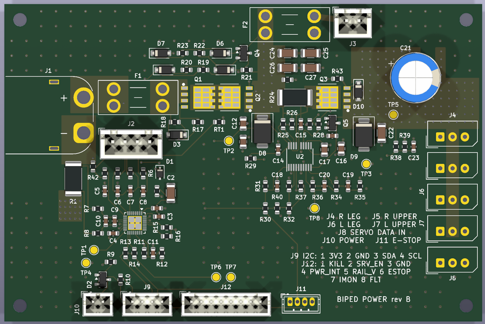
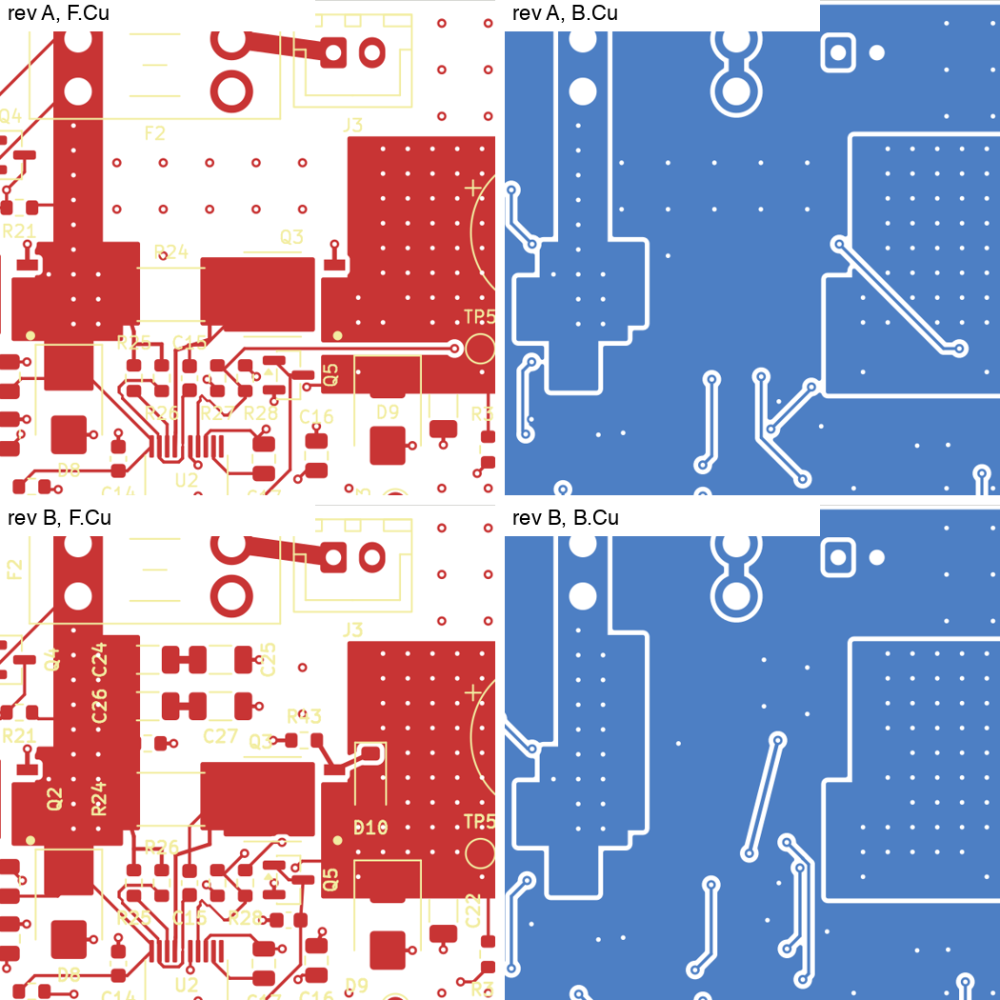

# Power board rev B: the board changes, checked and re-simulated (2026-10-29)

*A dated record. The board is [pcb/power-board](../../pcb/power-board/README.md). Rev A's
pre-order records are the [full simulation](2026-10-24-power-board-full-simulation.md), the
[pin audit](2026-10-24-power-board-pin-audit.md) and the
[layout review](2026-10-24-power-board-layout-review.md), reviewed by Percy on #150 with no
outstanding issues. Tom, 2026-10-29: "Do it" (rev B), the OTP choices "OK", and a firm quote
for 2 and 3 boards.*



## Summary

Rev B carries every board change those records asked for. ERC and DRC are clean, every
schematic net matches its spec, and every power pour fills as one piece. The whole-board
campaign was re-run on rev B on two engines, ngspice 47 and 42, with the same verdict in
every case: all 1152 truth-table cases and all 113 sweeps pass, and the same 52 of the 62
sequences pass. The board-side findings (F-1, F-2, F-5, F-7, F-9) no longer appear.

The ten sequences that still fail depend on something other than the board:
- the BQ76922's OTP image, which the model keeps at TI's defaults and the bring-up writes
  (F-3, F-4, F-6, F-8);
- firmware (F-10);
- how the supply tether is built.

One thing got worse. F-7's capacitors raise Q2's switch-on pulse, so VC0's brief dip below
its rating at each switch-on deepens from −0.68 V to −0.89 V (§2.5).

| item | rev B | evidence (§) |
|---|---|---|
| F-1: SHUTDOWN after KILL | R38/R39 4.7 kΩ / 1 kΩ, and R41 4.7 kΩ from PACK+ to GND | SHUTDOWN 1.2–6.2 s after KILL; POWER works again (§2.2) |
| F-2: a switched-off board wakes itself | D2 BAT54C → Diodes BAV70, R10 10 kΩ → 100 kΩ | no wake to 105 °C typical, 85 °C at the datasheet's maximum leakage (§2.3) |
| F-5: Q3's gate above U2's 16 V | D10, a 15 V zener (MMSZ5245B) from Q3's gate to its source | Q3's VGS peaks at 14.96–15.12 V (rev A 17.3–18.2 V) (§2.4) |
| F-7: PACK+ slew in a servo-side short | C24–C27, 4 × 10 µF on PACK+ as two series pairs | J4 short: PACK+ 15.8 V at 6.4 V/µs (rev A 28.0 V at 158 V/µs) (§2.4) |
| F-9: VC0 has no path to VSS | R42, 1 kΩ from J2.1 to BAT− | ngspice 42's floating VC0 is gone (§2.5) |
| audit F3: R29 under a harness fault | R29 10 kΩ, R30 549 kΩ | 16 mW in a shorted lead; UVLO 7.32 V falling, 7.82 V rising (rev A 7.42 / 7.87 V) |
| audit F4: Q5's bypass | C28, 1 nF across Q5 | TPS4811-Q1 §9.6.1 |
| layout W1: J9 and J11 take the same plug | J11 is a JST ZH 4-pin; the stray "J10" text is gone | no other ZH on the board |
| layout M1: Q3's 37.5 mm gate route | R43 (0 Ω placeholder) and D10 at Q3's gate pad; the gate net runs on B.Cu under Q3 to R28 | about 10 mm (§1.2) |
| layout M2: the FET stencil | drain columns at x −0.062 / +1.582, 0.766 × 0.508 mm fingers | TI SLPS392D §7.3 (§1.2) |
| layout M3: REG18's capacitor | C4 on REG18's F.Cu path, 2.4 mm from pin 15, no vias | §1.2 |
| layout M8: R1's ground end | the pour covers R1's GND pad; 20 vias instead of 10 | §1.2 |
| layout C1: the BOM | TP1–TP8 off the BOM; F1/F2 lines are the holders; TI maker names; C15, C17 and J1 links | §1.3 |
| layout C3: silk | legends 1.0 mm × 0.15 mm; references 0.8 mm × 0.15 mm, PCBWay's minimum | §1.2 |
| labels | C5–C8 "100n 50V", C22 "10u 35V", rated voltages on C9–C11, C15, C18, C20, C23 | the MPNs |
| hand-soldered parts | J1, F1 and F2 do-not-populate | BOM and placement leave them out (§1.3) |

## 1. Checks

### 1.1 Schematic

- **Generated.** The schematic is drawn by the same script as rev A, whose output was first
  proved identical to the committed rev A schematic (SHA-256 `891919aa…`). Rev B's
  SHA-256 is `c34ac86271d54bd91843efd67047f977fbb36ad582bf506dd44823355869c8de`.
- **ERC:** 0 violations. **Netlist against its spec:** 68 nets match pin for pin
  (rev A's 65, plus Q3's gate net and the two series pairs' midpoints). 5 more nets are
  single no-connect pins.
- **D2.** Diodes' BAV70 has the BAT54C's SOT-23 pinout (two anodes, common cathode on
  pin 3), so the footprint and routing stay. Its datasheet limits are 1N4148W's: at most
  25 nA at 20 V and 25 °C, and 30 µA at 25 V and 150 °C. Those are the data rev A's F-2
  fix was simulated with.

### 1.2 Layout

The layout is built by rev A's pipeline (placement, pinned power and Kelvin copper, then
Freerouting and the pours). Before the changes, it reproduced the committed rev A board
exactly: footprints, tracks, vias, zones and texts all equal.

- **DRC:** 0 violations, 0 unconnected pads, 0 footprint errors. Every power pour (BAT+,
  FBAT, MID, PACK+, SRV_D, SERVO+, BAT−, R1's GND) fills as one piece, and R7/R8's Kelvin
  pads touch only their own trace.
- **Q3's gate (M1).**
  - R43 and D10 sit at Q3's gate pad.
  - From R43 the gate net drops through a via, runs 7.5 mm on B.Cu under Q3 (GND there),
    and comes up beside R27 and R28: about 10 mm from R43 to R28.
  - Rev A's route was 37.5 mm and cut through the SERVO+ pour on both layers.

  
- **PACK+ bulk.** C24–C27 and R41 sit above R24. The PACK+ pour's lobe to F2 widens to
  take their PACK+ pads, and the pairs' midpoints are short 0.5 mm traces.
- **The FET stencil (M2).** TI's §7.3 chain is: source apertures 1.072 mm wide, 1.525 mm,
  a 1.294 mm column, 0.350 mm, a second column, 0.286 mm, then 0.766 mm finger apertures,
  6.586 mm in all. The drain paste is now TI's 9.28 mm².
- **C4 (M3).** U1's pin-15 corner is taken by the TS1 and TS2 escape vias and the threaded
  SRP/SRN traces. C4 now sits on REG18's existing F.Cu path, 2.4 mm from the pin, with no
  vias (rev A: about 8 mm and two vias). Its BAT− end has its own via into the island.
- **R1 (M8).** The ground pour now covers R1's GND pad west of the SRN pick-off, and twenty
  0.8/0.4 mm vias join it to the planes.
- **Silk (C3).** The legends are 1.0 mm high and the references 0.8 mm, all with 0.15 mm
  strokes. PCBWay's minimum is 0.8 mm × 0.15 mm ([its capabilities page](https://www.pcbway.com/capabilities.html)). At 1.0 mm, 46
  references would have no room on the silk; at 0.8 mm, 12 have none and stay on F.Fab.

### 1.3 Fab outputs

`fab.sh` regenerated `fab/` after its ERC and DRC gates.
- **The board:** 97.1 × 64.6 mm, 4 layers, 1 oz copper on every layer, 115 footprints,
  463 vias.
- **BOM:** 52 lines. **Placement:** 100 parts. Neither lists J1, F1, F2 or the test points.
- **Through-hole joints for the assembler:** 41 a board (C21 and J2–J12).

## 2. Simulation of rev B

### 2.1 The campaign

The whole campaign ran on rev B's netlist on both engines: ngspice 47 on the Mac
and ngspice 42 on Mira.

| suite | cases | pass, ngspice 47 | pass, ngspice 42 | verdicts that differ |
|---|---|---|---|---|
| truth table | 1152 | 1152 | 1152 | 0 |
| sequences | 62 | 52 | 52 | 0 |
| sweeps | 113 | 113 | 113 | 0 |

Across the two engines, the largest difference in a truth-table number is 0.95 mV, and the
largest in a sequence is Q2's turn-on peak (1.9 A of 57 A).

Changes to the model for rev B:
- **New device models.** The BAV70 has its datasheet's forward limits and the leakage
  above, and the MMSZ5245B is a 15 V zener. R43's 0 Ω is modelled as 0.1 mΩ.
- **Rev A's what-ifs are gone.** The parts they added are on the board now, so
  re-adding them would count them twice. Rev A's record keeps their results.
- **The ESP32's inputs above VDD are judged by clamp current, as RAIL_V already was.**
  When +3V3_HOST collapses, a pin held up by its pull-up and the lead's capacitance lags
  the rail. With R10 at 100 kΩ, PWR_INT_N lags by about 0.6 V for 8–21 µs at each
  power-down. The model's clamp then carries some 20 µA, and the limit is 1 mA, since
  Espressif publishes none. Rev A's 10 kΩ kept the lag under a microsecond.
- **C24–C27 carry 5 mΩ of ESR each,** and their capacitance is the rated 10 µF, as C22's
  is. Without the ESR, a hard short on PACK+ behind the supply tether's inductance leaves
  ngspice 47 with no timestep. Rev A's what-if took half the capacitance and 6 mΩ a pair.
  At half capacitance one hot-plug sequence has no timestep on ngspice 47. Half
  capacitance was therefore run separately, as a bound on the shorts (§2.4).
- **An operating-point warning is no longer a failure.** With the ESR, ngspice reports a
  singular matrix for some switched-off cases, then solves the operating point by gmin
  stepping. The harness had counted that warning as a failed case; it now fails a case
  only when gmin stepping fails too, or the run stops.

### 2.2 Shutdown (F-1)

Every shutdown now reaches SHUTDOWN (ngspice 47; ngspice 42 within 1 ms). The bench case
then presses POWER, and the board switches back on.

| sequence | SHUTDOWN after KILL |
|---|---|
| no servos (bench), `shutdown_no_servos_bench` | 3.40 s; PACK+ under 0.5 V at 5.76 s; POWER switches it back on |
| rail dropped first, `shutdown_rail_dropped_first` | 5.19 s |
| the same, the General Driver drawing 100 µA below UVLO | 4.74 s |
| rail on at KILL, `shutdown_rail_on_at_kill` | 6.20 s |
| servos drawing below 5 V, `shutdown_servos_resistive_lowv` | 1.21 s |
| flat pack, 3.4 → 2.9 V a cell, `low_battery_ramp` | SHUTDOWN at 11.4 s from the start |

Rev A was still in soft shutdown 6.5–10.5 s after KILL in each of these, with POWER
ignored, and the flat pack was held after its CUV cut. The times are the ones rev A's
what-if predicted (3.4–6.2 s). `shutdown_power_still_held` passes too: with POWER still
pressed after KILL, the board does not re-wake.

### 2.3 A switched-off board at temperature (F-2)

D2's leakage at the datasheet's limits, TS2 and LD in volts. Wake needs TS2 below
0.7 V (BQ76922 DS 6.3).

| °C | TS2, typical | TS2, maximum leakage | LD typical / maximum |
|---|---|---|---|
| 25 | 4.99 | 4.87 | 0.00 / 0.00 |
| 50 | 4.95 | 4.48 | 0.00 / 0.02 |
| 65 | 4.88 | 3.79 | 0.01 / 0.04 |
| 75 | 4.79 | 2.87 | 0.01 / 0.05 |
| 85 | 4.62 | 1.24 | 0.02 / 0.07 |
| 95 | 4.34 | **0.27** | 0.03 / 0.09 |
| 105 | 3.83 | **0.20** | 0.05 / 0.10 |

- **Typical part:** no wake to 105 °C (rev A's BAT54C woke at about 80 °C).
- **At the datasheet's maximum leakage:** no wake to 85 °C, the BQ76922's own functional
  limit (DS 6.1); it wakes between 85 and 95 °C (rev A: from about 5 °C).
- **POWER pressed still reads clearly:** TS2 is at most 0.42 V, at −20 °C, under the 0.7 V
  wake level. PWR_INT_N is at most 0.54 V, under the ESP32's 0.83 V (0.25 × VDD).

`python -m pbsim.board.summarize` prints the full table, −20 to 105 °C.

### 2.4 Q3's gate and PACK+ in faults (F-5, F-7)

**Q3's gate (F-5).** D10 clamps Q3's gate to its source. The worst cases are the cuts
with the rail on: the BQ76922's OCD trip at the low corner, and PACK+ shorts on the board.

| sequence | Q3 VGS peak, rev B | rev A |
|---|---|---|
| `rail_load_17A_ocd_low_corner` | 14.96 V | 17.74 V |
| `ocd_trip_then_power_press` | 14.96 V | 17.73 V |
| `short_packplus_board` | 15.06 V | 17.34 V |
| `short_packplus_board_stiff_pack` | 15.12 V | 18.24 V |

U2's PD−SRC rating is 16 V; the stress monitor no longer reports it anywhere.

**PACK+ in servo-side shorts (F-7).** U2 still trips first, as fast as on rev A.

| short | PACK+ peak, slew | Q3 VDS | U2 trips | rev A |
|---|---|---|---|---|
| far end of J4, 15 mΩ pack | 15.8 V, 6.4 V/µs | 7.8 V | 15.8 µs | 28.0 V, 158 V/µs; Q3 19.5 V |
| far end of J4, 5 mΩ pack | 16.9 V, 7.1 V/µs | 8.8 V | 14.4 µs | 29.3 V, 162 V/µs; Q3 20.7 V |
| SERVO+ on the board | 19.1 V, 10.8 V/µs | 14.1 V | 7.3 µs | 34.0 V, 181 V/µs; Q3 28.6 V |
| far end of J4, supply tether | 16.1 V, 5.3 V/µs | 8.9 V | 33.1 µs | 27.5 V, 162 V/µs; Q3 20.0 V |

U2's slew rating is 60 V/µs and Q3's VDS rating 30 V.

The model gives C24–C27 their rated 10 µF, but X7R loses part of that under DC bias. Each
capacitor in a pair sees about 5.7 V. The same four shorts were run with half the
capacitance as a bound, on ngspice 47:
- the J4 shorts: 18.2–19.4 V at 11.2–12.6 V/µs, Q3 10.3–11.4 V;
- SERVO+: 22.4 V at 19.9 V/µs, Q3 17.7 V;
- the tether: 18.7 V at 9.3 V/µs.

Both bounds are inside both ratings.

**What the bulk adds at switch-on.** Q2 now also charges C24–C27 when it closes. Its
turn-on pulse rises from 45 A to 57 A (51 A at half capacitance), still far inside its SOA
and below SCD (150 A). VC0's dip at switch-on deepens with it (§2.5).

### 2.5 The cell inputs (F-9)

- **The floating island (TI DS §8.3).** R42 gives VC0's lead the DC path to VSS that TI
  asks for.
  - Balance lead in, XT60 out: on ngspice 42, VC0 is past its −0.3 V rating only in each
    run's first 0.13–0.14 ms, while the simulation starts. Rev A sat at −1.45 V for the
    whole state. ngspice 47 shows no excursion, on either revision.
  - Hot-plugs in every order pass on both engines.
- **The dip at every switch-on is deeper.** Q2's turn-on pulse in the pack's negative lead
  pulls VC0 below VSS:
  - Rev B: −0.89 V for 9.8 µs, in all 216 truth-table switch-ons with both connectors in.
  - Rev A: −0.68 V for 8 µs, in 72 of them.
  - The cause is the larger pulse (§2.4). At half the bulk's capacitance it is −0.73 V.
  - The model's input clamp (1 fA, 10 Ω) carries about 11 mA at −0.89 V, against 0.24 mA
    at −0.68 V. TI rates VC0 at VSS − 0.3 V and publishes no clamp current for it. Its
    nearest current limits are 75 mA on VSS and 100 mA of balancing current (DS 6.1).
  - Rev A's record names the lever if the bench shows trouble: R3 toward 100 Ω, inside
    TI's 20–100 Ω range. It is not in rev B.

### 2.6 What still fails, and why

The same ten sequences fail on both engines. None is a board-side finding; each depends
on a setting, on firmware, or on the tether.

| sequence | what it shows | depends on |
|---|---|---|
| `ocd_trip_then_power_press` | after an OCD cut, POWER cannot switch the board back on | OTP: F-3, TI's default (latched), as Tom chose: unplugging the pack resets it, and with F-4's setting only a PACK+ fault reaches OCD |
| `ocd_trip_otp_time_recovery` | with time recovery, the board comes back by itself 3.0 s after the cut | OTP: the F-3 option not chosen |
| `otp_f3_pack_fault_time_recovery` | the same after a PACK+ fault, at 4.1 s | OTP: the F-3 option not chosen |
| `rail_load_17A_ocd_low_corner` | 17 A on the rail, under U2's 19.5 A breaker, trips the BQ76922's OCD at its −4 mV corner, and the whole robot goes off | OTP: F-4, OCD1 to 30 mV at bring-up (`rail_load_17A_otp_ocd30` passes) |
| `cuv_weak_cell_under_load` | after a CUV cut the board comes back by itself at 4.33 s | OTP: F-6, Shutdown Cell Voltage = CUV with 0 s delay (`otp_f6_shutcell_cuv_0s` passes) |
| `otp_f6_shutcell_cuv_1s` | the same with a 1 s delay | OTP: the F-6 option not chosen |
| `otp_f6_cuv_hys_300mV` | POWER at 6 s does not switch it back on | OTP: the F-6 option not chosen |
| `short_packplus_persistent_default_otp` | the BQ76922 re-closes Q2 into a lasting short twice | OTP: F-8, SCDL latch limit 1 (`short_packplus_persistent_scdl1` passes) |
| `estop_stuck_rail_bench_no_servos` | the firmware's 2 s / 70 % stuck-rail rule fires on a bench with no servos | firmware: F-10 |
| `tether_short_packplus_12V_loose` | a PACK+ short behind a tether of two loose wires puts 31.3 V across Q2 (30 V rating) | the tether: harness.md says to twist the lead (`…_twisted`: 24.7 V) |

`otp_f3_pack_fault_time_recovery` also reports VC0 at −1.05 V for 30 µs during the fault.
Rev A showed −0.97 V for 28 µs there.

## 3. The BQ76922 configuration for bring-up

Tom, 2026-10-29. The options behind each choice were simulated in the 2026-10-24 record:
- SCDL latch limit 1 (F-8);
- OCD1 at 30 mV (F-4);
- OCD recovery left at TI's default, latched (F-3);
- Shutdown Cell Voltage = CUV with Low V Shutdown Delay 0 (F-6);
- and the pin audit's C1–C9.

The `otp_*` sequences show each setting's effect on rev B.

## 4. What is left before ordering

- **A firm quote,** for 2 and 3 boards, from the rev B files.
- **The physical checks P1–P7** in harness.md, and T1, the supply tether's SERVO+ check.
- **The parts,** still to be chosen: the buttons. The torso outline and holes (#108).
- **Firmware:** F-10's stuck-rail rule, which is still 2 s / 70 %.

## 5. Reproduce

```bash
make pbsim                                    # the gate's sample
make pbfull                                   # the campaign (KiCad 10, libngspice)
cd pcb/power-board && python -m pbsim.board.crosscheck \
    ../../build/power-board/fullsim:ngspice-47 ../../build/power-board/fullsim-ng42:ngspice-42
sh pcb/power-board/fab.sh                     # ERC, DRC and the fab outputs
```

Per-case verdicts on both engines: [2026-10-29-power-board-rev-b-cases.txt](2026-10-29-power-board-rev-b-cases.txt).
