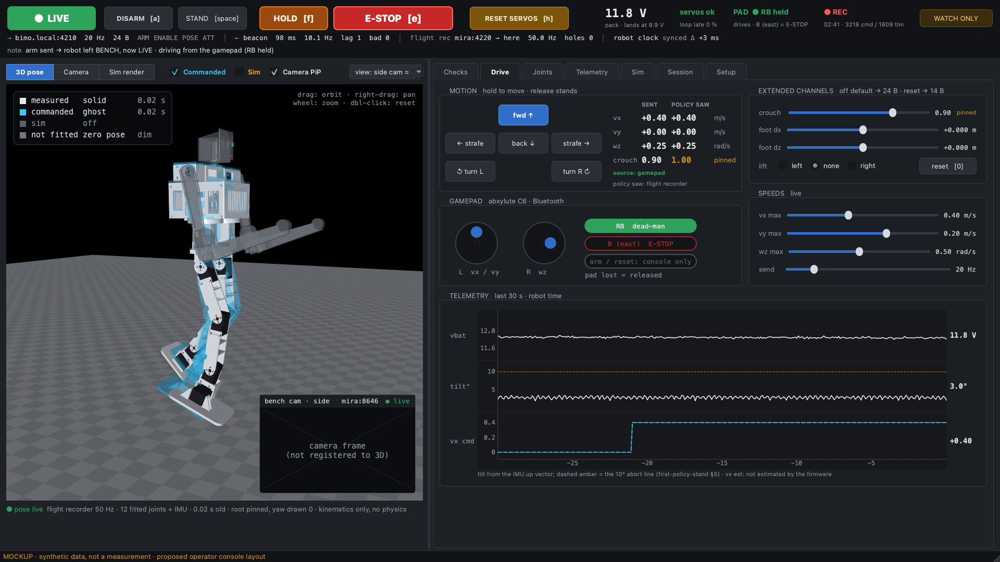
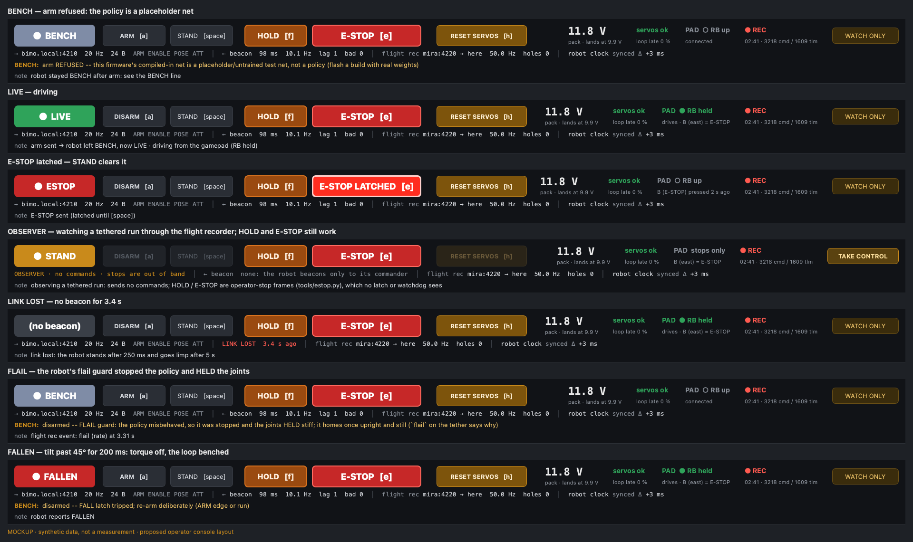
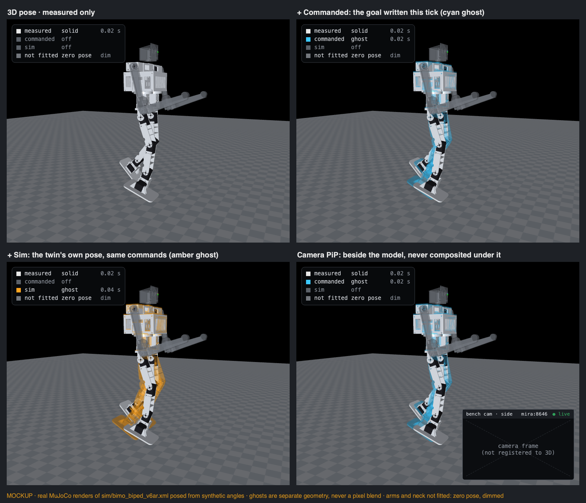
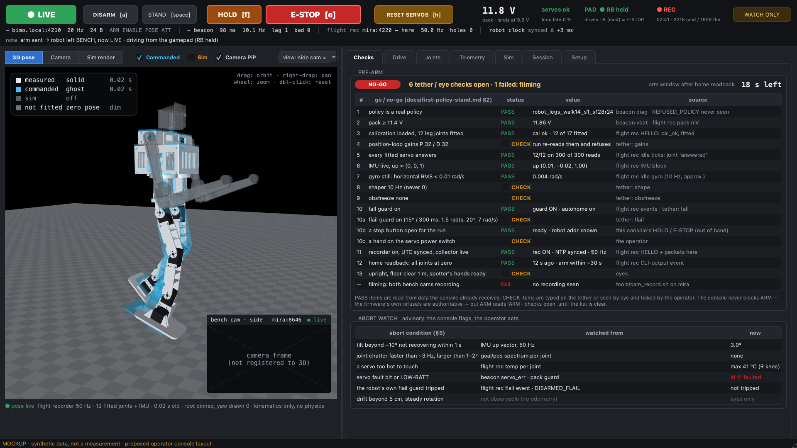
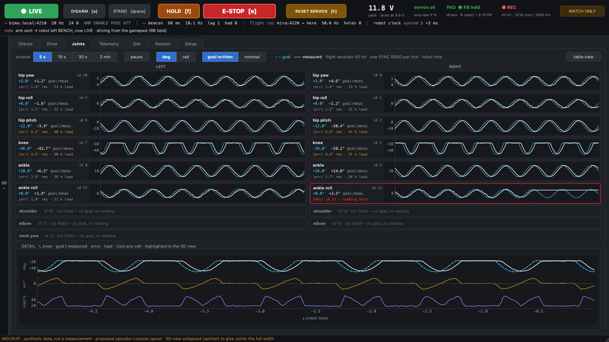
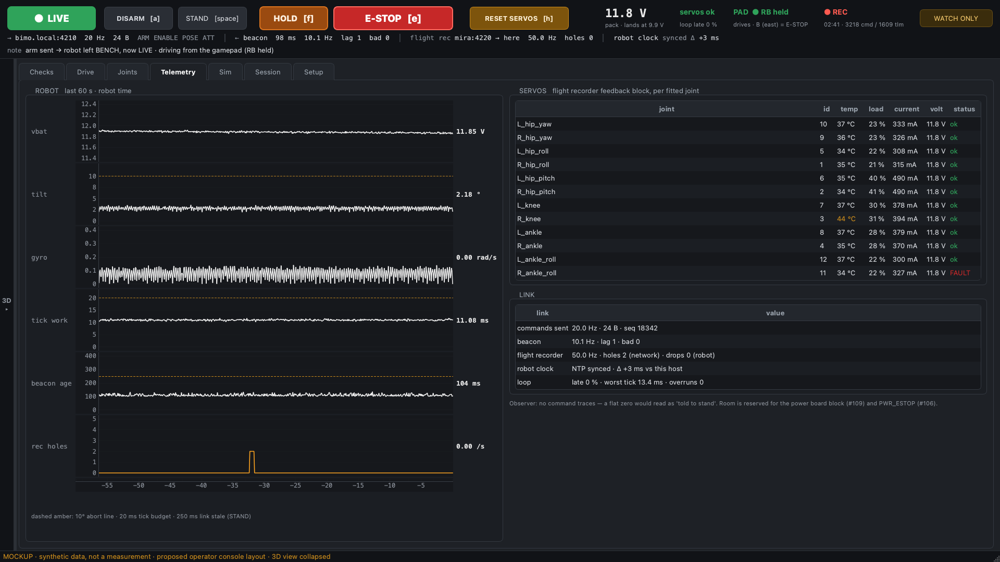
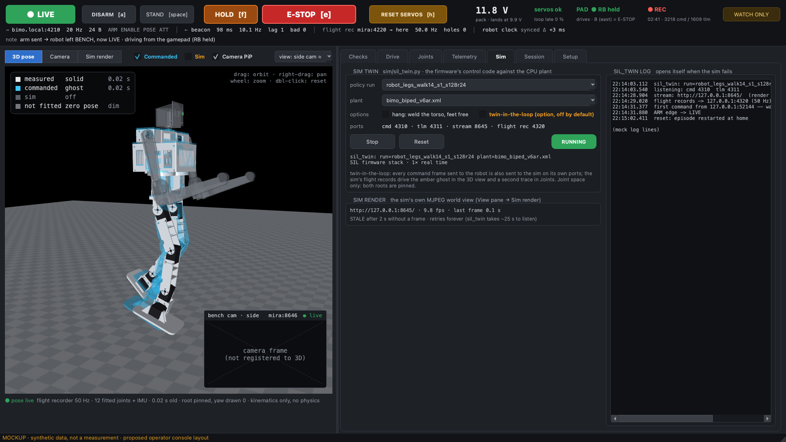
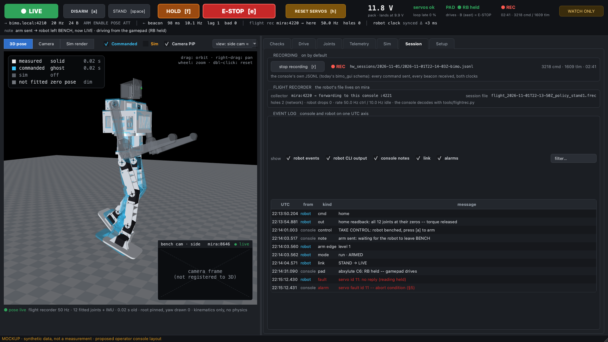
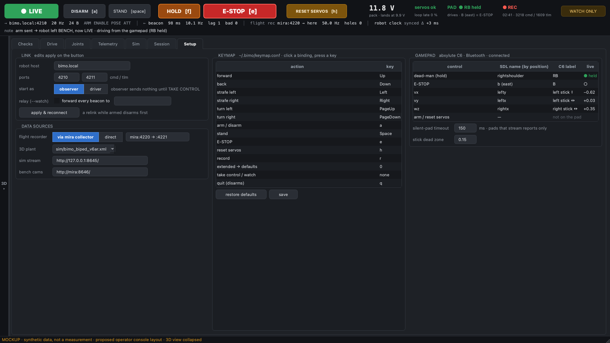

# Operator console v2: UI design (2026-11-01)

*A design record; the console is built from it as `link/bimo_console.py`
([console.md](../console.md)), and §17 lists where the build departs from it.
It replaces `bimo_gui` ([`link/gui.cpp`](../../link/gui.cpp),
C++ Dear ImGui) with a native Qt window in Python: tabs, a 3D view of the robot's
measured pose with commanded / sim / camera overlays, commanded-vs-measured
graphs for every joint, a Bluetooth gamepad, and a pre-arm checklist. Every
picture below is a mockup: a static PyQt6 + pyqtgraph window filled with
synthetic data ([`figs/console_ui_mockups.py`](figs/console_ui_mockups.py)); the
3D views are real MuJoCo renders of [`sim/bimo_biped_v6ar.xml`](../../sim/bimo_biped_v6ar.xml)
posed from synthetic angles. Nothing in them is a measurement.*



## 1. Goals and non-goals

**Goals**

- One native window (AGENTS.md "Local tools are native tools", [AGENTS.md:222](../../AGENTS.md)),
  laid out in tabs, readable at a glance, with the safety controls on every tab.
- The robot drawn in 3D from what it **measured**, with the **commanded** pose,
  the **sim twin** and the **bench camera** as optional, clearly separated overlays.
- Commanded vs measured for every joint, at the control rate.
- Drive from a Bluetooth gamepad as well as the keyboard, with a held dead-man.
- Support the written bench procedure ([first-policy-stand.md](../first-policy-stand.md)):
  its go/no-go list (§2), its abort conditions (§5), and its warning that a console
  started during a tethered run takes over the robot's watchdog (:88).
- Keep every safety rule `bimo_gui` learned (§3), single-sourced.

**Non-goals**

- No web UI, no browser tab, no served page for the console itself.
- No change to the wire protocol or the firmware for this console. The data
  the new views need already leaves the robot (the flight recorder, §8).
- No camera-to-model registration (AR overlay) in this design; §5 says why and
  what it would take.
- The SSH terminal console `bimo_tui` stays.

## 2. Who uses it, for what

| workflow | today | in this console |
| --- | --- | --- |
| first policy stand, tethered `run` | no commander may run ([first-policy-stand.md](../first-policy-stand.md) §3); the stop is `tools/estop.py --button` on mira; data read afterwards from the `.frec` | starts as **observer**: sends no commands, watches the flight recorder live through mira's collector, and its HOLD / E-STOP are the same out-of-band stop frames; Checks tab walks §2 |
| wireless arm and drive | `bimo_gui` keys / `commander.py` gamepad / `arm_script.py` | one window: keys or gamepad, safety bar, Joints and 3D view live |
| drive the sim twin | `bimo_gui` SIM panel spawns `sil_twin` | Sim tab; optionally twin-in-the-loop beside the robot |
| watch someone else drive | `bimo_gui --readonly` + the driver's `--watch` relay | observer mode, beacon relay unchanged; flight recorder needs no relay from the driver |
| review a session | `tools/flight_reader.py plot`, the console JSONL | Session tab event log now; later, open a recording into the plots |
| film the run | `tools/cam_record.sh` on mira | Checks tab shows whether recording is on; camera PiP / split view |

## 3. Design principles (inherited, each from a fixed bug or a rule)

- **A released input stops the robot on the next frame**, and so does losing
  focus ([gui.cpp:13](../../link/gui.cpp), [:1683](../../link/gui.cpp)).
- **A frozen GUI sends nothing, so the robot stands**: the link tick runs on the
  GUI thread, as today. No sender thread that could outlive a hung window.
- **Never show a picture that looks like a measurement and is not**: mirror's
  60/40 ghost blend was "part measurement and part guess" ([gui.cpp:490](../../link/gui.cpp));
  a stale view says FROZEN / STALE with its age; an observer shows no command traces.
- **Text that moves has to be re-read**: fixed-width numeric fields ([gui.cpp:834](../../link/gui.cpp)).
- **E-STOP is always red** — "a blue E-STOP is a lie" ([gui.cpp:968](../../link/gui.cpp)) —
  and, being out of band, live in every role, an observer's included.
- **The take-control key is unbound by default** (a stray key once turned a driving
  console into a watcher mid-arm, [keymap.cpp:137](../../link/keymap.cpp)).
- **Record by default** ([gui.cpp:2005](../../link/gui.cpp)).
- **One copy of every safety rule**: arming, E-stop latch, home frames and handover
  live in [`link/client.h`](../../link/client.h), shared with `bimo_tui`, because
  "two copies of a rule drift the moment one side is reworked" ([client.h:9](../../link/client.h)).
- **Handing over never drops the robot**: TAKE CONTROL adopts a running robot's
  arm level ([client.h:294](../../link/client.h)); WATCH ONLY sends no parting disarm.
- **Stopping never needs control.** The operator stop (`kFlagStop`) is out of band:
  the robot counts it and never puts it in the command mailbox, so no latch or
  watchdog sees it and no commander can undo it
  ([control-channel.md](../control-channel.md), [`tools/estop.py`](../../tools/estop.py)).
  The console's HOLD and E-STOP are those frames, in every role.

## 4. Window layout

Three regions, always in this order:

1. **Safety bar** (top, every tab, never scrolls): the state badge (colour per
   link state), ARM/DISARM, STAND, **HOLD** (soft stop: policy stopped, joints held
   stiff, the robot homes once upright and still), **E-STOP** (hard stop: torque
   off now), RESET SERVOS on its own amber, battery,
   servo health, gamepad state, recording, TAKE CONTROL / WATCH ONLY; a fixed-width
   link line (what is sent, the beacon, the flight recorder, the robot clock); the
   BENCH reason whenever the robot reports one; the last console note.
2. **View pane** (left, collapsible with a splitter): the 3D pose view (§5), or a
   camera, or the sim's own render.
3. **Tabs** (right): Checks · Drive · Joints · Telemetry · Sim · Session · Setup.

ARM, STAND, HOLD and E-STOP keys are application-level shortcuts, so they work on every
tab and whichever widget has focus (the `sim/joint_puppet.py` key-filter pattern);
a focused text field still swallows motion keys, as `WantCaptureKeyboard` does today.

The safety bar in the states that matter:



## 5. View pane: the 3D pose and its overlays



- **Measured, solid.** The console holds a MuJoCo model of the robot's plant
  (Setup; `sim/bimo_biped_v6ar.xml` names all 17 bus joints), sets `qpos` by joint
  name from the latest flight-recorder tick (or the beacon's joint block when no
  flight records arrive), torso attitude from the IMU, and runs `mj_kinematics`
  only — no `mj_step`, no physics, one thread, so the GUI-vs-physics `MjData` race
  in AGENTS.md cannot happen. It renders offscreen to a `QImage`
  (the `joint_puppet.py` pattern, [joint_puppet.py:664](../../sim/joint_puppet.py)), on a new
  sample or a camera move, capped at the screen rate. Root position pinned, yaw
  drawn 0, as [mirror-mode.md](../mirror-mode.md) does: the robot has no odometry.
  Unfitted joints are drawn at the plant's zero pose, dimmed, and the legend says so.
- **Commanded, cyan ghost**: the goal written in the same tick (flight recorder
  `goal`), or the policy's nominal target (Joints tab toggle). Joints with no goal
  draw no ghost.
- **Sim, amber ghost**: the sim twin's own pose when it is driven by the same
  command frames (twin-in-the-loop, §6 Sim). Joint space only; both roots pinned.
- **Ghosts are separate geometry** — a second `MjData` added with `mjv_addGeoms`,
  its rgba overridden — never a pixel blend of two renders.
- **Camera**: the bench cameras ([`tools/cam_live.py`](../../tools/cam_live.py), MJPEG on
  mira:8646) as picture-in-picture, as a split, or alone (source "Camera"). **Never
  composited under the model**: without a calibrated camera and a known robot base
  pose, the composite would look like a measurement and not be one. A composited
  AR mode is valid only where the base is fixed to the camera (the hang stand),
  after a one-time camera calibration — a later phase, if wanted.
- **"Sim render"** shows `sil_twin`'s own MJPEG world view (floor, contacts,
  position). The console never feeds `sil_twin` a ghost; its non-viewer render
  still blends one ([sil_twin.py:439](../../sim/sil_twin.py)).
- Every layer carries its age; a layer older than 1 s reads FROZEN.
- Camera control as in `joint_puppet.py` (orbit / pan / zoom / double-click reset),
  presets front / side / rear / top and approximate "side cam" / "rear cam" angles.
- Selecting a joint in the Joints tab highlights its link here.

## 6. The tabs

### Checks



The go/no-go list of [first-policy-stand.md §2](../first-policy-stand.md), each row
with where its value comes from. Rows the console can read from data it already
receives turn PASS or FAIL by themselves: pack voltage, calibration and fitted
joints (flight-recorder HELLO), every fitted servo answering, IMU up vector and
gyro, the recorder and NTP state, the home readback (a CLI-output event) and the
time left in the ~30 s arm window, and whether a stop is ready (10b: this
console's HOLD / E-STOP count, since they are the out-of-band frames). Rows only
the tether or the eyes can answer (gains, shaper, obsfreeze, the flail guard's
limits, a hand on the servo power switch, the floor and the spotter) are ticked
by the operator.
The console does **not** block ARM — the firmware's refusals are authoritative —
but the ARM button reads "ARM · checks open" until the list is clear.

The **abort watch** shows each §5 condition with what it is watched from, and
whether the robot's own flail guard has tripped (a flight `flail` event,
`DISARMED_FLAIL`). It is advisory: the console flags, the operator and the
spotter act. The robot judges itself (the flail guard holds the joints; the fall
guard goes limp); a console-side automatic E-stop would only add a limp robot
nobody is holding ([first-policy-stand.md §4](../first-policy-stand.md)).

### Drive

The hold-to-move pad (keyboard, mouse or gamepad), the speeds and send rate
(5–100 Hz; the 5 Hz floor stays), the extended channels, and two columns side by
side: what was **sent** and what the **policy saw** (the 7-wide command in the
flight record). The second column is what makes the current policy's pinned
channels visible: whatever the console sends, `robot_legs_walk14_s1` sees
crouch = 1 ([first-policy-stand.md §1](../first-policy-stand.md)). Charts: pack,
tilt with the 10° abort line, commanded vx.

### Joints



One cell per bus joint, laid out by side (LEFT | RIGHT) and limb, proximal to
distal: goal (dashed) and measured (solid) on a shared robot-time axis, the
latest values, the error RMS and the load. Source: the flight recorder at 50 Hz,
one SYNC READ per tick, so every joint has the same timestamp. A faulted servo
gets a red border and is labelled "reading held" (the firmware holds its last good
angle). Unfitted joints are one line. Toggles: window (5 s – 2 min), pause, deg/rad,
goal written / nominal. A detail plot of the selected joint adds error and load.
"Table view" gives the same numbers as a table.

### Telemetry



Strip charts on a real time axis (today's charts are indexed by sample,
[gui.cpp:72](../../link/gui.cpp)): pack, tilt, gyro, the control tick's work time against
its 20 ms budget, beacon age against the 250 ms stale line, flight-recorder holes.
`loop_late`, collected but never plotted today ([gui.cpp:367](../../link/gui.cpp)), is in the
link table. Per fitted servo: temperature, load, current, voltage, status, from
the flight recorder's feedback block. An observer shows no command traces. Room
is reserved for the power board's block (#109) and `PWR_ESTOP` (#106).

### Sim



Today's SIM panel, moved to its own tab: policy run, plant, hang, Start / Stop /
Reset, the ident line, the sim's ports, the `sil_twin` log (opens itself when the
sim fails). New: **twin-in-the-loop**, an option, off by default — every command
frame sent to the robot is also sent to the sim on its own ports, and the sim's
flight records drive the amber ghost and a second trace in Joints. This is
AGENTS.md's "twin first" as a live view.

### Session



The console's own recording (on by default; today's JSONL schema), the flight
recorder's state (collector, session file on mira, holes and drops), and one event
log for console notes and robot events — CLI commands and their printed output,
arm and home edges, mode handovers, link-state changes, faults — on one UTC axis,
filterable.

### Setup



Link (apply on the button; a relink while armed disarms first), **start as observer
or driver**, the beacon relay, data sources (flight recorder via mira or direct,
the 3D plant, stream URLs), the keymap (same `~/.bimo/keymap.conf` and format), and
the gamepad mapping with a live test.

## 7. Interaction and safety model

**Roles.** The console **starts as an observer** and sends no commands until TAKE
CONTROL. An observer still sees the robot through the flight recorder, which mira
forwards; the robot only beacons to its commander, so an observer without a
driver gets no beacon. Opening the console during a tethered run is therefore
safe by construction ([first-policy-stand.md](../first-policy-stand.md) §3: once
any command frame arrives, the watchdog follows that sender).

**Stops are for everyone.** HOLD and E-STOP send `tools/estop.py`'s frames —
`kFlagStop`, soft or hard, 100 Hz for 1 s, to the robot's address and the LAN
broadcast — and read the confirmation from the beacon; an unconfirmed HOLD is
escalated to a hard stop within 400 ms, as the tool does. They work in every
role and state, a driver's E-STOP also sets the classic latched ESTOP level, and
the console reuses the tool's code rather than a copy. A stop takes the beacon
(the robot answers its last sender), so after an observer's stop the driver
sees the beacon move until its next frame. The servo power switch stays the last
word.

**Controls by state** (driver; an observer has only HOLD and E-STOP):

| state | ARM | STAND | HOLD / E-STOP | RESET SERVOS | motion |
| --- | --- | --- | --- | --- | --- |
| BENCH | arm | — | yes | yes | refused: "not armed" |
| STAND / LIVE | disarm | yes | yes | yes (benches) | yes |
| ESTOP latched | disarm | clears the latch | yes | yes | refused until STAND |
| FALLEN / FLAIL / STOP / VSAFE | arm (fresh edge) | — | yes | yes | refused |
| link lost | — | — | yes (sent blind, unconfirmed) | — | released |

The refusal texts follow the keymap (today they hard-code `[a]` and `[space]`).

**Inputs.** Keyboard motion is a level while the key is down, unaffected by auto-repeat;
mouse hold buttons merge with the keys. Window focus loss releases everything.

**Gamepad.** SDL's GameController API, mapped by position, not by raw index
(`link/sources.py` uses raw indices today, [sources.py:230-233](../../link/sources.py)):
`rightshoulder` = dead-man (hold), east = E-STOP (the out-of-band hard stop, in
every role), left stick = vx / vy (vx through `stick_to_speed`'s trained band),
right stick x = wz. The pad cannot ARM or RESET SERVOS. The procedure's advice
for an operator who is also the spotter — the stop in one hand as a button
([first-policy-stand.md](../first-policy-stand.md) §4) — is this. While the
dead-man is held the pad drives and motion keys are ignored; the bar says which
source drives. Labels follow the pad (the abxylute C6 uses the Xbox letters: RB,
B). A disconnected pad releases everything.

**The Bluetooth hazard.** A pad that goes out of range or flat while the dead-man
is held leaves the console sending its last command — the link is fine, so the
robot's own watchdog never fires. The console must detect it. A pad held still
sends no new input events, so silence alone means nothing unless the pad streams
reports continuously (a motion sensor's do); otherwise the only signal is the OS
disconnect event, whose latency is unmeasured. Measure both on macOS and Linux
before the gamepad drives the robot (phase 6); until then the pad drives the sim only.

**Leaving.** Quit and window close disarm (10 frames), a relink disarms first,
WATCH ONLY sends no parting disarm, and an observer's quit sends nothing — all as
today.

## 8. Data sources

| source | rate | carries | path to the console |
| --- | --- | --- | --- |
| beacon ([control-channel.md](../control-channel.md)) | 10 Hz | state, vbat, up, servo_err, loop_late, robot clock; joints (POSE) and attitude (ATT) when asked | robot → its commander, UDP 4211 |
| flight recorder ([flight-recorder.md](../flight-recorder.md)) | 50 Hz armed, 10 Hz idle, 1 Hz HELLO, events | per fitted joint: nominal, goal, position, speed, load, current, voltage, temperature, flags; IMU; the command the policy saw; tick timing; CLI lines | robot → mira collector :4220 → **forward** → console |
| sim twin | 50 Hz | the same flight records (new) | `sil_twin` → console |
| streams | ~10 fps | sim render (:8645), bench cams (mira:8646) | MJPEG over HTTP, read natively |
| console recording | per tick / per beacon | today's JSONL schema | local file under `hw_sessions/` |

The flight recorder is what makes the Joints tab and the commanded ghost possible
without touching the robot: it already sends goal and measured position for every
fitted joint from one bus read per tick. A new commanded-joint telemetry block on
the 10 Hz beacon was considered and dropped for it.

## 9. Changes outside the console

1. **Telemetry receive buffers** (a bug, fixed separately): joint beacons are 65 / 69 B
   but every receiver read 64 B, so mirror mode and the probes' guards got no
   joint beacons since protocol v2.
2. **`tools/flight_collector.py --forward HOST:PORT`**: re-send every datagram
   verbatim, best-effort, after writing it — the `--watch` pattern. mira keeps the
   file; the console gets the stream. (`--port` is the only network option today,
   [flight_collector.py:360](../../tools/flight_collector.py).)
3. **`sim/sil_twin.py`** emits flight records (from its SIL targets and measured
   joints, through `tools/flightrec.py`) and sends the attitude block when asked
   (it never sends `up_xy` today).
4. **Dependencies**: `pyqtgraph` and `pygame` (SDL) join `PyQt6` in `requirements.txt`.

No firmware change.

## 10. Architecture

- `link/console/`: the Qt application (safety bar, view pane, tabs, gamepad).
- **The rules stay in C++.** A small `extern "C"` layer over
  [`link/client.{h,cpp}`](../../link/client.h) (plus keymap, recorder, simproc and MJPEG),
  built as a shared library by `firmware/host` (Makefile and CMake, so
  `make cmake-check` holds) and loaded with ctypes, the
  [`sim/sil/harness.py`](../../sim/sil/harness.py) / `firmware/host/sil_lib.cpp` pattern
  ([harness.py:522](../../sim/sil/harness.py)). `gui.cpp`'s non-drawing safety logic
  (relink disarm, quit disarm, observer key filtering) moves into that layer so
  both front ends run the same code until `bimo_gui` retires.
- **Threads.** The link tick (a `QTimer`), beacon and flight-record sockets
  (`QSocketNotifier`), the gamepad poll and the 3D render all run on the GUI thread.
  MJPEG readers run on their own threads and hand over decoded frames.
  Flight records decode with [`tools/flightrec.py`](../../tools/flightrec.py); stops are
  sent with [`tools/estop.py`](../../tools/estop.py)'s frame and confirmation code.
- `--headless` with today's stdin verbs, so [`tests/test_gui_e2e.py`](../../tests/test_gui_e2e.py)
  runs against both consoles.

## 11. Feature parity with `bimo_gui`

| `bimo_gui` today | here |
| --- | --- |
| header: link line, state badge, ARM / STAND / E-STOP, RESET SERVOS, BENCH reason, notes | safety bar, plus battery, servos, pad, recording, flight recorder |
| TAKE CONTROL / WATCH ONLY, `--readonly`, `--watch` relay | the same; starting as observer is the default |
| DRIVE: hold buttons, wire readout, extended channels | Drive tab, plus "policy saw" |
| SETTINGS: link, speeds, rate, relay, sim, paths, screenshot | Setup tab (speeds and rate live on Drive) |
| KEYMAP pane, `~/.bimo/keymap.conf` | Setup tab, same file and format |
| TELEMETRY: 6 strip charts by sample | Telemetry tab on a time axis, plus per-servo feedback |
| SIM panel, `sil_twin` log, external streams | Sim tab, plus twin-in-the-loop |
| `--mirror` (sil_twin as viewer over MJPEG) | the 3D pose view, rendered in the console |
| recorder JSONL + `bimo_gui.log` | Session tab, same schema, plus robot events |
| `--headless` stdin verbs | the same verbs |
| `--screenshot` | the same (`QWidget.grab`, no screen-recording permission) |
| — | Checks, Joints, 3D overlays, camera views, gamepad in the window |

## 12. Test plan

- **Headless end-to-end**: `tests/test_gui_e2e.py`'s scenarios against both consoles
  (arm, release stops on the next frame, home frames, observer refusals, EOF disarms).
- **Safety, at the socket**: an observer emits no command frame, ever — only operator-stop
  frames, and only on HOLD / E-STOP; focus loss and pad loss release on the next frame;
  quit sends the disarm frames; an unconfirmed HOLD escalates to a hard stop.
- **Flight records**: decode against the golden vectors `tools/flightrec.py` already pins.
- **Widgets**: offscreen Qt (`QT_QPA_PLATFORM=offscreen`) builds every tab; a screenshot
  per tab, as the mockups are made.
- **3D**: joint mapping by name round-trips against the plant; a ghost never changes
  the measured body's geometry.
- **Gamepad**: the Bluetooth disconnect / silence latency measured on macOS and Linux,
  written down before the pad drives hardware.

## 13. Build order

Each phase is usable on its own and ends with its tests passing.

1. C layer + ctypes binding + `--headless` console passing the e2e scenarios.
2. Qt shell: safety bar, Drive, Setup (link, keymap), Session recording, screenshot.
3. Flight-recorder path: collector `--forward`, console receiver, Joints and Telemetry.
4. 3D pose view, commanded ghost, camera PiP / split.
5. Sim tab, `sil_twin` flight records, twin-in-the-loop.
6. Gamepad: SDL inside Qt on macOS first, the latency measurement, sim-only until it passes.
7. Checks tab and the abort watch.
8. Parity review, retire `gui.cpp`, update [control-channel.md](../control-channel.md)'s consoles section.

## 14. Gamepad hardware

The design maps by position, so any SDL-recognised pad works.

**Chosen (Tom, 2026-11-01): abxylute C6** ([Amazon B0D9VRH5LH](https://www.amazon.com/dp/B0D9VRH5LH)).
What is known comes from its listing and reviews; no manufacturer manual or
product page was found online, so these are claims to verify on arrival, not specs:

- Bluetooth, a USB dongle and a cable; Hall-effect sticks; 1000 Hz polling; an
  Xbox-style layout; no gyroscope ([Notebookcheck](https://www.notebookcheck.com/abxylute-C6-Guenstiger-drahtloser-Controller-ist-ab-sofort-erhaeltlich.898922.0.html),
  [TurboVS](https://www.turbovs.com/review/abxylute-c6-65979)).
- The listing names Mac, Windows, Switch, Steam Deck, Android and iOS; one retailer
  says Mac uses its XInput mode ([Newegg](https://www.newegg.com/p/232-019Z-000T0)).
  Desktop Linux is not mentioned anywhere.

On arrival (phase 6): pair it on macOS over Bluetooth and through the dongle and
record which mode SDL's GameController API recognises; the same on Linux; measure
whether it streams reports while held still (it has no motion sensor to keep them
coming), which decides whether the silent-pad check of §7 is possible or only the
OS disconnect is; and keep the manual from the box in `docs/datasheets/`.

Considered: the 8BitDo SN30 Pro (macOS 13.2+ per [8BitDo](https://www.8bitdo.com/sn30-pro-g-classic-or-sn30-pro-sn/),
desktop Linux unlisted) and the Sony DualSense (Apple-supported; `hid-playstation`
in mainline since 5.12, [HID pull for 5.12](https://lkml.rescloud.iu.edu/hypermail/linux/kernel/2102.2/06092.html)).

## 15. Decisions and open questions

Decided (Tom, 2026-11-01):

1. The console starts as an observer.
2. Twin-in-the-loop is an option, off by default.
3. `bimo_gui` retires at feature parity (phase 8).
4. The pad is the abxylute C6 (§14).
5. HOLD is on `f`.

Open, with the default this design carries until decided:

1. **Checks: label ARM or block it?** Default: label ("ARM · checks open"). The
   firmware already refuses the hard cases (no calibration, gains, placeholder
   policy); blocking on rows the console cannot verify only trains the operator
   to tick boxes. Revisit after the first wireless sessions.
2. **Abort watch: advisory, or an opt-in automatic stop per condition** (as
   `arm_script.py`'s guards do)? Default: advisory. The robot already judges itself
   at 50 Hz with fresher data (the flail guard holds, the fall guard goes limp);
   if an automatic console stop is ever added, it should be HOLD, not E-STOP, so
   it never drops a robot nobody is holding.

## 16. How the mockups are made

```bash
uv run --no-project --with PyQt6 --with pyqtgraph --with mujoco==3.15.0 \
    python docs/design-v6/figs/console_ui_mockups.py
```

writes the nine `figs/console_ui_*.png` beside the script. Every image carries
"MOCKUP · synthetic data"; camera panes are placeholders.

## 17. As built (2026-11-11)

Where the build ([console.md](../console.md)) departs from the sections above:

- **E-STOP ends the run.** It is the out-of-band hard stop, so the robot benches
  (`DISARMED_STOP`) with torque off; STAND does not bring it back, re-arming
  does. For a driver it also sets the classic latch, for older firmware.
- **RESET SERVOS is refused while a stop burst is still going out** (1 s after
  HOLD or E-STOP): a hard-stop frame releases torque on a benched robot, so the
  rest of the burst would undo the reset. The stop wins, and the note says how
  long is left.
- **A focused text field takes every key**, the keymap's included (§4 said the
  ARM / STAND / HOLD / E-STOP keys would work whatever has focus). Typing a host
  name with an `a` in it must not arm the robot; the on-screen buttons never take
  focus and are always there. Two exceptions (#234): while the robot is LIVE (this
  console armed it, or a fresh beacon says LIVE) the HOLD and E-STOP keys still
  fire from inside a field and do not type, and a key-up always ends a held
  motion key. A field gets the keys only after a click into it: no tab change,
  `Tab` or window switch puts focus there.
- **Eight tabs: Bench is the eighth** (§6 has seven). It carries `bimo_gui`'s
  bench view (the serial-bridge telemetry and two camera panes, watch-only;
  [bench-console.md](../bench-console.md)) and is there when the console starts
  with `--bench-telemetry` or `--cam-relay`.
- **Cameras come from [`tools/cam_relay.py`](../../tools/cam_relay.py) on :8647**
  (`--cam-relay HOST[:PORT]`), not `tools/cam_live.py` on mira:8646 (§5, §8).
  Without `--cam-relay` the view pane has no camera source.
- **The sim child and the MJPEG readers are Python**
  ([`link/console/simproc.py`](../../link/console/simproc.py),
  [`mjpeg.py`](../../link/console/mjpeg.py)), not part of the C layer (§10).
  The C library carries the link, the keymap and the recorder; simproc.py
  follows `link/simproc.cpp`'s rules.
- **Setup shows the data sources read-only**, as the command line set them, and
  has no observer / driver choice (§6 Setup). The role is TAKE CONTROL / WATCH
  ONLY in the safety bar (or `--drive` at start); Setup only shows it.
- **Ports for flight records**: robot records on UDP 4221 (forwarded by mira's
  collector), the sim's on 4222.
- **`bimo_gui` stays until the new console has run a hardware session** (§13
  step 8, §15 decision 3): parity on the bench cannot be claimed from the twins
  alone.

### 2026-11-11 polish

- **A pending key rebind never swallows a stop.** The HOLD and E-STOP keys fire
  their stop while a Setup keymap row waits for its key, and the console never
  rebinds them (the stop rows refuse; edit `keymap.conf` with it closed).
  Rebinding is refused while armed or LIVE; Escape, a tab change, focus loss or
  5 s cancels it; the safety bar's note says `REBINDING <action>: press a key`.
- **HOLD on a benched robot is confirmed by BENCH, not escalated.** The
  firmware's benched soft stop changes no reported reason, so when the robot was
  BENCH at the press, BENCH with no servo reset in progress (`HOME_PENDING`)
  confirms it; `tools/estop.py --soft` uses the same rule. A HOLD during a reset
  still escalates: the robot leaves `HOME_PENDING` standing after a stop.
- **A failed relink leaves no link**: both sockets closed, read-only, no
  destination; the link line, Setup's role and the window title say NO LINK and
  no longer name the old robot. The title follows every relink.
- **`--drive` adopts.** It starts as an observer, waits up to 1 s for a beacon
  and takes control through TAKE CONTROL's adopt path; with no beacon it starts
  disarmed with the same warning.
- **Closing or quitting disarms first**: `shutdown()` runs before the gamepad,
  streams and flight store close, and in a `finally` (window and headless).
- **Notes say what happened**: a run ended by HOLD/E-STOP (or the flail guard)
  says so rather than "stayed BENCH after arm"; clearing the E-STOP latch no
  longer claims the robot stands; the link-lost edge says the robot stands after
  250 ms and goes limp after 5 s without our frames.
- **ARM is refused while a stop burst is going out**, like RESET SERVOS, and
  both countdowns run to the burst's real end (escalation extends it).
- **Stops resolve the host first**, so `localhost` is loopback and is not
  broadcast to the LAN.
- **The core library refuses a stale build**: older than any of its sources
  (when present), another `BIMO_API_VERSION` (now 2), or a missing function.
- **Known limit: a stop's confirmation needs the GUI thread.** The burst thread
  cannot hear beacons itself (a second socket on the beacon port would take
  them from the console's link), so a GUI hitch over the 400 ms window escalates
  a HOLD the robot did confirm to HARD: the safe direction.
