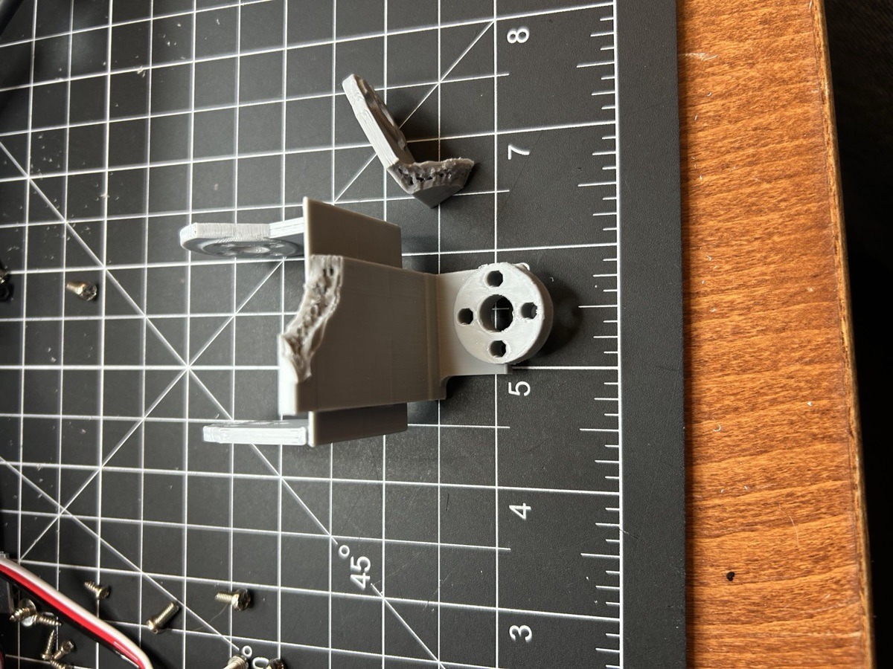
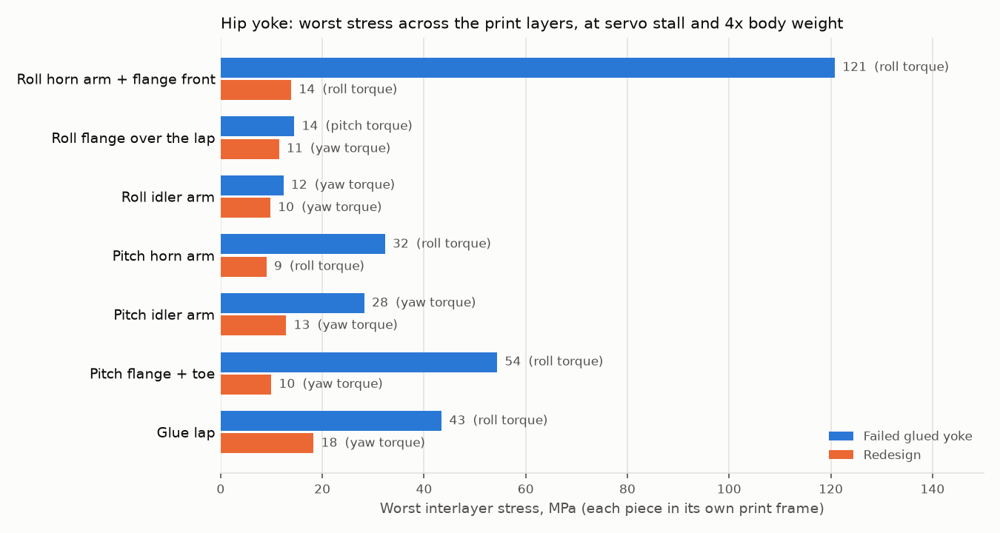
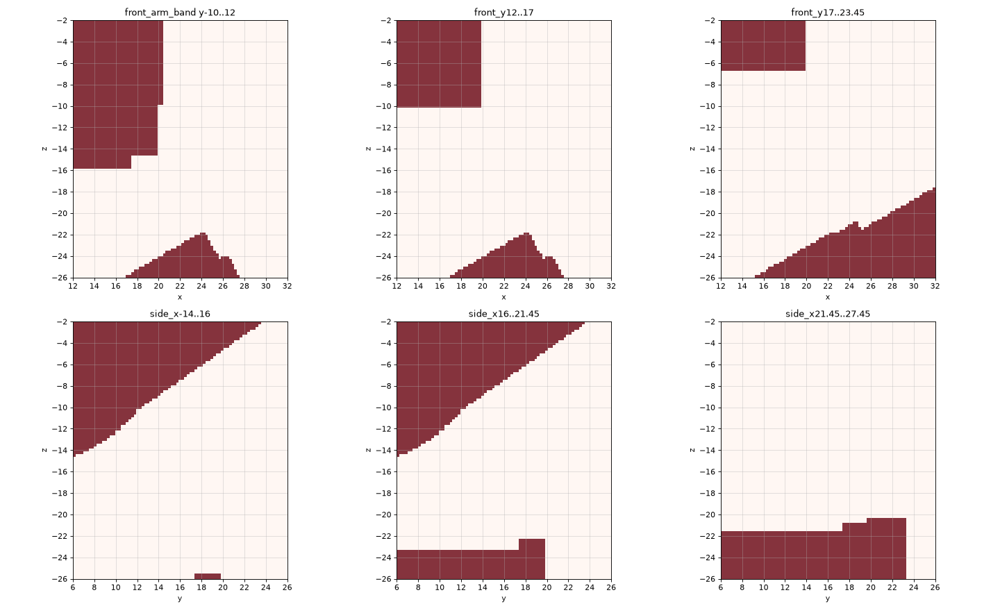
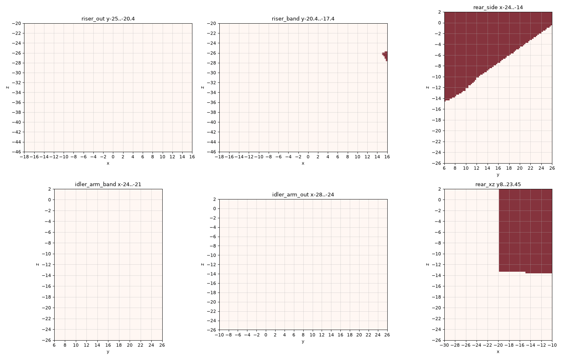

# Hip yoke: the roll horn arm broke, and the redesign (2026-11-02)

The first glued hip yoke (`cad/v6/hip_yoke_glued.py`, two U-channels snapped
and glued) failed on the robot: the roll horn arm came off. This record is the
fracture, the FEM that reproduces it, the redesign and its clearance checks.
The current yoke is described in [DESIGN.md §5.2](../../DESIGN.md) and
[cad/PRINT_LIST.md](../../cad/PRINT_LIST.md); the one-print yoke it replaced
is in [../archive/hip-yoke-single-print.md](../archive/hip-yoke-single-print.md).
The hip yoke is now only the glued pair; the one-print `hip_yoke_v6` and the
bolted split pair are gone.

## 1. The failure



The main piece keeps both pitch arms and the roll idler arm, with its O20
idler boss facing the camera. The loose piece is the roll horn arm (+X) with a
strip of the 4 mm roll flange. Print: 3 perimeters, 35 % infill, PETG.

What the photo and the CAD show:

- The break runs through the roll flange just outboard of the glued lap. The
  lap ended at x 16 (the pitch flange's half-width); the horn arm's inner face
  is at x 21.45. Between them the 4 mm roll flange, 27 mm wide, carried the
  roll servo's torque alone.
- Both fracture faces show the open cells of the sparse infill. The glue did
  not let go.
- The roll piece prints on edge (model −Y on the bed), so its layers are
  normal to Y. A torque about X through the horn arm into a 4 mm plate that
  lies in the XY plane twists that plate: its shear lands on the layer planes,
  and across-layer tension peaks at the arm's root.

## 2. Method

Linear-static FEM of the whole yoke with the two pieces fused (perfect glue):
gmsh 4.15 (FreeCAD.app's) second-order, straight-sided tets, clmax 1.0 mm
(baseline 215 k nodes, final 342 k); CalculiX 2.23; isotropic PETG, E 2000 MPa,
ν 0.38. Yoke frame: roll axis X through the origin, pitch axis Y through
(0, 0, −50). The stress tensor is resolved in each piece's print frame
(`interlayer.py`):

- roll piece (z > −20), layers normal to Y: tension across layers `s_yy`,
  interlayer shear `|(s_xy, s_yz)|`;
- pitch piece (z < −20), layers normal to X: tension `s_xx`, shear
  `|(s_xy, s_zx)|`;
- glue plane (z = −20): peel `s_zz`, shear `|(s_zx, s_yz)|`.

Bolt-hole walls (where the load and the restraint act) are excluded. Hot
spots are clustered 5 mm apart.

| case | load | restraint |
|---|---|---|
| roll | 4.9 N·m (STS3250 stall) about X, tangential forces on the 4 bolt holes of the roll horn pad | the 8 bolt holes of both pitch pads |
| pitch | 2.94 N·m about Y on the pitch horn pad | the roll pads |
| yaw | 2.94 N·m about Z, as ±x forces on the two pitch pads | the roll pads |
| fz | 100 N up through the pitch pads | the roll pads |
| fx | 50 N forward through the pitch pads | the roll pads |

The yaw case loads the pitch pads with a couple (the yaw servo's torque,
reacted at the roll pads); the leg forces are round numbers, not
measurements. Values are nodal maxima on sharp CAD corners: they rank designs;
they are not allowables. **No allowable across-layer strength of this PETG on
this printer has been measured**, so nothing here says a stress passes.

## 3. Results

Worst interlayer stress per member over all five cases (the larger of
across-layer tension and interlayer shear, each piece in its own print frame;
on the glue plane, the larger of peel and shear):



| member | failed glued yoke | redesign |
|---|---|---|
| roll horn arm + flange front | 120.8 (roll torque) | 13.9 (roll torque) |
| roll flange over the lap | 14.5 (pitch torque) | 11.5 (yaw torque) |
| roll idler arm | 12.3 (yaw torque) | 9.8 (yaw torque) |
| pitch horn arm | 32.3 (roll torque) | 9.0 (roll torque) |
| pitch idler arm | 28.3 (yaw torque) | 12.9 (yaw torque) |
| pitch flange + toe | 54.4 (roll torque) | 9.9 (yaw torque) |
| glue lap | 43.5 (roll torque) | 18.3 (yaw torque) |

`compare.py baseline v6`: worst value per case and measure, MPa, with the
location (x, y, z, yoke frame). `baseline` is the failed design; `v6` the
current one.

```
case   measure                              baseline                            v6
roll   roll  tension       120.8 ( 21.5, 12.0,-16.0)      13.9 ( 21.4, 16.1, -9.7)
roll   roll  shear          67.8 ( 21.2, 12.0,-16.0)       9.2 ( 21.4, 20.1, -7.8)
roll   pitch tension        54.4 ( 15.7, 16.9,-20.1)       9.0 ( 13.3, 23.1,-24.3)
roll   pitch shear          38.8 ( 15.7, -9.8,-20.3)      10.9 ( 14.3,-17.2,-25.6)
roll   glue  peel           39.0 ( 15.5, 17.0,-20.0)      13.0 (  2.7, 22.4,-20.0)
roll   glue  shear          43.5 ( 16.0,-10.0,-20.0)      16.6 ( 21.6,-10.0,-20.0)
pitch  roll  tension        31.7 ( 21.5, 12.0,-16.0)       5.0 ( -2.5, 22.4,-19.8)
pitch  roll  shear          14.8 ( 21.2, 12.0,-16.0)       4.7 (-22.4,  8.7,  0.2)
pitch  pitch tension        24.4 ( 10.7, 20.4,-24.9)       8.3 (  1.4, 21.3,-52.8)
pitch  pitch shear          20.3 ( 10.7, 20.4,-24.9)       6.9 ( 12.6, 22.2,-24.9)
pitch  glue  peel           23.1 ( -2.4, 16.5,-20.0)      12.5 (  1.6, 22.4,-20.0)
pitch  glue  shear          23.5 (-14.0, 17.0,-20.0)       7.5 (-14.0, 22.4,-20.0)
yaw    roll  tension        10.5 (-21.0, 13.5,-15.9)      13.4 ( 21.3, -9.8,-19.9)
yaw    roll  shear          13.3 (-13.8, -9.7,-19.7)      11.5 (-13.7, -9.7,-19.9)
yaw    pitch tension        28.3 (  5.6,-17.2,-24.2)      12.8 ( 15.1,-17.5,-24.6)
yaw    pitch shear          22.4 (  4.4,-17.0,-25.2)      12.9 ( 14.3,-17.2,-25.6)
yaw    glue  peel           28.0 (-14.0, 17.0,-20.0)      18.1 ( 21.6,-10.0,-20.0)
yaw    glue  shear          22.8 (-14.0,-10.0,-20.0)      18.3 (-14.0,-10.0,-20.0)
fz     roll  tension         3.3 (-21.0,  0.5,-10.0)       2.4 (-16.8, -1.7, -7.0)
fz     roll  shear           5.5 (-13.7, -9.7,-19.8)       5.5 (-13.7, -9.8,-19.8)
fz     pitch tension         3.2 (  3.5,-19.6,-20.4)       2.2 (  1.8,-10.2,-23.5)
fz     pitch shear           6.9 ( 15.6,-10.2,-20.2)       4.9 (-13.7, -9.9,-20.2)
fz     glue  peel            2.2 (  1.1, -4.0,-20.0)       1.8 ( -0.7, -3.9,-20.0)
fz     glue  shear           9.0 (-14.0,-10.0,-20.0)       8.8 (-14.0,-10.0,-20.0)
fx     roll  tension         9.1 (-13.3, -9.7,-19.9)       5.1 (-22.6, -0.4, -8.6)
fx     roll  shear           5.5 (-13.8, -9.7,-19.9)       3.5 (-14.2, -9.8,-19.8)
fx     pitch tension         6.6 (-13.8,-10.1,-20.3)       5.0 (-13.7, -9.8,-20.2)
fx     pitch shear           7.6 (  4.4,-17.0,-25.2)       4.2 ( 14.3,-17.2,-25.6)
fx     glue  peel           15.6 (-14.0,-10.0,-20.0)      10.6 (-14.0,-10.0,-20.0)
fx     glue  shear           8.8 (-14.0,-10.0,-20.0)       6.5 (-14.0,-10.0,-20.0)
```

Reading it:

- **The baseline puts 121 MPa across the layers at the roll horn arm's root,
  (21.5, 12, −16)**: the place the part broke, 3.2 mm of twist (peak
  displacement) at stall. That reproduces the fracture; the glue peaked at
  39 MPa on the lap's front edge (x 15.5).
- At the final design that location is 13.9 MPa at its worst (the roll case,
  now on the horn arm's web, (21.4, 16.1, −9.7)); peak displacement at
  roll stall is 0.75 mm.
- The baseline's second weak spot, the pitch idler riser, 28 MPa across layers
  under yaw (and 32 MPa in an intermediate design), is 12.8 MPa under yaw in
  the final design, now on the idler arm's front root at x 15.
- The yaw case drives the glue: 18.1 MPa peel at the toe's front corner
  (21.6, −10) and 18.3 MPa shear at the rear corner (−14, −10).

## 4. The redesign

Servo interfaces are byte-identical to the v5 clevises
(`check_interfaces()`: 3806.571 mm³ both). Every change lies inside the swept
clearance of the neighbours (§5).

| change | what it does |
|---|---|
| pitch flange toe: runs on to x 21.6, under the horn arm's inner face (21.45); underside rises from x 17 at slope 0.583 | carries the roll torque from the horn arm onto the lap instead of through the open flange. The 45° hip-flexion chamfer is removed; the toe's underside follows the thigh's and pitch servo's swept envelope at −120° with ≥ 1 mm to spare |
| roll flange widened to y 23.45 (the pitch flange's edge) | the lap and the torque section are 33.45 mm wide, not 27 |
| fin on the roll flange's +y edge, arm to arm (from y 8, slope 0.72, top z −8) | the 4 mm strip becomes a deep section; ≥ 1.2 mm under the carrier and roll servo sweep at ±55° |
| web beside each roll arm out to y 23.45, its top tangent to the pad | arm, web and fin are one outline with no notch (a web meeting the arm's edge in a corner put a 59 MPa peak there). The idler arm's web keeps a 1 mm rim round its sunk pad |
| pitch idler arm: a plate the width of its r14 hub (x ±14) with an R4 front root | replaces v5's 18 mm riser, which bent in its plane under the yaw torque |
| roll horn arm servo-side root fillet R2 | the roll servo's case ends at x 18.48, so R2 sweeps clear |
| 100 % infill, both pieces (`print_settings.json`) | the fracture ran through the sparse core |

Cost, from the module's mass audit (CAD mass): roll 16.08 g, pitch 12.76 g,
pair 28.85 g. The failed pair was 20.14 g (+8.7 g per hip); the one-print
`hip_yoke_v6` was 25.2 g (+3.7 g). Sliced at 100 % infill (OrcaSlicer, no
supports, no brim): roll 39 min and 17.8 g, pitch 32 min and 13.7 g; the four
pieces on one plate 2 h 9 min and 62.8 g. Both pieces pass the printability
audit with no supports.

## 5. Clearance

The swept maps are occupancy rasters of what the neighbours sweep through, in
the yoke frame: red is swept by the yaw carrier and roll servo over hip roll
±55° and by the thigh and pitch servo over hip pitch −120…90°. The yoke's
outline is drawn over them.





CAD gate rows, final geometry, both legs (`check_assembly_v6.py --joint ...
--samples 5 --side L|R`, 2026-11-02; every row group ALL CLEAR):

| row | min distance | at |
|---|---|---|
| hip pitch: thigh vs yoke (0.7 mm rule) | 0.70 mm | −120° |
| hip roll: yoke less its disc seats vs the carrier | 1.00 mm | 27.5° |
| hip roll: yoke less its disc seats vs the roll servo | 0.58 mm | −55° |
| hip roll: yoke vs bearing races, housing | ≥ 21.5 mm | 55° |
| hip roll/yaw: yoke vs the folded arms, left leg | ≥ 8.58 mm (upper arm) | 55° |
| hip roll/yaw: yoke vs the folded arms, right leg | ≥ 7.63 mm (upper arm) | −55° |

The hip-pitch row is the same limiting pair as before, at the same 0.70 mm.
The yoke seated on its discs does not intersect either servo (0.00 mm
overlap). Inter-leg contact is unchanged: the first piece to touch the other
leg is the thigh, at about 15° of adduction (measured on an intermediate
geometry; the fin stays within the pitch horn arm's y extent, 23.45, so it
does not change). The yoke is the same part on both legs, so its pitch
idler arm is inboard on the left leg and outboard on the right, which is why
the right leg's folded upper arm is the closer one.

## 6. What was not changed

The glue's rear corner at x −14, y −10 is where the two pieces' bed faces
meet: the roll piece's y −10 face and the pitch piece's x −14 face both end
there, so the corner is a property of the on-edge, support-free print and was
left as it is. It is the remaining glue hot spot: 18.3 MPa shear under yaw
stall, 10.6 MPa peel under 50 N forward and 8.8 MPa shear under 100 N up. These
are nodal values at a sharp corner of a perfect-glue model; the glue's real
strength was not measured.

## 7. Open items

Hardware, not done:

- Reprint both pieces at 100 % infill and fit them: the disc screws, the
  carrier bay, the clips, and the roll idler boss's journal (printed tangent
  on the bed).
- Cure the glue fully, then load the roll joint to stall and see where it
  goes next. The FEM's next candidates are the glue's rear corner (x −14,
  y −10) under yaw, the fin-to-arm junction on the roll piece, and the
  pitch idler arm's front root.
- Measure the across-layer strength of this PETG on this printer (a printed
  coupon, pulled on edge) to turn §3 into margins.

## 8. Reproduce

Tools and the exact commands are in
[experiments/hip-yoke-strength/](../../experiments/hip-yoke-strength/)
(outputs under `build/experiments/hip-yoke-strength/`). In short, with the
glued yoke built from this commit:

```bash
python experiments/hip-yoke-strength/export_glued.py v6       # STEPs of the pieces and their union
python experiments/hip-yoke-strength/run_cases.py v6          # the five cases (gmsh + CalculiX)
python experiments/hip-yoke-strength/compare.py baseline v6   # the table above
```

`baseline` is the first glued yoke (commit `ab92371`'s `hip_yoke_glued.py`),
exported the same way from a checkout of that commit.
