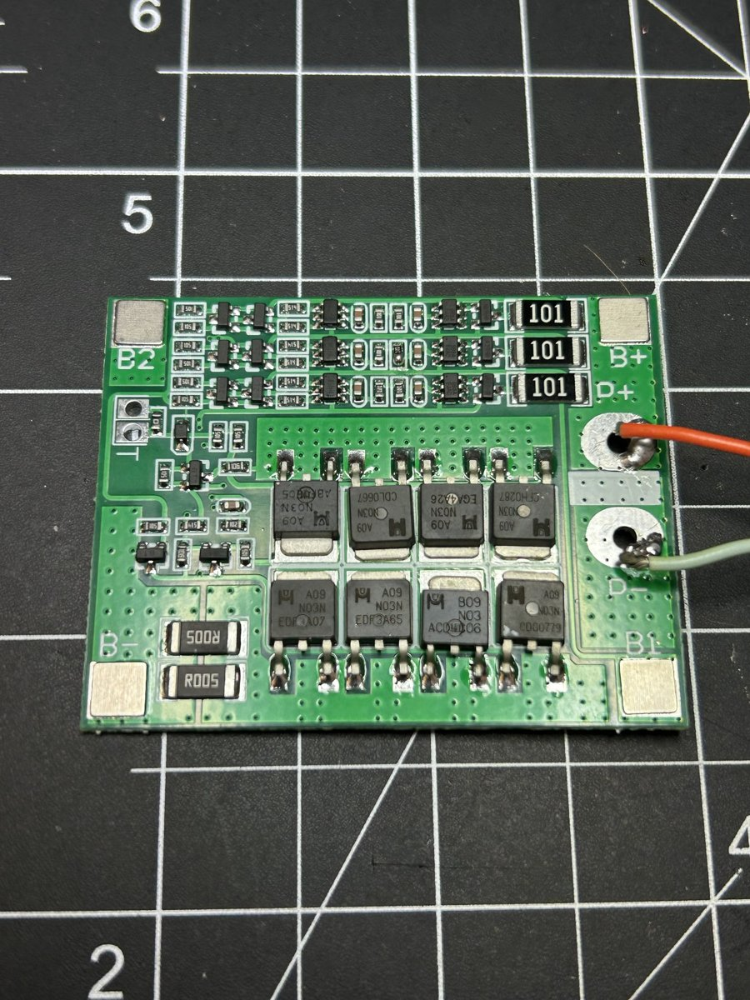

# The power lite's BMS on the bench: no under-voltage cut-off (2026-11-19)

*A dated record of Part 1 of [`pcb/power-lite/bringup.md`](../../pcb/power-lite/bringup.md)
(README step 1), run by Tom with one lab supply. The BMS is the ShillehTek CF-3SJH25A-C
([DS-NA405](../datasheets/power-lite/shillehtek-na405.pdf), whose thresholds are "not
specified"). The session was not filmed (Tom's decision).*

## Result

**The BMS has no under-voltage cut-off.** With the 1 kΩ load on its output, the output
followed the supply from 10.5 V down to 6.4 V, 2.13 V a cell, held 5 s a step, without
cutting off. Tom confirmed it and stopped the test there. The pass band was 7.5–9.6 V
(2.5–3.2 V a cell). This fails 1.4.

The README relied on that cut-off: the robot has a manual main switch only, and "the BMS's
under-voltage cut is what protects the cells if it is left on"
([options record](2026-11-02-power-lite-options.md), "What it gives up", 5). Left on, the
logic's load (General Driver and Pi, about 1 A) would run the pack below a LiPo's safe
voltage. The BMS cannot go in the robot as the pack's protection.

## Readings

The rig is bringup.md 1.1: the lab supply as the pack, three 1 kΩ (brown-black-red, checked)
as the cell divider, one 1 kΩ across P+ and P− as the load.

| step | reading | expected | measured | pass |
|---|---|---|---|---|
| 0 | PCB thickness | 1.2 mm (silkscreen) | 1.5 mm, now in the CAD (`BMS_PCB_T`, ad356d3a) | — |
| 1.2 | taps at 11.1 V | 3.7 / 7.4 / 11.1 V | as expected (Tom) | yes |
| 1.2 | output, 11.1 V, 1 kΩ load | ≈ 11.1 V | 11.11 V | yes |
| 1.2 | needed waking? | — | no, awake as delivered | — |
| (1.6) | output after the supply's + was unclipped and reclipped (gap not timed) | back by itself | 11.11 V, back by itself | one informal point |
| 1.3 | standing current | µA | 5 µA (5 mV across a 1 kΩ in the B− lead; meter resolves 1 mV) | — |
| 1.4 | trip, supply V | 7.5–9.6 V | **none down to 6.4 V** | **no** |

- **1.4 was run twice.** The first pass, down to 7.4 V, had no load on the output, so it
  could not show a trip. The second pass had the 1 kΩ load on from 7.4 V down.
- **The output read about 0.1 V below the supply's display** throughout the second pass. The
  source (the display or a drop in the BMS) was not resolved; at about 6 mA the MOSFETs'
  drop would be microvolts.
- **Not run:** 1.5 (no trip to recover from), 1.6 as written, and 1.7 (12 A for 2 s).
- **The standing current is negligible:** 5 µA would take decades to drain the 4.2 Ah pack.

## The board is not the one its datasheet describes

| | DS-NA405 (CF-3SJH25A-C) | the board received |
|---|---|---|
| MOSFETs | NIKO-SEM P75N02LDG | eight marked "A09 N03N" (one "B09 N03"), another maker's logo |
| shunts | two R004 (4 mΩ) | two R005 (5 mΩ) |
| tap labels | B−, B3 3.7V, B2 7.4V, B1+ 11.1V | B−, B1, B2, B+, no voltages printed |
| other | — | a 2-pin "T" connection |

- **The taps number upward on this board:** B1 is the bottom cell (3.7 V), B+ the pack's top.
  bringup.md and the assembly guide follow the datasheet (B3 = 3.7 V, B1+ = 11.1 V), which
  does not match this board.
- **Each cell has two 6-pin chips**, two SOT-23 transistors and a 100 Ω (101) bleed resistor;
  the chips' markings are not legible in the photo, so what they are and their thresholds are
  not known.

## It was not damaged

Rechecked after the sweep, at 11.1 V with the 1 kΩ load, all by the meter: B+–B− 11.1 V,
B2–B− 7.4 V, B1–B− 3.7 V, P+–P− 11.1 V, **B−–P− 0 V**. The taps were wired by voltage, the
cells were equal, and the MOSFETs are fully on. The supply may have reached about 14 V (4.7 V a
cell) at some point, well inside what such parts take; Tom saw the output held below the supply
when it was high, which fits an over-charge cut-off switching the charge MOSFETs off. So the
board works as built, and it was built without an under-voltage cut-off at or above 2.13 V a
cell. A later 1–2 V gap between the supply's display and P+/P− was not across the BMS (B−–P−
read 0 V).

## Bench notes

- **The lab supply's current display reads low at milliamps.** It showed 6 mA where 11.11 V
  across 1 kΩ plus the 3.7 mA divider make about 14.8 mA. Use the meter for small currents.
- **Tom's meter has no DC current range.** A current is read as the voltage across a known
  resistor in the lead (1 kΩ: 1 mV = 1 µA). bringup.md's ammeter steps (1.3 and 2.4) need
  this alternative.

## Next

A replacement for the pack's under-voltage protection: a BMS with a maker's specification,
or an under-voltage cut-off on the board. Tracked in #207.
