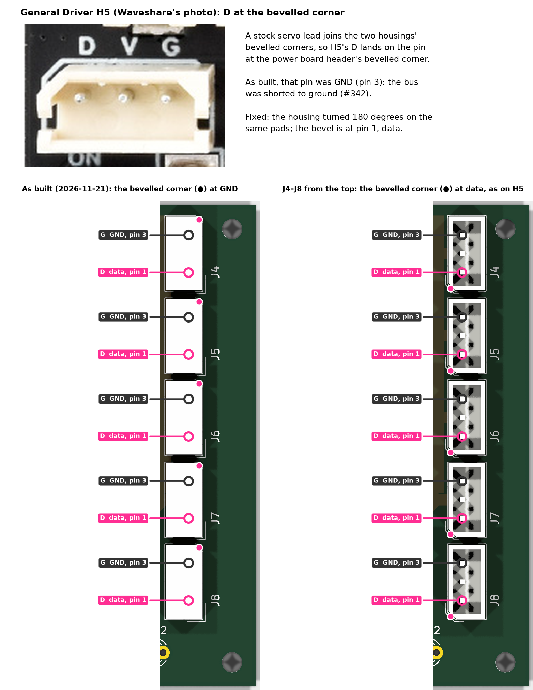

# The power lite's servo headers keyed against the General Driver's H5 (2026-11-22, #342)

*A dated record of the fault found on the robot on 2026-11-21 and of the board-file fix. The
design as it stands is in [`pcb/power-lite/harness.md`](../../pcb/power-lite/harness.md)
(J4–J8) and the README; the rework of the built board is in
[`assembly.md`](../../pcb/power-lite/assembly.md#rework-j4j8-seated-with-the-bevel-at-pin-3).*

## The fault

On the first board, J4–J8 sat as the silkscreen drew them: pin 1 (`SERVO_DATA`, the square pad)
at the housing's square corner and pin 3 (GND) at its bevelled corner. On the General Driver's
H5, D is at the bevelled corner (Tom, on the robot; Waveshare's top photo,
[General_Driver_for_Robots-top.jpg](../datasheets/general-driver/General_Driver_for_Robots-top.jpg),
shows the same). A stock servo lead joins its two housings' bevelled corners, so it put H5's
data wire on the board's GND: with J8 plugged in the bus read as shorted to ground (0 servos on
`scan`), and the servos on J4 and J6 had their GND wire on the floating data net. The issue
has the measurements.

## Why it got through

- The board took the stock KiCad footprint, `Connector_Molex:Molex_SPOX_5267-03A_1x03_P2.50mm_Vertical`.
  It follows Molex's drawing (sheet B-104,
  [molex-5267.pdf](../datasheets/power-lite/molex-5267.pdf)): circuit 1 at the square end, the
  bevel at the far end, on the wall the pins sit close to.
- `tools/parts.py` copied H5's silkscreen order "D V G" as pins 1, 2, 3. On H5, D is at the
  bevel, which is Molex's circuit 3 position. Both are right on their own; the key was never
  compared.
- harness.md listed it as check P4, to be done with the real parts. It was not done before the
  servos were connected; bringup.md now makes it step 4.1, before any servo.

## The fix

**The housing turned 180° on the same pads.** A new footprint,
`power-lite.pretty/Molex_SPOX_5267-03A_1x03_P2.50mm_Vertical_KeyPin1`, has KiCad's stock pads
(the same positions, sizes, shapes and drills, pad 1 still square) and the body drawn the
other way round: silkscreen, fab outline, courtyard and the 3D body (`tools/gen_3d.py`, now
from Molex's 9.9 × 4.9 × 5.9 mm) with the bevel at pin 1.

- **The copper does not change.** `tools/refresh_fp.py` swapped the five footprints on the
  routed board and checked every pad against the old one; outside J4–J8 the board file is
  unchanged, and inside it the pads are byte for byte the same. The copper, mask, drill and
  outline Gerbers are identical to the old ones apart from their header comments; only the top
  silkscreen changed.
- **The built board is fixed the same way:** desolder J4–J8 and turn them, in the same holes.
  Its leads stay stock.
- **Not chosen:** swapping nets 1 and 3 (or rotating the footprints) would also have keyed the
  headers, but it moves `SERVO_DATA` and GND between pads, so the board would need re-routing,
  and the built board could not follow it without cutting tracks.
- **The cost:** the turned housing's far wall is 1.3 mm further right. J4's now stands 2.7 mm
  from H2's centre: the M2.5 × 6 button head there (ISO 7380, 4.7 mm across) clears it by
  0.35 mm, but the two courtyards overlap. A DRC rule (`power-lite.kicad_dru`) lets that one
  pair through, and the key check measures the real clearance instead.

## The check

`tools/netcheck.py --keys` reads the board: for each of J4–J8 it finds the bevel on the
silkscreen outline, orders the pads from it, and compares their nets with `H5_FROM_BEVEL =
("SERVO_DATA", "SERVOP", "GND")` in `tools/parts.py`, the one fact taken from H5. It also checks
each header's body against the hardware in the mounting holes. `fab.sh` and `tools/route.py`
run it; `tests/test_power_lite_keys.py` runs it on the board and on the board with each header
turned back (as built), with data and GND swapped on the pads, and with H2 0.3 mm closer. The
first board fails it with ten mismatches, two on each header.

## Regenerated

With KiCad 10.0.7 from the `kicad/kicad:10.0` docker image (the files were made with 10.0.6 on
the Mac):
- `power-lite.kicad_sch`: `tools/gen_sch.py`, fed the symbol copies the schematic already
  embedded, so the only change is J4–J8's footprint and description. ERC 0.
- `power-lite.kicad_pcb`: `tools/refresh_fp.py J4 J5 J6 J7 J8`. DRC 0 with schematic parity.
- `fab/`: `fab.sh`. `power-lite.pdf` is left as it was: the regenerated one differs only in the
  KiCad version printed in the title block.
- Not regenerated: the whole-board renders (`powerlite_top.png`, `powerlite_3d.png`,
  `powerlite_bottom.png` and the step figures `powerlite_asm_*.png`). They need KiCad's stock
  3D models, which the docker image does not carry, and still show J4–J8's old outline and
  body. The new close-up, `powerlite_servo_header_keys.png` (`tools/asm_figs.py --keys`), shows
  the headers as they are.
