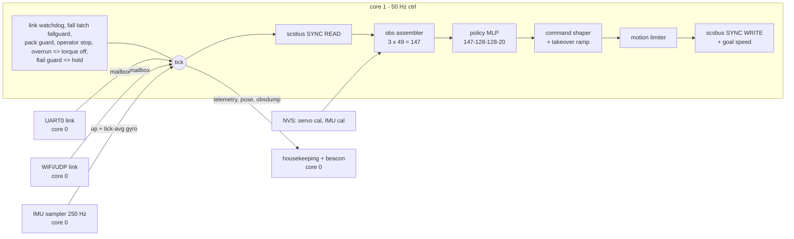

# Firmware design

*What runs on the ESP32 and why it is built the way it is. Usage (build,
flash, CLI, host tests) is [firmware/README.md](../firmware/README.md); the
wire protocol is [control-channel.md](control-channel.md); electrical is
[wiring.md](wiring.md); servo IDs and calibration values are
[servo-map.md](servo-map.md); first power-up is [bringup.md](bringup.md).*

**Status:** built, flashed and running on the v6 legs. Two joint sets
(§5.8):

- the **bus joint set** is the robot's 17 servos (`obs/bus_map.h`, the
  proposed ID map of [servo-map.md](servo-map.md) §2.1): calibration, the
  mechanical envelope, `pose`/`home`, the readback, the gain check, the
  telemetry joint block and the SIL arrays are all 17 wide;
- the **policy joint set** is what the compiled policy observes and commands:
  the v6 legs' 12 joints (6 per leg, plant `sim/bimo_biped_v6legs.xml`),
  policy `robot_legs_walk16_act_s128r24`.

The legs-only robot carries 12 servos, and its calibration marks the neck and
arms (IDs 13–17) not fitted.
The 17-joint port is done on the bus side and verified on the host (issue
#81); a 17-servo `pose` on the bench and a 17-joint policy (#86) are what
remain (§8).

## 1. Job description

The board runs the robot. Every 20 ms (50 Hz) the control task `ctrl`
(`main/ctrl_task.cpp`):

1. drains the command mailbox, feeding every frame to the arm and home
   latches (in both modes) and to the link watchdog (armed only);
2. reads every fitted servo's position and speed in one SYNC READ on the
   1 Mbaud servo bus;
3. takes the latest attitude and the tick-averaged gyro from the 250 Hz IMU
   sampler;
4. updates the pack guard (from servo register 62) and the fall latch;
5. if any safety state says limp — pack latched off, fallen, link `RELAX`,
   `ESTOP` — releases torque, reports, and stops there;
6. otherwise assembles the observation exactly as the simulator defines it,
   runs the policy, maps actions to joint angles, shapes them, blends them
   during the takeover ramp, and writes every target plus a per-servo goal
   speed in one SYNC WRITE, together with a hold target for every fitted
   servo the policy does not drive;
7. publishes telemetry, the measured pose for the beacon and, when enabled,
   the observation dump.

Benched, it does only steps 1 and 3 (so the attitude filter has converged by
the time the loop arms) and touches nothing else.

Non-goals: navigation or odometry (the robot is command-conditioned and has
no pose estimate), camera processing (the Pi's job), changing the policy
without a reflash, full-rate logging.

## 2. Language and house rules

**C++17 on ESP-IDF v5.4**, not the Arduino core: ESP-IDF gives deterministic
task control, dual-core pinning and first-party UART/I²C/timer APIs. The
safety story here is timing and torque-release semantics rather than memory
bugs, and the loop is small and heap-free, which is why the house rules
below are enough and Rust is not needed.

- **No heap after init.** Every task, queue and buffer is statically
  allocated in `app_main` or at file scope; driver allocation happens once at
  init.
- `-Wall -Wextra -Werror`, no exceptions, no RTTI (`firmware/CMakeLists.txt`,
  `sdkconfig.defaults`); the host build adds `-Wshadow -Wconversion
  -Wsign-conversion`.
- Every datum that crosses cores goes through a FreeRTOS queue or an atomic
  and has exactly one writer. No mutex in the control path.
- Fixed-size types only.
- The pure modules compile and run on the host under ASan/UBSan (§7).

## 3. Hardware

`main/board.h` is the authority and cites the vendor schematic.

| | |
|---|---|
| board | Waveshare **General Driver for Robots** rev 1.2; ESP32-D0WD-V3 rev 3.1, dual LX6 at 240 MHz, 4 MB flash, no PSRAM; partition table `firmware/partitions.csv` (a 3 MB app, NVS at the stock 0x9000) |
| servo bus | UART1, **GPIO 18 RX / GPIO 19 TX**, 1 Mbaud 8N1; half-duplex direction switched in hardware off the TX line (no direction GPIO). Feetech STS3215, ST protocol (little-endian) |
| host link | UART0 at 115200 over the CP2102N on the USB-C port silkscreened `USB`. The port silkscreened `LIDAR` is a second bridge that enumerates but never flashes |
| I²C | **GPIO 32 SDA / 33 SCL** at 400 kHz, also on header P1. QMI8658C IMU at 0x6B (used); AK09918C magnetometer at 0x0C (unused: beside the servos it measures their current, not north); BMP280 at 0x77 on the schematic (did not answer the bench scan; unused); INA219 power monitor at 0x42 (unused). 0x4A/0x4B are reserved for a BNO085 on P1 |
| pack voltage | servo register 62 (0.1 V), from the first servo that answers each tick. The INA219 sees the pack ahead of the buck but is not read yet (§8) |
| RGB LED | GPIO 4, header H2 |
| OLED, RTC | none; wall-clock time comes from SNTP ([control-channel.md](control-channel.md#time-on-the-wire)) |

`imu scan` lists what answers on the I²C bus.

### The IMU

The QMI8658C is a raw 6-axis part, so attitude fusion runs on the ESP32:
`imu::Fusion`, a complementary filter (accelerometer gain 0.5/s, crossover
near 0.08 Hz; the gravity correction is skipped whenever |accel| leaves
(1 ± 0.15) g, so a footfall does not drag the estimate). A core-0 task
(`main/imu_sampler.cpp`) reads the part and runs the filter every 4 ms
(250 Hz); the control tick takes the latest attitude plus the gyro
**averaged over the tick**, which anti-aliases it (`imu avg off` hands over
the latest 4 ms sample instead). Full scales are ±8 g and ±1024 °/s.

The policy's `up` is the torso z-axis in the **world** frame, the sim's
`framezaxis`. Gravity cannot observe yaw and no magnetometer is used, so the
fused yaw is a drifting gyro integral. The driver therefore strips the ZYX
yaw from the quaternion before taking `up`
(`imu::upYawStrippedFromQuaternion`), which equals the sim's `up` at zero
yaw, where every sim episode starts.

Calibration is stored in NVS (§5.4) and is specific to how the board is
mounted; the values below were measured on the prototype, and the robot's
board mount will need its own.

- **Gyro bias is not optional.** The untrimmed zero-rate offset is
  ~0.45 rad/s on x; against the 0.5/s filter gain that settles at about 64°
  of attitude error. Calibrate with `imu bias` **with the board installed,
  the body in the standing pose**: bias moves with orientation and
  temperature. A bench calibration later bolted into the prototype's pelvis
  left ~1°/s of heading drift; calibrated in place it is 0.07°/s.
- **Mount** (`imu mount`). In the prototype the board stands vertical and
  transverse in the pelvis, so sensor→body is a ~90° rotation, not a trim.
  Measured (w x y z): `0.505654 0.494116 0.485838 0.513931` — chip +Y up,
  chip +Z **forward**. Gravity alone cannot tell this from the same mount
  flipped 180° about the vertical; check any mount with a deliberate tilt.
  Leaning the body forward must give `projgrav.x` negative and `up.x`
  positive (`imu` prints both).
- **Gyro scale** (`imu gscale x y z`, its own NVS record, unity when absent).
  The sensor x gyro over-reads by 18 % against the accelerometer's tilt;
  y and z by 2–3 %.
- `applyImuCalFromNvs()` applies bias, mount and scale at boot and again
  after `imu reinit`.

Also:

- **The on-chip AttitudeEngine does not work on this silicon.** Enabling it
  leaves the dQ/dV registers holding static bytes. The part reports revision
  0x7C; the datasheet (QST rev 0.6, ADVANCE INFORMATION) documents 0x79. The
  driver probes for AE at init and falls back to the raw path; `imu ae`
  re-runs the check.
- **I²C bus recovery at init.** A reset that lands mid-transaction can leave
  the sensor holding SDA low; the driver clocks it free. If the part still
  does not answer, the loop runs on `imu::StubImu` (level and still) and the
  boot log names which one is live.
- The upgrade path is a BNO085 on P1: a driver change plus one 4-wire cable.

## 4. Tick budget, tasks and cores

| task | core | priority | job |
|---|---|---|---|
| `ctrl` | 1 | `configMAX_PRIORITIES - 2` | the §1 loop. An `esp_timer` fires every 20 ms and wakes it with `vTaskNotifyGiveFromISR`, so wake jitter is microseconds, not scheduler ticks |
| `link` | 0 | 5 | UART0 reader: demultiplexes binary command frames from CLI text lines |
| `wifi_link` | 0 | 5 | UDP command frames in on 4210; the 10 Hz telemetry beacon out on 4211 |
| `imu` | 0 | 4 | the 250 Hz IMU sampler and fusion |
| `flightrec` | 0 | 3 | drains the flight recorder's two rings to UDP 4220, 1 Hz hello ([flight-recorder.md](flight-recorder.md)) |
| `housekeeping` | 0 | 2 | the CLI (tether and Wi-Fi lines, one queue), arm and home requests, the home readback, pose streaming, the bench flight-recorder read, UART telemetry, the observation dump |
| `wcli` | 0 | 1 | the authenticated Wi-Fi CLI's socket on UDP 4213: authenticates, queues lines for `housekeeping`, sends their output ([wifi-cli.md](wifi-cli.md)). Lowest on purpose: a datagram flood can starve only this task |

The WiFi/LwIP tasks stay on core 0 (IDF default), so nothing they do can
preempt `ctrl`. All tasks are created once at init, and the control loop is
paced by the hardware timer, never by `vTaskDelay`.

How data crosses cores (`main/shared.h` states the rules beside each item):

- **Command mailbox**: a length-1 queue written with `xQueueOverwrite` by
  both link tasks and read non-blocking by `ctrl`. Latest command wins; a
  stale command can never queue up behind a late tick.
- **Telemetry snapshot**: atomics with `ctrl` as the single writer. A read
  may tear across fields; every reader is a 10 Hz human-facing report.
- **Payloads too big to tear harmlessly** (the observation dump, the measured
  pose for the beacon) are double-buffered with a sequence counter; `ctrl`
  writes the slot the reader is not in, and a copy the writer overran is
  dropped, never reported.
- **IMU sample**: the one lock the tick takes is the sampler's `portMUX`
  critical section around a sample copy.
- **Flight records**: one lock-free single-producer ring per producer
  (`ctrl`, `housekeeping`), drained by the `flightrec` task; a full ring
  drops the record and counts it, so no producer ever waits.
- **Requests from the link** (arm and home edges) are counters bumped by
  `ctrl` and consumed by housekeeping, so each atomic keeps one writer.

Measured cost of each phase of the 20 ms tick, 10 servos, 240 MHz (`stat`
prints the live values — `us_read`, `us_imu`, `us_obs`, `us_net`,
`us_write`, `us_other` — plus overruns and the worst tick):

| phase | measured |
|---|---|
| SYNC READ, 10 servos | 2.80 ms |
| IMU burst read + fusion | 0.47 ms, in the sampler task; the tick only copies the sample |
| observation assembly + history | 0.02 ms |
| policy forward, 147 → 128 → 128 → 20 | 7.2 ms |
| SYNC WRITE | 0.07 ms |
| mailbox drain + watchdog | 0.07 ms |
| flight-recorder record (encode + ring push), when `rec` is on | not yet measured on the robot; `rec` prints the worst case ("push cost max ctrl"). It adds no bus traffic: the record is built from the SYNC READ above |

About 10 ms of the 20 ms tick is used, with 0 % late ticks on the prototype.
The SYNC READ covers the fitted servos only; at the measured ~0.28 ms per
servo, 17 would take about 4.8 ms, which has not been measured (`stat` on the
robot will).

A phase that always costs exactly its timeout is not slow; it is waiting on
a condition that cannot occur. `Bus::syncReadFeedback` requests only the
bytes still outstanding, because `uart_read_bytes()` returns only when it
has the full count: asking for the whole buffer makes every read sleep out
its timeout while the replies have long since landed.

Supervision:

- A tick that takes longer than two periods (40 ms) releases torque on every
  servo with one broadcast frame: the loop is no longer in control.
- The IDF task watchdog watches `ctrl` with a 1 s timeout. It reports only
  (`CONFIG_ESP_TASK_WDT_PANIC` is off) and does not reset the board.

## 5. Modules



| module | what it is | on the host |
|---|---|---|
| `components/scsbus/` | Feetech SCS/STS protocol: packet codec and transactions (PING, READ/WRITE, REG WRITE + ACTION, RESET, SYNC READ, SYNC WRITE, torque enable incl. broadcast, EEPROM lock, ID change, set-middle, error-flag decode). The golden packets are the worked examples in Feetech's own protocol manual | tested against a scripted fake port |
| `components/linkproto/` | byte-exact port of `link/protocol.py`: frames, CRC, `Watchdog`, `ArmLatch`, `HomeLatch`, envelope clamps (the generated `cmd_envelope.h`), the bench diagnostic, the UART demux | golden vectors from the Python reference |
| `components/obs/` | observation assembler, history ring, gait clock, action ↔ angle ↔ tick maps, `Calibration`, `CommandShaper`, `MotionLimiter`, goal speed, velocity estimator; the bus joint map `bus_map.h` (hand-written) and the policy spec `obs_spec.h` (generated) | vectors from real `walker_env._obs()` frames; the bus map |
| `components/policy/` | static MLP forward pass. `weights.h` is generated | numpy golden vectors |
| `components/imu/` | `Imu` interface, frame maths and `Fusion` (pure); `qmi8658_idf.cpp`, the only file with I²C in it; `StubImu` | frame maths + fusion |
| `components/battguard/` | pack under-voltage guard | yes |
| `components/balance/` | the stance-leg roll PI behind the bench `pose ... B<L\|R>`, and the stance-hip trim behind `pose ... S<L\|R>` (§5.6) | yes, pinned to the sim twins |
| `components/gaitplay/` | the gait track behind `track`: rolling keyframe queue, interpolation, stop/rest, the phase → support-state map (§5.6) | yes, plus the SIL harness `host/sil_gait.cpp` |
| `components/fallguard/` | the one fall detector + pick-up rule both paths run (armed: 45 deg / 200 ms; bench: 30 deg / 100 ms; §5.6 "Fall guard") | yes, incl. the armed-to-bench hand-over |
| `components/flailguard/` | the armed loop's judge of the POLICY: pose / rate / tilt / chatter (§5.6 "Flail guard") | yes, incl. a replay of the 2026-11-01 flailing stand (`vectors/flail_vectors.h`) |
| `main/` | everything that touches ESP-IDF: tasks, UART/WiFi/NVS/SNTP, the CLI (file list in [firmware/README.md](../firmware/README.md)) | the plain-data halves of `cal_store` and `obs_dump` |

### 5.1 Observation

The frame is the byte-exact on-board twin of `walker_env._obs()`. The obs
SPEC (ordering, scaling, history depth, joint table, action map, clock
flags, and the run's held servos and per-servo stiffness) **is exported
from the sim as a generated header so it cannot drift by hand**: `tools/gen_obs_spec.py --run <run>` writes `obs/obs_spec.h` from
the run's `config.json` and MJCF. Nothing downstream hardcodes a width.

One frame is 49 floats, and the policy sees three of them, newest first
(147):

```
q(10) | dq(10) | up(3) | linvel(3) | gyro(3) | prev_action(10) | height(1) | sin,cos(2) | cmd(7)
```

- **q**: servo position through the calibration (`stepsToAngle`). A servo
  that does not answer keeps its last angle and sets its fault bit.
- **dq**: servo register 58 (steps/s, sign-magnitude) in rad/s. A filtered
  finite difference is computed beside it and not used (§8).
- **up, gyro**: from the IMU sampler (§3).
- **linvel, height**: hard zeros. The run trains with `imu_obs`, because the
  robot has no sensor for either.
- **prev_action**: the raw policy output of the previous tick, not the shaped
  or ramped target, because that is what the policy saw in training.
- **phase**: a gait clock at the base `kGaitFreqHz`, generated per policy: the
  centre of the run's per-episode draw (`gait_freq_range`, U(1.25, 1.75) unless
  the run set `--gait-freq`, so 1.5 Hz). With `kSpeedClock` the rate is scaled by
  clip(sqrt(v / 0.35 m/s), 0.7, 1.25), v the commanded planar speed; with
  `kClockStandFreeze` the phase holds at a plain stand (|vx|, |vy|, |wz| ≤
  0.05 and |lift| < 0.5). Both flags come from the run, as in training.
- **cmd**: vx, vy, wz, crouch, lift, foot_dx, foot_dz (defaults 0, 0, 0, 1,
  0, 0, 0), from the watchdog: the operator's command only while `LIVE`,
  clamped to the trained envelope (generated from the run: forward, backward and lateral bands, turn limit, crouch floor). Crouch is the lower of the link's value
  and the pack guard's landing ramp; the travel channels are zeroed while the
  guard is latched.
- The history ring is refilled with the first frame after every arm (as
  `walker_env.reset()` does) and pushed after the policy has been fed.

Actions map to angles with `action_map = "full"`: 0 is the standing pose
(`kJointDefault`), ±1 are the policy range `kJointLo`/`kJointHi`,
piecewise-linear on each side. Angles become ticks through the calibration
and are clamped to that range.

### 5.2 Policy

- The arithmetic is brax's: the `running_statistics` normaliser
  x = (obs − mean) / std (no clip), **swish** hidden layers, a linear head
  2 × act_dim wide (mean ‖ log-std), and the deterministic action
  tanh(mean). The normaliser ships in the header beside the weights.
- The compiled-in net is 147 → 128 → 128 → 20: 38 036 weights plus a
  147-wide normaliser, ~150 KB of fp32 `constexpr` in flash `.rodata`, so
  DRAM is unaffected.
- `weights.h` is written by `tools/gen_policy_weights.py --run <run>` from
  the run's exported `.silw`; there is no argument-less default.
  `test_policy` asserts `kWeightsArePlaceholder == false` and
  `kWeightsRun == obs::kRunName`: the net and the observation spec come from
  the same run.
- `policy::forwardNet` takes the weights as a parameter and `forward()`
  binds it to the generated header, so the SIL library runs an exported
  `.silw` through the identical arithmetic. Only the act_dim mean logits of
  the head are computed; the log-std half is never read at inference.
- A policy profile may instead carry an **int8** net (`--quant int8`,
  `POLICY_WEIGHTS_Q8`, `policy/q8.h`): the way a net wider than (128, 128)
  fits the tick. §6.1 has the budget and the arithmetic.

### 5.3 Command shaper and goal speed

Written raw with goal speed 0 (unlimited), each 50 Hz target makes a servo
slam toward it at full speed (~3000 steps/s measured) and stop mid-tick: a
50 Hz velocity square wave on every joint. The act path therefore has two
stages, both in `components/obs`, so the SIL library runs them too:

- **`obs::CommandShaper`** (`obs/actuation.h`): three cascaded first-order
  lags, all poles at 10 Hz, each the exact zero-order-hold discretisation
  (stable for any pole, no overshoot, output inside the hull of its inputs).
  The commanded trajectory has continuous velocity and acceleration. It is
  reseeded from **measured** q on every torque (re)engage or bus handover,
  so the first shaped target is never a jump.
- **Per-servo goal speed** (register 46) in the same SYNC WRITE: the speed
  that closes the gap from the measured position to the shaped target in one
  tick, × 1.25, floored at 50 steps/s (0 would mean unlimited) and capped at
  3400. While tracking, that is the trajectory's own speed; under a
  disturbance the error term grows it, so smoothing costs no stiffness.
- 10 Hz is the strongest smoothing that kept SIL-vs-python referee parity in
  a closed-loop pole sweep; 8 Hz measurably cost task performance.
- `shape [hz]` sets the pole live; `shape 0` writes raw targets at unlimited
  speed. The SIL equivalent is `sil_set_shaper()`.

### 5.3a Motion limiter

The shaper smooths the policy's 50 Hz staircase but does not bound it: a large
target step still comes out as a fast shaped move, and the fast STS3215s
(~240–275 deg/s at full duty) then stop dead at the goal. The reaction torque
of such a stop can spin the robot on its stance foot.
**`obs::MotionLimiter`** (`obs/actuation.h`) bounds what goes to the servo.
It is the last stage before the angle → tick map, after the shaper and the
takeover ramp. Each tick, per policy joint, with state position `p` and
velocity `v`:

```
e  = target - p
vb = min(vmax, limitBrakeSpeed(|e|, amax, dt))     braking look-ahead
v += clamp(sign(e) * vb - v, -amax dt, +amax dt)
p += v dt
```

- **Braking look-ahead.** `limitBrakeSpeed` is the exact discrete-time
  stopping curve: the largest speed from which braking by `amax·dt` per tick
  stops exactly on the target. With `u = amax·dt²` and `m = dist/u`, take
  `k = ⌊(√(1+8m) − 1)/2⌋` whole braking ticks; then
  `v = amax·dt·(k + (m − k(k+1)/2)/(k+1))`. The curve is piecewise linear
  between the triangular numbers and tends to `√(2·amax·dist)`. A joint
  whose target holds still arrives on it with zero velocity and never
  passes it, and the stop takes the trapezoid's own time, rounded to the
  tick. The joint can overshoot only when the target moves back toward it
  faster than `amax` allows, and then by at most the `v²/(2·amax)` that the
  bound costs.
- **Jerk** (optional, `jmax`). The output is a boxcar (moving average) of
  the newest `taps = ⌈2·amax/(jmax·dt)⌉` ticks of `(p, v)`, at most 16. The
  output is a convex mix of limited positions, so it keeps the vmax and
  amax bounds and still never overshoots. Its jerk is at most
  `2·amax/(taps·dt) ≤ jmax`, and it delays the trajectory by
  `(taps − 1)/2` ticks.
- **Goal speed.** While the limiter is on, every policy joint's goal speed
  is the limited velocity × 1.25, floor 50, cap 3400 steps/s
  (`obs::limitGoalSpeedSteps`). The servo therefore slews along the limited
  profile and reaches each goal just before the next one. It no longer chases
  the measured gap at whatever speed that gap asks for. Held servos keep the
  gap law. Unlike the gap law, this speed does not grow under a
  disturbance. Whether that softens a pushed joint depends on how the servo
  applies register 46, which is a bench question.
- **Seeding.** The limiter is seeded from **measured** q at rest. It is
  invalidated wherever the shaper is: on a bus handover, a torque release,
  or an operator stop. The state is float, and the only transcendental is
  `sqrtf`.
- **Live.** `limit [off|on|<vmax> [<amax> [<jmax>]]]` takes deg/s, deg/s² and
  deg/s³, and is read every tick from three atomics (`shared.h`
  `g_limit_*`). vmax is written last, so a tick never sees an enable with
  half a config. Changing the limits keeps the state. The limiter is **off
  at boot**. `limit on` sets the proposed 200 deg/s and 2000 deg/s² with no
  jerk limit (`kLimit*`). A policy has to be trained with the limiter in its
  loop (`--fw-limit`, [training.md](training.md)) before it is deployed with
  the limiter on.
- The SIL equivalents are `sil_set_limiter()`, and `sil_limit_trace()` for
  the pure law. `tests/test_fw_limit.py` pins the training env, the referee
  and `sim/fw_limit.py` to the compiled code through `sil_limit_trace()`.

### 5.4 Calibration in NVS

- **Two mechanisms, not interchangeable.** `middle <id>` writes the servo's
  own offset (register 40 ← 128); it lives in the servo's EEPROM and travels
  with the servo. `cal …` writes the firmware's per-joint `zero_steps` and
  `dir` to NVS; `dir` is something the servo cannot express. `middle` at the
  neutral pose first, then `cal zero` to absorb the residual the horn
  splines cannot. Procedure: [bringup.md](bringup.md); the values:
  [servo-map.md](servo-map.md).
- **Servo blob** (`main/cal_store.h`): magic `BMC1`, version 3, indexed by
  bus joint: the joint count (17), `zero_steps`, `dir` and `fitted` per bus
  joint, the bus map (`kBusServoId`) it was measured under, CRC-32. A
  joint-count or map mismatch rejects it: the robot boots uncalibrated and
  arming is refused.
- **Fitted** says which bus servos this robot carries. The loop, `pose`,
  `home`, `ping`, `volt` and the gain check touch fitted servos only, and
  `run` refuses unless every policy joint is fitted. `cal zero` over all
  joints sets it from who answers; `cal fit` sets it by hand.
- **Migration.** A version-2 blob (the prototype's: 10 policy joints with
  their servo map) proves its map, so boot migrates it exactly: each servo's
  zero and direction on its bus joint, IDs 1–10 fitted, 11–17 not, re-saved
  as v3 under the same key. No re-calibration. A version-1 blob, which
  carries no map, is adopted only if it equals the compiled as-built table
  exactly; `cal migrate` is the manual path.
- **`main/asbuilt_cal.h`** holds that as-built table as a reference for the
  migration check, not as a default. NVS is the runtime source of truth.
  Change it and [servo-map.md](servo-map.md) in the same commit.
- **IMU blob** (`BMI1`): gyro bias and mount quaternion, kept separate so a
  servo-map change does not discard them. The gyro scale is its own record.
- **WiFi credentials** are NVS strings (`wifi <ssid> <psk>`), never in git.
- All NVS writes are bench-only: a flash write stalls both cores' cache, and
  with them the control tick.

### 5.5 Modes, arming and handover

- **Two modes, one bus owner, no lock.** `kBench` (boot default): torque
  released, the CLI owns the bus, `ctrl` only drains the mailbox and keeps
  the IMU filter warm. `kRun`: `ctrl` owns the bus and bus-touching CLI
  commands are refused. The mode changes only between ticks; going to bench,
  `ctrl` releases torque and clears `g_ctrl_owns_bus` before the CLI may
  touch the bus.
- **One decision point.** `cmdMode()`, on the housekeeping task, decides every
  mode request: a typed `run`/`bench` and a wireless ARM edge alike. It
  refuses `run` without an as-built calibration from NVS, or unless every
  driven servo's position-loop gains read back as expected (§5.7), and
  records its verdict in `g_arm_result`, which the `BENCH` beacon carries.
- **Arming over the radio.** `ctrl` runs `linkproto::ArmLatch` on every
  drained frame in both modes and publishes each edge; housekeeping applies it
  between CLI lines, so a wireless arm never lands inside a bench-mode bus
  command. The latch outlives the watchdog, so it sees the 1 → 0 edge that
  ends a run.
- **Every arm starts clean**: a fresh watchdog, history ring, shaper,
  motion limiter, fall latch and takeover ramp.
- **Takeover ramp** (issue #29). For the first 1000 ms of acting ticks after
  an arm, the written targets blend from the pose measured at takeover to the
  policy's shaped targets. Without it the first acting tick snaps the joints
  from the bench hold to the policy's targets — a step training never
  produced — into an empty history. The ramp sits after the shaper and before
  the angle → tick map, so goal-speed streaming follows the blend;
  `prev_action` stays raw. It is not in the SIL library, which has no
  bench → run handover.
- **Home** (the wireless `HOME` edge, or typed `home`). Housekeeping benches
  the loop, waits for the handover, then — refused without calibration or
  while the pack guard holds torque off — enables torque and streams a
  minimum-jerk move of every fitted servo to its calibrated zero (clamped to
  the mechanical envelope; duration from the longest move at 300 steps/s,
  2.5–8 s). It then rolls each hip 5° out and back to take up roll play,
  reads every fitted servo back (±12 ticks) and **releases torque**; gear friction
  holds the stand. It reports `HOME_PENDING` while moving, then
  `DISARMED_HOME` or `HOME_NOT_REACHED`. It never arms.

### 5.6 Failsafes

In the order the tick applies them:

1. **Pack guard** (`components/battguard`). The only over-discharge
   protection: the pack has none, and the servos' own under-voltage flag
   trips near 6 V. On 3S it warns at 10.5 V and lands at 9.9 V held for 25
   ticks (0.5 s): travel commands go to zero and crouch ramps to 0.60 (the
   lowest trained stance) over 1.5 s (`VLAND`), then torque goes off
   (`VSAFE`), latched until `batt reset` (bench only, after a pack swap) or a
   power cycle. A tick with no servo reply is "no data", never 0 V.
   Thresholds and the power path: [wiring.md](wiring.md).
2. **Fall latch** (`components/fallguard`, shared with the bench path; see
   "Fall guard" below). Torso tilt past 45 deg (`up_z` < 0.707) for 200 ms:
   report `FALLEN`, release torque, record `DISARMED_FALL` and bench the loop.
   This is tighter than walker_env's `fall_up_z` = 0.4 (66 deg), which stays
   the sim's episode end (`linkproto::kFallUpZ`): holding torque from 45 down
   to 66 deg only grinds the servos into the floor. Nothing here auto-clears
   or re-arms; the bench half takes the latch over and homes the robot (ends
   released) once it is picked up. Re-arming is a fresh ARM edge or `run`.
   `StubImu` pins `up_z` at 1, so an IMU-less board never trips it.
3. **Operator stop** (`linkproto::kFlagStop`, out of band: the link tasks
   count it in `g_op_stops` and never pass it to the latches or the
   watchdog). Hard (with `ESTOP`): release torque this tick, `DISARMED_STOP`,
   bench. Soft: hold (below), `DISARMED_STOP`, bench. `tools/estop.py` sends
   it; [control-channel.md](control-channel.md) has the wire rules.
4. **Link watchdog** (`linkproto::Watchdog`, armed only): `STAND` after
   250 ms without a valid frame (the command decays to the trained stand),
   `RELAX` after 5 s (torque off), `ESTOP` on the operator's flag (torque
   off, latched until a frame with `ENABLE` off). See
   [control-channel.md](control-channel.md).
5. **Flail guard** (`components/flailguard`, after the policy and the
   shaper, before the write; see "Flail guard" below): the policy doing
   something clearly wrong for its command. Hold, `DISARMED_FLAIL`, bench.
6. **Overrun**: a tick longer than 40 ms releases torque (§4).

Every limp state releases torque with one broadcast frame and invalidates
the shaper, so a re-engage reseeds from wherever the joints are. The two
**holds** (the flail guard and the soft operator stop) are the exception: the
tick writes every fitted servo's goal to the position it reported this tick
(one SYNC WRITE, torque on) and the bench handover that follows skips its
release, so the robot ends the run stiff where it was, not sagging.

The **mechanical envelope** (`main/mech_envelope.h`) is the per-bus-joint
measured or CAD-verified travel; the leg rows are the v6 legs plant's policy
range ([servo-map.md](servo-map.md) §3.3). Only the CLI's bench moves (`move`, `pose`,
`home`) clamp to it; the act path clamps to the policy range from
`obs_spec.h`. It pairs with [servo-map.md](servo-map.md). The CLI also
refuses a goal write to a servo whose torque is off (`torqueGate`), because
an STS goal write enables torque and moves the joint; `home` is the one
command that enables torque itself, by name. The bench rules are in
[AGENTS.md](../AGENTS.md).

**Bench balance** (`pose ... B<L|R>`, `balance`). The bench `pose` streamer
(`poseTick`, housekeeping, 50 Hz) is open loop; `B<L|R>` adds a closed roll
loop for a one-leg stand. `B` names the **stance** leg (the foot that stays
down) and works identically for either side: no side-specific gain or offset.
Each tick the fused torso roll (`imu::Sample::up`, read with `robot::peekImu`,
which does not consume the gyro window `ctrl` averages) is compared with the
roll captured when the pose was issued. The reference is whatever the robot
reads at the shifted pose, so the IMU's absolute roll zero never enters. A PI
plus gyro damping (`components/balance/roll_pi.h`: `u = kp*err + ki*I + kd*w`,
`w` the body roll rate, the latest 4 ms gyro sample about the body x axis, +
= roll increasing, the same sign as the roll; output clamp, anti-windup that
freezes the integral while saturated) turns that error into a correction added to the
stance leg's ankle-roll and hip-roll targets, in joint radians through the
calibrated `dir`, then through the same envelope clamp (`clampTicks`) as every
bench write. The swing leg is untouched. The correction persists through the
hold after the min-jerk move ends, and ends at the next `pose`, `move`, `home`,
`release`/`torque`, or when the loop is armed (the next move then starts from
where the servos are). Safety: if the roll error passes the abort limit, or
the attitude read fails or is older than 100 ms, or the gyro rate is not
finite, the loop **aborts**: it stops making decisions and runs a fixed
open-loop sequence, chosen in sim ([2026-10-25-abort-policy-sim.md](../experiments/one-leg-stand/2026-10-25-abort-policy-sim.md)).
The correction u fades to zero over 0.3 s (min-jerk), then every joint of the
stream returns to the pose the `B` move started from (`s_traj_start`, the
double-support pre-lift pose) over 1.0 s, from wherever its nominal target
was at the abort: the lifted foot is put back down. Torque stays on
throughout and no step of the sequence reads the IMU, so a dead IMU lands the
foot the same way. The abort is idempotent: the first cause and its numbers
stand. A message prints at the abort and at the landing; the loop then holds
the pre-lift pose until the next `pose` or `balance off`. `balance` prints
the gains, the live roll, the active correction in degrees and ticks and,
once aborted, the cause, the time, the error and u at the abort and the
phase (fading, landing, landed); `balance log` dumps the last 24 s at 25 Hz
(`BAL ms roll err u` in 0.01 deg, then the roll rate in 0.1 deg/s) followed,
after an abort, by `BALEVT abort <tip|imu> <ms> <err> <u>` and
`BALEVT landed <ms>`; `balance set <kp> <ki> <ankle> <hip>
[clamp_deg] [abort_deg] [kd] [decay_s] [land_s]` changes the gains and the
abort times (refused while engaged; the defaults are kp 0.3, ki 1.0,
kd 0.03, mixes +1/-1, clamp 10 deg, abort 12 deg, decay 0.3 s, land 1.0 s).
The pure sequence (`balance::abortProfile`, `landTarget`) is host-tested and
pinned to the sim twin `balance_abort.py`. An impulsive tip that is already
past a few rad/s at 12 deg falls under any policy; the sequence is for the
controller-caused and sensor-caused aborts. The sim twin and the gain sweep are in
[experiments/one-leg-stand](../experiments/one-leg-stand/README.md).

**Stance trim through the lift** (`pose ... S<L|R>[h]`, `trim`). The stepper's
own pelvis levelling on the 50 Hz tick (#297; the design and its sim evidence
are in [experiments/roll-balance](../experiments/roll-balance/README.md)).
`S` names the stance leg. Each tick it takes e = roll - the roll at the chain's
first pose. On L stance s = +1, on R s = -1.

    hike = clip(r*T[side] + kp*s*e, +-lim)    (the stepper's hike: + lifts the other hip)
    T[side] += ki*s*e*dt                      while closed, unsaturated and |e| <= learn, |T| <= tlim
    stance hip roll target += s*hike          through the calibrated dir and the envelope clamp

T is learned per stance side and kept from step to step. r ramps it in over
the chain's first move's own min-jerk progress. Only the stance hip roll moves.

**T is provisional within a chain.** A chain uses T as it integrates, but
what it leaves for the next chain is committed only if the chain was clean.
If the chain ends (release, abort, stop) with its peak |e| past `keep`, with
an abort, or after the hike sat at its clamp, T of that side goes back to its
value at the chain's begin. Defaults: learn 6 deg, keep 8 deg. Why: in the
hardware shuttle on 2026-11-12 a lift with too little shift tipped 9-10 deg
toward the lifted foot. T wound from 5.4 to the 14 deg limit, and the next
lifts started from that and failed too. The trim cannot fix an inboard CoM,
so it must not learn from one. `trim` prints the rule and whether the last
chain kept or put back T; the TS line ends in ` Tback` when it put it back.

The upper layer marks the phases on its poses:

| pose flag | phase | state | what the trim does |
|---|---|---|---|
| `S<L\|R>` | raise, swing | CLOSED | the law above; the first S pose takes the reference |
| `S<L\|R>h` | lowering | HOLD | the correction is frozen |
| no `S` | the next pose | FADE | linear to 0 over `fade`, then off |

- **Continuity.** While a correction is live every pose starts from the
  stream's nominal targets, so it is never counted twice. A new chain, on
  either side, leaves the previous chain's correction fading on its own hip.
- **Abort.** |e| past `abort`, or no usable attitude, freezes the correction
  and fades it. Nothing returns to a pre-lift pose and no other joint moves,
  so in a walking sequence the upper layer owns the foot. Torque stays on.
  The abort prints a `trim ABORT <side> ...` line at once, and stays latched
  until the next `trim` read reports it (`ABORTED since the last read`), so a
  later chain cannot hide it.
- **Holds without a chain.** `S<L|R>h` with no live chain on that side means
  no trim: no fresh reference, no T ramp; the pose runs plain.
- **All 12 leg joints.** An S pose must carry all 12 leg joints (the 17-target
  form); otherwise it is refused.
- **Stops.** `move`, `home`, `release`/`torque`, a fall, `STOP`, arming the
  loop or a single-frame pose stop it at once.
- **CLI.** `trim` prints the gains, the learned T, the state, e, hike and the
  joint correction. `trim set <kp> <ki> [lim] [tlim] [fade_s] [abort]` sets the
  gains; the defaults are kp 0.25, ki 1.0, lim 15 deg, tlim 14 deg, fade
  0.6 s, abort 15 deg. `trim T <L|R> <deg>` seeds T, `trim T clear` zeroes it,
  and `trim off` fades now.
- **Flight record.** The balance block carries the trim: states 5-9
  (`balance::TrimState`), integral = T, u = hike, hip_* = the correction.
- **Not combined.** `B<L|R>` and `S<L|R>` are refused in one pose.
- **Tests.** `components/balance/stance_trim` is host-tested and pinned to
  the Python twin `sim/stance_trim.py`.

**Gait track** (`components/gaitplay`, `track`; #297 B2). A queue of
time-stamped 12-leg keyframes the host appends WHILE it plays, sampled at the
50 Hz pose tick on the robot's own clock. It exists because the host has no
50 Hz joint-target path (a CLI pose costs ~100 ms), and a continuous sway needs
a target every tick. Each frame carries the gait phase φ and flags: kLift (a
foot lifts in this half cycle), kStepEnd (both feet down: a stop may end
here) and kRest (not on the timeline: the centred stand for that step end).
Ticks are Catmull-Rom between frames, φ linear.

- **Support state from the phase.** `gaitplay::supportFromPhase` maps φ
  (the policy convention: L swings while sin φ > 0) to the stance leg in
  single support (the middle half of each half cycle), the raise progress
  (its first 35 %) and the lowering (after 65 %). `balance::TrimDriver` turns
  that into the trim's begin / ramp / hold / fade, the same calls the S poses
  make. A policy's gait clock drives the same two functions.
- **Handover.** A single support can begin while the last one's correction
  is still fading. That happens when half a step is shorter than the fade:
  a policy's clock at 1.5 Hz, or the track below T = 1.2 s. The driver then
  hands that correction to a residual, which finishes its fade on its own
  hip while the new chain ramps in; it is never dropped in one tick. At the
  track's step times (T ≥ 2 s) the fade is over 0.4 s before the next ramp
  starts. The SIL shows the same handover roll rate and excursion with the
  residual, with the correction dropped, and with fades of 0.3-0.6 s
  (`experiments/roll-balance/handover.py`).
- **Rolling append.** `track add` takes up to 4 frames a line (42 hex digits
  each), during playback too. The queue holds 128 frames (12.8 s at 10 Hz;
  the host stays two steps ahead, at most 81 frames at 4 s a step). It is
  allocated from the heap at the first `track` command (4.7 KB), so an image
  that never plays a track pays nothing. A static 256-frame queue took the
  image to 99.8 % of static DRAM.
- **Ending.** `track stop`, or a queue that runs dry AT a step end, finishes
  the step, drops the rest and moves to that step end's rest pose (min-jerk,
  `track rest <ms>`, default 1 s). A queue that runs dry mid-step holds the
  last frame and says so. `track halt` is the walking-safe abort: the targets
  freeze where they are and the trim fades; nothing returns to a pre-lift
  pose. A trim abort freezes and fades only the correction; the track goes
  on. Anything that ends the trim (move, home, STOP, a fall, torque, arming)
  ends the track; `pose` and `sweep` are refused while it plays.
- **Telemetry.** One line per single support, printed when it ends:
  `TS <n> <L|R> in <deg> out <deg> e <deg> T <deg> hike <deg> ok|ABORT[ Tback]` (peak
  lean toward the swing foot and toward the stance side; e, T and hike at the
  end of the raise). `track steps` repeats the last 16. The flight record
  carries the trim per tick, as for S poses.
- **Tests.** `host/test_gaitplay` (parse, rolling append, interpolation,
  stop / dry / rest, the phase map) and the TrimDriver cases in
  `host/test_stance_trim`. `host/sil_gait.cpp` exposes the track + trim to
  Python: `experiments/roll-balance/sil_gait.py` plays the sway gait through
  them against the sim plant.

**Stance trim on the policy's gait clock** (`trim policy on|off`; #297 B2).
The same trim, armed: `ctrl_task` runs `balance::TrimDriver` on
`gaitplay::supportFromPhase(phase, clockWalking(cmd))` every control tick. It
sits after the shaper and the takeover ramp, before the motion limiter, and adds
the correction to the stance hip roll target. `clockWalking` is the training
envs' gate: vx, vy or wz past 0.05, or the lift channel past 0.5.

- **Off by default.** `trim policy on` copies the bench trim's kp, ki and
  learned T; the loop takes them at the next arm and never switches
  mid-run. It starts once the takeover ramp is over.
- **Status.** `trim policy` prints the state, the hike and T as the loop
  publishes them.
- **Training.** The same law runs in training: `walker_env` / `env_mjx`
  `stance_trim=True`, with `sim/trim_kernel.py` (numpy / jax) at the same
  point of the chain and the learned T drawn per episode
  (`stance_trim_T`).
- **Parity.** `sim/sil/test_trim_kernel.py` pins the kernel to the C++
  (`sil_trim_*`) and numpy to jax. `parity_test.py --stance-trim` (R18)
  holds CPU against MJX. The policy SIL (`sil_set_trim`, `host/test_sil`)
  runs it in the deployed control path.

**Online gyro bias at stand-still** (`imu::StillBias`, `imu bias online`). The fused yaw dead-reckons the
gyro, so any residual bias is heading drift. On 2026-11-12 it was −1.33 deg/s at rest, and it moved by
~0.1 deg/s between runs.
- **When it learns.** The driver feeds every raw read to a stand-still estimator. Still means every gyro
  axis within 2.9 deg/s of the current bias and |a| within 3 % of g, for ≥ 2 s. Housekeeping must also
  allow it: no pose stream, no track, not armed. While still, the bias follows the raw gyro with a 10 s
  time constant. Any motion freezes it and restarts the hold.
- **Seeding.** The NVS bias (and `imu bias`) seeds it.
- **Commands.** `imu bias online` shows it, `on` / `off` (on at boot), and `save` writes it to NVS
  (tether only). Nothing is written to NVS by itself.
- **Tests.** `host/test_fusion` (hold, convergence, freeze on motion / an accel bump / not allowed).

**Fall guard** (`components/fallguard`, `fall`). One module, one table of
limits, used by both control paths (Tom 2026-11-01: work towards one
policy-driven system, not a bench system and a policy system):

| path | owner | fall | on a fall |
|---|---|---|---|
| armed policy loop | `ctrl_task.cpp`, `Motion::kPolicy` | tilt > 45 deg (`up_z` < 0.707) for 200 ms | `FALLEN`, limp, `DISARMED_FALL`, bench the loop; hand the fall to the bench guard |
| bench (scripted `pose`/`home`, idle) | `cli.cpp` `fallTick`, `Motion::kBench` | tilt > 30 deg (`up_z` < 0.866) for 100 ms | stop the pose stream, balance and any home; torque off |

`linkproto::kFallUpZ` = 0.4 (66 deg) stays the **sim's** episode end and is no
longer used on the robot. The bench line is tighter because scripted motion
never leans on purpose (one-leg stands peak at the 12 deg balance abort).

Recovery is the same whichever path fell: while latched, `pose`/`move` are
refused; within 25 deg of upright **and** |gyro| < 1.0 rad/s continuously for
1 s (upright for a moment mid-tumble does not count; the line sits below the
30 deg bench fall line) runs `home`
by itself (2.5 s smooth, hip play take-up, readback, torque **released**) and
clears the latch. It never arms. An armed fall reaches the bench guard through
`g_armed_falls` (ctrl stores the tilt, then bumps the counter; housekeeping
latches its own `Detector` on a new count, before its mode gate, so the latch
is in place while ctrl is still handing the bus back; ctrl has already
released torque, so the hand-over writes nothing to the bus). From then on the
bench guard's pick-up rule drives the autohome exactly as after a bench fall
(host-tested: `test_fallguard` `testArmedFallHandsOverToBenchAutohome`). A
typed `home`, the wireless home, `fall clear` and a fresh arm each clear the
latch (a person deciding, looking at the robot). `fall` prints both limits,
the latch and which path it came from; `fall off` / `fall autohome off` turn
the bench guard / its autohome off (the armed latch is not switchable). Every
step is a flight-recorder `fall` event (code 10: a = motion, b = fell / picked
up / cleared), next to the `out` lines that say the same in words. A get-up
policy (which works lying down) will need its own rule when it is deployed.

**Flail guard** (`components/flailguard`, `flail`). The fall guard only fires
once the torso is going over. On 2026-11-01 the first armed policy stand
stood ~3.3 s, then the policy's targets chattered and swung (hip rolls to
-24/+22 deg, knees to -35..-95 deg, feet kicked high) and the robot never fell
on its own: the operator had to grab it and tilt it past 45 deg. The flail
guard judges the policy itself, every acting tick; any criterion trips:

| criterion | signal | limit | when |
|---|---|---|---|
| pose | any joint's written (shaped) target vs the trained stand pose | > 15 deg (per-joint table `poseLimitDeg`) for 300 ms | stand command only, after the 1 s takeover ramp |
| rate | torso \|gyro\|, EMA tau 0.2 s | > 1.5 rad/s | always |
| tilt | torso tilt | > 20 deg for 200 ms | always |
| chatter | mean over joints of \|d raw target / dt\| (before the shaper), EMA tau 0.1 s | > 7.0 rad/s (8 deg per tick) | always |

Tuned on that recording (`tools/gen_flail_vectors.py` freezes its first 4 s
into `firmware/host/vectors/flail_vectors.h`; `test_flailguard` replays it):
in the clean first 3 s the peaks are rate 1.07 rad/s, chatter 3.9 rad/s,
written-target deviation 10.9 deg (never sustained), tilt 3.7 deg. On their
own, rate and chatter trip at 3.31 s, pose at 3.55 s; tilt never reached
20 deg until the operator tilted the robot (it would have tripped at 9.23 s;
the 45 deg fall guard tripped at 9.96 s). The guard as flashed trips at
**3.31 s**, about when the flailing became visible.

On a trip the policy's targets for that tick are not written; the servos
**hold** where they are (above), `DISARMED_FLAIL` goes in the beacon, the loop
benches without releasing torque, and housekeeping takes the hold over
(`g_armed_holds`; `cli.cpp` `flailTick`): flight-recorder `flail` event (code
11: a = criterion, b = held), then, once the robot is within 20 deg of
upright and |gyro| < 0.35 rad/s for 1 s, the ordinary `home` (2.5 s smooth,
play take-up, readback, torque released). Freeze-then-home rather than a
1 s ramp to home from inside the loop: the freeze stops putting energy in on
the trip tick, the trip comes early enough that the frozen pose is near the
stand, and the way back is the bench's verified `home` rather than a new
trajectory into a robot mid-disturbance. Past the bench fall line (30 deg /
100 ms) the bench fall guard goes limp and its pick-up rule takes over, as for
any bench fall; limp is never the flail guard's answer. `bench`, `release`,
`home`, `pose`/`move` or `run` take the hold over; `fall autohome off` leaves
it held for a typed `home`. `flail` prints the limits and the holds since
boot; `flail off` stops judging (for deliberate experiments only). The
operator's soft stop runs the same hold. The SIL library does not mirror the
guard (it is a hardware stop, and the sim's columns must not move).

### 5.7 Position-loop gains (Plan B)

Plan B raises the position-loop P (register 21, with D in 22) on the roll and
knee servos ([DESIGN.md](../DESIGN.md) §4). Those values live in each servo's
EEPROM, and a factory reset or a swapped spare comes back at P = 32 without a
word. Two pieces, both in `components/scsbus/gains.{h,cpp}` and host-tested
against a scripted port:

- **The arm gate** (`checkPositionGains`): one 2-byte read at register 21 per
  driven servo, compared with the compiled table `main/servo_gains.h` (per
  servo ID; factory 32/32 on every row until the bench test, issue #73,
  measures the raised values). It runs at boot, after the torque-off
  broadcast, and again inside `cmdMode()` before every arm. A difference or a
  silent servo refuses the arm with `ArmResult::kRefusedGains`, and a failed
  boot check puts that verdict on the `BENCH` beacon before anyone asks.
- **The policy gate** comes first in the same arm path: a build whose
  compiled-in net is not a policy (`policy::kWeightsArePlaceholder` -- the
  scaffold, or a policy profile's untrained test net) refuses every arm with
  `ArmResult::kRefusedPolicy`.
- **The write** (`gains <id> <P> <D>`, `writePositionGains`): bench mode, one
  servo by ID, and only if that servo reports torque off. It unlocks the
  EEPROM (55 ← 0), writes 21/22 in one frame, locks it again (also on every
  failure path), waits 2 s for the commit and reads the pair back. It writes
  no goal and no torque register: a gain write with torque off does not move
  the servo, and the torque gate keeps it that way.

The table is compiled in rather than kept in NVS because it is a design value
with evidence behind it; the procedure is [servo-map.md](servo-map.md) §4.
It is cross-checked against the deployed policy at compile time: the run's
per-servo stiffness factor (`obs_spec.h` `kServoKpScale`, from its
`servo_kp_scale`; Plan B trains ×4 on hip roll, ankle roll and knee) must be
above 1 exactly where the table raises P. A Plan B policy flashed onto a
factory-P table, or the reverse, does not build. The factor-to-register
value is the bench measurement (#73), so the check is on the pattern.

### 5.8 Bus joints and policy joints

The robot carries 17 servos; the policy it runs may drive fewer (the v6 legs'
12 today, a 17-joint one after #86). So the firmware keeps two
joint sets and never confuses them:

| | bus joints | policy joints |
|---|---|---|
| defined by | `obs/bus_map.h`, hand-written: 17, bus index *b* = joint `kBusJointNames[b]`, servo `kBusServoId[b]` (not *b* + 1) | `obs/obs_spec.h`, generated from the deployed run: `kNumJoints`, sim actuator order |
| sized by it | the calibration blob, the envelope, `pose`/`home`/`ping`/`volt`, the gain check, the SYNC READ and WRITE, the telemetry joint block and `servo_err`, the SIL arrays | the observation, the action, the shaper, the takeover ramp, `obsdump` |
| mapping | `obs::policyToBus(j)` / `obs::busToPolicy(b)`, checked at compile time: every policy joint is a bus joint with the same name and servo | |

While armed, `ctrl` SYNC READs every fitted servo (the list is taken from
the calibration at the arm handover), feeds the policy its joints, and in
the SYNC WRITE sends the policy's targets plus a **hold** for every fitted
servo the policy does not drive:

- a servo the deployed run itself holds -- the robot's runs hold the neck
  at 0 and the arms at their walking pose (`obs_spec.h` `kHeldServoId` /
  `kHeldTarget`, generated from the run's `held_joints`) -- is driven from
  its takeover position to that trained target along the takeover ramp, then
  held there (clamped to the mechanical envelope);
- any other fitted servo (the neck and arms under a legs-only policy that does
  not hold them) stays at its measured takeover position.

A held servo that has not answered since the arm is left off the frame
rather than sent a guess. The SIL library mirrors the hold without the ramp
(its non-policy slots hold the trained target, or what they sensed on the
first tick after a reset).

`pose` takes either 17 targets in servo-ID order or the policy's joints in
policy order (the other servos are left alone);
targets for servos that are not fitted are ignored.

## 6. Fitting the network

The training nets are (512, 256, 128): ~232 k parameters, ~930 KB of fp32.
That does not fit beside the application in the 1 MB app partition, and at
the measured forward-pass rate it would not fit the tick either. So the
deployed net is **distilled** to (128, 128): ~38 k parameters, ~150 KB,
7.2 ms per forward pass, resident in flash (§5.2).

Flash is not the constraint. `firmware/partitions.csv` gives the app 3 MB
of the 4 MB flash, with `nvs` and `phy_init` at the stock single-app offsets,
so the NVS calibration survives the table change. `idf.py -C firmware build`
gives a 1 012 832 B image (0xf7460) against the 0x300000 app partition: 68 %
free (2 132 896 B). A checkout whose gitignored `sdkconfig` predates the
table is refused at configure time with the fix (delete `firmware/sdkconfig`).
The distillation
(`sim/mjx/distill_student.py`, DAgger against the frozen teacher normaliser)
is described in [training.md](training.md) §9.

The referee gates the deployed artifact: the distilled net is scored on both
scorecard columns — the python referee and the SIL column through the
firmware's own code — before its headers are generated and flashed.

### 6.1 The forward-pass budget, and int8 for a wider net

The 2026-11-02 distillation study put most of the student-vs-teacher gap on
student width: on walk14 a (256, 256) student scores 62/160 and a
teacher-sized (512, 256, 128) one 69/160, against 37/160 for (128, 128)
(teacher 79). The question is what fits the 20 ms tick. On the robot
(2026-11-01, `stat`, 12 servos, the v6legs (128, 128) float net) the tick is
servo read 3.55 ms, IMU 0.02, obs 0.04, **net 7.8**, write 0.09, other
0.6: worst 13.2 ms. Everything but the net is ~5.4 ms, so the net may take
about 14 ms and still leave the tick ~1 ms of margin, and the wider the net
the less of that is left.

**Where the 7.8 ms goes.** The weights are `constexpr` in flash `.rodata`,
read through the 32 KB flash cache, and the 162 KB (128, 128) net is five
times that cache: every tick streams all of it over QIO SPI at 80 MHz
(40 MB/s raw, ~1.1 µs per 32-byte cache line). The float inner loop
(`lsi, lsi, madd.s, ssi`, 6 instructions per MAC in a zero-overhead loop)
is ~6–10 cycles per MAC, 1.0–1.7 ms for 40 576 MACs, and swish through
libm's `expf` (a call chain through `__ieee754_expf`, `finitef` and
`__divsf3`) ~200 cycles a unit, 0.2 ms. The remaining ~6 ms is the flash
stream: **~37 µs per KB of weights** (36–40), a number every option below
inherits. Weights cannot sit in RAM instead: static DRAM is 89 % used (the
`.bss` is 136 KB) and the robot reports ~105 KB of free heap with WiFi up.

**The options for a (256, 256) or (192, 192) net**, in ms per forward pass at
240 MHz (estimates from the generated code and the flash rate above;
`nettime` measures them, see below):

| net | storage, kernel | weight bytes | flash stream | compute + act. | **net** | worst tick |
|---|---|---|---|---|---|---|
| (128, 128) | float, flash (as deployed) | 162 KB | ~6.1 | 1.3–2.0 | **7.8 measured** | 13.2 measured |
| (128, 128) | int8, MAC16, flash | 39 KB | 1.5 | 0.5 | **~2.0** | ~7.4 |
| (128, 128) | int8, MAC16, RAM (fits the boot budget) | 39 KB | 0 | 0.5 | **~0.6** | ~6.0 |
| (192, 192) | float, flash | 286 KB | 10.6 | 2.6 | **~13** | ~18.5 |
| (192, 192) | int8, MAC16, flash | 71 KB | 2.6 | 0.9 | **~3.6** | ~9.0 |
| (256, 256) | float, flash | 445 KB | 16.5 | 4.2 | **~21** | > 20: does not fit |
| (256, 256) | float, rows split over both cores | 445 KB | 16.5 (one SPI bus) | 2.1 | **~19** | does not fit |
| (256, 256) | int16 weights, MAC16 `mula.dd` (1 cycle/MAC), flash | 218 KB | 8.1 | 0.7 | **~9** | ~14.5 |
| (256, 256) | **int8, C kernel, flash** | 109 KB | 4.0 | 3.1 | **~7.1** | ~12.5 |
| (256, 256) | **int8, MAC16, flash** | 109 KB | 4.0 | 1.4 | **~5.4** | **~10.8** |
| (256, 256) | int8, MAC16, all in RAM (needs ~109 KB of heap) | 109 KB | 0 | 1.4 | **~1.4** | ~6.8 |

Splitting rows across the cores does not help the float net: both cores'
caches fill over the one SPI flash bus, so the stream does not parallelise.
It would also put the control tick at the mercy of core 0, where WiFi's
interrupts and tasks take hundreds of microseconds at a time, and it would
cost three cross-core barriers per tick. ESP-NN's optimised kernels are for
the S3's SIMD; on the classic ESP32 it falls back to plain C. ESP-DSP's
`dotprod_s16` uses the same MAC16 unit as the kernel below but needs int16
weights. **int8 weights in flash, MAC16 kernel** is the one option that fits
a (256, 256) net with margin and needs no RAM: ~5.4 ms against 7.8 today, so
the wider net makes the tick *faster*.

**The int8 arithmetic** (`policy/q8.h`, `q8.cpp`, `q8_mac16.S`; numpy mirror
`tools/policy_q8.py`):

- Weights are int8 with one float scale per output channel, stored
  **output-major** (row j is output j, zero-padded to a multiple of 4
  inputs), so each output is one dot product. Activations are int16, scaled
  per tensor at run time from their max |x| (the int16 step loses <2e-4 of
  action; the weights are where the error is). The integer sum is exact in
  int32. Then y = acc · (s_x · s_j) + b_j and a polynomial swish
  (`swishFast`: e^z by 2^n · 2^f with a degree-6 polynomial, ~1e-6 from
  brax's swish, and about a fifth of `expf`'s cost).
- The **MAC16 kernel** (`q8RowsMac16`, in IRAM) splits each word of four
  int8 weights with one shift and two masks into int16 halves holding
  w << 8, and feeds four `mula.da` multiply-accumulates. Two of them also
  load the next activation words, so the loop is 9 instructions per 4 MACs,
  ~2.3 cycles per MAC. The 40-bit accumulator holds 256 · sum exactly for
  inputs up to 512 wide. The C kernel (`q8RowsC`, 22 instructions per 4
  MACs) computes the same integers.
- Every float step is one IEEE operation in a fixed order, and `q8.cpp`
  builds with `-ffp-contract=off`. So the robot, the host build (SIL) and
  the numpy mirror agree to the bit, up to the final `tanhf`; the host test
  holds the golden vectors to 2e-6.
- **Rounding.** Plain round-to-nearest int8 costs the walk14 (256, 256)
  student ~0.007 rms / 0.06 max in action on its own rollouts. The
  generator therefore rounds with **GPTQ** error feedback: each kernel's
  inputs are rounded in turn and the error is folded into the inputs not yet
  rounded, weighted by the layer's input covariance on CPU-plant rollouts of
  the float net. That is about half the error, with the same format at run
  time: 0.004 rms, 0.03–0.07 max. Frozen channels, which never move in
  calibration, are rounded first and handed nobody's error. No retraining
  or GPU is needed. Quantization-aware fine-tuning is the next step if a
  deployed int8 net ever needs the last 0.004.

**Boot.** `policy::init()` (from `app_main`, before the control task) copies
int8 layers into internal RAM, largest first, while they fit the free heap
minus a 64 KB reserve for WiFi's dynamic buffers. Today that is the small
head, or the first layer when the heap allows; the rest streams from flash,
with the same arithmetic. It then runs the generator's self-test case
(`kSelfTestObs` → `kSelfTestAction`): the C path must reproduce numpy's
action to 1e-4 or `run` refuses, and the MAC16 path must reproduce the C
path **to the bit** or `forward()` stays on C. The MAC16 instruction
semantics are pinned on the host only by an instruction-level emulation in
`test_policy`; the silicon is checked here, on every boot. `stat` prints the
result on its `net:` line.

**Measuring it on the robot: `nettime [n]`** (benched; ~2 s at n = 20). It
runs on core 1 below the control task and prints min / median / max µs for
every way this image can run its net:

- an int8 image: as run (the boot placement and kernel), C from flash,
  MAC16 from flash, MAC16 with every layer the heap allows in RAM, then each
  layer's kernel alone from flash and from RAM. The last pair is the flash
  cost per KB directly.
- a float image: as run, the same net with its weights copied to RAM as far
  as the heap allows, and the net quantized to int8 on the spot with plain
  rounding (`policy::quantizeDense`; for timing, not accuracy), with the C
  and MAC16 kernels.
- both: 512 swish units through `expf` and through `swishFast`.

`stat` then gives the armed number (`net`) and the worst tick.

The profile **`v6legs256`** carries the walk16_act (256, 256) student
`robot_legs_walk16_act_s256r24` as an int8 net, a deploy candidate. Until
2026-11-02 it carried the walk14 (256, 256) student as a test net, which gave
the budget above (on the robot, `nettime 50`: 6.29 ms median, 6.6 ms max, MAC16, 1 of 3 layers in RAM); the timing does not depend on the weights. Its SIL golden
(brax float vs firmware int8) holds to 0.08 (worst 0.049 at GPTQ damping 0.1;
the walk14 net's was 0.066). The closed-loop
SIL scorecard, float vs int8 through the firmware stack, is recorded in
[design-v6/2026-11-02-esp32-int8-policy.md](design-v6/2026-11-02-esp32-int8-policy.md).

## 7. Test and deploy (host first, hardware last)

- **Host tests.** The pure modules compile on the host with the firmware's
  warnings plus `-Wshadow -Wconversion -Wsign-conversion`, under ASan/UBSan:
  `make -C firmware/host test`. The protocol vectors are generated by running
  `link/protocol.py`; the obs vectors are real `walker_env._obs()` frames; the
  policy vectors are numpy forward passes of the deployed weights. The target
  for the policy is 1e-6 against the golden vectors; the test allows 2e-6,
  because float32 accumulation order differs from numpy's over a 147-wide
  dot product. `main/cal_store.cpp` and `main/obs_dump.cpp` keep their
  ESP-IDF calls behind `#ifdef ESP_PLATFORM` or out of the file so their
  logic is covered too.
- **SIL.** The same component sources are linked into `libctrl_sil` and run
  against the CPU plant, scored by the same referee
  ([sil-harness.md](sil-harness.md)).
- **Deploy.** `make -C firmware/host deploy-headers RUN=<run>` regenerates
  `obs_spec.h` and `weights.h` (and their vectors) together, from one run;
  then `make -C firmware/host test`, `idf.py -C firmware build`, flash. The
  path from a trained run to the flash is [training.md](training.md) §9.
- **On the robot**: bring-up order and checks are
  [bringup.md](bringup.md).

### 7.1 `obsdump`: the observation off the armed robot

SIL covers every layer from `obs::Inputs` to the servo write. What it cannot
supply is the numbers the real sensors put into `obs::Inputs`; a
degrees-for-radians error, a sign flip, a swapped IMU axis and a permuted
joint all look the same from outside. `obsdump` measures them.

- `main/obs_dump.h` publishes, once per tick while enabled, one record: the
  tick, the raw `obs::Inputs` (q, dq, up, gyro, phase, cmd) and the
  assembled 49-float frame. The raw half catches sensor and unit faults; the
  frame half catches assembler faults.
- It is double-buffered with a sequence counter (§4) and published **last**
  in the tick, after the servos have their targets. Off, it costs one relaxed
  load; on, ~350 bytes of copy, which lands in `us_other`.
- Armed only. Benched, the loop reads no servos and assembles nothing, so
  `obsdump on` refuses and says so.
- Output is text on the tether beside the binary telemetry: `OBSHDR,…` once,
  then `OBS,<tick>,…` at 5 Hz. Housekeeping writes both, so a record is
  never split, and host tools find records by their `OBS,` tag. Column names
  come from the generated obs spec.
- `tools/obs_capture.py` drives it and writes `captures/obs_<ts>.csv` with
  per-channel statistics; `--compare A.csv B.csv` prints per-channel RMS
  ratios, where ~57.3 means degrees where radians belong and 0 on one side a
  channel that never reaches the observation. `sim/sil_twin.py --obs-csv`
  writes the sim side in the same format.
- `obsfreeze [none|up|gyro|imu|dq|gain=k]` pins parts of the observation at
  nominal (or scales the gyro) while the beacon and the guards keep the real
  values; it does not persist.
- `firmware/host/test_obsdump.cpp` covers the double buffer and the CSV
  writer.

## 8. Open questions

- **Velocity source.** The loop feeds register 58; a filtered finite
  difference is computed beside it (`obs::VelocityEstimator`), so the switch
  is one branch in `ctrl_task.cpp`. A bench check put the reported/differenced
  slope at 0.69: a scale question, not a unit error. The sim uses true
  `qvel`; decide in sys-ID and match the sim's randomisation to whichever
  ships.
- **Gait base frequency.** Fixed per policy (`kGaitFreqHz`), speed-scaled
  (§5.1). A commanded frequency is not on the wire.
- **Pack sense.** `battguard` reads register 62 (0.1 V, and only while a
  servo answers). The INA219 sees the pack even with the bus released;
  switching to it is not done.
- **Telemetry gaps.** The firmware does not estimate `vx_est`/`wz_est` (it
  sends 0).
- **Idle torque-off** while standing still is not implemented. Powered
  friction measures 0.235 N·m (8 % of stall at 200 steps/s), a lower bound on
  unpowered backdrive; `home` already ends with torque released and friction
  holding the stand.
- **What the 17-joint port still needs** (issue #81):
  - the owner's sign-off on the ID map (#77) -- the bus map is compiled in
    as proposed;
  - a 17-servo `pose` and `home` on the bench, and the 17-servo SYNC READ
    time from `stat`;
  - every direction sign, measured on the robot;
  - a policy trained on the robot's plant (#86). `tools/gen_obs_spec.py`
    already handles one (the 12 leg joints as the policy, the held neck and
    arms with their targets, the per-servo stiffness; the SIL suite runs it
    on a robot config), and the firmware already holds the held servos.
    What deploying a 17-joint one still changes, enforced at compile time:
    the SIL ABI's `action`/`obs` widths (12/165 today);
  - the Plan B gain values (#73) in `main/servo_gains.h`;
  - the bench tools in `tools/` that hard-code the prototype's calibration.
