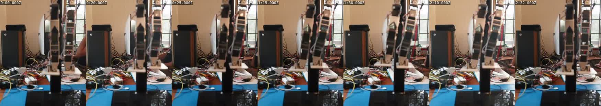

# 2026-10-24 — one-leg stand rehearsed on the test stand

The robot was clamped on the test stand (the pelvis held, the feet resting on the
platform), Tom present. The Sony A7 III recorded from before the port opened until
after it closed. The serial transcripts, video and `.pts` sidecars are in
`hw_sessions/2026-10-24/stand/` (gitignored): `oneleg_*`, `hiproll_*`, `NOTES.md`.

*Front view, robot facing the camera (its right leg is image left). Left to right:
straight, crouch, half shift, full shift, right foot lifted, lowered, straight.*

## Before: what holds a goal

The hip rolls (STS3250, ids 51/52) had sat about 2° off their goal under torque
earlier in the day. On the stand: id 51 at 2030 with goal register 2047; `torque 51`
→ no motion and load 0 for 1.5 s; a fresh `move 51 2047` → 2046–2047 at once. **An
STS servo's torque-on holds the present position, and the goal register is ignored
until a new goal is written.** Streaming goals (`pose`, the policy) never meets
this; a bare `torque` after a release does. No register was changed.

Per-joint check, all 12 joints: a fresh `move` to zero, a 3° step and back, each
within ±4 ticks with loads ≤ 4 % duty. Id 52 hunts ±3–5 ticks around a goal and
never settles (dead zone 0/0, against 1/1 on the STS3215s); id 51 settles within
1–3.

## The sequence

`torque` (broadcast, holds the present pose), then one `pose <17 ticks> s<ms>` per
stage, all 12 positions, loads and the IMU read back after each:

| stage | ms | reached | notes |
|---|---|---|---|
| straight | 3000 | within 4 ticks | no jump at torque-on |
| crouch 20 mm | 2000 | within 5 | |
| half shift | 2000 | within 2 | the feet move to the robot's right under the held pelvis, soles flat: the sign is right |
| full shift | 2000 | within 4 | rolls ∓9.8° |
| lift right foot 30 mm | 2000 | within 5 | right ankle clamped 1589 → 1593 (the −40° envelope), as planned |
| hold | 37 s | unchanged to the tick | loads ≤ 4.8 % duty, no fault flag, 27–30 °C |
| lower, centre, straight | 2000 / 3000 / 2000 | within 5 / 6 / 3 | then `release` |

With the pelvis held, this shows the motion is right (signs, ranges, tracking, no
contacts and no unplanned clamps). It cannot show balance: the stand carries
whatever the legs do not.
