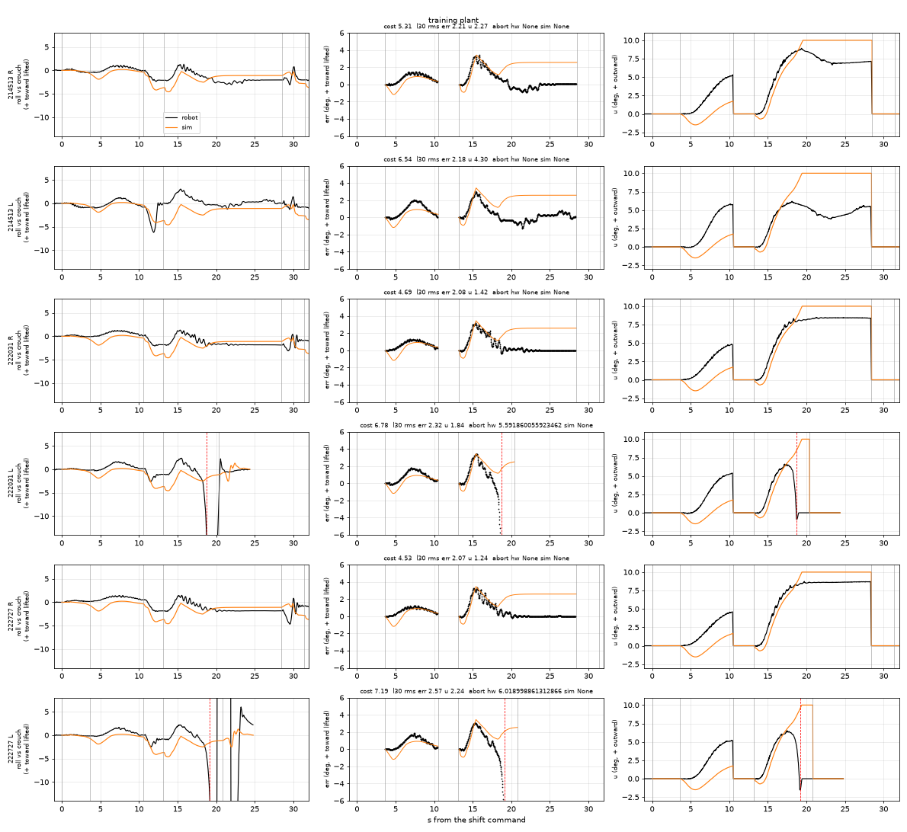
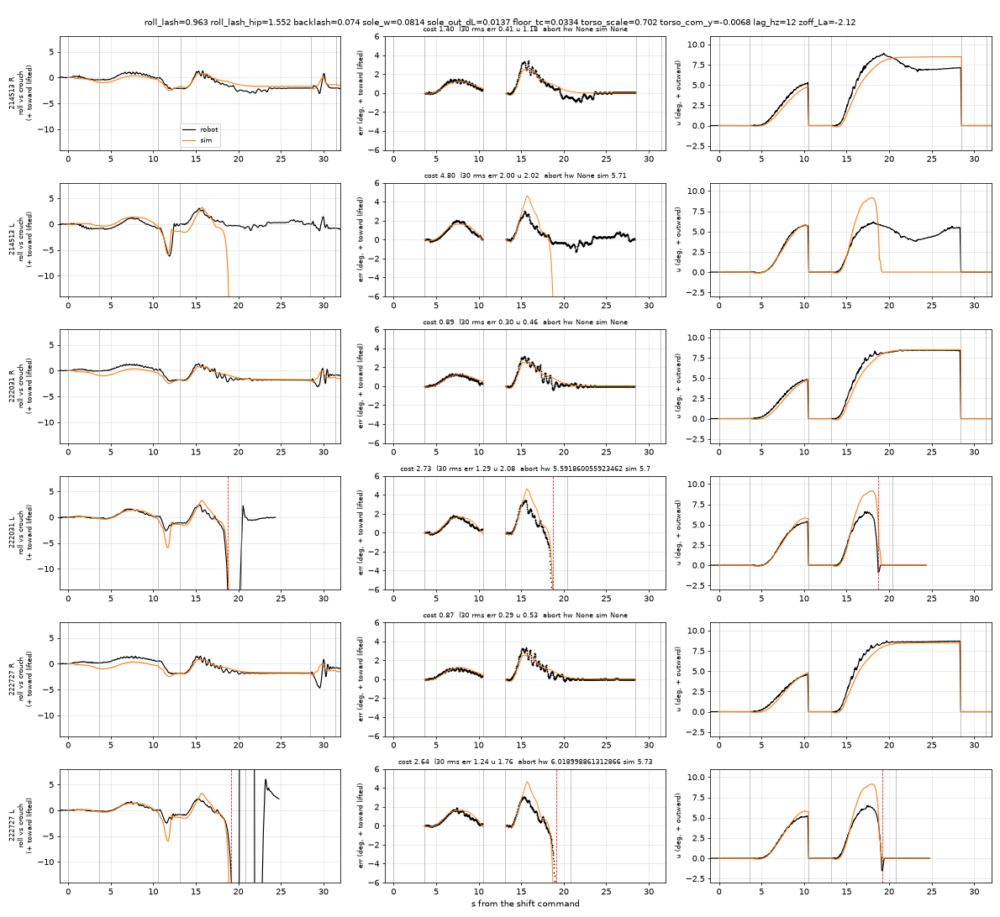

# 2026-10-30: fitting the legs sim to today's one-leg stands, and retuning the roll loop in it

Tom's goal: "capture the discrepancies between predicted positions and actual so that the
simulation can be updated properly". The inputs are today's flight-recorder sessions of the 10-25
one-leg protocol on carpet: crouch, shift (1.3x the model's lateral shift), 10 mm lift over 6 s with
`B`, lower, 30 mm lift over 4 s with `B` plus a 12 s hold, lower, crouch. The bench PI ran live with
kp 0.3, ki 1.0, kd 0.03, ankle x+1 / hip x-1, clamp 10 deg, abort 12 deg. Firmware main f04266c,
1.7 mm rubber soles.

| session | R stance | L stance |
|---|---|---|
| 214513 (feedback reads mostly missing) | held, u 7.1 | held, u 5.5 |
| 222031 | held, u 8.4 | **aborted at 5.6 s**, outward, u peaked 6.6 |
| 222727 | held, u 8.7 | **aborted at 6.0 s**, outward, u peaked 6.5 |

Both sides lean the same way early: err +3.0..3.4 deg toward the lifted foot at 2.2-2.4 s into
the 30 mm lift. They part after ~3.5 s. R winds u up to 8.4-8.7 deg and settles with err 0 and no
creep. L reverses while u is still 6-6.5 deg, goes past the reference at ~4.5 s and falls outward
(-0.3 to -10 deg in ~1.2 s). In the 10 mm stage both sides held, with u 4.3-5.8 deg, still rising
when the lowering began.

## Method

**Replay harness** (`simfit_sim.py`, data loader `simfit_hw.py`). The plant is
`sim/bimo_biped_v6legs.xml` in `walker_env.BimoWalkerEnv`, the CPU twin of env_mjx, configured
as `train_mjx --robot --xml bimo_biped_v6legs.xml --servo-kp-scale asbuilt --quantize
--joint-frictionloss 0.35` sets it up (STS3250 envelope at the hip rolls), with every
domain-randomisation draw fixed. The firmware side is re-implemented tick for tick from
`cli.cpp` (poseTick / balTick) and `balance/roll_pi`:

- every `pose ... s<ms>` is a quintic min-jerk from the servos' read-back positions (the sim
  encoder) to the commanded ticks;
- `B<side>` engages the PI with ref = the roll then;
- the stance ankle roll gets +ka·u and the hip roll +kh·u, in integer ticks on top of the
  nominal;
- past 12 deg the correction fades over 0.3 s and the pose lands back on the move start over
  1.0 s;
- the next pose without B drops the correction.

The move list and its start times are the robot's own "streaming" stamps from the events CSV. The
target ticks are converted with the calibration recovered from the session's own rad columns. The
replay starts settled in the crouch, ticks every 24 ms (the bench runs ~25 ms) and reads roll
exactly as `rollFromUp` does on the IMU site. It logs, per tick: roll, rate, ref, err, I, u, every
joint's goal and encoder (the shaft, i.e. the link plus the downstream roll play), load (‰ of
stall), the CoM relative to the stance sole, and both feet's normal forces. One stand takes 0.8 s,
so 6 stands x 30 plants run in ~10 s on 32 cores.

**Cost** (`simfit_compare.py`). The cost is computed per B stage (l10, l30), on the robot's own
tick times, up to the first abort (robot or sim):

    rms(err_sim - err_hw) / 1 deg  +  rms(u_sim - u_hw) / 2 deg  +  min(|t_abort_sim - t_abort_hw|, 3 s) / 2 s

A missing abort counts as the end of the window + 2 s. A sim fall that the robot did not have,
anywhere in the stand (lowering, crouch), adds 5.

**Fit** (`simfit_fit.py`). A random design (600-1200 plants) in a box, then Nelder-Mead, then a
one-at-a-time profile of each parameter. **Training stands: 214513 R/L and 222031 R/L. Held out:
222727 R/L.** A second fit on all six stands checks for degeneracy.

## What the training plant predicts (before any fit)



Black is the robot, orange the sim. Columns: roll vs the crouch, err and u, signed so that + is
toward the lifted foot (outward for u). Total cost 35.1.

- **The early lean in the 30 mm lift is already right**: +3.4 deg at ~2.3 s on both sides. The
  play released at foot-off makes it; it is not a CoM error.
- **Hold: the sim cannot correct it.** u runs into the 10 deg clamp with err stuck at +2.6 deg on
  every stand, while the robot settles with err 0 at u 8.4-8.7 (R). The cause is the 3 deg roll
  play on the hip rolls: the hip carries a moment that a pelvis translation (ankle +u, hip -u)
  does not change, so the torso stays at the edge of the hip's dead band whatever u does. On the
  robot u does fix the lean, so the robot's lean must come mostly from places whose load u changes
  (ankle, foot/floor).
- 10 mm stage: the sim leans away from the lifted foot first (u -1.5 deg) and reaches u 1.7 deg,
  where the robot reaches 4.6-5.8.
- The sim is symmetric, so L never falls.

## The fitted plant

Best fit with `kp_scale` held at 1.0, i.e. the asbuilt stiffness the bench measured. Fit on 4
stands, validated on 222727. The uncertainty column is the range over which that parameter alone,
the others held at the optimum, raises the training cost by <= ~1 (profile; the cost is not a
likelihood, see the caveats).

| parameter | training plant | **fitted** | range | notes |
|---|---|---|---|---|
| roll play, ankle rolls (`roll_lash`) | 1-5 deg DR | **0.96 deg** | 0.6-1.25 | |
| roll play, hip rolls | same value | **1.55 deg** | 1.1-1.6 | cliff at 1.9: above it the hold saturates |
| gear backlash, all joints | 0.5-1.0 deg DR | **0.07 deg** | 0-0.2 | kp and backlash trade off: free kp gives 1.9x with backlash 0.75, about the same cost |
| servo stiffness x asbuilt | 1.0 | **1.0 (held)** | (free fit: 1.65-2.5 with backlash 0.75) | |
| effective sole width | 84 mm | **81 mm** | 79-85 | |
| floor/pad contact solref time constant (carpet) | 0.02 s | **0.033 s** | 0.015-0.045 | flat |
| torso mass x | 1.0 (0.324 kg) | **0.70** | 0.6-0.69 | cliff at 0.78 |
| torso CoM y | 0 (DR +-15 mm) | **-6.8 mm** (right) | -10..-5 | cliff at -4 |
| **L-only:** outer sole edge pulled in | - | **13.7 mm** | 0-17 (weak, discontinuous) | asymmetric |
| **L-only:** L ankle-roll zero error | - | **-2.1 deg** | bimodal: -2.5..-0.8, or +0.3 | asymmetric |
| servo target lag (3 stages) | 2-12 Hz DR | 12 Hz | 5-20 hardly changes the cost | set from the joint tracking, below |



| stand | training plant | fitted plant | |
|---|---|---|---|
| 214513 R | 5.31 | 1.38 | train |
| 214513 L | 6.54 | 4.80 | train (sim aborts at 5.7 s, the robot held) |
| 222031 R | 4.69 | 0.89 | train |
| 222031 L | 6.78 | 2.73 | train (abort 5.7 s, robot 5.6 s) |
| **222727 R** | 4.53 | **0.87** | **held out** |
| **222727 L** | 7.19 | **2.64** | **held out** (abort 5.7 s, robot 6.0 s) |
| total | 35.1 | 13.3 | |

**R stance is reproduced closely** on all three runs: err rms 0.3 deg, u rms 0.5 deg, u
8.5 vs 8.4-8.7, the 10 mm stage included. **L stance falls outward at 5.7 s** in the replays of
the two runs where the robot fell at 5.6 / 6.0 s. The fall has the same shape: the torso reverses
and the robot rolls over the outer edge while u is still high.

**The data do need an L/R asymmetry.** No symmetric plant, CoM offset included, made L fall while
R held. The best symmetric fit costs 17.1 on all six stands, against 13.3 here, and it misses both
L aborts. Which asymmetry it is, the data cannot say. A soft or rounded L outer sole edge, an L
ankle-roll zero error and a torso CoM offset trade off against each other, and the profiles are
discontinuous because each small change flips whether L falls. A fit on all six stands found an
equally good but knife-edge optimum (sole 75 mm, floor_tc 0.014, kp 2.2x, L edge 10 mm, zero error
-0.7 deg; neighbours fall on R). The asymmetry the plant needs is "L stance reaches its outer
support edge with ~1 deg of u to spare over its equilibrium". The robot shows that directly: in
214513 L sat at u 4-5.5 with err about 0, and 6.5 deg tipped it twice.

## Discrepancies that remain

1. **L u level.** The sim's L needs u 8.6 deg and leans 4.6-4.9 deg before it falls. The robot's
   L leaned 3.0-3.4 deg and fell at u 6.5. The fitted L zero error (-2.1 deg) buys the fall
   timing with too much lean. The other mode of the profile (+0.3 deg) and the "hardware-like L"
   band variants (zero error +1..+1.5 deg with the edge 9-12 mm in) tip L at u 5-6.5 deg, as the
   robot did, at a slightly higher cost. The controller below is checked against both.
2. **214513 L**, which held on the robot, falls in the deterministic replay. L was marginal on the
   bench: 3/3 held this morning, 1/3 this afternoon. A sim that matches the two falls will also
   drop the held run.
3. **Joint loads and deflections** (30 mm hold, robot / sim, pos-goal in ticks, load in ‰ of
   stall):

   | joint | R stance (222031) | L stance (222031, before the fall) |
   |---|---|---|
   | stance hip roll | -6 / 0, 48 / 0 | +6 / 0, 48 / 4 |
   | stance ankle roll | -5 / -12, 48 / **221** | +3 / 0, 32 / 16 |
   | swing hip roll | +3 / -8, 24 / **117** | -4 / 0, 32 / 6 |
   | stance knee | +7 / +6, 64 / 103 | +9 / +6, 80 / 112 |
   | swing hip pitch / knee | +3 / +1 and -5 / -4, 32-48 / 18-64 | +2 / +6 and -7 / -10, 24-64 / **111-179** |

   The joint positions agree within a few ticks. The loads do not: the sim's stance ankle roll and
   swing hip roll carry 4-5x the robot's load, and its swing-leg pitch joints 2-4x. The sim's
   stance hip roll sits inside its play (no load), where the robot's is loaded at 48. Either the
   load register under-reads in a static hold (the 10-25 bench found 0 there: gear friction holds
   the pose), or the leg links are lighter than modelled; the fitted torso at 0.70x points the
   same way. **Weighing the leg links and the torso would settle it.**
4. **Servo tracking.** The robot follows a min-jerk move with a 95 ms goal->pos delay (median
   over the knees, hip pitches and ankles of 2 sessions; worst error 12.5 ticks). The fitted
   plant gives 125 ms / 12 ticks at a 12 Hz 3-stage lag (110 ms at 20 Hz, 175 ms at 5 Hz). The
   training plant's 0.5-1.0 deg backlash makes it 175-230 ms. The bench stream has no shaper.
   The policy path's C2 shaper is what `--act-lag 2,12` stands for, so that range should stay.
5. **Double-support lean during the shift.** At the end of the shift the robot sits -0.4..+0.2 deg
   from its crouch roll on R (sim -0.9) and -0.2..-0.9 on L (sim -0.3). Within ~1 deg; not
   fitted.

## Controller retune (in the fitted plant)

`simfit_tune.py` runs the whole protocol for each stance (both lifts, the hold, both lowerings,
the crouch) on the recorded timing and ticks. It runs on the fitted plant and a 24-plant band:

- each fitted parameter at both ends of its range;
- the symmetric plant;
- three "hardware-like L" variants that tip at u 5-6.5 deg;
- 3 seeds, the second and third with 0.05 deg IMU and 0.0075 rad/s gyro noise.

A run is ok when there is no abort, no fall anywhere, and the foot stays off for >= 90 % of the
hold. Margin is the minimum distance (mm) of the CoM to the outer sole edge over the 30 mm stage;
"in" is the same distance to the inner edge.

| controller | R ok | R outer margin min (nominal) | R err, last 5 s | L ok | L outer margin min (nominal) | L err, last 5 s | u end R / L |
|---|---|---|---|---|---|---|---|
| bench default (no I limit) | 71/72 | 14.9 (17.6) | <= 0.2 | **6/72** | fell (fell) | - | 8.5 / - |
| clamp 7 deg | 72/72 | 20.3 | <= 1.6 | 55/72 | fell | - | 7.0 / 7.0 |
| clamp 5 deg | 72/72 | 27.4 | <= 2.2 | 70/72 | fell (33.3) | - | 5.0 / 5.0 |
| I limit 6 deg | 72/72 | 22.1 | <= 1.9 | 58/72 | fell | - | 6.5 / 6.8 |
| I limit 5 deg | 72/72 | 25.4 | <= 2.1 | 69/72 | fell (29.6) | - | 5.6 / 6.0 |
| I limit 4 deg | 72/72 | 28.7 (30.9) | <= 2.2 | 70/72 | fell (33.1) | - | 4.6 / 5.1 |
| **I limit 3 deg** | **72/72** | **32.2 (34.1)** | **<= 2.7** | **72/72** | **28.3 (36.4)** | **<= 4.1** | **3.7 / 4.1** |

The kp 0.2-0.45, ki 0.5-1.0 and kd 0.03-0.06 grid (`tune3`, 2 seeds) moves these numbers by
<= 2 mm. **The integral's authority decides the outcome; the gains barely matter.** Every
failure at a 4-5 deg limit is the hardest "hardware-like L" variant. The 10 mm stage holds in
every case: margin >= 33 mm R and >= 29 mm L with the 3 deg limit. With the bench default, the one
R failure is a fall in the lowering (sole 79 mm, noise seed). Inner margins stay >= 33 mm R and
>= 26.5 mm L: the residual lean toward the lifted foot is far from the inner edge.

**Recommendation: keep kp 0.3, ki 1.0, kd 0.03, ankle +1 / hip -1, clamp 10 and abort 12, and
limit the integral's share of u to 3 deg (|ki·I| <= 3 deg).**

- **What it trades.** The loop no longer drives the torso roll all the way back to the pre-lift
  reference. It holds with a residual lean of ~2.5 deg (R) to ~4 deg (L) toward the lifted foot.
  The sim's foot stays off throughout, with inner margins of 26-33 mm.
- **Why that is the right trade.** On this robot the reference is not a CoM target: on L the
  err = 0 point sits ~1 deg of u from the outer edge. Under-correcting tips the robot toward the
  lifted foot, which is benign: the foot touches. Over-correcting is the hard outward fall the
  bench saw.
- **What it keeps.** kp·err keeps the full 10 deg clamp against a real inward fall, which a lower
  output clamp would give up (clamp 5 also fails 2/72 on L).
- **4 deg** is the alternative if the residual lean bothers: less lean, 70/72 on L.
- With the limit, the recorded sequences replay with both stances held: u 3.7 (R) / 4.2 (L) deg,
  err 2.4 / 4.0 deg ([figure](2026-10-30-sim-fit-ilim3.png)).
- For the bench: R held at 8.5 deg on the robot with err 0. With the limit, expect it to hold at
  ~4-5 deg of u and ~2 deg of lean toward the lifted foot.

A feedforward was not pursued: it would add outward push on top of the I term, which is the
direction that fails (the walk's `+5 deg ff` run tipped outward earlier, 2026-10-30-s2-lift-sim.md).

### Firmware change (this branch; host-tested, not flashed)

- `balance::Config::i_lim_rad = 0.05236f` (3 deg; 0 = off), checked by `validate` (0..15 deg).
- `RollBalance::update`: after the anti-windup integration step, `i_ = clamp(i_, ±i_lim_rad/ki)`.
  u uses the old I, as before, so the limit acts from the next tick. It is the same code for
  either stance.
- `balance set <kp> <ki> <ka> <kh> [clamp] [abort] [kd] [decay] [land] [ilim_deg]`. `balance`
  prints the limit. `balance set default` restores 3 deg.
- `balance.py` `RollPI(..., i_lim=)` is the sim twin and prints a third golden block.
  `host/test_roll_pi.cpp` pins it (`testIntegralLimitMatchesSimTwin`) and checks the properties
  (symmetric, scales with ki, 0 = the old loop runs to the clamp) and the default.
  `make host` -> roll_pi 1975 checks, 0 failures.

## What the night training should adopt

These are the changes to the current legs queue line (`--robot --xml bimo_biped_v6legs.xml
--servo-kp-scale asbuilt --act-lag 2,12 --quantize --joint-frictionloss 0.35 --roll-lash-deg
1.0,5.0 --torso-mass-range 0.4 --torso-com-y 0.015 --imu-mount-deg 3 ...`):

| flag | now | adopt | why |
|---|---|---|---|
| `--roll-lash-deg` | `1.0,5.0` | **`0.5,2.0`** | fitted 0.96 (ankle) / 1.55 (hip). At 4-5 deg the replay saturates or falls on every stand |
| `--backlash-deg` | (default 0.5-1.0) | **`0,0.25`** | fitted 0.07; 0.5-1.0 doubles the play and slows tracking to 175-230 ms (robot 95 ms) |
| `--zero-offset-deg` | (unset, 0) | **`2`** | the L/R asymmetry the data need is a ~2 deg roll-zero error, or the like |
| `--servo-kp-scale` | `asbuilt` | keep | the fit holds it at 1.0 with no loss |
| `--torso-mass-range`, `--torso-com-y` | `0.4`, `0.015` | keep | fitted 0.70x and -6.8 mm are inside |
| `--act-lag` | `2,12` | keep | the bench stream is 12-20 Hz-equivalent, but the policy path's shaper is what the lag stands for |
| `--joint-frictionloss` | `0.35` | keep | fitted with it (not varied) |

Plant XML (`sim/gen_plant_v6.py` -> `bimo_biped_v6legs.xml`; low priority, the profile is flat):
give the `pad` default class and the `floor` geom `solref="0.033 1"`, the carpet's contact
compliance (the default is 0.02).

Not expressible as a flag yet: an outer sole edge that varies per foot (fitted 14 mm in on L).
The cheap way is a per-episode, per-foot DR in env_mjx/walker_env that scales the outer pads' y
by U(0.7, 1.0). The torso mass may be ~30 % high in the plant; weigh it before moving the
nominal.

## Reproduce

```bash
export CUDA_VISIBLE_DEVICES=
F="kp_scale=1.0 roll_lash=0.963 roll_lash_hip=1.552 backlash=0.074 sole_w=0.0814 sole_out_dL=0.0137 floor_tc=0.0334 torso_scale=0.702 torso_com_y=-0.0068 zoff_La=-2.12 lag_hz=12"
.venv/bin/python experiments/one-leg-stand/simfit_hw.py                              # the stands, per stage
.venv/bin/python experiments/one-leg-stand/simfit_compare.py --png base.png          # training plant
.venv/bin/python experiments/one-leg-stand/simfit_compare.py --set $F --png fit.png  # fitted
.venv/bin/python experiments/one-leg-stand/simfit_compare.py --set $F --ctl i_max=0.05236 --png ilim3.png
.venv/bin/python experiments/one-leg-stand/simfit_fit.py fit roll_lash=0:2.5 roll_lash_hip=0:3 backlash=0:1 \
    sole_w=0.07:0.095 sole_out_dL=0:0.02 zoff_La=-2.5:2 torso_com_y=-0.01:0.015 floor_tc=0.01:0.05 \
    torso_scale=0.6:1.3 --base kp_scale=1 --n0 600 --iters 200 --train 214513R,214513L,222031R,222031L   # ~10 min
.venv/bin/python experiments/one-leg-stand/simfit_tune.py grid i_lim_deg=0,3,4,5,6 --seeds 0,1,2     # simfit_plant.json
```

The recordings are read from `/home/claw/code/robot/hw_sessions/2026-10-30` (gitignored;
`ONELEG_HW_DIR` overrides).

## Caveats

- The cost is a weighted rms plus an abort-time term, not a likelihood. The ranges are profile
  ranges at Δcost <= ~1, and several profiles are discontinuous (fall / no fall). Read them as
  "where the fit stays as good", not as confidence intervals.
- Six stands, three per side, one floor, one day. The morning's 3/3 L holds are not in the
  flight recorder.
- The replay starts each stand settled in the crouch. The robot's play state at that moment is
  unknown, and the pre-l30 references show it carries history (R: -1.8 deg before l10, ~0 before
  l30).
- The joint-load comparison assumes the load register reads ‰ of stall.
