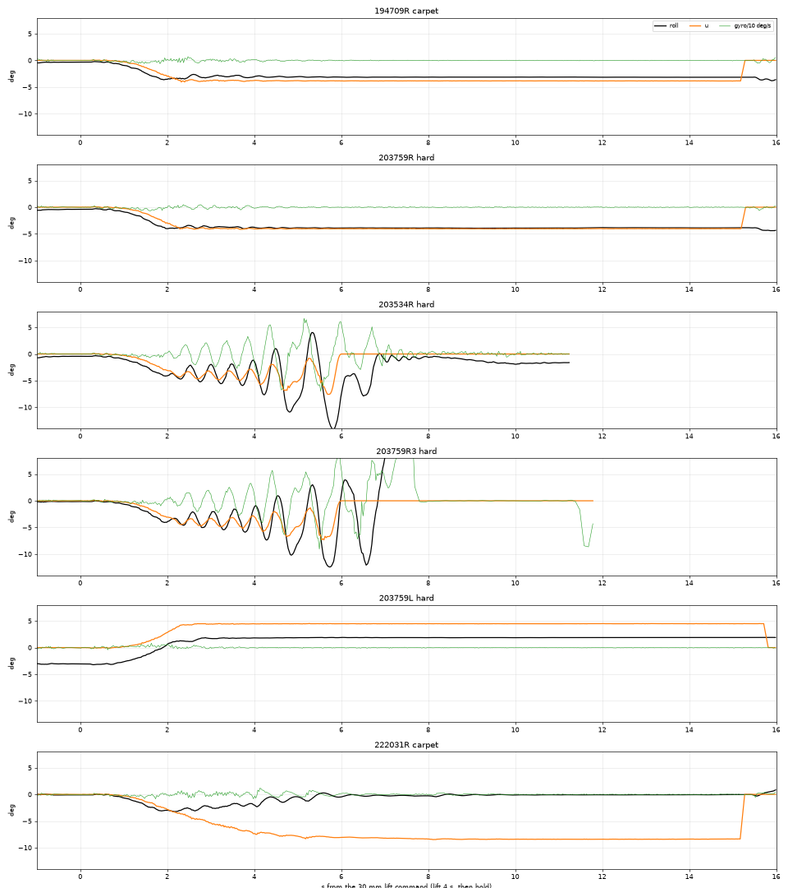
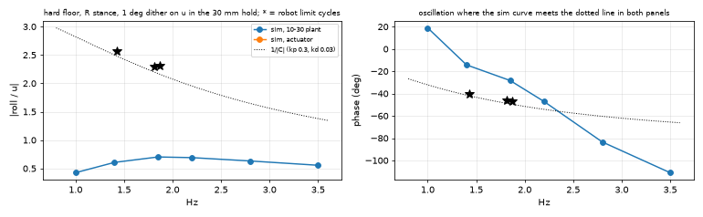
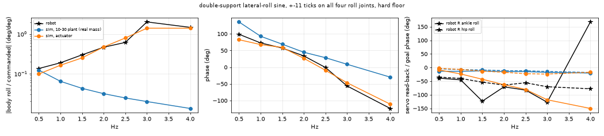
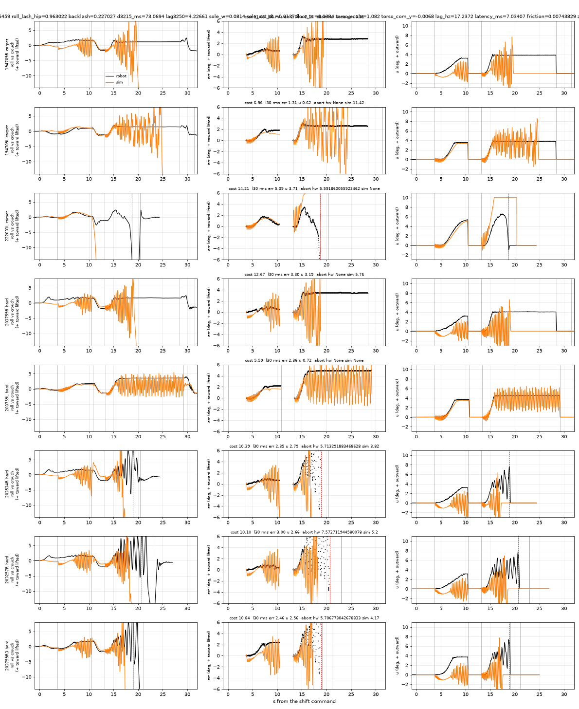
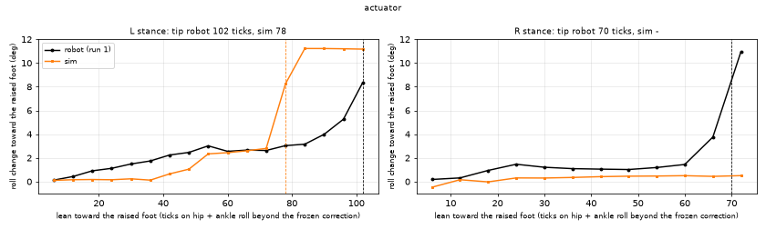
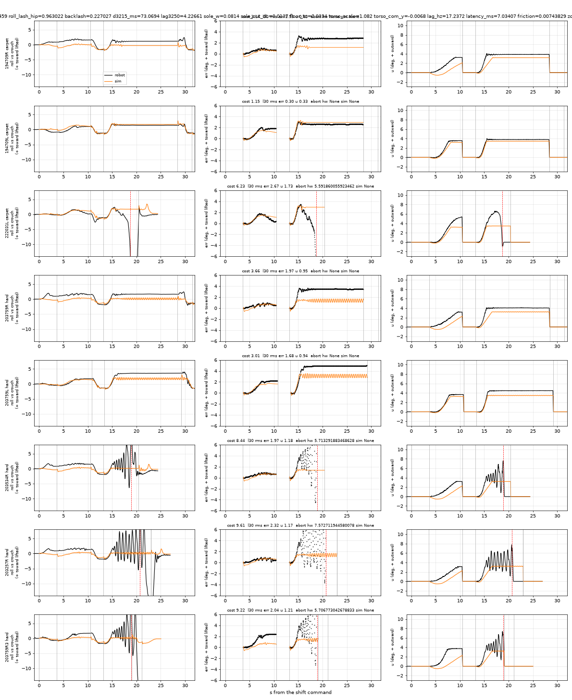

# 2026-11-01: the one-leg balance on a hard floor, and the actuator model the sim was missing

Tom's goal: capture the sim-vs-real discrepancies so the sim, and the policies trained in it, are
right on both floors. Trigger: on a hard floor the bench roll balance (kp 0.3, ki 1.0, kd 0.03,
3 deg I cap, ankle +1 / hip -1, live through the lift) goes into a divergent 1.4-1.9 Hz roll
oscillation on R stance, while the same protocol holds on carpet.

**Short answer.** The floor contact is not the missing piece. What the 10-30 plant lacks is the
actuator. The STS3215s sit ~70 ms of dead time behind a goal write. The servos are far less
damped than modelled: the plant's 0.35 N·m joint friction and its servo D locked every small motion.
An actuator model fitted to the new double-support roll sweep and to the loaded step responses
reproduces the robot's body-level roll response, including the ~3 Hz double-support peak the old
plant did not have at all (0.01-0.1 where the robot reads 0.14-2.0). In that model the one-leg PD
loop is unstable in a kp-driven 1.4-1.9 Hz mode. That is the robot's mode, and R goes before L.
With kd reduced to 0.01 it reproduces the robot's pattern: hard-floor R aborts at 4.9 s at 1.8 Hz
(robot 5.7 s), carpet R and both L hold. At the bench's kd 0.03 the model is more unstable than
the robot (it also fails on carpet, at 3.5 Hz). The floor dependence itself is not reproduced. The
retuned loop is **kp 0.15, ki 1.0, kd 0, I cap 3 deg** (firmware default on this branch). It holds
87/88 band runs on both floors in the fitted model, where the bench gains hold 0/88. At the robot's
own limit cycle it gives |C·P| = 0.35 (the bench gains: 1.07).

## Data

| session (hw_sessions/2026-11-01) | floor | what | result |
|---|---|---|---|
| 194709 `ilim_stands` | carpet | 3x R + 3x L stands, 3 deg cap | 6/6 held; lean R -2.9..-3.1, L +1.9..+2.6, u ±3.7-3.9 |
| 203257 | hard | R stand | 30 mm hold: 1.4-1.6 Hz limit cycle, roll -10..-1 deg for 5 s, lifted L foot striking at the inward extreme, abort 7.6 s, caught |
| 203534 | hard | R stand | from 2.4 s a 1.7-1.9 Hz oscillation growing 3 -> 18 deg p2p, abort 5.7 s |
| 203759 | hard | R, L, R, L, R | R1, L1, R2, L2 held (R lean 3.4-3.8, L 4.6-5.0); R3 oscillated, abort 5.7 s, fell after landing |
| 205338 (+ tip2 log) | hard | inside tipping point (tip.sh), 3 runs/side | L tips at -102/-102/-102 ticks, R at +72/+66/+72 |
| 213236 | hard | `sweep 11`, double support, crouch | body roll / command 0.14 (0.5 Hz) ... **2.04 at 3 Hz** ... 1.49 (4 Hz) |
| step_loaded.txt | hard | `stepresp` +30 ticks per joint | STS3215: dead 66-87 ms, t63 117-159 ms; STS3250 hip rolls: dead 12-18 ms, t63 27-39 ms |
| 10-30 `oneleg_rec` | carpet | no I cap | R held (u 8.4-8.7), L fell outward 2/3 |

The oscillation starts when the 30 mm lift ends and the integral reaches its 3 deg cap (2.2-2.5
s), on every unstable run. Below the hard-floor stands (R carpet, hard held, hard R3, hard L,
10-30 carpet R):



### The robot's own loop gain at the oscillation (model-free)

u is computed on board, so its spectrum is exact. At a sustained oscillation the roll PD C(jw) =
kp + kd·jw and the stance plant P = roll/u satisfy C·P = 1. From the three unstable stands
(`simfit_frf.py hw`):

| stand | f | roll/u = P | C (kp 0.3, kd 0.03) | C·P |
|---|---|---|---|---|
| 203534R | 1.87 Hz | 2.32 at -47 deg | 0.46 at +50 deg | 1.07 at +3 deg |
| 203759R3 | 1.81 Hz | 2.30 at -46 deg | 0.46 at +49 deg | 1.05 at +3 deg |
| 203257R | 1.43 Hz | 2.56 at -41 deg | 0.41 at +42 deg | 1.05 at +1 deg |

The gyro term's ~50 deg of lead is what brings the loop phase onto zero. With kd 0 the same P gives
C·P = 0.69 at -46 deg. With kp 0.15 and kd 0 it gives 0.35. The 10-30 plant's P at 1.85 Hz is
0.69 at -29 deg, 3.3x too small. Its gain margin is ~2.5x: it goes unstable only at 2.5x the bench
gains.



(The fitted actuator plant has no points in this figure. With the bench gains it is already
unstable, so a 1 deg dither on u aborts the stand.)

## 1. Floor contact alone does not reproduce it

`Plant` now carries the contact per floor: `floor_*` for carpet and `h_*` for hard, either as tc/dr
or as a direct stiffness/damping `k/b` (MuJoCo negative solref). The rest of the robot is shared;
`Plant.on(floor)` swaps the contact. On the 10-30 plant (mass pinned, below):

- tc 0.004-0.033 s × damping ratio 0.1-1, and k 1e3-3e5 /s² × b 15-1000 /s on the hard R stands.
  No setting gives a 1.4-2 Hz oscillation. Low damping at tc 0.004 makes the contact chatter at
  2.5-3.4 Hz, a numerical mode, not the robot's.
- Kick tests (a roll torque impulse in the hold) show the plant's roll mode at ~2.5 Hz and heavily
  damped, whatever the contact.
- With the actuator made livelier, a stiff floor is *more* stable than a soft one in the sim: the
  opposite of the robot.
- Tom: the hard-floor board is not springy. The fits below use a rigid floor (tc 0.005, dr 1).

## 2. The actuator model

The two new system-ID sets pin it down. Both are double support on the hard floor.

**Joint level: loaded step responses** (`simfit_step.py`). +30 ticks and back per joint at the
stand pose:

| joint | robot dead / t63 / final (out \| back) | fitted sim |
|---|---|---|
| R hip roll (3250) | 12 / 144 / 0.63 \| 12 / 27 / 1.21 | 24 / 48 / 1.05 \| 36 / 60 / 0.78 |
| L hip roll (3250) | 12 / 33 / 0.93 \| 18 / 39 / 0.86 | 24 / 48 / 0.89 \| 36 / 60 / 0.84 |
| R ankle roll | 69 / 153 / 0.73 \| 72 / 117 / 1.09 | 96 / 144 / 1.03 \| 12 / 108 / 0.92 |
| R hip pitch | 66 / 123 / 0.83 \| 72 / 132 / 0.84 | 96 / 144 / 0.77 \| 108 / 156 / 1.00 |
| R knee | 78 / 144 / 0.83 \| 69 / 129 / 0.96 | 96 / 144 / 0.87 \| 108 / 132 / 1.25 |
| R ankle | 87 / 159 / 0.93 \| 72 / 132 / 1.06 | 96 / 144 / 1.18 \| 60 / 132 / 1.17 |

ms; the sim reads at its 24 ms tick, so its times are quantised to 24 ms. The 10-30 plant gives
~50/100 ms on every joint: one law for both servo types.

**Body level: the double-support roll sweep** (`simfit_sweep.py`). Body roll over the commanded
offset, and the servos' read-back over goal:

| Hz | 0.5 | 1 | 1.5 | 2 | 2.5 | 3 | 4 |
|---|---|---|---|---|---|---|---|
| robot roll/cmd | 0.14 / +99 | 0.19 / +73 | 0.30 / +57 | 0.47 / +34 | 0.62 / -1 | **2.04 / -56** | 1.49 / -124 |
| 10-30 plant (1538 g) | 0.12 / +136 | 0.06 / +93 | 0.04 / +69 | 0.03 / +45 | 0.02 / +29 | 0.02 / +9 | 0.01 / -30 |
| **fitted actuator** | 0.10 / +83 | 0.16 / +68 | 0.25 / +59 | 0.47 / +27 | 0.80 / -9 | **1.42 / -47** | 1.41 / -111 |
| robot R ankle roll act/goal | 0.71 / -39 | 0.75 / -45 | (bad read) | 0.73 / -71 | 0.75 / -83 | 0.69 / -127 | 0.53 / +168 |
| fitted | 1.03 / -9 | 1.04 / -23 | 1.07 / -43 | 1.12 / -63 | 1.29 / -80 | 1.11 / -118 | 0.61 / -150 |
| robot R hip roll act/goal | 0.69 / -35 | 0.76 / -40 | 0.74 / -54 | 0.61 / -64 | 0.92 / -56 | 0.83 / -70 | 0.67 / -78 |
| fitted | 1.02 / -3 | 1.03 / -7 | 1.01 / -13 | 1.01 / -17 | 1.04 / -23 | 0.83 / -24 | 0.92 / -17 |



The body response and the ankle-roll lag match. The hip-roll read-back does not. The robot's STS3250
lags 35-78 deg with 0.6-0.9 amplitude even at 0.5 Hz, a deadband describing function at ±1 deg.
The sim reads its "encoder" as the link plus the downstream play, which follows the (fast) hip-roll
target. A pure goal-to-encoder fit gives, for the STS3250: dead 30 ms, 1st-order pole 23 Hz,
deadband 0.75 deg. For the loaded STS3215 ankle roll: dead 53-76 ms, pole 7-10 Hz, deadband
0.53-0.62 deg.

**Fitted actuator** (`simfit_sweepfit.py`, sweep + 0.5 × step cost, rigid floor, total mass 1538 g;
`simfit_plant_actuator.json`):

| | 10-30 plant | **fitted** |
|---|---|---|
| servo stiffness × asbuilt (all) | 1.0 | **1.40** |
| servo D × (0.25 N·m·s/rad × the asbuilt map) | 1.0 | **0.27** |
| joint viscous damping | 0.1 | **0.16** N·m·s/rad |
| joint Coulomb friction | 0.35 | **0.0074** N·m |
| gear backlash (deadzone on the servo error) | 0.07 deg | **0.23 deg** |
| roll play ankle / hip | 0.96 / 1.55 deg | **1.65 / 0.96 deg** |
| common dead time + 3-stage lag | 4 ms + 12 Hz | **7 ms + 17.2 Hz** |
| STS3215 extra dead time | - | **+73 ms** |
| STS3250 lag pole × | - | **4.2** (68 Hz: effectively none) |

The decisive pieces are the low friction and D (a lively structure) and the per-type dead time.
Sweep cost: 13.1 for the 10-30 plant, 3.4 fitted. Step cost: ~8, then 3.0.

The unloaded STS3250 self-oscillation (hip rolls at ~4.6 Hz, 0.5 deg p2p, legs hanging; recorder
221631) fits this picture: a fast servo, little D, a deadband. It is not fitted. A limit cycle
inside the deadband needs the shaft model below.

## 3. What the fitted actuator does to the one-leg balance

`simfit_compare` replays every stand tick for tick with the firmware's own balance as it ran. The
replays use the recorded timing, poses and controller, and the floor of each stand.



- At the bench gains (kp 0.3, kd 0.03) every R stance aborts, carpet and hard, at 3.4-3.6 Hz. L
  goes unstable on carpet, holds on hard. The sim is more unstable than the robot.
- kd 0.03 -> 0.01, kp 0.3 (`sw` grid in the fit log): hard R 203534 and R3 abort at 4.9 s at
  1.77 Hz (robot 5.7 s, 1.8 Hz). Carpet R holds with a small 2.5 Hz ripple (0.2 deg rms), L holds
  on both floors. This is the robot's pattern.
- kd 0, kp 0.3: unstable at 1.4-1.8 Hz on both floors. So the mode is kp-driven. The rate term
  moves it to 3.5 Hz in this model; on the robot it rather tips the 1.85 Hz phase onto zero.
- With the balance gains ~0 there is no oscillation: the loop drives it.

The hard/carpet difference is not reproduced. A joint fit of the stands, the FRF, the tip test and
the sweep (fitD, with carpet k/b, roll play, kd, hip stiffness, CoM height, sole edges and IMU delay
free around the actuator) did not find it in its budget. The robot's floor dependence is a
small-margin effect (|C·P| ≈ 1.05). On a rigid board it plausibly lives in the stance foot's
rocking and the lifted-foot strikes, which 8 sphere pads per sole model poorly. **Open.**

## 4. Mass, CoM and the L/R asymmetry

- **Mass pinned at 1538 g** (kitchen scale; the plant is 1501 g): torso × 1.082 instead of the
  10-30 fit's 0.70. With the real mass the 10-30 plant's uncapped carpet stands fall: R and L, cost
  35 -> 107. The 0.70 was compensating for the over-damped, slow actuator. In the fitted-actuator
  plant the capped stands replay within the as-run pattern above. The uncapped 10-30 L fall timing
  is not reproduced (222031L cost 14).
- **Inside tip test** (`simfit_tip.py`, figure below). The robot's roll rises 0.25-0.3 deg per
  6-tick step on L (0.5 deg per commanded deg) and ~0.15 on R. The 10-30 plant gives 0.1; the
  actuator plant 0.05-0.4, uneven. Tips: robot L 102, R 70 ticks; actuator plant L 78, R none within
  72. Using the sim's 0.46-0.50 mm of CoM travel per tick, **the robot's implied CoM-to-inner-edge
  margin at the frozen hold is ~47 mm (L) and ~35 mm (R)**. The sim places them at 55 and 62 mm.
  Most of R's shortfall is the robot's R hold lean: it sits 3.9-4.0 deg toward the raised foot when
  frozen, the sim -0.1..-0.3, about 17 mm of CoM at 0.25 m. The rest is an inner edge or a CoM
  offset. The fits that freed `sole_in_dR/dL` put R's inner edge 5-7 mm further in than L's (fitB/C,
  not converged).
- The heading-flip test (robot-fixed roll -0.71 deg, floor slope 0.50 deg in the hard runs'
  heading) is in the plant as `h_tilt_roll_deg = -0.5`. The robot-fixed part is an IMU mount or a
  physical lean; the relative-roll replays cannot tell which.



## 5. Bench balance retune

`simfit_tune.py` runs the full clr.sh protocol (shift, 10 mm lift with B, lower, 30 mm lift with B
+ 12 s hold, lower, crouch) for each stance, on both floors. The plant is the fitted actuator plus a
band:

- servo D 0.18 / 0.40, stiffness 1.1 / 1.7;
- STS3215 dead time 48 ms;
- friction 0.03;
- hip-roll play 0.6 / 1.4;
- a lossy carpet (k 4000, b 350);
- 20 ms IMU delay;
- 2 seeds, one with noise.

Two band members (dead time 96 ms, lag 10 Hz) fall in the shift for every controller, which the
robot never does; they are left out. ok = no abort, no fall, foot off ≥ 90 % of the hold, hold
oscillation < 0.5 deg rms. Margins are the CoM's distance to the outer / inner sole edge over the
30 mm stage, min over the band (nominal in brackets).

| kp / kd (ki 1.0, cap 3 deg) | carpet R | carpet L | hard R | hard L |
|---|---|---|---|---|
| 0.30 / 0.03 (bench) | 0/22 | 0/22 | 0/22 | 0/22 |
| 0.30 / 0.01 | 9/22 | 19/22 | 1/22 | 0/22 |
| 0.30 / 0 | 11/22 | 18/22 | 2/22 | 2/22 |
| 0.20 / 0 | 22/22, out 20.3 (21.3), in 46.3 | 22/22, 11.2 (12.1), 40.8 | 11/22 | 11/22 |
| **0.15 / 0** | **22/22, out 20.3 (21.3), in 46.2 (47.0), osc 0.17** | **22/22, 12.1 (12.8), 40.8 (42.4), 0.15** | **22/22, 20.6 (21.8), 46.1 (46.7), 0.27** | **21/22, 13.2 (14.3), 40.6 (41.8), 0.58** |
| 0.15 / 0.01 | 22/22 | 22/22 | 19/22 | 20/22 |

**Recommendation: kp 0.15, ki 1.0, kd 0 (no gyro term), I cap 3 deg; clamp 10, abort 12, ankle
+1 / hip -1 unchanged.** A gyro low-pass is moot once kd is 0 (with kd > 0 a 4 Hz low-pass did not
rescue kp 0.3 or 0.2 either). An output slew limit is in the sim `Ctl` (`u_slew`) but was not
needed and was not swept.

- **Margins.** In the fitted model kp 0.2 already fails half the hard-floor band, so the margin
  there is ~1.3x in kp. That model is more unstable than the robot, which held carpet at kp 0.3 /
  kd 0.03. On the robot's own FRF the margin at its limit cycle is 1/0.35 ≈ 2.9x.
- **Cost.** u at the hold drops ~0.4 deg (3.2-3.4 vs 3.7-4.2), so the lean toward the raised foot
  grows by ~0.2-0.4 deg. Hard R had ~6 deg of commanded lean to its inner tip.
- **On the bench.** First on carpet (no regression expected; the replay of 194709 with these gains
  holds both sides), then the hard floor, R stance first.



**Firmware (this branch; host-tested, not flashed):** `balance::Config` defaults kp 0.15, kd 0.0
(ki, clamp, abort and the 3 deg cap unchanged). The previous values are kept in the header comment.
`balance set default` restores the new ones. `balance.py` gets `DEFAULT` and a fourth golden block.
`host/test_roll_pi.cpp` has `testDefaultsMatchSimTwin` and the updated `testDefaultsAreSimChosen`.
`make test` in firmware/host: roll_pi 1996 checks, 0 failures; every suite passes.

## 6. Training

New env/trainer features on this branch:

- walker_env/env_mjx `act_delay_extra` and `act_lag_scale`, per actuator or role, preset `sts2026`:
  STS3215 +3 ticks (60 ms), hip-roll lag pole ×4.
- env_mjx `floor_contact_range`: per-env log-uniform k and b on the floor and the 16 sole pads.
- train_mjx flags `--act-delay-extra`, `--act-lag-scale`, `--servo-kd`, `--servo-joint-damping`,
  `--floor-contact`.
- Tests: `tests/test_actuator_per_servo.py` (walker/MJX parity), `tests/test_floor_contact_dr.py`.
  MJX honours direct solref (CPU vs MJX z after 150 steps equal to 1e-5).

Flags for the legs line (20 ms control tick). These replace the actuator part of the current
`--servo-kp-scale asbuilt --act-lag 2,12 --quantize --joint-frictionloss 0.35 --roll-lash-deg 0.5,2.0
--backlash-deg 0,0.25`:

```
--servo-kp-scale hip_yaw=3.9,hip_roll=5.6,hip_pitch=3.9,knee=3.9,ankle=3.9,ankle_roll=3.9  # asbuilt x 1.40
--servo-kd 0.068                         # 0.25 x 0.27: the servos are lightly damped
--servo-joint-damping 0.16
--joint-frictionloss 0.0075 --joint-frictionloss-range 0.004,0.05
--backlash-deg 0.1,0.35
--roll-lash-deg 0.8,2.0
--act-lag 12,22 --act-lag-scale sts2026  # 3-stage pole 12-22 Hz; the STS3250 hip rolls x4
--act-delay-max 1 --act-delay-extra sts2026   # 0-20 ms common + 60 ms on every STS3215
--floor-contact 300,300000,10,1000       # carpet .. rigid, log-uniform k (1/s^2), b (1/s)
```

Keep `--quantize`, `--torso-mass-range 0.4` and `--torso-com-y 0.015`. Change
`--zero-offset-deg 2` to 3: the R-stance hold leans ~1.5 deg more than L on both floors.

- **Dead time.** The STS3215's 60-80 ms is the term that matters most. A policy trained without it
  is ~3 control ticks early on every joint except the hip rolls.
- **Floor contact.** The fit says the floor matters little for this robot, so its range is cheap
  insurance, not a fitted quantity.
- **Stiffness.** asbuilt × 1.4 trades off against the D scale. If the asbuilt preset must stay,
  `--servo-kd 0.05` with asbuilt kp keeps the same damping ratio.

Not expressible yet: the STS3250's own deadband/limit cycle at the shaft (4.6 Hz unloaded), which
needs a shaft state in the actuator model.

## Discrepancies that remain

1. The hard-vs-carpet difference of the one-leg loop (§3). The fitted model is unstable on both
   floors at the bench gains; the robot only on hard.
2. Single-stance frequency at kd 0.03: 3.5 Hz in the sim, 1.4-1.9 Hz on the robot. At kd ≤ 0.01
   the sim's mode is the robot's 1.4-1.8 Hz.
3. Hip-roll (STS3250) read-back lag at small amplitude (35-78 deg at ±1 deg): needs a shaft/encoder
   state with a deadband in the actuator model.
4. R-stance static lean (robot -3.9 deg frozen, sim ~0) and the tip asymmetry (R 31 % less inner
   margin).
5. 10-30 uncapped L outward fall with the real mass.

## Reproduce

```bash
export CUDA_VISIBLE_DEVICES=
D=experiments/one-leg-stand
.venv/bin/python $D/simfit_hw.py                     # all stands (10-30, 11-01 carpet + hard)
.venv/bin/python $D/simfit_osc.py                    # roll-mode amplitude / frequency per stage
.venv/bin/python $D/simfit_frf.py hw                 # the robot's roll/u at its limit cycles
.venv/bin/python $D/simfit_sweep.py --fitted $D/simfit_plant_actuator.json
.venv/bin/python $D/simfit_step.py  --fitted $D/simfit_plant_actuator.json
.venv/bin/python $D/simfit_tip.py   --fitted $D/simfit_plant_actuator.json
STEP_W=0.5 .venv/bin/python $D/simfit_sweepfit.py friction=0.001:0.35:log kp_scale=0.3:1.5 \
    kd_scale=0.03:2:log latency_ms=4:40 lag_hz=2:20 backlash=0:1.5 jdamp=0.005:0.5:log roll_lash=0.2:3 \
    roll_lash_hip=0.2:3 d3215_ms=0:96 lag3250=1:6 --base torso_scale=1.082 h_tc=0.005 h_dr=1 --n0 500 --iters 120
.venv/bin/python $D/simfit_tune.py grid kp=0.3,0.2,0.15 kd=0.03,0.01,0 i_lim_deg=3 \
    --fitted $D/simfit_plant_actuator.json --seeds 0,1
.venv/bin/python $D/simfit_floors_figs.py --plant simfit_plant_actuator.json --tag actuator --frf-vs simfit_plant.json
```

Stand fits with all targets: `SIMFIT_TIP_W=1 SIMFIT_FRF_W=1 SIMFIT_SWEEP_W=2 simfit_fit.py fit ...`.
Recordings are read from `/home/claw/code/robot/hw_sessions` (`ONELEG_HW_ROOT`). The step responses
are read from `STEPRESP_RAW`.
