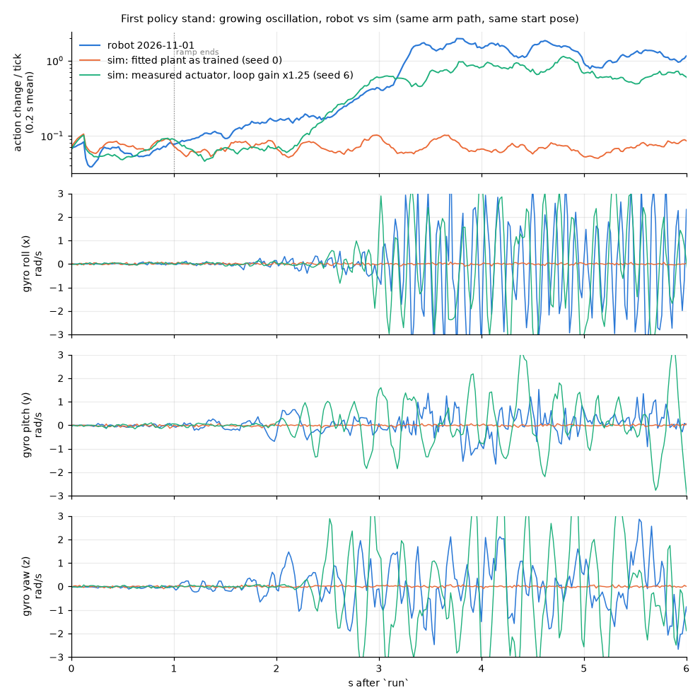
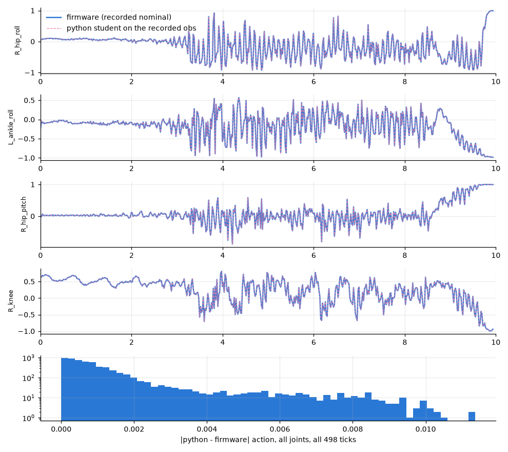
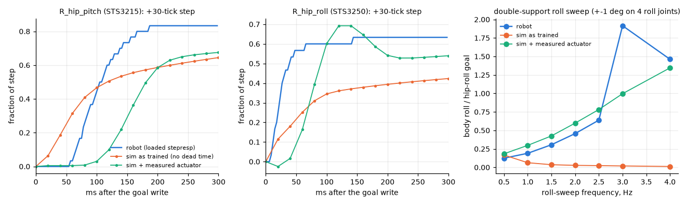
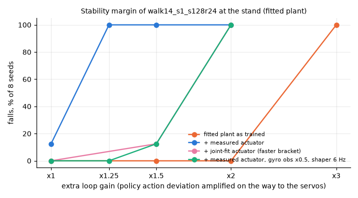

# First policy stand (2026-11-01): root cause of the flail

*The first stand on the ESP32, at 21:39:23 UTC with `walk14_s1_s128r24`, flailed after 3.3 s.
The firmware and the observations are correct: the python student reproduces the firmware's
actions to the recorder's quantization. The cause is actuator dynamics. On the robot, the
STS3215 servos have ~70 ms of pure dead time, a slow rise and very little damping at
stand amplitudes, and the STS3250 hip rolls ring. The training plant had none of that. With
the measured actuator, this student's loop-gain margin drops from about 3x to about 1.25x.
The remaining plant error is larger than that, so the stand oscillated, doubling every
~0.4 s, until the actions saturated. Two firmware knobs that need no reflash restore margin
for the next stand: `obsfreeze gain=0.5` and `shape 6`. The real fix is training with the
actuator randomized around its measured response (flags in §5).*

Recording: `hw_sessions/2026-11-01/flight_20261101T213631Z_policy_stand1*` (498 armed ticks,
0 late, no holes). Code: `experiments/policy/rca/` (all CPU, `CUDA_VISIBLE_DEVICES=`).
Servo measurements: `experiments/policy/rca/data/2026-11-01_stepresp_*.txt` (firmware
`stepresp`, Tom). Roll sweep: `flight_20261101T213236Z_ilim_stands` (firmware `sweep 11`).

## 1. What the robot did



- **0-1 s (ramp):** the per-tick action change is 0.063, the same as sim (0.07).
- **1-3.2 s:** it grows steadily: 0.114 (1-2 s), then 0.239 (2-3 s). The torso tilt stays
  under 4 deg. Yaw and pitch rates grow first, at 3-6 Hz, up to ±1.5 rad/s by 2.5 s. Then
  roll starts at ~9 Hz. The 6-13 Hz roll-rate envelope doubles every **0.40 s**.
- **3.2 s:** the actions saturate (per-tick change 1.4-2), the feet are thrown and the robot
  kicks. The operator tilted it at 9.9 s to trip the fall guard.

That is a closed-loop oscillation growing out of a quiet stand, not a trigger event. The loop
timing was healthy throughout: worst tick 13.2 ms, net 7.8 ms.

## 2. Fidelity: firmware and observations are correct

`rca/fidelity.py` rebuilds the 165-wide obs from the recording the way `ctrl_task.cpp` does:
the v6legs spec, 3 frames newest first with the history filled from the first frame,
register-58 dq, the IMU `up` and tick-averaged gyro, phase and the pinned command. It then
runs the brax student on that obs.

| check | result |
|---|---|
| python student fed its own previous actions, against the firmware (498 ticks) | max 8.8e-3, mean 1.0e-3. The max is half an encoder step on the knee's 5 deg positive span, the recorder's `nominal` quantization |
| same, with prev_action rebuilt from the recorded nominal | max 1.1e-2, mean 1.2e-3 |
| for scale: a gyro sign flip would change actions in the first 3 s by | 0.051 mean, 0.46 max |
| phase / command | 1.5006 Hz from phase 0.19 at tick 0 (GaitClock advances before the frame); cmd (0, 0, 0, 1, 0, 0, 0) on every acting tick |
| joint order and sign | the policy order matches `kServoId`. Gyro x/y agree with leg kinematics: in the roll sweep, gyro x vs −(hip roll + ankle roll)' gives r = +0.84, pitch r = +0.66 / +0.80 |
| IMU frame | the accelerometer agrees with the gyro: a_x = 0.14-0.17 m × pitch acceleration, R² 0.7. No axis or sign error |
| joint velocity | register 58 is quantized at **50 steps/s** (training assumed 1) and lags d(pos)/dt by **19 ms** (stepresp: median of 20 steps, gain 0.92). On the STS3250 hip rolls it is noisy: r = 0.33-0.55 with the finite difference |



So the MLP, obs assembly, frame stacking, phase, joint map and IMU frame are not the cause.
The register-58 dq differs from training (late and coarse) and is a small extra ingredient
(§4, row 10).

## 3. The actuator, measured



**Loaded steps** (`stepresp`, +30 ticks, in double support at the stand pose): see the
table below. `stepresp.py` fits them.

| servo | dead time | t90 | final | notes |
|---|---|---|---|---|
| STS3215 (10 joints) | **60-84 ms** | 150-260 ms | 0.7-1.0 | the same unloaded (60-80 ms), so the dead time is intrinsic. Speed is proportional to error, τ ~55-90 ms |
| STS3250 (hip rolls) | 12-18 ms | 51-95 ms | 0.63-0.93 | overshoot 10-22 %. Legs hanging, both self-oscillate at ~4.6 Hz (0.5 deg p2p, L/R antiphase) |

**Roll sweep** (±1 deg on all four roll joints, 0.5-4 Hz). The robot's body roll per
hip-roll goal rises from 0.12 to **1.92 at 3 Hz**. The sim plant as trained gives
0.16 → 0.01, with no resonance at all. No rigid-floor contact setting reproduces the robot's
curve (`floor_grid.py`: time constant 4-33 ms, damping ratio 0.1-1), and neither does roll
lash. Tom confirms the board is not springy.

**Joint fit** (`joint_fit.py`) fits both data sets at once, through the fitted plant: the
plant's servo stiffness, damping and friction, plus per-type dead time and set-point lag.
The best fit:

- stiffness 0.92x the asbuilt model (the static P is right);
- **damping 0.17x**;
- friction 0.17 N·m (training: 0.35);
- STS3215: 28 ms dead time and 57 ms lag on top of the plant's own response;
- STS3250: 6.5 ms dead time and 2.4 ms lag.

Its score is 0.76, against 4.87 for the plant as trained. The sweep body roll comes out as
0.16, 0.25, 0.35, 0.48, 0.64, 0.90, 1.33, against the robot's 0.12-1.92.

The **measured** model (`simh.MEAS_SERVO`) uses the stepresp numbers directly: STS3215 dead
68 ms + τ 55 ms; STS3250 dead 12 ms, 2nd-order ζ 0.55 at 9 Hz; the joint fit's damping and
friction. It is slower than the robot's loaded steps, and the joint fit is faster, so the
two bracket the real actuator.

## 4. Sim repro: which ingredient makes the student flail

`rca/takeover.py` reproduces the firmware path. The robot starts from the recorded arm pose
(L ankle roll +1.9, R hip roll +3.5, R ankle roll −3.3 deg), held 1.5 s on the floor. Then:
history = one frame, prev 0, the firmware gait clock, the 10 Hz shaper seeded at the measured
pose, the 1 s ramp from it, the stand command for 10 s. The tables have 8 seeds per row and
a fresh env per episode; the full table is in `rca/repro_table.md`.

| # | plant + actuator | falls train / fit | action change 1-2 s / 2-3 s (fit) |
|---|---|---|---|
| — | **robot** | flailed at 3.2 s | 0.114 / 0.239 |
| 1 | as trained: shaper 10 Hz + 12 Hz servo lag | 0/8 / 0/8 | 0.073 / 0.072 |
| 2 | + servo dead time 60 ms only | 0/8 / 0/8 | 0.069 / 0.069 |
| 3 | + servo lag 2 Hz only | 0/8 / 0/8 | 0.069 / 0.070 |
| 4 | + set-point hysteresis 2 deg | 0/8 / 0/8 | 0.070 / 0.070 |
| 5 | + hard floor (contact time constant 2 ms) | 0/8 / 0/8 | 0.073 / 0.074 |
| 6 | + floor friction 0.3 | 0/8 / 0/8 | 0.073 / 0.072 |
| 7 | + IMU noise x3 | 0/8 / 0/8 | 0.220 / 0.213 |
| 8 | joint-fit actuator (fast bracket) | 0/8 / 0/8 | 0.068 / 0.068 |
| 9 | **measured actuator** | 0/8 / 1/8 (that seed flails at 3.6 s) | 0.069 / 0.071 |
| 10 | measured + register-58 dq (19 ms late, 50 steps/s) | 2/8 / 2/8 | 0.073 / 0.087 |
| 11 | **measured, loop gain x1.25** | **6/8 / 8/8**, onsets 2.1-5.8 s (median ~2.9 s) | 0.096 / 0.370 |
| 12 | sweep-only fit (stiffness .47, damping .03, compliance past the encoder) | 8/8 / 8/8, onset ~1.0 s | 2.3 / — |

One ingredient at a time (rows 2-7), the student shrugs off every timing or contact change.
The measured actuator does not make it flail on its own either (row 9). What it does is take
away the margin:



"Loop gain xk" amplifies the policy's action deviations (from their own 0.5 s mean) on the
way to the servos. That is a plant k times more responsive. On the fitted plant as trained,
the student survives x2 (0/4) and falls at x3 (4/4). It survives a gyro path x3 and flails
at x4. With the measured actuator, it falls **8/8 at x1.25**. With the joint-fit actuator it
falls 1/8 at x1.5 and 8/8 at x2. The robot's roll resonance is still 2x the fitted sim
(1.92 vs 0.90 at 3 Hz), and the STS3250 limit cycle and the late register-58 dq are not in
the model. That extra error is larger than the margin. At x1.25, seed 6 starts flailing at
3.2 s. Its growth, and its yaw and pitch rates oscillating before roll, look like the
robot's (first figure, green).

**Root cause:** the student's feedback gains were tuned on servos that respond in ~20-40 ms
and are well damped. The robot's STS3215s add ~70 ms of dead time and ~55-90 ms of rise, and
at stand amplitudes they act with ~1/6 of the modelled damping, so the robot's roll mode
rings at ~3 Hz. Training had no pure dead time at all: `--act-lag 2,12` is a 3-stage lag
cascade, which gives phase without the dead time's growing lag. Its plant damping and
friction were fixed. So the policy reached the robot with almost no margin, and the robot's
remaining modelling error closed the loop above unity gain.

**Would another policy have been safe?** No. Every distilled student was graded on the
measured actuator (`candidates.py`, `ACT=meas`; `rca/candidates_meas.md`):

- the deployed student is the best of them: 1/8 falls, 8/8 at x1.25, and 5/8 under 0.4 m/s
  pushes;
- the other students fall 2-6/8 even at x1;
- the teachers (walk14_s1, walk14, walk13_fit_s1) flail **8/8**.

The day's first retrained teacher, with gyro-gain DR only (`walk14_s1_gg`), still flails 5/8.
Randomizing the gyro alone does not buy the margin.

## 5. The fix

### Firmware (runtime knobs, no reflash), for the next stand of the current student

| setting | measured actuator | x1.25 | x1.5 | push 0.4 m/s | IMU noise x2 | as-trained plant |
|---|---|---|---|---|---|---|
| as run (gyro x1, shaper 10 Hz) | 1/8 | 8/8 | 8/8 | 5/8 | 5/8 | 0/8 |
| `obsfreeze gain=0.5` | 0/8 | 0/8 | 6/8 | 1/8 | 0/8 | 0/8 |
| **`obsfreeze gain=0.5` + `shape 6`** | **0/8** | **0/8** | 1/8 | **0/8** (0.6 m/s: 8/8) | 0/8 | 0/8 |
| `obsfreeze gain=0.5` + `shape 4` | 0/8 | 0/8 | 0/8 | not run (0.6 m/s: 8/8; `shape 4` alone at 0.4: 3/8) | 0/8 | 0/8 |

(Fitted plant, falls of 8. `fw_mitigation*.md`.) Halving the gyro observation is what the
September robot needed too (`env_mjx` gyro_gain note, 2026-09-03). With the measured actuator
plus the register-58 dq it is still 0/8. Recommendation: for the next tethered stand, run
`obsfreeze gain=0.5` and `shape 6` before `run`. Keep 10 s stages, the spotter and the fall
guard. The flail guard on the other branch is the backstop, because this only raises the
margin to ~1.5x.

Firmware follow-ups (not in this PR):

1. Make the gyro obs gain and the shaper pole per-policy-profile constants, generated with
   `obs_spec.h`, so a policy ships with the values it was graded at.
2. Read velocity the way training sees it. Either model register 58 in training (1 tick
   late, 50 steps/s) or feed a position finite difference. Both are ~1 tick late on the
   robot, so the training side is the one to change.

### Training: flags for tonight's queue

The branch adds three env/trainer knobs to `env_mjx` / `train_mjx`:

- `--act-delay-types sts3215=lo:hi,sts3250=lo:hi`: per-servo dead time in ticks, drawn per
  episode per servo by servo type;
- `--servo-kd-range lo,hi`: per-episode servo damping multiplier;
- `--servo-kp-range lo,hi`: per-episode servo stiffness multiplier.

The recipe is walk15's with:

```
--act-delay-types sts3215=2:5,sts3250=0:1   # 40-100 ms / 0-20 ms dead time (stepresp)
--act-lag 2,8                               # shaper + STS3215 rise (tau 55-90 ms)
--servo-kd-range 0.12,1.0                   # fit: 0.17x
--servo-kp-range 0.6,1.2                    # fit: 0.92x; the sweep-only fit says 0.47x
--joint-frictionloss-range 0.1,0.4          # fit: 0.17 N*m
--gyro-gain-range 0.7,1.6 --gyro-delay-max 1
```

Grade on the measured actuator and choose students by margin: falls at loop gain x1.25 and
x1.5, and 0.4 m/s pushes (`candidates.py`, `ACT=meas`), not by the as-trained referee alone.

#### Results of the day's GPU window (warm-started from walk14_s1)

All on the fitted plant, 8 seeds per cell; numbers are falls. `rca/cand_*.md|json`.

| policy | measured actuator | x1.25 | x1.5 | x1.75 / x2 | push 0.4 / 0.5 m/s | measured + reg-58 dq | sweep-only fit (pessimistic) | as-trained plant |
|---|---|---|---|---|---|---|---|---|
| walk14_s1_s128r24 (deployed) | 1/8 | 8/8 | 8/8 | — / 8/8 | 5/8 / — | 2/8 | 8/8 | 0/8 |
| + firmware fix (gyro x0.5, shaper 6 Hz) | 0/8 | 0/8 | 1/8 | — / 8/8 | 0/8 / — | 0/8 | 0/8 | 0/8 |
| walk14_s1_gg_s128r24 (gyro DR only, 200M) | 0/8 | 4/8 | 8/8 | — | 4/8 / — | — | — | — |
| **walk14_s1_act_s128r24** (actuator DR, 400M) | 0/8 | 0/8 | **0/8** | 8/8 / 8/8 | 0/8 / 6/8 | 0/8 | 8/8 | 0/8 |
| **walk14_s1_actar_s128r24** (actuator DR + action rate 0.3, 300M) | 0/8 | 0/8 | **0/8** | 8/8 / 8/8 | 0/8 / 8/8 | 0/8 | 5/8 | 0/8 |

Actuator randomization moves the margin from below 1.25x to about 1.6x. Gyro DR alone does
not. The as-trained referee's stand is intact. For walk14_s1_actar_s128r24:

- stand_10s 8/8, drift 2.6 cm, **51 W** (the deployed student: 176 W);
- foot clearance in walk_steps dropped to 1.2-1.3 cm. It is a stand policy for now, and its
  walking has to come back with more steps on the new plant.

The firmware fix on the old student reaches about the same margin. Tonight's queue (below)
continues from these checkpoints with the margin probes as the gate.

**Next hardware stand:** either (a) the deployed student with `obsfreeze gain=0.5` +
`shape 6` (no reflash), or (b) `walk14_s1_actar_s128r24`, exported with
`make deploy RUN=robot_legs_walk14_s1_actar_s128r24 POLICY=v6legs` (runs dir:
`~/code/robot-mjx/sim/runs/`; collect first). Run (b) at the stock `shape 10` / `gain=1`,
which is what it was graded at. Either way: 10 s stages, spotter, fall guard, flail guard.


#### Tonight's queue (2026-11-01 22:00), inserted first, pre-flight 14/14 PASS

| job | recipe | warm start |
|---|---|---|
| `1101214001-robot_legs_walk16_act` | the flags above + `--w-action-rate 0.3`, 400M steps, seed 0 | robot_legs_walk14_s1_actar |
| `1101214002-distill_robot_legs_walk16_act_s128r24` | stock 24-round distill | — |
| `1101214003-robot_legs_walk16_actwide` | `--servo-kp-range 0.45,1.5 --servo-kd-range 0.05,1.0 --gyro-gain-range 0.7,2.0`, seed 1 | robot_legs_walk14_s1_actar |
| `1101214004-distill_robot_legs_walk16_actwide_s128r24` | stock 24-round distill | — |

All four are `BRANCH=policy-stand-rca`, because the flags live on this branch. The planner's
jobs follow unchanged. The `actwide` variant targets the pessimistic sweep-only actuator and
a more responsive plant. Morning grading: `ACT=meas` and `ACT=hard` `candidates.py`.

#### Relation to PR #192 (floors/actuator fit, merged to main on 11-01)

#192 adds its own actuator knobs:

- `--act-delay-extra sts2026`: STS3215 +3 ticks; with `--act-delay-max 1` that is 3-4
  ticks, and 0-1 for the STS3250s;
- `--act-lag-scale`, `--servo-kd`, `--servo-joint-damping`, `--floor-contact`;
- a fitted plant: kp 1.4x asbuilt, kd 0.068 (0.27x), joint damping 0.16, friction 0.0074.

Its dead time matches this analysis: ~70 ms on the STS3215, ~15 ms on the STS3250, damping
well below the old model. The two dead-time implementations overlap. This branch's
`--act-delay-types` draws each servo's delay independently over a range (2-5 / 0-1 ticks).
#192 uses a fixed +3 ticks plus a shared 0-1. Before #189 merges, rebase it onto main and keep
one mechanism. The suggestion is main's flags plus a per-servo range option if the morning
grading shows the spread matters. Tonight's jobs were trained and graded with this branch's
flags, which is why they use them.

Deploy caveat for #192-trained students: #192's `--servo-kp-scale hip_roll=5.6,...` is a sim
calibration of the same factory P32/D32 servos, not a gain change. `servo_gains.h`'s
`kSimKpScale` static check compares sim kp factors, so it must be updated to say so (or
taught the calibration), or such a student will look like it needs raised gains.

## 6. Not the cause (checked)

- **Floor:** no rigid-floor setting reproduces the 3 Hz body roll, and Tom confirms the board
  is not springy. Floor friction 0.3 is 0/8.
- **Observation construction:** see §2.
- **The takeover ramp:** onset is 2-3 s after the ramp ends, in sim and on the robot.
- **The STS3250 limit cycle:** as ±0.25-0.5 deg set-point dither at 4.6 Hz it changes
  nothing in sim (`measured_repro.json`). Its real effect may be larger than a dither.

## Reproduce

```bash
cd experiments/policy/rca          # CPU only: CUDA_VISIBLE_DEVICES= JAX_PLATFORMS=cpu
python fidelity.py                 # python vs firmware actions on the recording
python sweep_fit.py; python stepresp.py data/2026-11-01_stepresp_loaded.txt
python joint_fit.py 84 42          # actuator fit to stepresp + sweep (~8 min, 14 workers)
python repro_table.py              # §4 table
ACT=meas python candidates.py <runs> fit 8 out.json   # margin probes per policy
python make_figs.py
```
