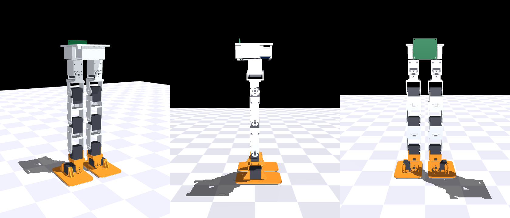
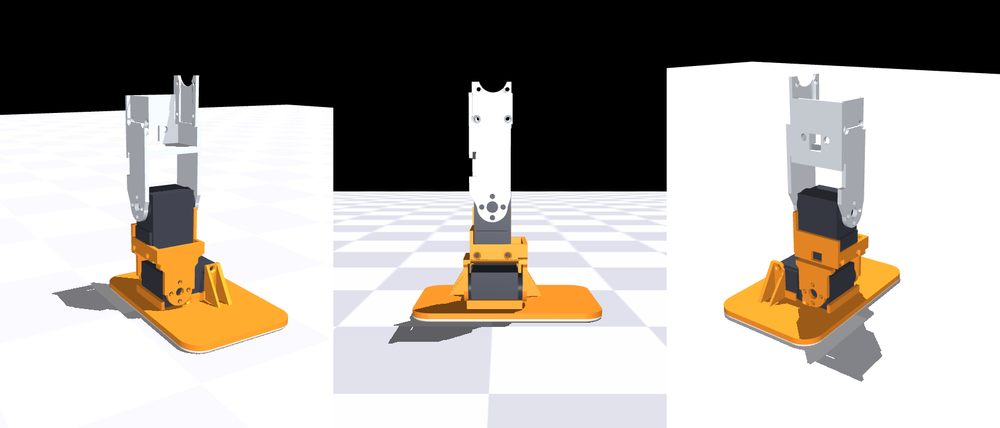
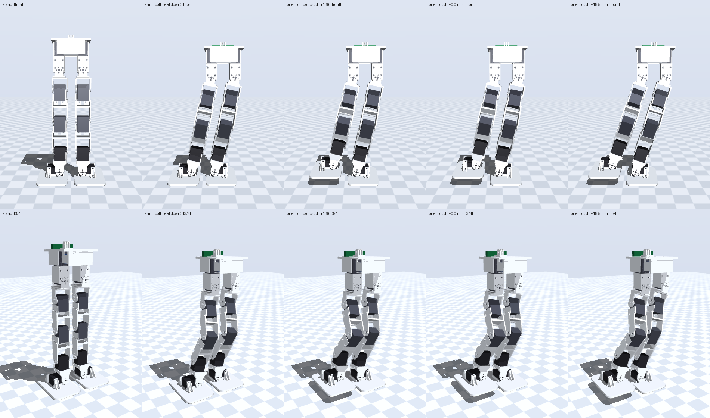

# v5b: one-foot balance on the v5 body with the v6 ankle

v5b is the printed v5 prototype's torso and legs with the v6 ankle stack
under each shin: `ankle_link`, an ankle-roll STS3215, `foot_L`/`foot_R` and
the silicone sole. It exists to bench-test **one-foot balance**: what the
ankle roll does in single support (margin, torque, sag) on a real body,
before the whole v6 robot is printed.

It is not a stand-in for v6's mass or CoM height: no ballast, the v5 battery
(3S 850 mAh) or a bench supply, STS3215s at every joint including the hip
rolls.




## Files

| file | what it is |
|---|---|
| `v5_cad.py` | the printed v5 parts' CAD, pinned to commit `357aacf` with `git show` into a gitignored cache, imported apart from today's `cad/` modules |
| `assembly_v5b.py` | the articulated v5b: v5 chain plus the v6 ankle stack; writes `step/assembly_v5b.step`, `figs/assembly_v5b.png` and the ankle close-up |
| `check_v5b.py`, `check_v5b.txt` | the ROM interference gate for the pairs the swap creates, and its last output |
| `plant_v5b.py` | the v5b sim plant, built in memory from `sim/bimo_biped_v5body.xml` and the v6 ankle stack of `sim/bimo_biped_v6ar.xml` |
| `stance_v5b.py`, `stance_v5b.txt` | the one-foot stance study on that plant: margins, the bench keyframes, the CoM sweep, and its last output |
| `render_stance.py` | `figs/v5b_stance_strip.png`: the plant at the bench poses |

```
.venv/bin/python experiments/v5b/assembly_v5b.py
.venv/bin/python experiments/v5b/check_v5b.py --ankle-pitch 45 > experiments/v5b/check_v5b.txt
.venv/bin/python experiments/v5b/plant_v5b.py
.venv/bin/python experiments/v5b/stance_v5b.py
MUJOCO_GL=cgl .venv/bin/python experiments/v5b/render_stance.py
```

## The swap

- **The interface is unchanged.** The v5 shin's lower fork and
  `leg_link_v6`'s are built from the same pad constants
  (`cad/dimensions.py`: horn pad at `SV_HORN_FACE`, idler pad at
  `IDLER_ARM_INNER`, `PAD_D`, the M3 BCD), so the ankle stack bolts to the
  v5 shin as drawn.
- **The body rises 58.40 mm**: the v6 ankle-pitch axis is 76.36 mm above the
  floor, the v5 foot's was 17.96.
- **The ankle-pitch servo turns 90° relative to the shin.** The v5 foot held
  its case lying back along −X; `ankle_link` holds it hanging along −Z. Its
  stored zero is wrong by about 1024 ticks after the move (calibration below).
- **The feet are 19 mm apart** at v5's 66 mm hips (37 mm on v6's 84 mm),
  and stay 19 mm apart through the one-foot shift.

## The fit (`check_v5b.txt`)

All clear: the v5 shin against the ankle link, the pitch servo, the roll
servo, the foot and the sole over ankle pitch ±45° (the plant's range; the
firmware clamps at ±40°) × roll ±25°, and the v5 thigh against the same
pieces over knee ±95°. The link runs in its designed
0.70 mm gap inside the shin's fork; the roll servo and the foot keep 22 mm
from the shin, and the thigh is never closer than 58 mm.

**Hip yaw is limited by the feet**, one leg yawing toward the other: 18.1°
toe in, 28.7° heel in, against the ±45° ROM. The stance test does not yaw;
the firmware's clamp still allows ±45°, so nothing but the keyframes keeps
yaw near zero.

## Parts

Reused from the v5 robot: the pelvis, both yaw carriers, yokes and the four
leg links, ten STS3215s (IDs 1–10), the General Driver board, the 850 mAh
pack. The v5 feet come off.

New:

| part | qty | source |
|---|---|---|
| `ankle_link` | 2 | `python3 cad/slice.py ankle_link --copies 2` ([PRINT_LIST.md](../../cad/PRINT_LIST.md)) |
| `foot_L`, `foot_R` | 1 + 1 | `python3 cad/slice.py feet` |
| sole | 2 | 2 mm silicone sheet cut to `sole_tpu_L/R` ([assembly.md §3](../../docs/assembly.md)) |
| STS3215, ankle roll | 2 | IDs 11 (`R_ankle_roll`) and 12 (`L_ankle_roll`), [servo-map.md §2.1](../../docs/servo-map.md) |
| M2.5 × 8 flat-head | 6 + 6 per leg | the foot's tabs and bosses, and the link's grip channel |
| M3 × 5 / M3 × 6 | 8 per leg | the link's tines onto the roll servo's discs (4 × M3 × 5 each side) |

The shin's pads go back onto the pitch servo's discs with the screws they
came off with.

## Assembly, per leg

The steps are the robot's ([docs/assembly.md](../../docs/assembly.md)):

1. Unscrew the shin's pads from the ankle-pitch servo's discs and take the
   servo out of the v5 foot.
2. §3: sole on the foot, the roll servo into the foot's cradle (horn forward,
   cable end outboard), tabs and bosses.
3. §4: the pitch servo into `ankle_link`'s grip channel, from the case's
   cable end.
4. §5: the link's tines onto the roll servo's discs, then the shin's fork
   onto the pitch servo's discs (horn +Y), the shin vertical. The horn's four
   screws take it at any 90°; `middle` (below) re-centres the encoder there.
5. Chain the roll servo off the pitch servo's second port (one hop, the
   last on that leg's branch).

## Calibration, before anything is armed

**Any bus write is a motion command** (AGENTS.md, bench safety). These steps
are reads, register writes with torque off, or `cal` on the board.

1. **IDs**: each new servo alone on the bus, `id 1 11` (right) and
   `id 1 12` (left), labelled on the case.
2. **Zero the four ankle joints** with the robot held at the CAD-neutral
   pose (shins vertical, soles flat): `middle 4`, `middle 8`, `middle 11`,
   `middle 12` (each latches the shaft's position as 2048 and leaves torque
   off), then `cal zero R_ankle`, `cal zero L_ankle`,
   `cal zero R_ankle_roll`, `cal zero L_ankle_roll`. The pitch servos need
   this because their case moved, not only the new ones.
3. **Fitted set**: `cal fit R_ankle_roll 1`, `cal fit L_ankle_roll 1`;
   `cal show` must list IDs 1–12 fitted and 13–17 not.
4. **Signs**: torque off, tilt each foot by hand and read `pos 11` /
   `pos 12` (and `pos 4` / `pos 8` for pitch). Through `cal show`'s zero and
   direction (tools/bus_cal.py) the joint angle's sign must match the
   plant's (`stance_v5b.txt` states the convention). Then `cal save`.

## The sim (`stance_v5b.txt`)

The plant is the v5 plant (pinned with the parts) with the v6 ankle stack hung
at the v5 ankle point: 1.30 kg, standing CoM 208 mm up. All twelve joints are
the same STS3215 model; the ankle pitch is held to the firmware's ±40°. The
servo is ideal (no lag, dead time, backlash or play), so every number is a gate
under this plant, not a prediction of the bench.

- **What the ankle roll buys:** the best one-foot margin (CoM to the edge of
  the stance sole) is 42 mm on v5b, against 6–7 mm on the v5 plant with its
  pitch-only ankle, which only gets there by rolling the torso 17–27°.
- **The bench pose**: crouch 20 mm, shift the pelvis 57 mm toward the stance
  foot (both feet down), lift the other foot 20 mm straight up. The shift is
  purely lateral; the lift is 20 mm because 30 mm needs the swing ankle past
  the firmware's −40°. Margin 25 mm, CoM 1.6 mm outboard of the stance
  ankle-roll axis, so the ankle roll carries almost nothing there.
- **The CoM sweep loads the ankle.** From the bench pose the CoM moves across
  the stance sole, d = −10 … +25 mm from the ankle-roll axis (+ outboard; the
  sole's centreline is +18.5). The stance ankle-roll torque goes from about
  0.17 N·m one way at −10 to 0.41 N·m the other at +25, and it sags up to 2°
  at stock gains.
- **Compliance amplifies the ankle's load.** The stance hip roll and ankle
  roll sag in the direction that carries the 1.16 kg above the ankle-roll axis
  further outboard, so the torque grows past the rigid-body figure: by about
  40 % at stock stiffness (12 N·m/rad; 0.305 against 0.214 N·m at the sole's
  centreline) and 28 % at the measured 17. The gravity moment of the
  simulated, sagged pose matches the servo torque to 1–2 %, so nothing else
  carries it. On the bench this is the thing to measure: sag at each d, and
  the torque it implies.
- **Both feet.** Right-foot stance is solved on the plant too: its targets are
  within 2° of the left's mirrored (1.2° up to d = +18.5), and its holds
  (stock stiffness) match the left's to a few percent.
- **It stays up** in every run: the shift and lift at each shift time
  (1, 2, 4 s) and each stiffness (stock 12 N·m/rad, measured 17, Plan B ×2.8
  and ×3.5), and every d, alone and as one continuous sweep, at 12 and 17.
  The stance hip roll is the most loaded joint, about 0.6 N·m (≤ 26 % of
  stall), sagging 2.4–3.1° at stock gains. The tightest margin is 11.8 mm,
  at d = −10.



## The bench test

The keyframes are `stance_v5b.txt`'s tables (C: stand, crouch, shift,
one-foot; D: the one-foot pose at each d; each for either stance foot), in
plant joint angles by servo ID,
each row checked against `firmware/main/mech_envelope.h` with 2° to spare.
They go to the board as the firmware's 17-target `pose s<ms>` (tools/bus_cal.py
converts degrees with the board's own `cal show`; tools/squat_bench.py is the
pattern). The rules are AGENTS.md's: on the floor, a spotter, filmed from
before the port opens, one motion per "go", torque checked first, and an
abort away from plumb keeps torque on.

1. stand → crouch → shift, both feet down (2 s each).
2. lift the free foot 20 mm, hold.
3. the CoM sweep, outboard first: d = +5, +10, +15, +18.5 (2 s moves, 3 s
   holds, joint readback at every hold), back to the bench pose; then inboard,
   d = −5, −10, back.
4. set the foot down, shift back, stand.

What it measures: each stance joint's readback against its target at every
hold (the ankle roll's and hip roll's sag under a known load), and whether the
body stays up as the CoM crosses the sole.
