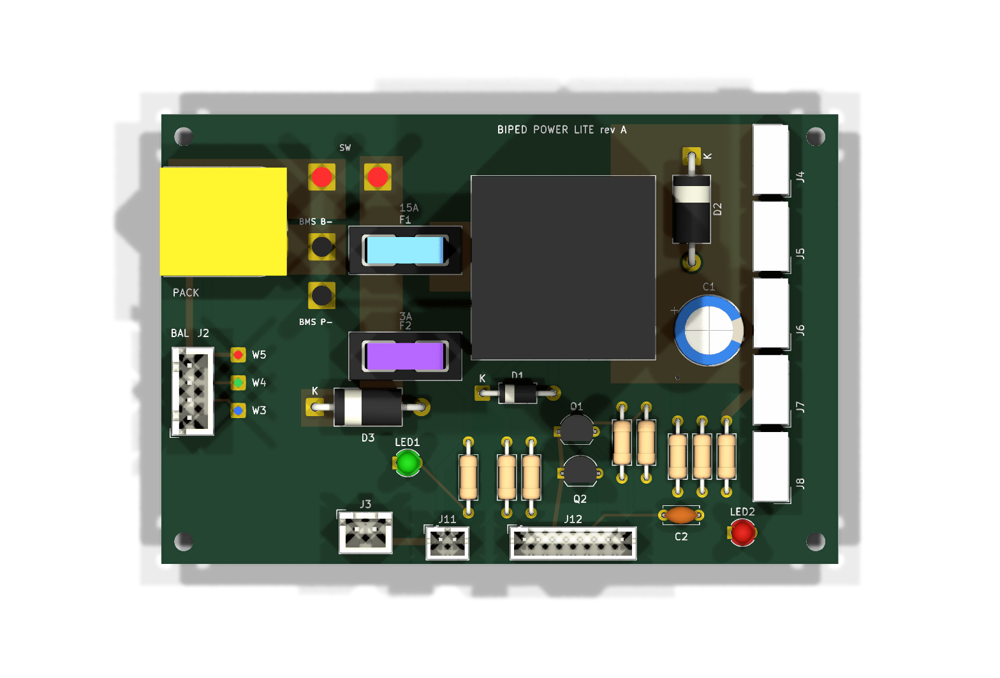
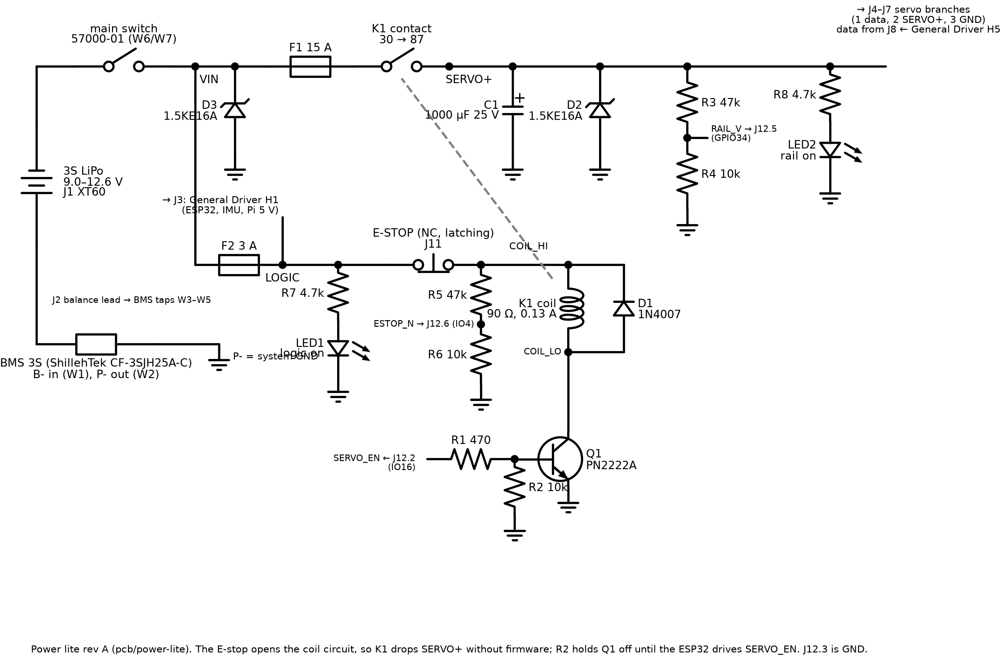
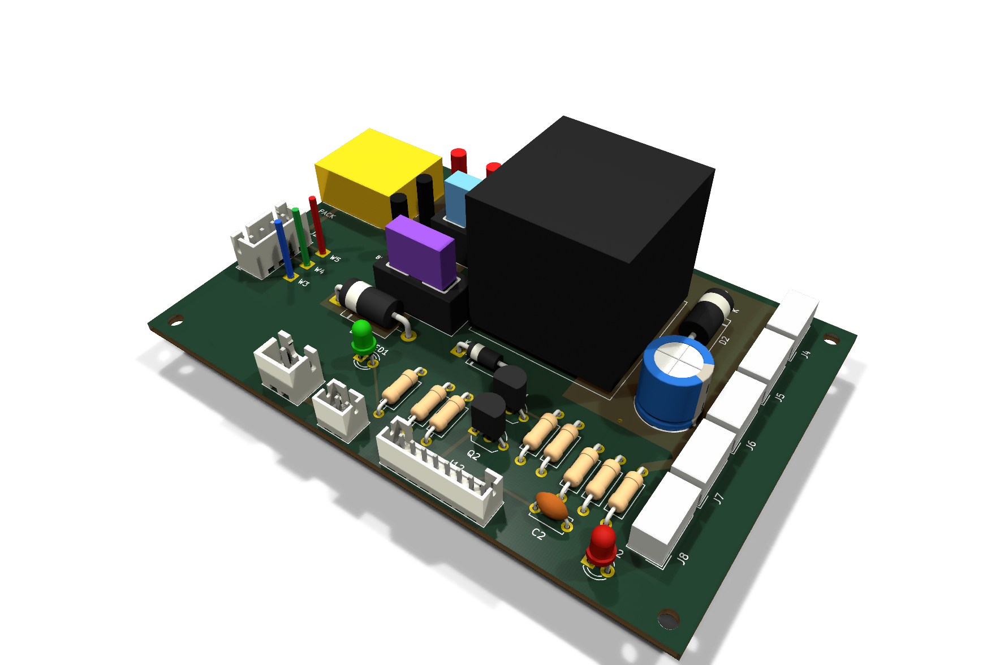
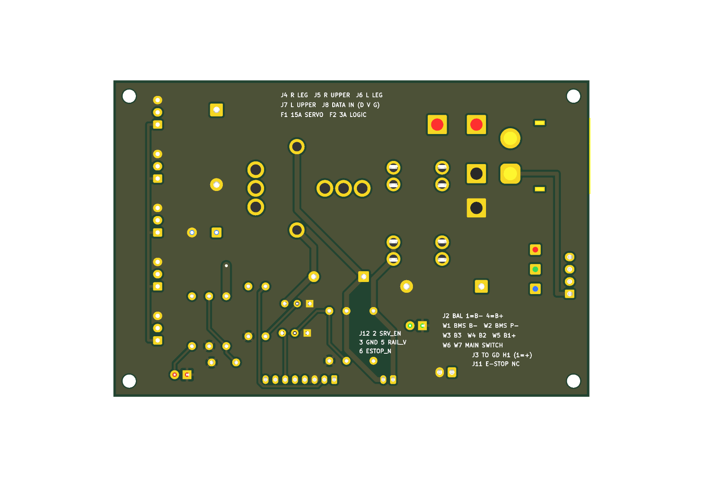

# Power lite: the robot's battery protection and power distribution

*The choices behind it are in
[2026-11-02-power-lite-options.md](../../docs/design-v6/2026-11-02-power-lite-options.md). It
replaces the custom [power board](../power-board/README.md) for the robot.*



A 2-layer board, 97 × 64.5 mm, with through-hole parts only, soldered by hand. It carries:
- the pack's connectors;
- the solder pads for an off-the-shelf 3S BMS and for the main switch;
- the fuses;
- a relay that the E-stop drops;
- the servo distribution;
- the signals to the ESP32.

## How power flows



*The circuit as a wired drawing: `tools/draw_circuit.py`, with the same parts and nets as
`tools/parts.py`. The KiCad schematic carries the same nets as labels on every pin.*

```
pack XT60 (J1) ─ BMS (W1-W5, cuts the negative lead) ─ main switch (W6/W7) ─┬─ F2 3 A ─ J3 ─ General Driver H1 (and the Pi)
pack balance lead (J2) ─ BMS cell taps                                      ├─ F2 3 A ─ J11 E-stop NC ─ K1 coil ─ Q1 ─ GND
                                                                             └─ F1 15 A ─ K1 contact ─ SERVO+ ─ J4-J7
```

- **The BMS** is a ShillehTek CF-3SJH25A-C ($6.99, ships from the US).
  - It sits on wires: its B−, B3, B2 and B1+ pads go to W1, W3, W4 and W5, and its P− pad to
    W2.
  - It switches the negative lead, so the system ground is its P−. The pack's balance lead
    goes only to the BMS, through J2.
  - Its thresholds are not documented, so it is characterised on the bench before it goes in
    the robot (below).
- **The main switch** is a Cole Hersee 57000-01 panel rocker (25 A DC), on W6 and W7.
- **The servo rail** is fed through the TE 1-1414610-0 relay (K1; 70 A, operates at 7.2 V).
  - The relay's coil current, about 0.13 A, flows only while the E-stop's NC contact (J11) is
    closed and the ESP32 holds `SERVO_EN` high.
  - Pressing the E-stop drops the rail without firmware.
  - Until the ESP32 drives `SERVO_EN`, R2 holds Q1 off and the rail stays off.
- **The coil:** D1 clamps its turn-off. The relay's built-in 470 Ω alone would put about 63 V
  on Q1 (rated 40 V), and about −66 V on the E-stop and Q2's base when the E-stop opens.
  - TE warns that a coil diode slows the release and shortens the contact life (V23134 notes
    4 and 6).
  - The relay switches a few times a session, far inside its 10⁵-operation life, and the
    simulated release still takes only 5.3 ms.
- **The General Driver and the Pi** are fed through F2 and stay up through an E-stop.
- **Surge:** D2 and D3 (1.5KE16A) clamp the servo rail and the switched input. C1 (1000 µF)
  is the servo bulk.

## Connectors

| ref | what | part | pins |
|---|---|---|---|
| J1 | the pack | Amass XT60PW-M | 1 B− (angled side), 2 B+ |
| J2 | the pack's balance lead | JST B4B-XH-A | 1 B−, 2 cell 1+, 3 cell 2+, 4 B+ |
| J3 | General Driver H1 | JST B2B-XH-A | 1 LOGIC (+), 2 GND; the lead runs pin 1 to pin 1 |
| J4–J7 | servo branches: R leg, R upper, L leg, L upper | Molex 22-03-5035 | 1 data, 2 SERVO+, 3 GND (the General Driver's H5 order, "D V G") |
| J8 | servo data from the General Driver's H5 | Molex 22-03-5035 | 1 data, 2 unconnected, 3 GND |
| J11 | the E-stop's NC contact | JST B2B-PH-K-S | 1 LOGIC, 2 to K1's coil; any latching switch (0.13 A) |
| J12 | control to the ESP32 | JST B8B-PH-K-S | 2 `SERVO_EN` (IO16), 3 GND, 5 `RAIL_V` (GPIO34), 6 `ESTOP_N` (IO4, with its internal pull-up on); 1, 4, 7, 8 unconnected |
| W1–W5 | the BMS | wire pads | W1 B−, W2 P− (system GND), W3 B3, W4 B2, W5 B1+ |
| W6/W7 | the main switch | wire pads | W6 pack B+, W7 switched (VIN) |

- **J1's plug faces out of the left edge.** The XT60's mating face overhangs the edge by 0.25 mm,
  with its pins 16.1 mm in, as on the custom board. Ask the board house for no rail or panel on
  that edge.
- **J3 and J11 are different families** (XH and PH), so the two 2-pin leads cannot swap.
- **The ESP32's readings:**
  - `RAIL_V` is SERVO+ divided by 5.7, giving 2.21 V at 12.6 V.
  - `ESTOP_N` is an open collector (Q2), read by IO4 with its internal pull-up on.
    - It reads low while the E-stop is released, because Q2 conducts while the coil supply is up.
    - It reads high when the E-stop is pressed, the board is unpowered, F2 has blown, or the
      lead is unplugged. Every failure reads as stop.
    - The levels and polarity are rev B's ESTOP_N's.
  - C2 (100 nF) filters `RAIL_V` for the ADC.
- **J3 and J4–J8 keep the custom board's pin orders**, so the harness in
  [`../power-board/harness.md`](../power-board/harness.md) applies (checks P2–P4).

## Before it goes in the robot

1. **Check the BMS on the bench** (the exception to the datasheet rule, Tom 2026-11-02). Use
   the lab supply as the pack: its + to B1+, its − to B−. Feed B3 and B2 from a divider of
   three 1 kΩ resistors across the supply, so each "cell" is a third of the supply voltage.
   Load P+ to P− with about 1 kΩ, and record each value:
   - **Under-voltage trip:** lower the supply until P− lets go. The trip per cell is the supply
     voltage ÷ 3. Raise it again and record where it recovers.
   - **No trip at 12 A for 2 s:** supply at 12.0 V with a 15 A limit, and a 1 Ω load of 150 W or
     more switched across P+ and P− for 2 s.
   - **The short-circuit trip** needs a stiff source, a pack, and is not done on the bench. F1
     and F2 protect against shorts downstream.
2. **Bring up the board without the BMS or the pack.** Put the lab supply at 12.0 V, limited
   to 0.5 A, on W7 (+) and W2 (−).
   - With J11 jumpered: LED1 lights and J3 reads 12 V. J12.6 (`ESTOP_N`), pulled up to 3.3 V
     through 47 kΩ, reads below 0.1 V. J12.5 (`RAIL_V`) reads 0.
   - 3.3 V on J12.2 (`SERVO_EN`): K1 clicks, LED2 lights, and `RAIL_V` reads about 2.1 V.
   - Remove the J11 jumper: K1 drops, and `ESTOP_N` reads 3.3 V.
3. **Check the inrush with the real load.** Wire the BMS and the pack, with the servos
   connected. Switch the rail on with `SERVO_EN` ten times.
   - The BMS must not trip, and the relay must open every time the E-stop is pressed.
   - The simulation puts the peak at 176–341 A, above 100 A for 52–132 µs, depending on the
     servos' own capacitance (below).
   - If the BMS trips, the options are a smaller C1, or a pre-charge resistor in series with C1.

## Checks

- **Schematic:** ERC reports 0, and the netlist matches `tools/parts.py` (37 parts, 19 nets).
- **Board:** DRC reports 0 with schematic parity, and 0 unconnected pads.
- **Copper on the 15 A path:** the narrowest section is the 6.1 mm strip of `VIN` between W7 and
  F1, in 1 oz copper with the GND plane beneath it. The return pads (W2, each servo header's
  pin 3, C1, D2, D3) join the plane with full copper: four 0.5 mm thermal spokes would be 2 mm
  of copper carrying up to 15 A (`tools/post_pcb.py`).
- **Simulation:** `tests/test_power_lite_sim.py` runs in `make pytest` and passes 23 of 23. It
  uses ngspice, through `sim/lite_sim.py`, which builds the netlist from `tools/parts.py`. Its
  assumptions are listed in that file.

| case | result | limit |
|---|---|---|
| the rail, over pack 9.0–12.6 V × E-stop × `SERVO_EN` high, low or floating | on only with the E-stop released and `SERVO_EN` high | — |
| K1's coil at a 9.0 V pack | 8.77 V, 97.5 mA | operates at 7.2 V, 80 mA (TE) |
| Q1 saturation; the `SERVO_EN` pin's current | 0.17–0.23 V; 4.9 mA | ESP32: 20 mA |
| `ESTOP_N`, released / pressed | 0.007 V / 3.30 V | ESP32: low ≤ 0.83 V, high ≥ 2.48 V |
| `RAIL_V` at 9.0 / 12.6 V | 1.58 / 2.21 V | ADC ~3.1 V |
| LEDs | 1.5–2.3 mA | — |
| release after the E-stop opens, or `SERVO_EN` drops | 5.3 ms (coil inductance assumed 0.3 H) | — |
| clamps during release | COIL_HI −0.78 V; Q2's base −0.2 V; Q1's collector 11.8 V | Q1 VCEO 40 V; Q2 VEBO 6 V |
| a 12 A get-up at a 9.0 V pack | logic ≥ 8.71 V, SERVO+ ≥ 8.66 V, coil ≥ 94.8 mA | K1 holds |
| the relay closing onto the rail, with 0–2 mF of servo capacitance | 176–341 A at the contact; above 100 A for 52–132 µs; F1 I²t 1.3–7.8 A²s | F1 melts at 135 A²s |

- **The inrush is the open question.** It is set by the pack, BMS and wiring resistance and by
  the servos' own input capacitance, not by this board.
  - The pulse is shorter than a typical 3-cell protection IC's short-circuit delay (ABLIC
    S-8254A: 320 µs). But the ShillehTek board's IC is not known.
  - The peak is above the 200 A capacitive make that TE lists for the 24 V-coil part.
  - A welded contact would defeat the E-stop. The firmware's stuck-rail check (`ESTOP_N` high
    while `RAIL_V` stays up) catches it, and bring-up step 3 tests it with the real servos.

## Ordering (two robots)

The quantities include spares. Prices are Digi-Key's, as listed on 2026-11-02.
- **Boards:** `fab/power-lite-gerbers.zip`, 2 layers, 97 × 64.5 mm, 1.6 mm, 1 oz, HASL. Landed
  prices for 5 boards: about $32 from JLCPCB with the duty prepaid, about $51 from PCBWay, or
  $48.49 for 3 from OSH Park (made in the US, no duty). The quotes are in
  [the 2026-11-03 record](../../docs/design-v6/2026-11-03-power-lite-quotes.md).
- **BMS:** ShillehTek CF-3SJH25A-C, $6.99 each.
- **Already bought:** the XT60PW-M connectors and the Keystone 3568 fuse holders.

| part | Digi-Key | qty | each |
|---|---|---|---|
| relay TE 1-1414610-0 | 17-1-1414610-0-ND | 2 | $13.37 |
| main switch Cole Hersee 57000-01 | F8885-ND | 2 | $19.11 |
| E-stop: E-Switch 100SP2T1B1M1QEH toggle, wired to its NC throw | EG2373-ND | 2 | $3.59 |
| fuse 15 A 0297015.WXNV / 3 A 0297003.WXNV | F992-ND / F987-ND | 5 / 5 | $0.33 / $0.35 |
| TVS 1.5KE16A | 1.5KE16ACT-ND | 5 | $1.06 |
| 1N4007 | 4786-1N4007CT-ND | 3 | $0.16 |
| 1000 µF 25 V EEU-FR1E102 | P14424-ND | 3 | $1.42 |
| PN2222ATA (Q1, Q2) | PN2222ATACT-ND | 10 | $0.32 |
| 100 nF 50 V X7R radial KEMET C322C104K5R5TA (C2) | 399-4329-ND | 6 | $1.49 |
| resistors Yageo 1 % ¼ W metal film: 470R, 10k, 47k, 4K7 | MFR-25FBF52-470R-ND, 10.0KXBK-ND, 13-MFR-25FRF52-47KCT-ND, 13-MFR-25FRF52-4K7CT-ND | 10 each (10k: 20) | $0.04 |
| LEDs WP710A10GD / WP710A10ID | 754-1603-ND / 754-1606-ND | 3 / 3 | $0.24 |
| headers B4B-XH-A, B2B-XH-A, B2B-PH-K-S, B8B-PH-K-S | 455-B4B-XH-A-ND, 455-B2B-XH-A-ND, 455-1704-ND, 455-1710-ND | 3 each | $0.10–0.35 |
| servo headers Molex 22-03-5035 | 900-0022035035-ND | 11 | $0.20 |
| housings XHP-2, PHR-2, PHR-8 and crimps SXH-001T-P0.6, SPH-002T-P0.5S | 455-2266-ND, 455-1165-ND, 455-1189-ND, 455-1135-100-ND, SPH strip | as needed | |

- **The 47k and 4K7 resistors** are MFR-25FRF52: the MFR-25FBF52 values in `tools/parts.py`
  are out of stock at Digi-Key until 2027-03. The two series have the same rating, size and
  tempco.
- **Total:** about $104 for two robots before shipping and tax. The relay, switch and E-stop
  are about $93 of it. The Digi-Key cart, with spares, hook-up wire and crimps, is $163.30.
- **The rocker's rating:** "25 A DC" is listed at 12 V; check it against the pack's 12.6 V
  in Littelfuse's catalog.

## Regenerating

The KiCad files are generated: edit the tools, not the files.
1. Edit `tools/parts.py`, the parts and the net of every pin.
2. Run `python3 tools/gen_sch.py` to draw the schematic.
3. Run `FREEROUTING_JAR=<freerouting-2.x.jar> python3 tools/route.py <work dir>`. It checks the
   netlist against `parts.py`, places the parts (`tools/gen_pcb.py`), routes with Freerouting,
   adds the GND plane and the silkscreen (`tools/post_pcb.py`), and runs DRC.
4. Run `sh fab.sh` to write the fab outputs, after ERC and DRC.

The relay's footprint (`power-lite.pretty/TE_PowerRelay_F7_PCB`) is drawn from TE's V23134
datasheet; the XT60's is the custom board's.



Bodies drawn by `tools/gen_3d.py` (in `power-lite.3dshapes/`) stand in where this KiCad has no 3D
model, or where the part is not a footprint:
- the XT60, the relay and the Mini-SPOX servo headers, from the makers' outlines;
- the blade fuses in their holders, 15 A light blue and 3 A violet;
- wire stubs on the W pads, for the BMS and switch leads.

The other parts use KiCad's stock models; LED1 uses the green one.



## Open

- **The BMS bench check** (above).
- **The E-stop switch:** the E-Switch toggle above, or any latching switch with an NC contact
  rated 0.5 A at 12 V or more. Confirm on the toggle's datasheet which throw opens when it is
  thrown to "stop".
- **The torso mounting:** the four M2.5 holes sit 3.2 mm in from the corners, as on the custom
  board (#108). The BMS (56 × 45 mm) and the switch mount in the torso on their wires.
