# Power lite: assembling the board

*How to solder and check the [power lite](README.md) board, make its leads, and wire the BMS
and main switch. The powered checks are the README's
[Before it goes in the robot](README.md#before-it-goes-in-the-robot). The figures are renders
of this board (`tools/asm_figs.py`), so each one shows the board after its step.*

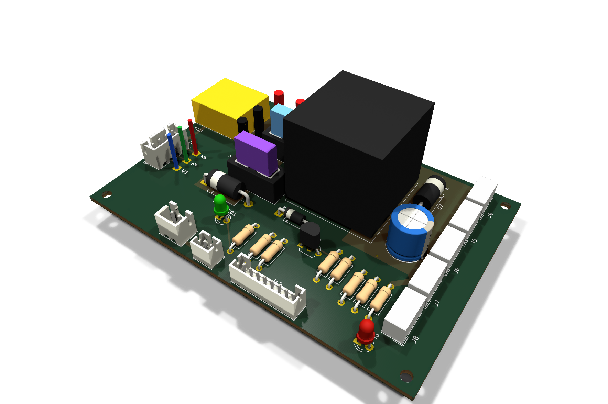

## Order of work

1. Solder the parts, lowest first (steps 1–12).
2. Clean the board, inspect it, and run the meter checks with no power.
3. Make the leads.
4. Fit the fuses and bring the board up on the lab supply: the README's step 2.
5. Check the BMS on the bench, then wire it and the main switch to the board (step 13).
6. Check the inrush with the pack and the servos: the README's step 3.

## What you need

**Parts for one board:**

| ref | part | qty |
|---|---|---|
| R1 | 470 Ω, ¼ W, 1 %, axial | 1 |
| R2, R4, R6 | 10 kΩ | 3 |
| R3, R5 | 47 kΩ | 2 |
| R7, R8 | 4.7 kΩ | 2 |
| D1 | 1N4007 | 1 |
| C2 | 100 nF, 50 V, ceramic | 1 |
| Q1, Q2 | PN2222A, TO-92 | 2 |
| LED1, LED2 | 3 mm LED: green (LED1), red (LED2) | 2 |
| D2, D3 | 1.5KE16A TVS | 2 |
| J2, J3 | JST B4B-XH-A, B2B-XH-A | 1 each |
| J11, J12 | JST B2B-PH-K-S (or a straight 2-pin PH header from the IWISS kit), B8B-PH-K-S | 1 each |
| J4–J8 | Molex 22-03-5035 | 5 |
| F1, F2 | Keystone 3568 MINI fuse holder | 2 |
| C1 | 1000 µF, 25 V electrolytic | 1 |
| J1 | Amass XT60PW-M | 1 |
| K1 | TE 1-1414610-0 relay | 1 |
| fuses | MINI blade, 15 A (F1) and 3 A (F2) | 1 each |

**Tools and supplies:**
- A temperature-controlled iron with a chisel tip, solder and flux.
- Desoldering braid or a pump, flush cutters and wire strippers.
- A multimeter with a diode range.
- A crimper for the JST PH and XH contacts.
- Isopropyl alcohol and a brush, and tape to hold parts while you solder.
- Heat-shrink.

## Before you start

- **Every part goes on the top**, the side printed "BIPED POWER LITE rev A". Solder from the
  bottom, and trim each lead to about 1.5 mm after its joint.
- **Lowest parts first.** The board then lies flat on the new parts while you solder them.
- **Some pads take more heat.** These join the bottom ground plane with full copper, not thermal
  spokes, because they carry the return current:
  - W2, C1's − lead, and the unbanded ends of D2 and D3;
  - pin 3 of J4–J8 and J12, and pin 2 of J3;
  - the emitters of Q1 and Q2.

  The large pads in the top copper pours also soak up heat: J1, W1, W6, W7, F1, F2, K1's
  contacts, C1's + lead, and the banded ends of D2 and D3. Use more flux and hold the iron until the solder
  flows through the hole to the top.
- **Check the bare board** with the meter. Each of these should read open:
  - W6 to W1, the pack's + and −;
  - W7 to W2, the switched input and ground;
  - the + pad of C1 to W2.

## Solder the parts

### Step 1: resistors R1–R8

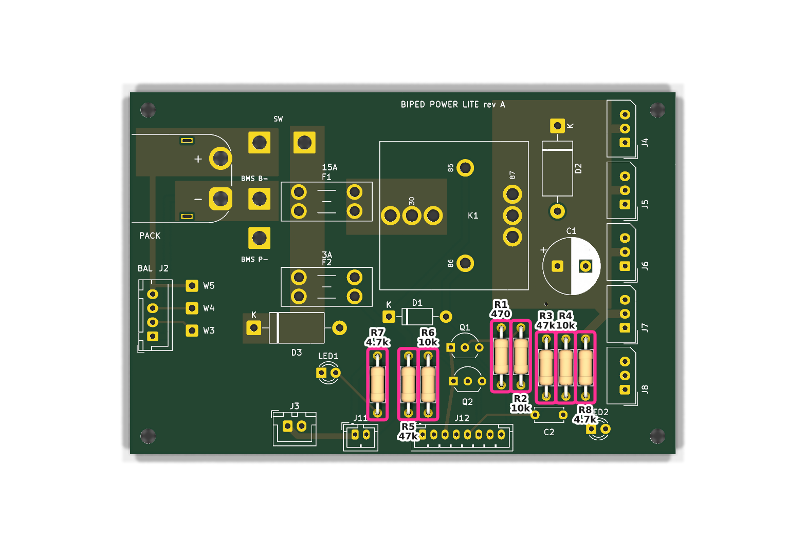

Lay them flat, leads bent to 10 mm (0.4"). Either way round is fine.

| ref | value | bands (5-band, 1 %) |
|---|---|---|
| R1 | 470 Ω | yellow violet black **black** brown |
| R7, R8 | 4.7 kΩ | yellow violet black **brown** brown |
| R3, R5 | 47 kΩ | yellow violet black **red** brown |
| R2, R4, R6 | 10 kΩ | brown black black red brown |

470 Ω, 4.7 kΩ and 47 kΩ differ only in the fourth band, so measure each one before you fit it.

### Step 2: D1 (1N4007)

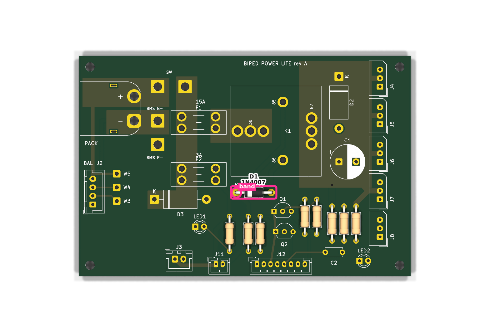

**The band goes to the square pad**, the end marked K, on the left. D1 clamps the relay coil when
it turns off. Fitted backwards, it shorts the coil: the relay never closes, and Q1 and D1 carry
the short.

### Step 3: C2 (100 nF)

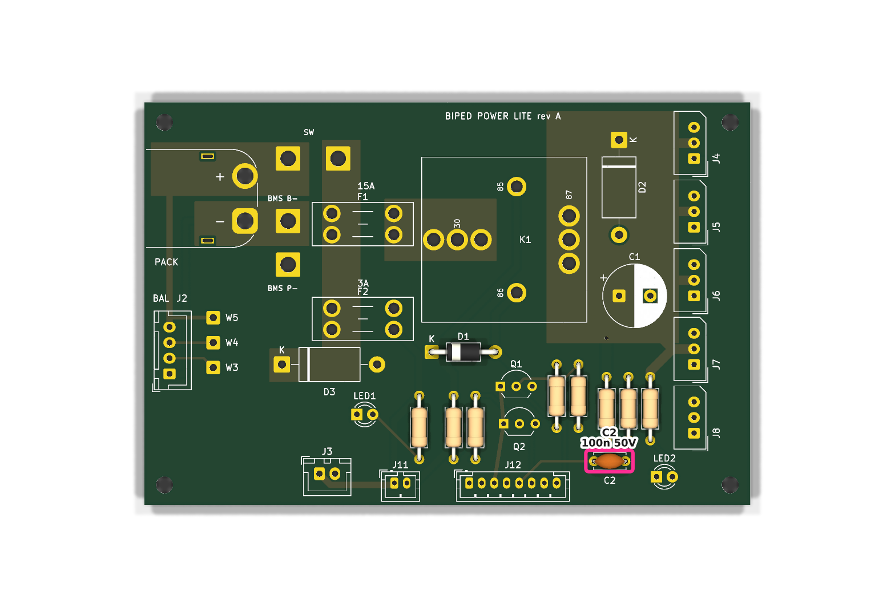

Either way round. Its 5.08 mm leads go into the 5.0 mm holes.

### Step 4: Q1 and Q2 (PN2222A)

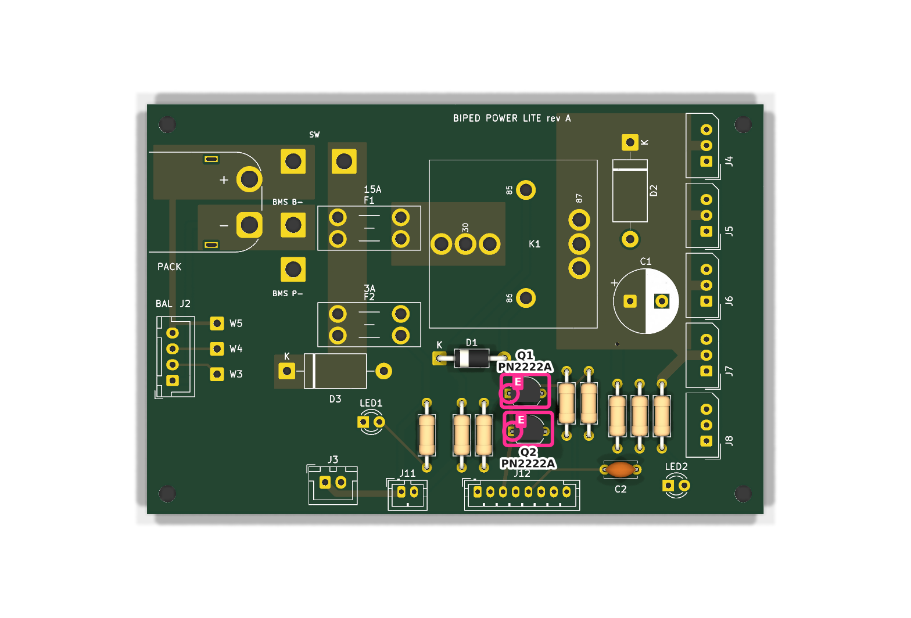

- **The flat face goes toward the bottom edge** (toward J12), matching the flat side of the
  printed outline.
- The emitter then lands on the square pad, on the left: onsemi's pin order is E, B, C, left to
  right, facing the flat side.
- Leave about 3 mm of lead under the body, and don't hold the iron on a joint for long.

### Step 5: LED1 (green) and LED2 (red)

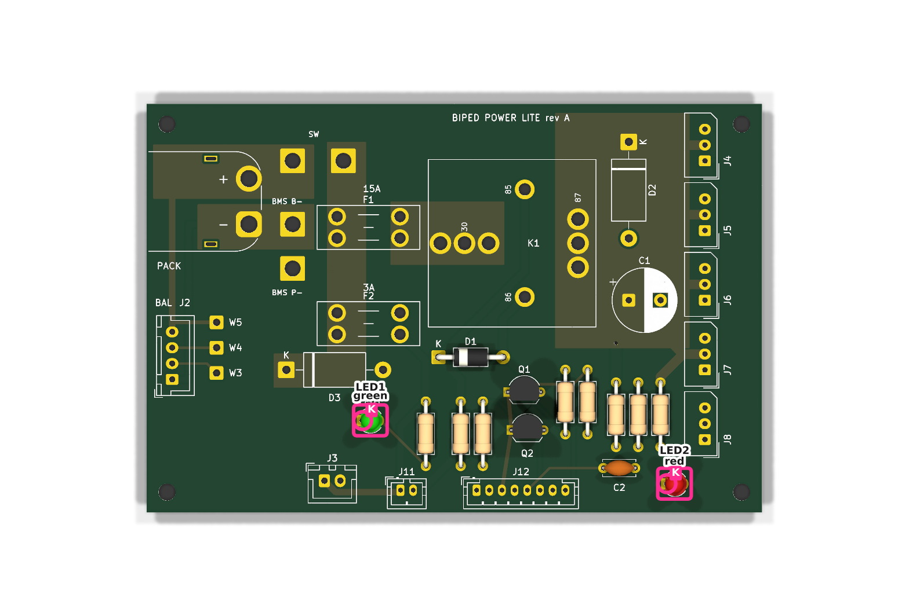

- **The short lead goes into the square pad**, the side of the flat on the LED's rim. That is
  the cathode.
- LED1 is the green one, below D3: it shows the logic feed. LED2 is the red one, bottom right:
  it shows the servo rail.

### Step 6: D2 and D3 (1.5KE16A)

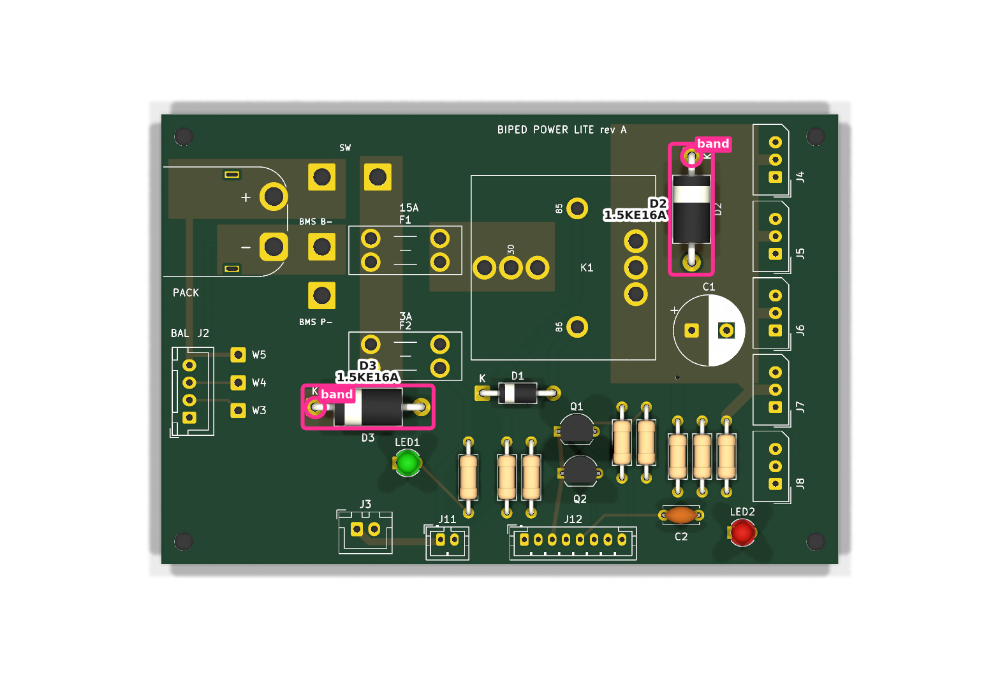

- **The band goes to the square pad marked K.** On D3 that is the left end. On D2 it is the end
  toward the top edge.
- **Both are polarized, and a backwards one is a short.**
  - D3 sits before the fuses. Backwards, it shorts the pack as soon as the switch is on.
  - D2 backwards blows F1 when the relay closes.
- Their unbanded ends are on the ground plane, so give those joints time.

### Step 7: JST headers J2, J3, J11, J12

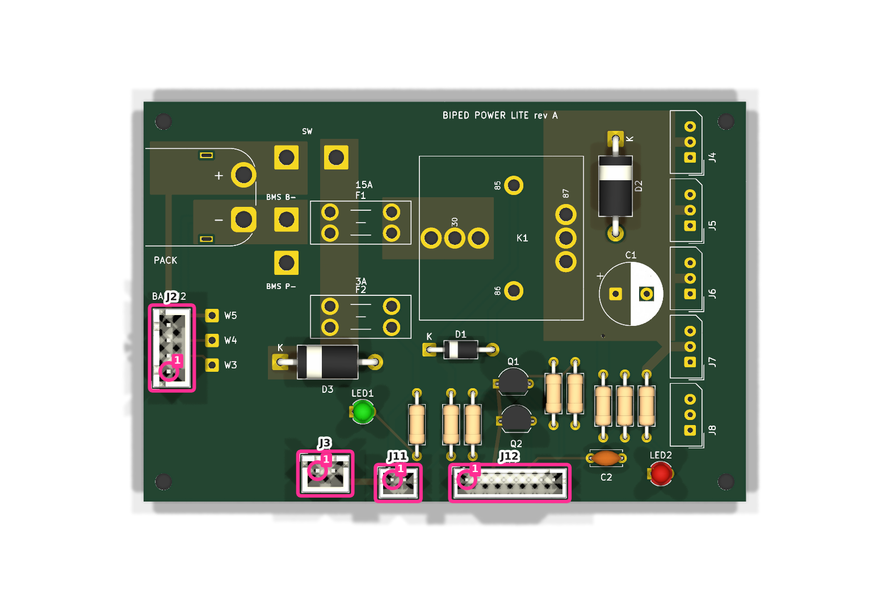

- **Pin 1 is the square pad.**
- **Line each header's body up with its printed outline.** The pins sit off-centre in the body,
  so it matches only one way:
  - J3, J11 and J12: the wider side of the body faces the bottom edge.
  - J2: the wider side faces W3–W5, toward the middle of the board.
- **Backwards is a wrong connection.** A 2-pin header turned round swaps its pins: J3
  backwards feeds the General Driver reversed.
- J2 and J3 are XH (2.5 mm pitch); J11 and J12 are PH (2.0 mm). A straight 2-pin PH header
  from the IWISS kit works for J11 if it sits within the outline.
- Tack one pin, check that the header sits flat and square, then solder the rest. J12's pins are
  2.0 mm apart: check for bridges.

### Step 8: servo headers J4–J8 (Molex 22-03-5035)

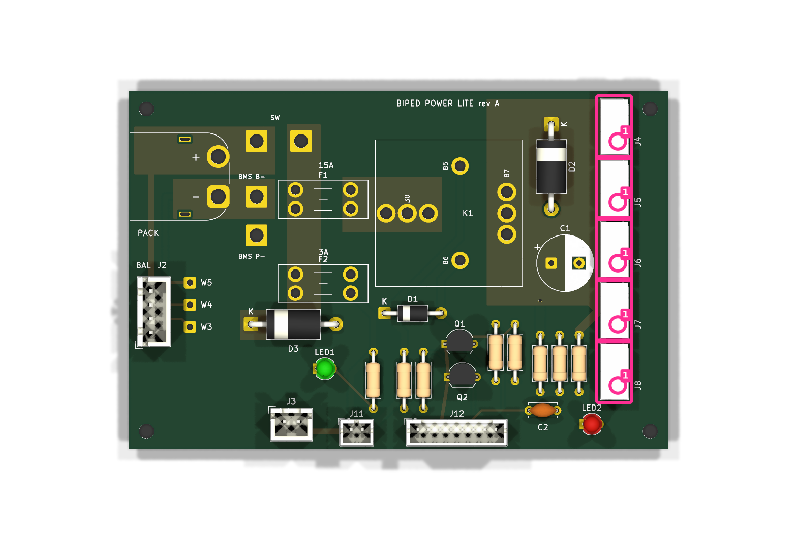

- **Pin 1 is the square pad**, the lowest pin of each header.
- **The wider side of the body faces the middle of the board**, and the narrow side the right
  edge, as the printed outline shows.
- Pin 3 (the top pin) is on the ground plane.
- **Which header is which:** J4–J7 are the servo branches: right leg, right upper, left leg,
  left upper. J8 is the data input from the General Driver. J8's middle pin is unconnected on
  purpose.

### Step 9: fuse holders F1 and F2 (Keystone 3568)

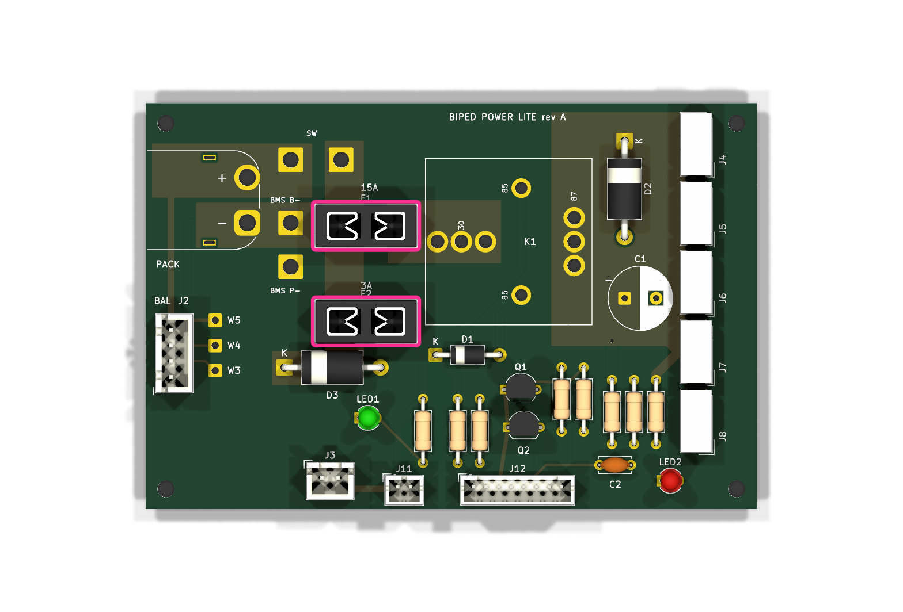

- Either way round. F1 is the upper one (15 A), F2 the lower one (3 A).
- All four pins sit in copper pours. Fill each hole.
- Leave the fuses out for now.

### Step 10: C1 (1000 µF, 25 V)

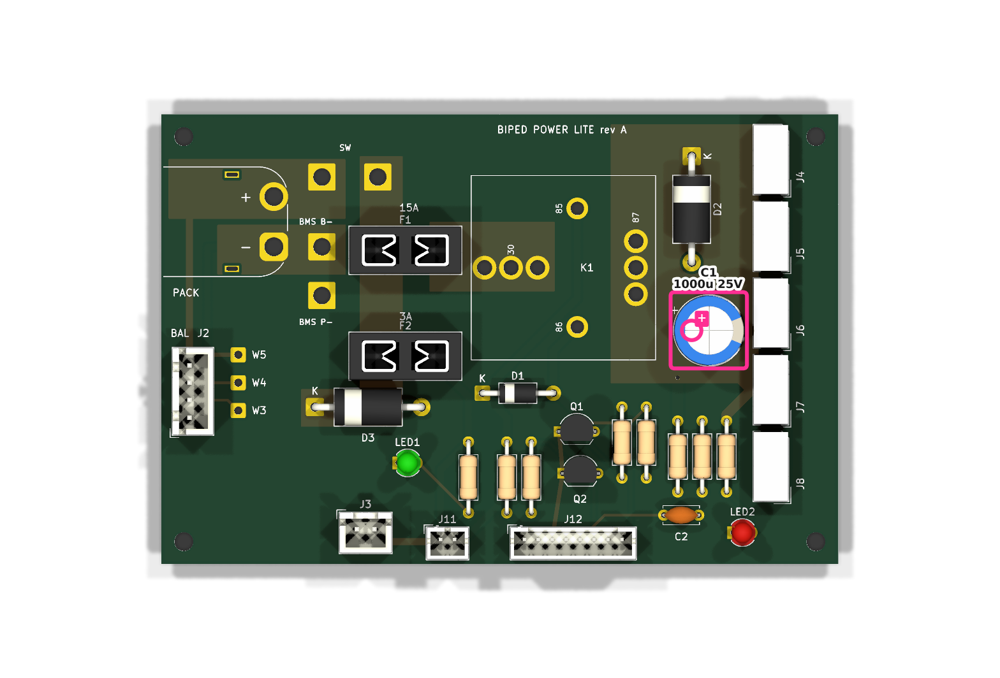

**The long lead (+) goes into the square pad marked +**, on the left. The stripe on the can (−)
then faces the servo headers. A backwards electrolytic on the 12 V rail fails, and can vent.

### Step 11: J1, the XT60 (Amass XT60PW-M)

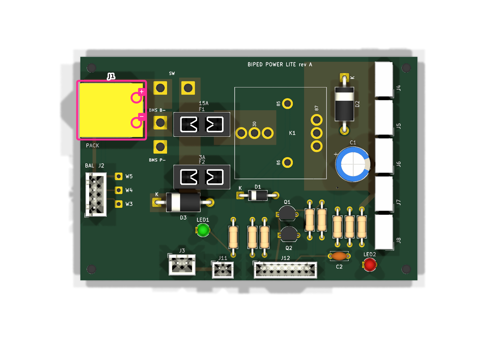

- **The plug face points out over the left edge**, overhanging it by 0.25 mm. Its two small
  fixing legs go into the two slots. The slots are plated, so if the legs are metal, solder them
  too: they take the force of plugging and unplugging.
- The upper pin is + and the lower one −, as printed.
- Both pins sit in copper pours. Hold the iron until the solder fills the hole, and add solder
  until the joint is full.

### Step 12: K1, the relay (TE 1-1414610-0)

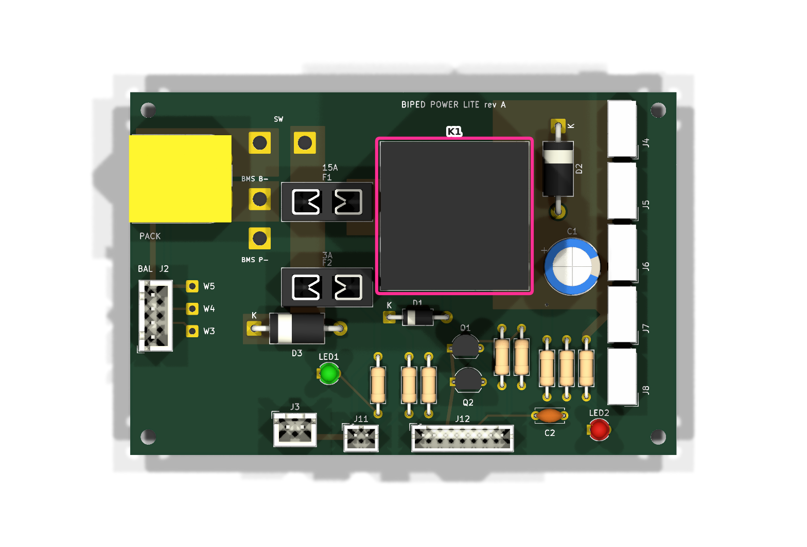

- It fits one way only. Seat it flat.
- Its pins are printed on the board: 85 and 86 are the coil, 30 and 87 the contacts.
- **The contact pins carry the servo rail, up to 15 A.** There are three 30s and three 87s. Fill
  every hole.

## Clean, inspect and check

1. **Clean off the flux** with isopropyl alcohol and a brush, and let the board dry.
2. **Inspect every joint.** Each should be shiny and concave and fill its hole, with no bridges.
   Look hardest at J12, J2, J3 and the TO-92 legs.
3. **Meter checks, with no power and the fuses out:**

| between | reads | it checks |
|---|---|---|
| J1's + pin and W6; J1's − pin and W1 | 0 Ω | J1's polarity |
| W6 and W1 | open | no short across the pack |
| diode range, red on W2, black on W7 | a diode drop, about 0.5–0.7 V; open with the leads swapped | D3 the right way round |
| diode range, red on W2, black on C1's + lead | a diode drop, after a second or two as C1 charges. A reading that keeps climbing to open means D2 is backwards | D2 the right way round |
| K1's pin 85 (red) and 86 (black) | about 75 Ω: the 90 Ω coil with its built-in 470 Ω | the relay coil |
| J3 pin 1 and F2's right-hand pins | 0 Ω | J3 the right way round |
| J3 pin 2, J12 pin 3, and pin 3 of each of J4–J8, to W2 | 0 Ω | the grounds |
| pin 2 of each of J4–J7, to C1's + lead | 0 Ω | the servo rail |
| pin 1 of each of J4–J7, to J8 pin 1 | 0 Ω | the servo data line |

## Make the leads

**Crimping:** strip each wire so that the conductor fills the contact's wire barrel and the
insulation sits in its insulation barrel. Push each contact into its housing until it clicks,
then tug the wire to check it is held.

| lead | board end | far end | wire | pins |
|---|---|---|---|---|
| J3 to the General Driver's H1 | XHP-2 | XHP-2 | 22 or 24 AWG (XH contacts take 22–28) | pin 1 to pin 1; H1 pin 1 is + (harness check P3) |
| J11 to the E-stop | PHR-2 | the switch | 24–26 AWG (PH contacts take 24–30) | across the two terminals that are closed in "run" |
| J12 to the General Driver | PHR-8 | P3, H3, H2 | 24–26 AWG | below |
| J4–J8 to the servos | stock servo leads, 5264-03 at both ends | | | J8 to the General Driver's H5 |

- **The E-stop:** any latching switch rated 0.5 A DC or more will do; the coil current is about
  0.16 A at a full pack. With the switch at "run" its two wires read 0 Ω, and at "stop" open.
- **J12** uses pins 2, 3, 5 and 6 only. Their far ends follow the
  [harness](../power-board/harness.md#j9-and-j12-control-to-the-general-driver):
  - pin 2 `SERVO_EN` to P3 pin 4 (IO16);
  - pin 3 GND to P3 pin 3;
  - pin 5 `RAIL_V` to H3 pin 4 (GPIO34);
  - pin 6 `ESTOP_N` to H2 pin 1 (IO4).

  The far-end housings depend on the General Driver's headers (harness check P5). The elechawk
  kit has 2.54 mm Dupont housings.
- **The servo leads** must put the General Driver's GND wire on pin 3 here (harness check P4).
- **J2 takes the pack's balance plug directly.** Meter the plug first (harness check P2): pin 1
  must be B−.

## First power

1. **Fit the fuses:** 15 A in F1 (the upper holder) and 3 A in F2 (the lower one).
2. **Bring the board up on the lab supply**, without the BMS or the pack: the README's step 2.
   Film the session (AGENTS.md).

## Step 13: wire the BMS and the main switch

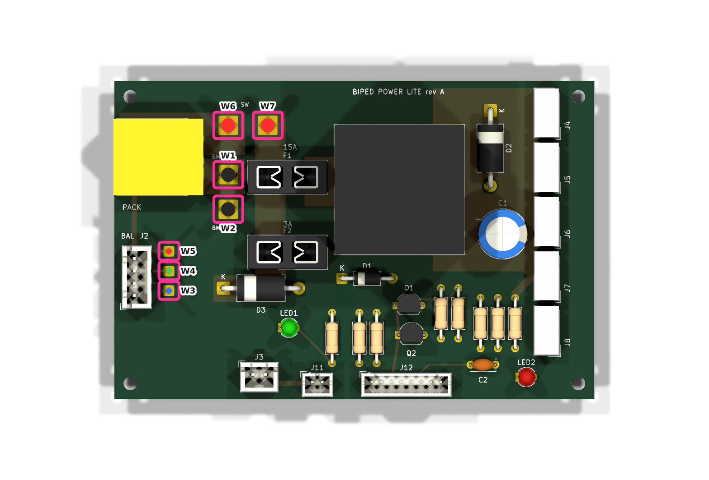

Do this after the BMS's bench check (the README's step 1) and the first power.

| pad | to | wire |
|---|---|---|
| W1 | the BMS's B− | 14 AWG silicone, black |
| W2 | the BMS's P−, the system ground | 14 AWG silicone, black |
| W3, W4, W5 | the BMS's B3, B2 and B1+ | 24 AWG |
| W6, W7 | the main switch's two terminals | 14 AWG silicone, red |

- **Tin each wire end**, push it through from the top, and solder from the bottom until the hole
  is full.
- **Keep the heavy wires short**, and tie them down so the joints don't carry their weight.
- **Without the main switch,** join W6 to W7 with a short 14 AWG link. Unplugging the XT60 is
  then the off switch.
- Then check the inrush with the pack and the servos: the README's step 3.

## Regenerating the figures

The step figures are renders of `power-lite.kicad_pcb`. Each shows only the parts placed by its
step, with those parts outlined and their pin 1 or polarity marked. Run from `pcb/power-lite`:

```
uv run --with matplotlib --with pillow --with numpy python tools/asm_figs.py <work dir>
```
