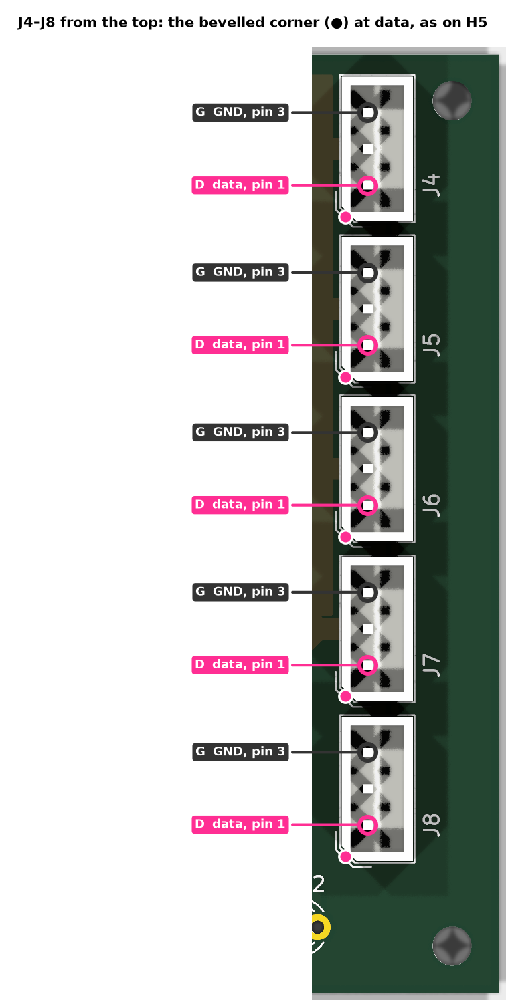
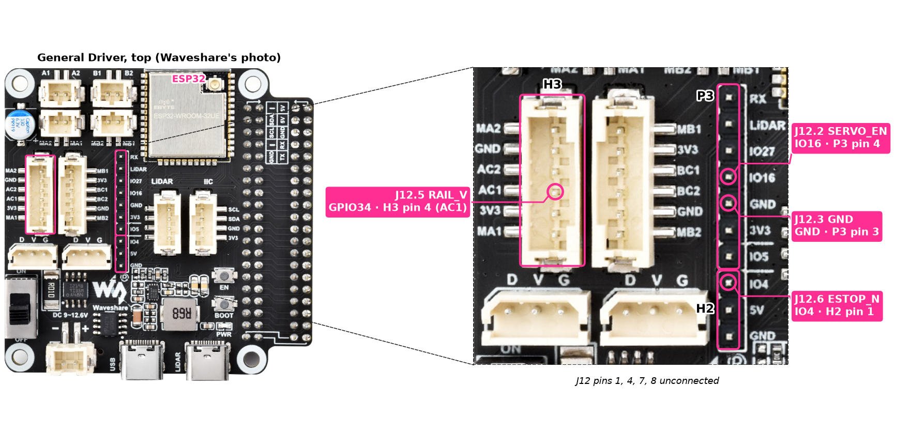

# Power lite: cables and connectors

How the board connects to the rest of the robot, connector by connector. The board is
[README.md](README.md); how to crimp and wire the leads is [assembly.md](assembly.md); the robot's
other wiring is in [docs/wiring.md](../../docs/wiring.md) and the General Driver's headers are in
[docs/sensor-expansion.md](../../docs/sensor-expansion.md).

Every cable is plugged, not soldered, except the E-stop's lugs. The four checks **P1–P4** need
the real parts and are done before the first connection.

## Summary

| board | to | board part | mating part | current |
|---|---|---|---|---|
| J1 | the pack's discharge lead | Amass XT60PW-M (right-angle, male, 45 A) | the pack's XT60 female | up to 15 A (F1) |
| J2 | the pack's balance lead | JST B4B-XH-A | the pack's XHP-4 | µA |
| J3 | General Driver H1 (logic power), through F2 | JST B2B-XH-A | XHP-2 to XHP-2 lead, 22 AWG | about 1.1 A with a Pi 4B, 1.3 A with a Pi 5 |
| J4–J7 | first servo of each branch | Molex 22-03-5035 (5267 header) | stock servo lead (5264-03 both ends) | branch peak 3.7–4.3 A |
| J8 | General Driver H5 (servo data) | Molex 22-03-5035 | stock servo lead | mA |
| J11 | E-stop | JST B2B-PH-K-S | PHR-2 lead to the switch | 0.13 A |
| J12 | General Driver P3, H3, H2 (control) | JST B8B-PH-K-S | PHR-8 to the housings the headers take | mA |

## J1: the pack

- **Board:** Amass XT60PW-M, board-mount right-angle **male**
  ([spec sheet](../../docs/datasheets/power-lite/amass-xt60pw.pdf): 45 A rated, 60 A
  momentary). Its female twin, XT60PW-F, is the battery side. The mating face is 0.25 mm past the
  board's left edge.
- **Pins:** pin 2, the contact on the housing's straight side, is **B+**; pin 1, on the angled
  (chamfered) side, is **B−**. The silkscreen carries + and − beside the pads.
- **Pack:** OVONIC 4200 mAh 3S 130C (O-130C-4200-3S1P-XT60-2P): 12 AWG leads, an XT60 and a
  JST-XHR-4P balance plug. The listing does not state the XT60's gender or polarity. **P1:** check
  that the pack's XT60 is female with + on the housing's straight side, before first connection:
  a reversed J1 reverses the whole board.
- **Lead:** the pack's own discharge lead plugs in directly, with no extension.

## J2: the balance lead

- **Board:** JST B4B-XH-A ([datasheet](../../docs/datasheets/power-lite/jst-xh.pdf)).
- **Pins:** 1 B− (0 V), 2 cell 1+, 3 cell 2+, 4 B+. The pack's 4-pin XH plug mates directly.
- **P2:** meter the pack's balance plug before first connection. Taking the contact that mates
  pin 1 as 0 V, the others must read about 3.7, 7.4 and 11.1 V in order.

## J3: logic power to the General Driver

- **Board:** JST B2B-XH-A. Pin 1 is LOGIC (+, the switched pack voltage through F2); pin 2 is GND.
- **F2** is a 3 A MINI blade fuse in a Keystone 3568 holder
  ([datasheet](../../docs/datasheets/power-lite/keystone-3568.pdf)), pulled and replaced by
  hand. Keep spares. A short on this cable can blow it.
- **Cable:** XHP-2 to XHP-2, pin 1 to pin 1, 22 AWG, as short as the torso allows. The General
  Driver's H1 takes conductors of 22–30 AWG at 3 A per contact.
- **P3:** H1 is silkscreened "− +". Confirm with a meter that H1 pin 1 is +, through to the
  AO4407.

## J4–J8: servo branches and the data line

**Board:** Molex 22-03-5035 (5267 Mini-SPOX header). **Pins:** 1 data, 2 SERVO+, 3 GND: the
General Driver's H5 order ("D V G"). **Leads:** stock servo leads, with a 5264-03 housing at each
end.

**Orientation: data is at the bevelled corner.** The header's housing has one bevelled corner,
on the long wall the pins sit close to.
- **On the General Driver's H5,** D is at the bevelled corner: in Waveshare's top photo (H5 is
  the left of the two white 3-pin headers above the power switch, silkscreen "D V G" over it), the
  bevel is at the housing's top left, under the D.
- **A stock lead joins its two housings' bevelled corners,** so the wire at H5's D lands at the
  bevelled corner of whichever header the other end plugs into.
- **So on J4–J8 the bevelled corner is at pin 1** (data, the square pad), and pin 3 (GND) is at
  the square corner at the far end. Seen from the top, with "BIPED POWER LITE rev A" upright,
  each header's bevel is at its lower end, on the side toward the middle of the board; the
  silkscreen outline shows it. `tools/netcheck.py --keys` checks the board against the one fact
  it takes from H5, `H5_FROM_BEVEL` in `tools/parts.py`.

| header | branch | first servo, then the chain | walking peak / RMS (upper model) | get-up peak (range over the two sides) |
|---|---|---|---|---|
| J4 | right leg | 9 → 1, 2, 3, 4, 11 | 3.7 A / 1.6 A | 3.0–4.3 A |
| J5 | right upper | 13 → 14, 15 | 0.3–0.4 A / 0.1 A | 2.9–3.0 A |
| J6 | left leg | 10 → 5, 6, 7, 8, 12 | 3.7 A / 1.6 A | 3.0–4.3 A |
| J7 | left upper | 16 → 17 | 0.3–0.4 A / 0.1 A | 2.9–3.0 A |
| J8 | data in from General Driver H5 | pin 2 unconnected on the board | | |

- **Contact rating:** a 5264 contact is rated about 2.5–3 A, which is not yet read from Molex's
  datasheet. The leg branches' RMS current is under that; their peaks exceed it for moments.
  Measure the first lead's temperature on the bench.
- **P4:** a stock lead from H5 must put H5's D wire on pin 1 of each of J4–J8, and its G wire on
  pin 3. It is a meter check, done before any servo is connected: [bringup.md, 4.1](bringup.md#41-p4-the-servo-headers-before-any-servo).
  **It failed on the first board** (2026-11-21, #342): its headers sat with the bevel at pin 3,
  so H5's data wire landed on GND and the whole bus read as shorted to ground. That board is
  reworked by turning J4–J8 ([assembly.md](assembly.md#rework-j4j8-seated-with-the-bevel-at-pin-3)).

## J11: the E-stop

JST B2B-PH-K-S ([datasheet](../../docs/datasheets/power-lite/jst-ph.pdf)): pin 1 LOGIC, pin 2 to
K1's coil. Any latching switch that carries the coil's 0.13 A and is closed in "run" works; the
E-stop is a miniature toggle wired across terminals 2 and 3 ([assembly.md](assembly.md)). Open
means the servo rail is off.

## J12: control to the ESP32

JST B8B-PH-K-S, pins 2, 3, 5 and 6 only, fanned out to three headers:

| J12 pin | net | to | ESP32 |
|---|---|---|---|
| 2 | `SERVO_EN` | General Driver P3 pin 4 | IO16 |
| 3 | GND | P3 pin 3 | GND |
| 5 | `RAIL_V` | H3 pin 4 | GPIO34 (ADC1) |
| 6 | `ESTOP_N` | H2 pin 1 | IO4 |

*Waveshare's top photo of the General Driver
([General_Driver_for_Robots-top.jpg](../../docs/datasheets/general-driver/General_Driver_for_Robots-top.jpg)),
oriented with the ESP32 module at the top and the USB-C ports at the bottom. Drawn by
`tools/gd_fig.py`.*

- **Where the headers are:** P3 and H2 share one 1×10 pin-header column, just left of the
  LiDAR and IIC connectors. Its silkscreen reads, top to bottom, RX, LiDAR, IO27, **IO16**,
  **GND**, 3V3, IO5 (P3, pins 7 to 1), then **IO4**, 5V, GND (H2, pins 1 to 3). H3 is the left
  one of the two tall white 6-pin connectors on the left edge. Its silkscreen reads MA2, GND,
  AC2, **AC1**, 3V3, MA1 (pins 1 to 6). The right one is H4: its BC2 pin is IO16 too, so H4 stays
  empty.
- **`ESTOP_N` levels:** an open collector (Q2) read by IO4 with its internal pull-up on. Low means
  the E-stop is released; high means it is pressed, the board is unpowered, F2 has blown or the
  lead is unplugged.
- **Unwired header pins:** H3 pins 1 and 6 are motor A outputs, and H2 pin 2 is 5 V. None of them
  is wired.
- **Connector families:** in Waveshare's product photos, P3 and H2 are a fitted 1×10 male pin
  header at 2.54 mm, so 2.54 mm Dupont housings (the elechawk kit's) plug onto them. H3 is a JST
  PH 2.0 mm 6-pin header (Waveshare's wiki: "Motor interface PH2.0 6P"), so its wire takes a PHR-6
  with one contact in position 4. The J12 end is a PHR-8. Both PH ends take SPH-002T-P0.5S
  contacts (24–30 AWG).

## A bench supply instead of the pack

A supply on W7 (+) and W2 (−) in place of the BMS and pack runs the board (README, bring-up step
2). For the robot's servos it must give 15 A or more: a get-up draws 12 A for 2 s.

- **T1, before the first motion on a supply:** most supplies cannot sink current, so the energy
  the servos push back into SERVO+ when they brake or are back-driven charges C1, the servos' own
  capacitors and the supply's output capacitors instead. The ST3215 stops driving above 14 V. Scope
  SERVO+ while back-driving a joint by hand with torque on, and during a sit-down. If it passes
  about 13.5 V, run on the pack, or add a supply that can sink (or a load across its output).

## Checks before the first connection

| | check | how | why |
|---|---|---|---|
| P1 | the pack's XT60 is female, with + on the housing's straight side | look and meter the pack lead | a reversed J1 reverses the whole board |
| P2 | balance-plug order | meter the plug: 0, 3.7, 7.4, 11.1 V from the pin-1 side | J2 pin 1 must be B− |
| P3 | General Driver H1 pin 1 is + | meter to the AO4407 | J3 is wired pin 1 to pin 1 |
| P4 | a stock lead from H5 puts D on pin 1 (the bevelled corner) of J4–J8 | meter, before any servo ([bringup.md 4.1](bringup.md#41-p4-the-servo-headers-before-any-servo)) | J4–J8 copy H5; failed on the first board, 2026-11-21 (#342) |
